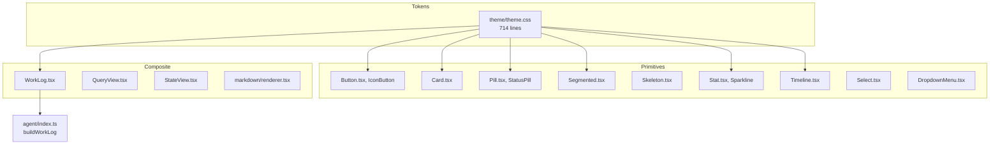
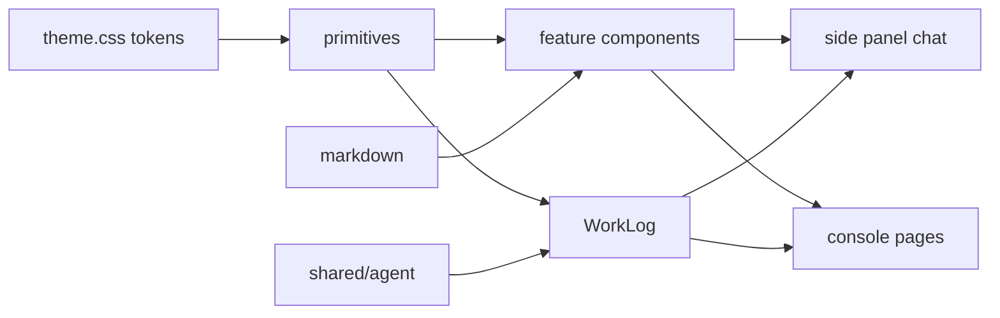
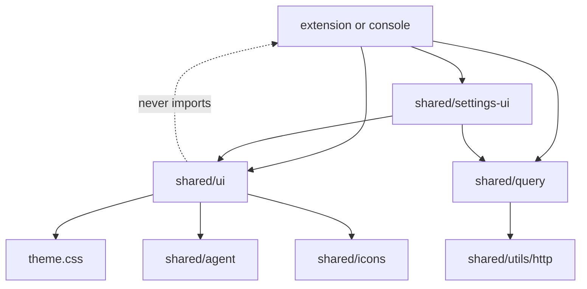
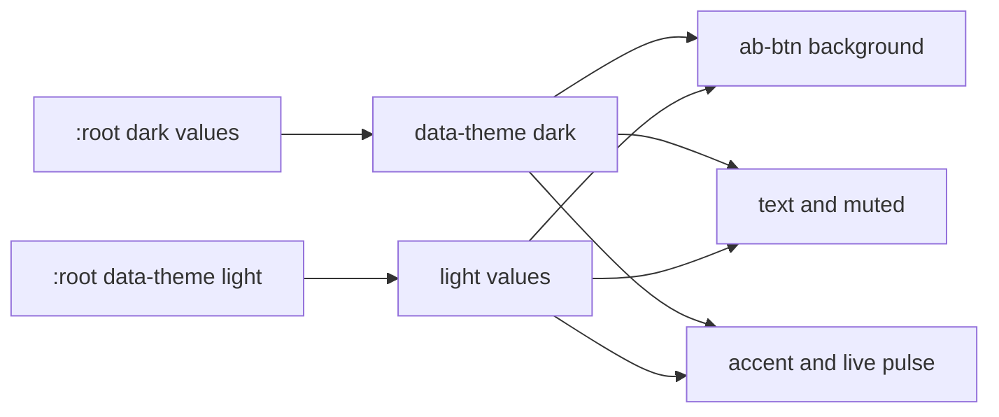
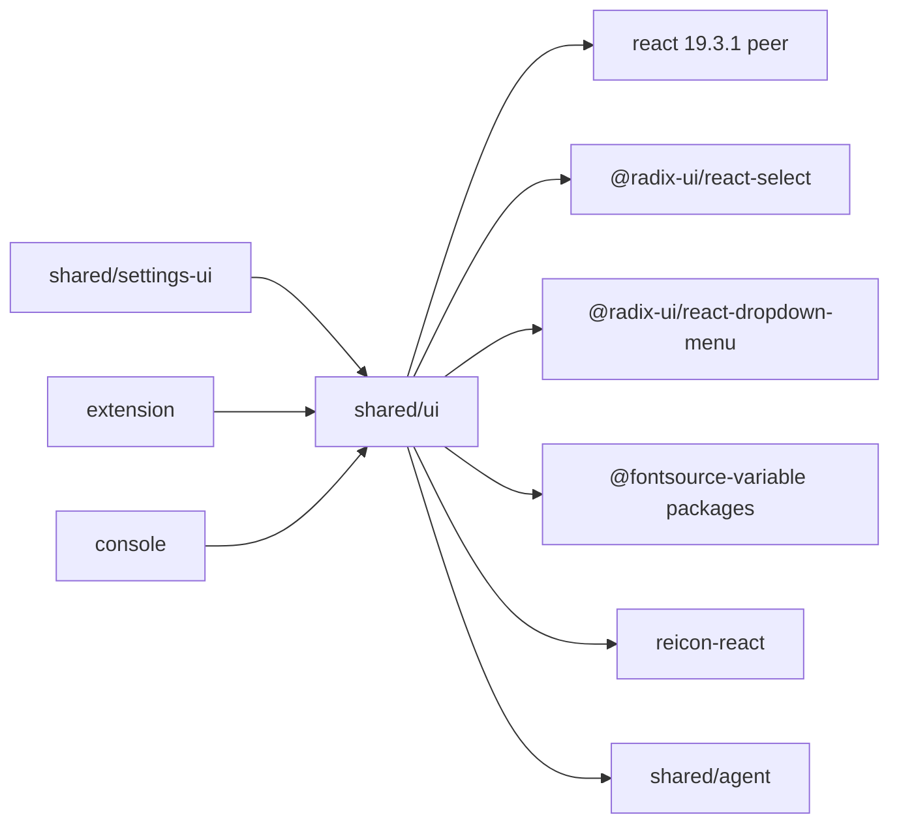

# UI component library

`clients/shared/src/ui` is the component layer both apps import. Every component renders class names from `clients/shared/src/theme/theme.css`, so the side panel and console share spacing, colour and motion. The library covers primitives, a work log for agent runs, a markdown renderer and Radix wrappers.

Key capabilities:
- One visual language for the extension and console.
- Class-driven styling with no Tailwind dependency in the components.
- Dark and light themes from `[data-theme]` on `<html>`.
- Status tones shared between pills, timelines and run badges.

## Repository layout

## Building blocks

- `ui/index.ts`: the public surface. It exports `AppMark`, `Button`, `IconButton`, `Card`, `Kbd`, `Pill`, `StatusPill`, `toneFor`, `QueryView`, `SearchField`, `Segmented`, `Skeleton`, `Sparkline`, `Stat`, `StatStrip`, `StateView`, `describeError`, `Timeline`, `classifyEvent`, the Select family, the DropdownMenu family and `WorkLog`.
- `ui/Button.tsx`: `Button` with variants `default`, `primary`, `ghost`, `danger`, sizes `sm`, `md`, `lg`, a leading `icon` and a `loading` spinner. `IconButton` requires a `label`, which becomes both `aria-label` and `title`.
- `ui/Pill.tsx`: `Pill` tone `neutral`, `ok`, `warn`, `err` or `live`, `StatusPill` that maps a status word to a tone, and `toneFor`.
- `ui/WorkLog.tsx`: renders `buildWorkLog(events, live)` with a collapsible header and per-item rows.
- `theme/theme.css`: design tokens and component classes.

## Child pages

| Page | What it covers |
| --- | --- |
| `Shared Primitives.md` | Button, Card, Pill, Select, Segmented, Skeleton, Stat and Timeline. |
| `Work Log and Chat Rendering.md` | `WorkLog`, `AgentTrace`, `RunSteps`, markdown and Mermaid rendering. |
| `Settings Components.md` | Section shell, rows, fields, modals, secret editors and backend sections. |
| `Console Feature Components.md` | Overview, runs, run detail, memory graph and diagnostics. |

## Shared concepts

- Class names, not inline styles, for anything reused. `Button.tsx` composes `ab-btn`, `ab-btn--primary` and `ab-btn--sm`.
- Tones are a fixed set. `STATUS_TONE` maps `running`, `queued` and `connecting` to `live`; `completed`, `ok`, `online` and `connected` to `ok`; `blocked` and `degraded` to `warn`; `failed`, `offline` and `missing` to `err`.
- Sizes are tokenised: 26px buttons in `sm`, 40px in `lg`, 32px icon buttons.
- Motion is short. `--t-fast` is 120ms, `--t-med` 200ms, `--t-slow` 360ms, all with `--ease: cubic-bezier(0.2, 0.8, 0.2, 1)`.

## How it fits together

The theme is imported once per app entry. `sidepanel/main.tsx` imports `@agentic-browser/shared/theme.css` before `App`, and the console imports it in `main.tsx` before its own `styles.css` and `shell.css`, so app-specific rules can override tokens without redefining them.

## Composition rules

A component in the library may use another library component, but it may not import from the extension or console. That one-way rule is what keeps the package usable from both apps and from a future client.

The same rule applies to props: shared components take data and callbacks, never a route or a store. `QueryView` and `StateView` accept a query-like object with `isError`, `error`, `data` and `isPending`, so they work without TanStack Query.

## Theme tokens

The dark palette is warm graphite: `--bg: #11110f`, `--surface: #181816` and `--text: #f3efe8`, with `--accent: #ff703b` as the only signal colour. The light block overrides the same variables, so components never branch on theme.

## Dependencies

Radix supplies focus management and portalling; the classes supply the look. `theme.css` is the one file both apps import directly, because WXT and Vite resolve CSS differently.

## Performance

- Primitives are function components with no data fetching and no timers.
- The sparkline draws one SVG path and skips work below two points.

## Troubleshooting

- Symptom: a button renders unstyled. Cause: `theme.css` was not imported in the app entry. Fix: import `@agentic-browser/shared/theme.css` first.
- Symptom: text disappears in light mode. Cause: a component hardcoded a dark hex value instead of a token. Fix: use `var(--text)` or a text token.
- Symptom: a pill is always grey. Cause: the status word is not in `STATUS_TONE`. Fix: pass a known word or an explicit `tone`.
- Symptom: an icon button has no accessible name. Cause: `label` was omitted. Fix: `IconButton` requires it by type.
- Symptom: a component renders twice in both apps. Cause: someone forked a primitive into an app folder. Fix: move the change into `shared/ui` behind an optional prop.

## Appendix

### Implementation examples
- Export surface, `ui/index.ts`.
- Button class composition, `classes` in `Button.tsx`.
- Status tone table, `STATUS_TONE` in `Pill.tsx`.
- Work log shell, `WorkLog` in `WorkLog.tsx`.
- Theme variables, `:root` and `:root[data-theme="light"]` in `theme.css`.

### Source files
- `clients/shared/src/ui/index.ts`
- `clients/shared/src/ui/Button.tsx`
- `clients/shared/src/ui/Pill.tsx`
- `clients/shared/src/ui/WorkLog.tsx`
- `clients/shared/src/theme/theme.css`
