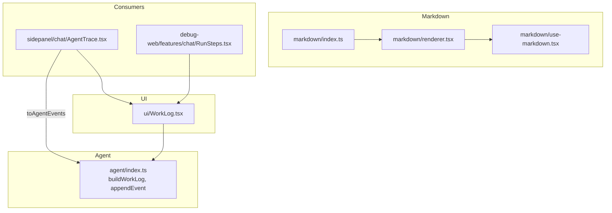
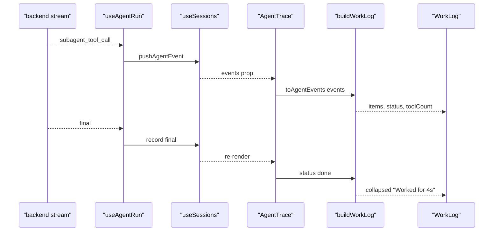
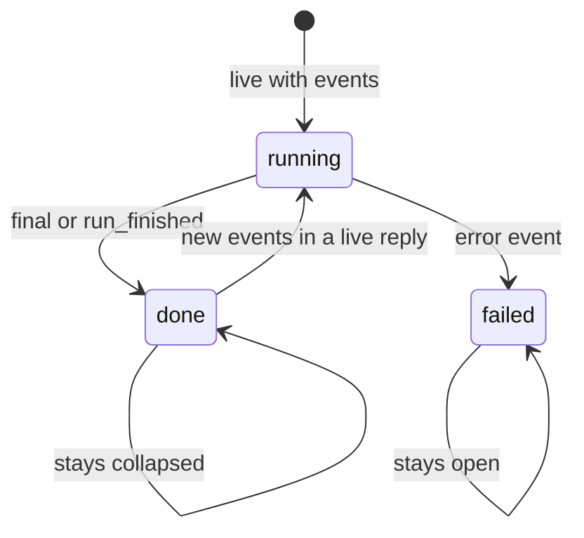
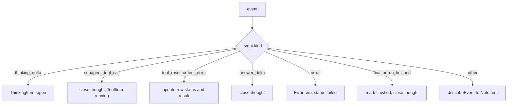
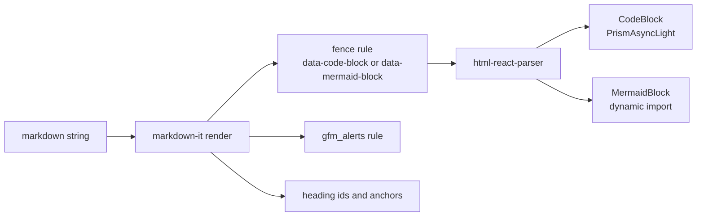
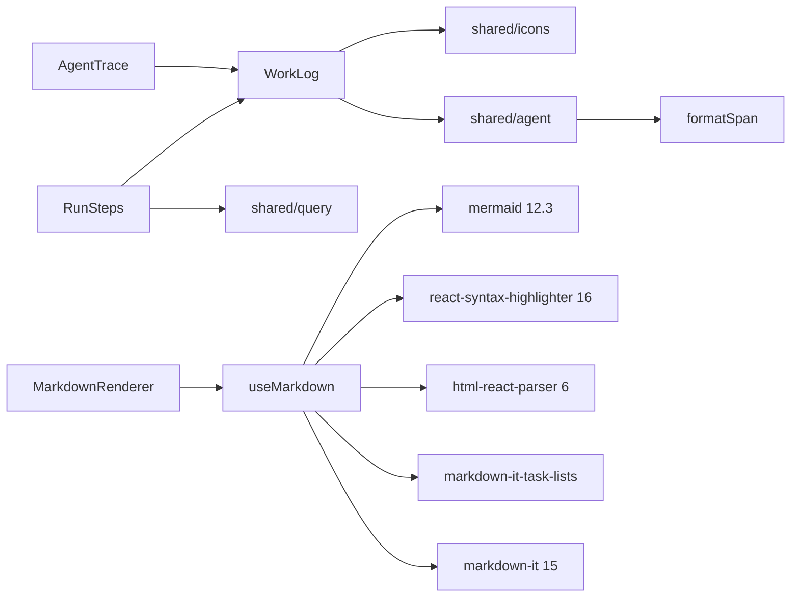

# Work log and chat rendering

`WorkLog` turns a flat list of agent events into the collapsible record of what the agent did for one reply: reasoning blocks, one row per tool call, notes and errors. `AgentTrace` uses it in the side panel. `RunSteps` uses it in the console on a stored run. Markdown rendering is separate and lives in `clients/shared/src/markdown`.

Key capabilities:
- One work log for live and stored runs, driven by `buildWorkLog`.
- Header states: Thinking, Working, Worked for 12s, Failed after 3s.
- Tool rows expand to show input and output, capped at 4000 characters.
- Markdown with GFM alerts, task lists, syntax highlighting and Mermaid.

## Repository layout

## Building blocks

- `ui/WorkLog.tsx`: the component and its item renderers `Thought`, `ToolRow` and `Block`, plus `useNow`.
- `agent/index.ts`: `AgentEvent`, `WorkItem`, `buildWorkLog`, `appendEvent`, `toolTitle`, `toolSummary`, `describeEvent`, `formatSpan` and `spanBetween`.
- `markdown/renderer.tsx`: `MarkdownRenderer`, a thin wrapper around `useMarkdown`.
- `markdown/use-markdown.tsx`: markdown-it instance, custom renderer rules and `html-react-parser` replacement for code and Mermaid blocks.
- `sidepanel/chat/AgentTrace.tsx`: maps `AgentLoopEvent` to `AgentEvent` and renders a compact work log.
- `debug-web/src/features/chat/RunSteps.tsx`: loads a run's events and renders the same log.

## How it fits together

The backend emits events, the client stores them, and the renderer derives the log on every render. `buildWorkLog` is pure and cheap, so there is no separate state machine to keep in sync with the event list.

## Log states

`WorkLog` starts open when the run is live or failed. An effect watches the status: running to done closes the body, failed forces it open. The header shows a spinner while running, an `XCircle` on failure and a `Check` on success.

While running, `useNow` ticks every second so the elapsed label updates. Once the status is not `running`, the interval is cleared. `formatSpan` renders `3s` under a minute and `1m 04s` above it.

## Items

`buildWorkLog` walks events in order and emits four item kinds. `thinking_delta` and `thinking` push a `ThinkingItem`. `subagent_tool_call` closes any open thought and pushes a running `ToolItem`. `subagent_tool_result` or `subagent_tool_error` finds the matching row by `call_id`, or by tool name when there is no call id, and marks it ok or error. `error` pushes an `ErrorItem` and flips the log to failed. Anything else goes through `describeEvent` to become a `NoteItem`, and a label equal to the event name is dropped as legacy noise.

When the run is no longer live, any item still marked running is settled: open thoughts get an `endedAt`, and running tools become ok, or error if the run failed. This prevents a stuck spinner after a dropped event.

## Header text

The title depends on the last item. If the log is running and the last item is an unfinished thought, the title is `Thinking`. If a tool is running, the title is `toolTitle(tool)`, for example `Searched memory` or `Used the browser`. Otherwise it is `Working`. Finished runs read `Worked for `, failures read `Failed after `. The step count comes from `log.toolCount` and is singular when it is one.

`toolTitle` has a name map for `recall_memory`, `write_memory`, `recall_document_facts`, `browser_action_agent`, `browser_action_executor`, `google_search_agent`, `websearch_agent`, `gmail_agent`, `calendar_agent`, `youtube_agent`, `github_agent` and `website_agent`. Anything else becomes spaced words with a capital first letter.

## Tool detail

`ToolRow` shows the tool name, a summary from `toolSummary(args)` and the duration. A row is expandable only when it has args, a result or an error. The detail has an Input block and either an Output or an Error block. `Block` prints strings as is and everything else as `JSON.stringify(value, null, 2)`, then truncates at 4000 characters with an ellipsis.

`renderThought` splits reasoning text on blank lines or before a `**` heading, renders a leading bold run as `<strong>` and strips the remaining markers. It is not a full markdown renderer, by design: thoughts are summaries, not documents.

## Markdown pipeline

`useMarkdown(content)` memoises a markdown-it instance and a parsed React tree. The instance enables raw HTML, linkify and typographer, and adds task lists. Custom fence output becomes a placeholder div, which `html-react-parser` replaces with a React component.

The GFM alert rule runs after the block rule. It looks for a blockquote whose first paragraph starts with `[!NOTE]`, `[!TIP]`, `[!IMPORTANT]`, `[!WARNING]`, `[!CAUTION]` or `[!DANGER]`, adds `gfm-alert gfm-alert-<type>`, removes the marker and prepends an icon plus a title.

Headings get a slug id and a trailing `#` anchor link. Tables are wrapped in a scroll container. Lists, paragraphs, inline code and normal blockquotes get `md-*` classes so `theme.css` can style them.

## Code and Mermaid blocks

Code blocks render a dark panel with three traffic light dots, a language badge coloured from `LANG_COLORS`, a Copy button and `SyntaxHighlighter` with line numbers. Copy uses `navigator.clipboard.writeText` and resets the label after two seconds. Grammars load through `PrismAsyncLight`, so only the languages actually rendered are fetched.

Mermaid blocks get a random id, then a dynamic `import("mermaid")`. The module initialises with `startOnLoad: false` and `theme: "dark"`, and runs against the block's id. The import is cancelled on unmount, which prevents a late diagram from rendering into a removed node.

## Console and panel consumers

`AgentTrace` is deliberately small: `WorkLog events={toAgentEvents(events)} live={live} compact`. The compact class reduces spacing inside a chat bubble.

`RunSteps` reads `useRunEvents(runId, live)`, maps each stored event to `{ ...payload, event: event_type, at: created_at, id: event_id }`, and returns `null` when there are no events. It does not pass `compact`, so a stored run gets the full size log.

## Dependencies

`WorkLog` has no data dependency. `RunSteps` brings the query hook, which is why it lives in the console. The markdown module is exported as `@agentic-browser/shared/markdown`.

## Performance

- `buildWorkLog` is pure and runs per render, but the event list is small: one entry per step, with thinking deltas already merged by `appendEvent`.
- `useNow` runs a 1s interval only while the log is running.
- Tool detail is mounted only when expanded, and the block text is capped at 4000 characters.
- The markdown renderer memoises both the markdown-it instance and the parsed tree on `content`.
- Prism grammars are lazy and Mermaid is a dynamic import, so a chat with no code or diagrams does not pay for either.

## Troubleshooting

- Symptom: the log says `Worked for 1s` and hides everything. Cause: the run finished, so the body auto-collapsed. Fix: click the header to expand.
- Symptom: a tool row stays spinning. Cause: no result event arrived and the log is still live. Fix: wait for `final`, or check the stream in the network panel.
- Symptom: a tool row shows no detail. Cause: args, result and error are all null. Fix: check the event payload the backend emitted.
- Symptom: a Mermaid block stays empty. Cause: the dynamic import failed or the diagram syntax is invalid. Fix: check the console for a Mermaid parse error.
- Symptom: `RunSteps` renders nothing. Cause: the run has no stored events. Fix: open a run that executed tools, or check the run trace endpoint.

## Appendix

### Implementation examples
- Log derivation, `buildWorkLog` in `agent/index.ts`.
- Header state and collapse, `WorkLog`.
- Tool detail blocks, `ToolRow` and `Block`.
- Markdown rules, `renderer.rules` and `gfm_alerts` in `use-markdown.tsx`.
- Stored run mapping, `RunSteps`.

### Source files
- `clients/shared/src/ui/WorkLog.tsx`
- `clients/shared/src/markdown/renderer.tsx`
- `clients/shared/src/markdown/use-markdown.tsx`
- `clients/browser-extension/entrypoints/sidepanel/chat/AgentTrace.tsx`
- `clients/debug-web/src/features/chat/RunSteps.tsx`
