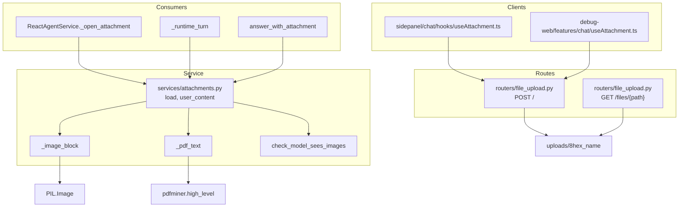
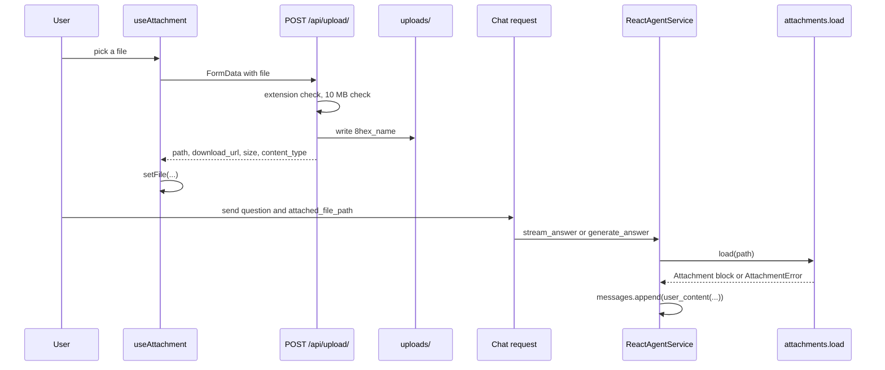
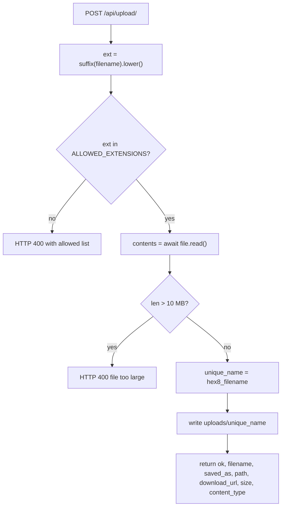
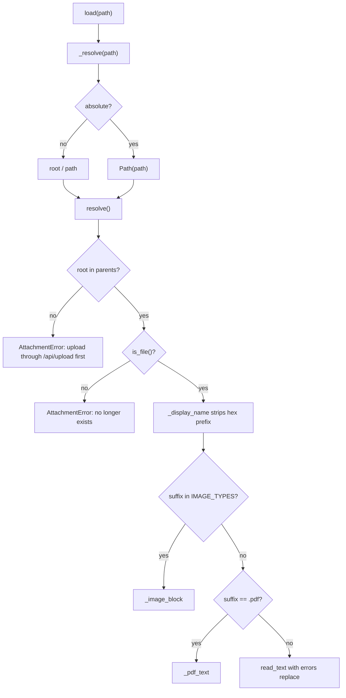
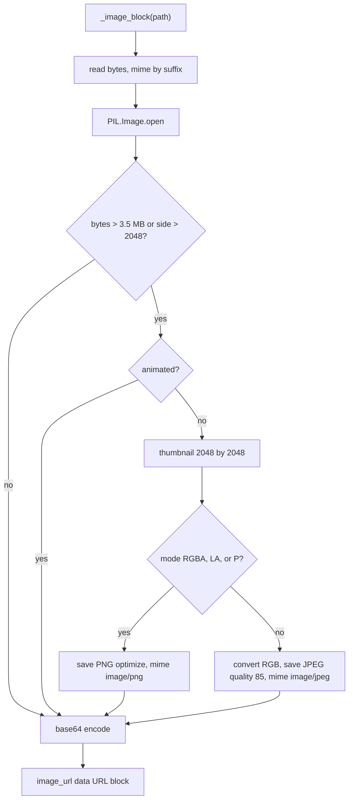
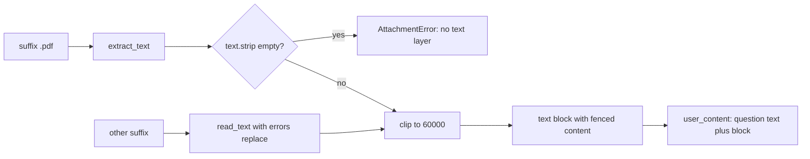
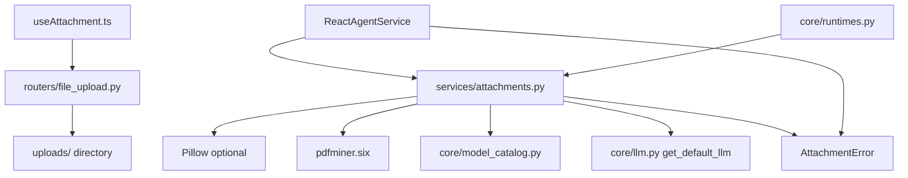

# Attachments

A chat message can carry one file. The client uploads it first, the server stores it under `uploads/` with a short random prefix, and the message then references the saved path. At turn time `services/attachments.py` turns that file into either an image block or a text block that the chat model can read.

The path is the security boundary. It arrives from the client, so `_resolve` refuses anything that does not land inside `uploads/`. A path outside the folder never reaches the model, even if the file exists.

Key capabilities:
- Extension allowlist and a 10 MB hard cap on upload.
- Images sent as base64 data URLs in the `image_url` shape accepted by the main LangChain clients.
- Downscale above 3.5 MB or 2048 px, PNG for transparency, JPEG otherwise.
- Text and code clipped at 60000 characters with a marker.
- PDF text extraction through pdfminer, with a clear error for scanned files.
- A capability check that refuses images when the picked model has no image input.

## Repository layout

The feature spans one upload route, one service module, and a small hook in each client. The service does not import the router. Both compute the same `uploads/` path from the repository root.

## Building blocks

- `routers/file_upload.py`: `upload_file` validates extension and size, writes `f"{uuid.uuid4().hex[:8]}_{file.filename}"`, and returns `path` plus `download_url`.
- `ALLOWED_EXTENSIONS`: images, documents such as `.pdf`, `.txt`, `.md`, `.csv`, `.json`, and `.xml`, and source files such as `.py`, `.js`, `.ts`, `.html`, `.css`, `.java`, `.c`, `.cpp`, `.go`, and `.rs`.
- `download_file`: resolves the requested path under `UPLOAD_DIR` and serves it with `FileResponse`.
- `Attachment`: dataclass with `name`, `kind`, and `block`. `is_image` is a property.
- `_resolve`: normalizes relative paths against `uploads/`, resolves symlinks, and checks containment.
- `_display_name`: strips the 8-character hex prefix so the model sees the original filename.
- `_image_block`: reads bytes, optionally resizes, and builds the data URL block.
- `load`: dispatches on suffix to image, PDF, or plain text.
- `check_model_sees_images`: reads `model_info(...)["input"]` and returns a reason when `image` is absent.
- `user_content`: returns a two-block list, the question text first and the file second.

## How it fits together

The upload and the chat message are separate requests. The hook holds the uploaded metadata, the composer sends `attached_file_path` with the next question, and the service opens the file after it has created the conversation and stored the user message.

If `load` raises, the service does not fail the turn. It writes the error text as the assistant message, completes the run, and returns it to the user. A refusal for an image on a text-only model works the same way.

## The upload route

`upload_file` checks the lowercased suffix against `ALLOWED_EXTENSIONS` before reading the body. The size check happens after `await file.read()`, so the 10 MB limit protects disk, not memory. The saved name keeps the original filename for display but prefixes eight hex characters to avoid collisions.

The download route uses the same containment idea as the attachment service. It resolves the joined path, confirms `uploads/` is among its parents, and returns 400 for anything else. It serves generated files too, since those live under `uploads/generated`.

## Reading the file back

`_resolve` handles both absolute and relative inputs. A relative path is joined to the upload root. The resolved path must have the root in `parents`, which rejects `../` traversal and absolute paths elsewhere. It must also be a regular file, so a directory or a deleted upload produces a specific error.

Absolute paths are accepted only when they already sit inside `uploads/`. That matters for the browser extension, which sends back the `path` string the upload route returned.

## Images

`_image_block` builds `{"type": "image_url", "image_url": {"url": "data:<mime>;base64,..."}}`. The module comment notes that OpenAI, Anthropic, Google, and Ollama LangChain clients all accept this shape, so the image reaches whichever provider is selected. `IMAGE_TYPES` covers `.png`, `.jpg`, `.jpeg`, `.gif`, and `.webp`. The upload route also accepts `.svg`, but the service has no image type for it, so an SVG is read as text.

Resizing uses Pillow when it is installed. The trigger is either more than 3.5 MB of bytes or a side longer than 2048 px. Animated images are left alone, since `thumbnail` would drop frames. Transparent modes such as `RGBA`, `LA`, and `P` are saved as optimized PNG. Everything else is converted to RGB and saved as JPEG at quality 85. Any Pillow failure is logged at debug level and the original bytes are sent.

Before the image is used, `_open_attachment` calls `check_model_sees_images` when no subscription runtime is picked. The check asks the model catalog for input modalities. If the catalog knows the model and `image` is not listed, the turn is answered with a message naming the model and suggesting a Gemini, GPT, or Claude model. If the catalog does not know the model, the check returns `None` and the image is sent, which keeps custom OpenAI-compatible endpoints working.

## Text and PDFs

Plain text, markdown, CSV, JSON, XML, and source files are read with `errors="replace"`, so a binary file with a text suffix produces replacement characters rather than an exception. The content is clipped to 60000 characters and wrapped in a fenced block with the original filename, a `[cut at 60000 of 91234 characters]` marker when clipped, and the file placed after the question.

PDFs go through `pdfminer.high_level.extract_text`. An empty result raises `AttachmentError` with the scanned-PDF hint. The module does not OCR and does not render pages to images. The suggested workaround is to attach page images instead.

`user_content` keeps the question as its own block and puts the file after it. An empty question becomes `Describe the attached file <name>.` For images it also appends a short line naming the attachment, so the model has a text handle for the image.

## Dependencies

Attachments depend on the upload route for storage, Pillow and pdfminer for decoding, and the model catalog for the image capability check. The chat service depends on the module but tolerates its errors.

## Performance and limits

- Upload cap is 10 MB in `routers/file_upload.py`. Attachment image cap is 3.5 MB after upload.
- Images over 2048 px on the long side are thumbnailed to 2048.
- JPEG re-encode uses quality 85. PNG re-encode uses `optimize=True`.
- Text is clipped at 60000 characters, roughly 15000 tokens by the compaction estimate.
- PDF extraction happens on the event loop thread inside `load`, so a very large PDF blocks the turn.

## Troubleshooting

- "File type '.exe' is not allowed": the extension is not in `ALLOWED_EXTENSIONS`. Add it to the set if the file type is genuinely wanted.
- "File too large. Maximum size is 10 MB": the upload body exceeded `MAX_FILE_SIZE`, before any attachment processing.
- "Attachments must be uploaded through /api/upload first": the path resolved outside `uploads/`, usually a client sending a local absolute path.
- "Attachment X no longer exists. Attach it again": the client still holds a path to a file that was deleted, or the server restarted on a different volume.
- A model returns an error on an image: the picked model may not accept the `image_url` shape or may not have image input.
- A PDF returns nothing: it is a scan with no text layer. Attach page images instead.

## Appendix

### API endpoints

| Method | Path | Body | Response |
| --- | --- | --- | --- |
| POST | `/api/upload/` | multipart `file` | `{"ok": true, "path": "...", "download_url": "..."}` |
| GET | `/api/upload/files/{file_path:path}` | none | file response or 400 |

### Implementation examples

- `POST /api/upload/` returns `{"ok": true, "path": ".../uploads/ab12cd34_name.png"}`.
- `GET /api/upload/files/ab12cd34_name.png` serves the file with a containment check.
- `attachments.load(path)` returns an `Attachment` or raises `AttachmentError`.

### Source files

- `services/attachments.py`
- `routers/file_upload.py`
- `clients/browser-extension/entrypoints/sidepanel/chat/hooks/useAttachment.ts`
- `clients/debug-web/src/features/chat/useAttachment.ts`
