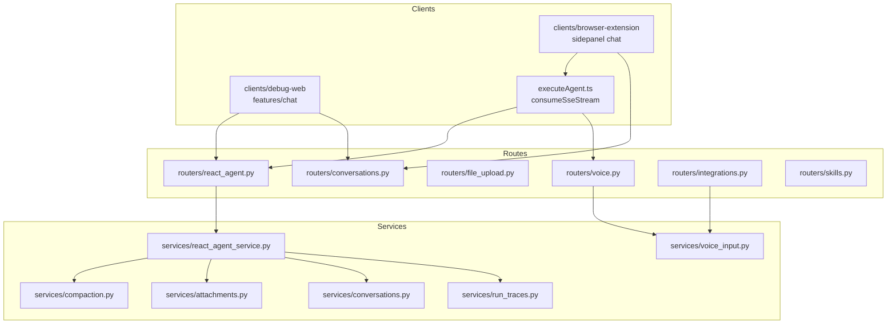
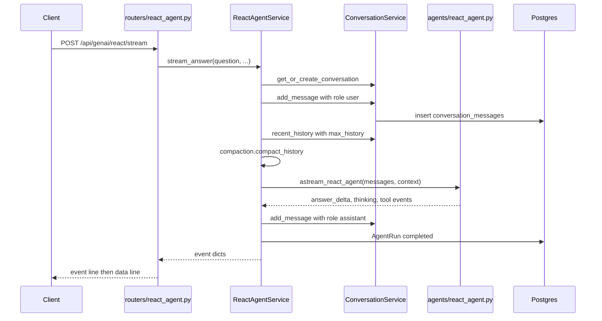
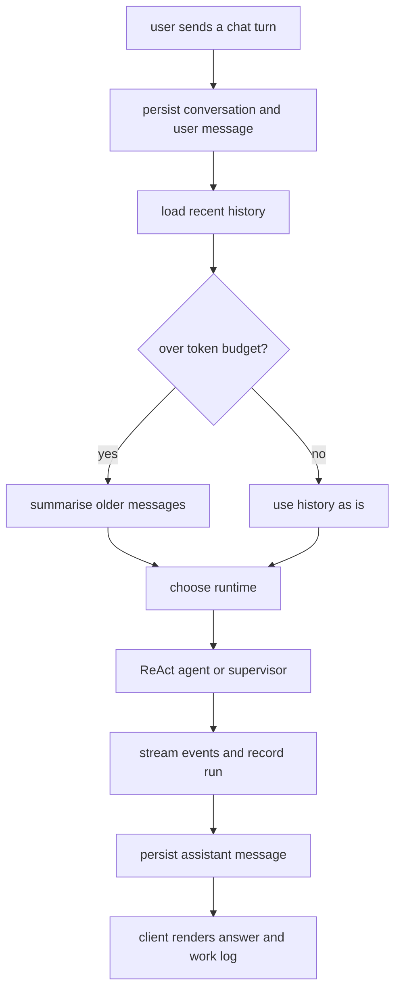
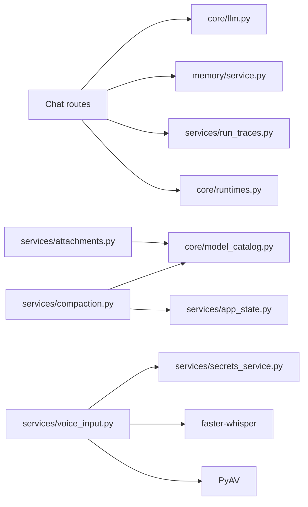

# Chat experience

The chat experience is the path from a typed message to a rendered answer. A client posts a question with optional history and an attachment. `routers/react_agent.py` hands it to `ReactAgentService`. The service persists the turn, retrieves memory, runs either the ReAct graph or the supervisor harness, and streams events back. The browser side panel and the debug console are two front ends over the same routes.

The pages in this folder cover the behaviours around the agent run rather than the agent itself: how events are framed and rendered, how long conversations are compacted, how files become model input, how speech becomes text, and how conversations survive a reload.

Key capabilities:
- Two HTTP shapes on the same question: one JSON response and one `text/event-stream`.
- A single event vocabulary shared by the ReAct agent, the supervisor harness, and the browser runtime.
- A running summary stored on the conversation instead of a hard cut to the last N messages.
- Uploaded files read only from `uploads/`, with image and text caps.
- Postgres as the record for conversations, messages, runs, and client context snapshots.
- Dictation and read-aloud with cloud providers and local fallbacks.

## Repository layout

The server side lives in `routers/` and `services/`. The agent internals live in `agents/`. The two clients live under `clients/`, and the extension talks HTTP through its own fetch helpers.

## How it fits together

The service always creates or reuses a conversation first, then stores the user message, then loads history up to `max_history`, then compacts. Only after that does it choose a runtime: a subscription runtime pick, the ReAct agent, or the supervisor harness. Each successful branch ends with an assistant message and a completed `AgentRun`.

## Pages in this folder

| Page | What it covers |
| --- | --- |
| [Streaming and Work Log](Streaming%20and%20Work%20Log) | SSE framing, event types, client reducers, WorkLog rendering |
| [Conversation Compaction](Conversation%20Compaction) | token budget, stored summaries, tool output trimming |
| [Attachments](Attachments) | upload route, path guard, image downscale, text clipping |
| [Voice Input and Output](Voice%20Input%20and%20Output) | transcribe and one-pass routes, local Whisper fallback, TTS |
| [Conversation Persistence](Conversation%20Persistence) | conversation and message tables, titles, context snapshots |

## Shared concepts

- A conversation is addressed by `conversation_id`, a `conv_` prefix plus a UUID hex string. Every message uses the same pattern with `msg_`.
- A run is addressed by `run_id` and recorded in `agent_runs`. Events land in `agent_events`.
- `client_id` defaults to `"browser-extension"` at the service boundary and is stored on every conversation and message row.
- Server history wins over client history. `server_history or chat_history` is passed to the agent.
- The summary entry uses role `"summary"` and is translated back to a system message before the model sees it.
- Live token events are not persisted. Structural events are.
- Attachments and voice files are stored under `uploads/`. A path outside that root is refused.

## Dependencies

The chat section depends on the LLM factory, the memory retrieval service, and the run trace writer. The voice and attachment routes depend on `services/secrets_service.py` and the model catalog for capability checks.

## Performance and limits

- History load defaults to 400 messages, the `max_history` default in `DEFAULTS`.
- Compaction budget is `trigger_ratio` of 0.5 of the model context window, floor 4000 tokens, fallback window 128000.
- `estimate_tokens` uses `len(text) // 4 + 1`, so budgets are approximate.
- Recent messages are capped at 60 percent of the budget before summarising.
- Image attachments are downscaled above 3.5 MB or 2048 px. Text is clipped above 60000 characters.
- `_BACKGROUND_TASKS` keeps a strong reference so post-turn memory ingestion is not collected mid-run.
- SSE frames are single-line JSON. Token deltas are not written to the trace.

## Troubleshooting

- Empty `answer` in a stream: the client only accumulates `answer_delta` and `final`. A run that errors emits `error` and no final answer.
- Stream ends with no events: check that `question` is non-empty, since the route raises HTTP 400 before opening the stream.
- Oversized request body: `routers/file_upload.py` caps uploads at 10 MB even though attachments clip later.
- Attachment refused with "must be uploaded through /api/upload first": the path resolved outside `uploads/`.
- Conversation title stuck at "New Conversation": the first user message triggers `generate_chat_title`, and the title is only written when it still equals that literal.
- A reloaded conversation loses the work log: only structural events are stored. Token deltas were never persisted.
- The model sees fewer messages than the UI: the agent uses `recent_history` with compaction settings, not the UI's list call.
- Voice transcription is empty: the route returns `ok: true` with empty text and the client does not call `onTranscript`.

## Appendix

### Implementation examples

- `POST /api/genai/react` returns `{"answer": "..."}`.
- `POST /api/genai/react/stream` returns SSE frames shaped as `event: <name>` and `data: <json>`.
- `ReactAgentService.stream_answer` is an async generator fed by an `asyncio.Queue`.
- `_fallback_title` takes the first 60 characters of the message plus an ellipsis marker.
- `POST /api/upload/` returns the `path` used later as `attached_file_path`.

### Source files

- `services/react_agent_service.py`
- `routers/react_agent.py`
- `services/compaction.py`
- `services/attachments.py`
- `services/voice_input.py`
- `services/conversations.py`
- `clients/debug-web/src/features/chat/ChatPage.tsx`
- `clients/browser-extension/entrypoints/utils/executeAgent.ts`
