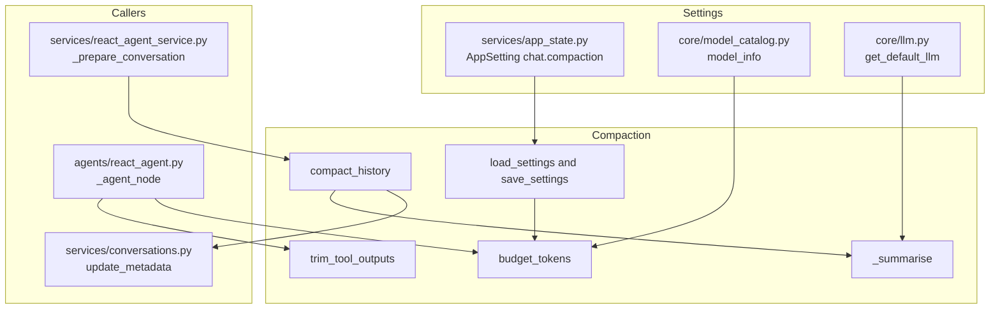
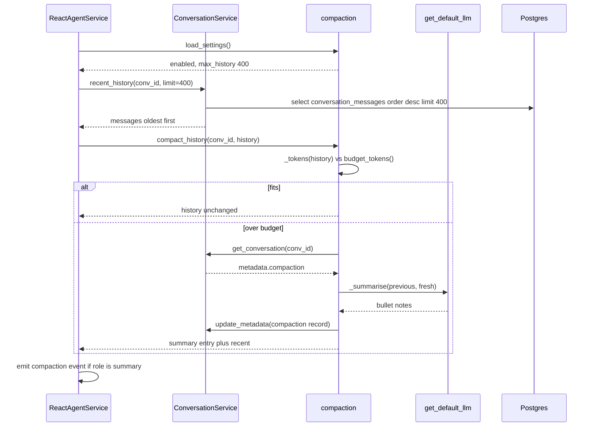
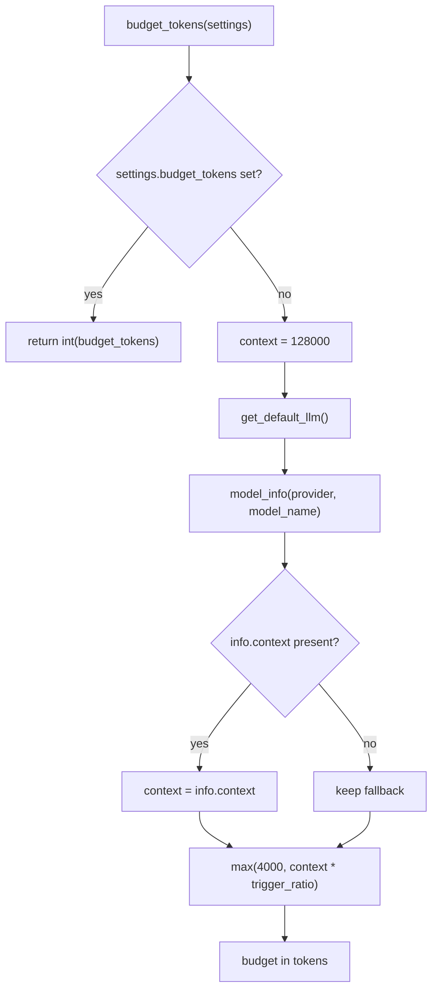
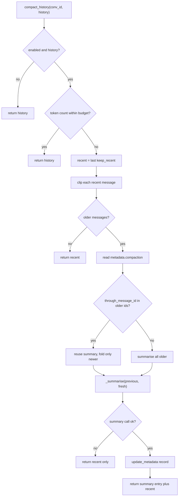
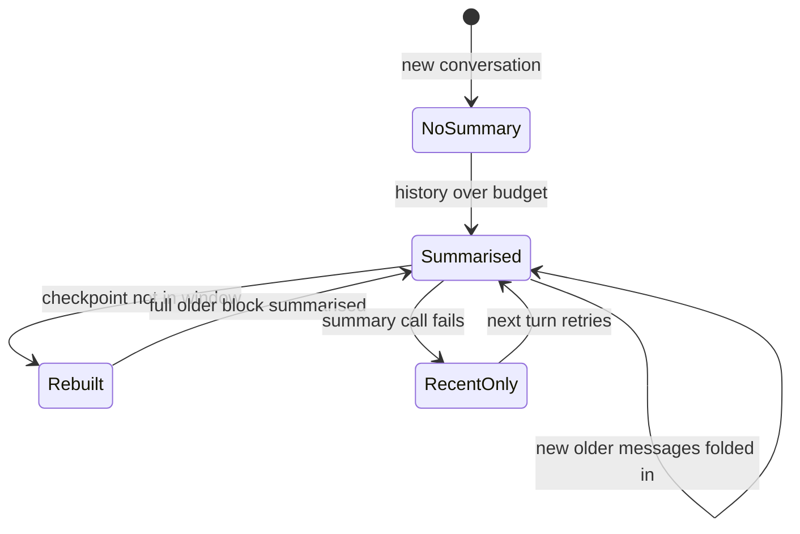
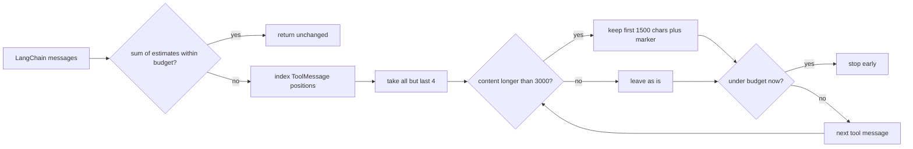
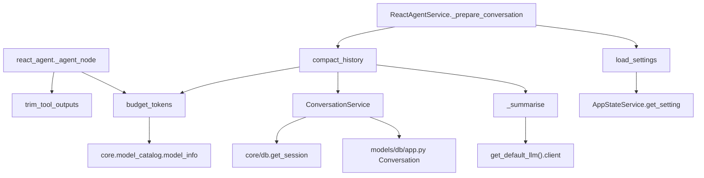

# Conversation compaction

Long chats do not fit a model window. `services/compaction.py` keeps the recent turns word for word and folds everything older into a running summary stored on the conversation row. The summary is extended on later turns instead of regenerated, so the cost grows with new messages, not with total history.

There are two halves. `compact_history` runs before a turn and shapes the message list. `trim_tool_outputs` runs inside a single agent run and cuts old tool results when the message list grows past the budget. The agent node calls the second one before every model call.

Key capabilities:
- Whole-conversation load up to `max_history` messages, not a fixed last-20 cut.
- Budget derived from the picked model's context window or a fixed override.
- Summary reuse keyed by `through_message_id`.
- Graceful degradation: a failed summary call sends recent messages only.
- Per-run trimming that keeps the newest four tool results intact.

## Repository layout

The module owns no tables of its own. It reads settings from `app_settings`, reads and writes conversation metadata through `ConversationService`, and calls the default LLM for the summary text.



## Building blocks

- `DEFAULTS`: `enabled=True`, `trigger_ratio=0.5`, `budget_tokens=None`, `keep_recent=8`, and `max_history=400`.
- `SETTING_KEY = "chat.compaction"`: the `AppSetting` row the console edits under Settings, Model.
- `estimate_tokens(text)`: `len(text) // 4 + 1`, a cheap approximation with no tokenizer dependency.
- `_tokens(messages)`: sums the estimate plus 4 tokens of overhead per message.
- `load_settings`: starts from `DEFAULTS` and overlays only keys that already exist in the defaults, so a stale saved key is ignored.
- `budget_tokens`: fixed override first, otherwise `context * trigger_ratio` with a floor of 4000.
- `compact_history`: decides whether the list fits, clips recent messages, summarises older ones, and returns a summary entry plus recent messages.
- `summary_preamble`: wraps the stored summary in a system message explaining what it is.
- `trim_tool_outputs`: truncates older `ToolMessage` content to 1500 characters each.

## How it fits together

`ReactAgentService._prepare_conversation` stores the user message, loads settings, reads `max_history` messages, and compacts. The resulting list is what the agent sees, and it is also what the service inspects for a leading summary role so it can emit a `compaction` event to the client.



## Choosing the budget

The budget is resolved on every call, so switching models changes it without a restart. A fixed `budget_tokens` wins. Otherwise the catalog's context size for the current provider and model is multiplied by `trigger_ratio`. If the catalog lookup fails for any reason, the fallback window is 128000.



The floor of 4000 means a tiny context model still gets a usable prompt. The ratio of 0.5 leaves half the window for the answer, system prompt, tools, and memory block.

## Compacting the history

`compact_history` first checks the gate: compaction disabled or empty history returns the input untouched. If the estimated total is within budget, nothing is summarised, which is the common case for short chats. Over budget, the last `keep_recent` messages, minimum 2, form the recent window and the rest are candidates for summary.

Recent messages are clipped individually to `max(500, budget * 0.6 / len(recent))` tokens. `_clip_message` keeps the first and last half of the allowed characters and inserts a marker with the count cut, so a long pasted log keeps both its beginning and its end.



The summary prompt asks for third-person bullet notes under four headings: facts and preferences, what was asked and done, decisions, and open threads. It asks for numbers, names, prices, versions, URLs, ids, and file paths, and caps the notes at 900 words. The transcript passed to the model caps each message at 6000 characters and keeps the head and tail when it clips.

## Summary lifecycle

The stored record lives at `metadata.compaction` on the conversation:

```json
{
  "summary": "The user ...",
  "through_message_id": "msg_...",
  "messages_summarised": 42,
  "at": "2026-11-21T09:56:38+00:00"
}
```

On the next over-budget turn, `through_message_id` is looked up in the older message ids. If it is present, the stored summary covers everything up to that point and only messages after it are folded in. If it is missing, the whole older block is summarised again, which handles a history window that moved past the old checkpoint.



The returned list starts with `{"role": "summary", "content": ..., "compaction": {...}}`. `_build_react_messages` and `_runtime_turn` translate that role into a system message using `summary_preamble`, so the model reads the notes as prior conversation rather than as a user instruction. The `compaction` field is what the service emits to the client as a `compaction` event.

## Trimming tool output during a run

Compaction outside the turn does not help a single run that calls twenty tools. `_agent_node` calls `trim_tool_outputs(messages, await budget_tokens())` before each model invocation. If the message list is under budget it returns the same list. Otherwise it walks tool messages from oldest to newest, skipping the last `keep_last=4`, and replaces each long result with its first 1500 characters plus a marker.



The trim rebuilds `ToolMessage` with the original `tool_call_id` and `name`, so the graph's tool-call pairing stays valid. It is a blunt instrument by design. The newest results, which usually answer the current subgoal, are never touched.

## Dependencies

Compaction is called from the agent service and the agent node, and depends on settings storage, the model catalog, and the LLM factory. It has no database tables of its own.



## Performance and limits

- Token counting is `len // 4`, so no tokenizer runs per turn.
- A conversation loads at most 400 messages per turn, the `max_history` default.
- Recent messages get at most 60 percent of the budget between them.
- The summary target is under 900 words. The transcript clips each message to 6000 characters.
- A failed summary skips the call on that turn and returns recent messages, keeping the chat usable.

## Troubleshooting

- The model still reports a context overflow: compaction measures characters, not provider tokens. Lower `trigger_ratio` or set `budget_tokens`.
- No compaction happens: check `enabled` in the `chat.compaction` setting. `load_settings` drops unknown keys, so a typo in a saved key silently falls back to defaults.
- The summary repeats old content: `through_message_id` was not found in the current older window, so the whole block was summarised again.
- Compaction is invisible in the transcript: the summary is stored in conversation metadata, not as a `conversation_messages` row.
- The first turn after enabling compaction shows a `compaction` event but no summary text in the UI: the event carries counts and budget, not the notes.

## Appendix

### Implementation examples

- `compact_history(conversation_id, history)` returns `[{"role": "summary", ...}, *recent]`.

### Source files

- `services/compaction.py`
- `services/conversations.py`
- `services/react_agent_service.py`
- `agents/react_agent.py`
- `core/model_catalog.py`
