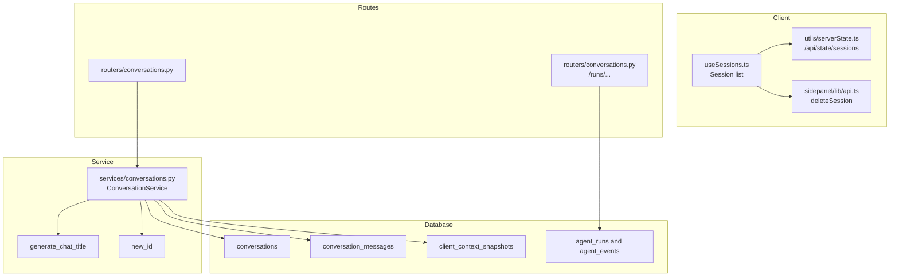
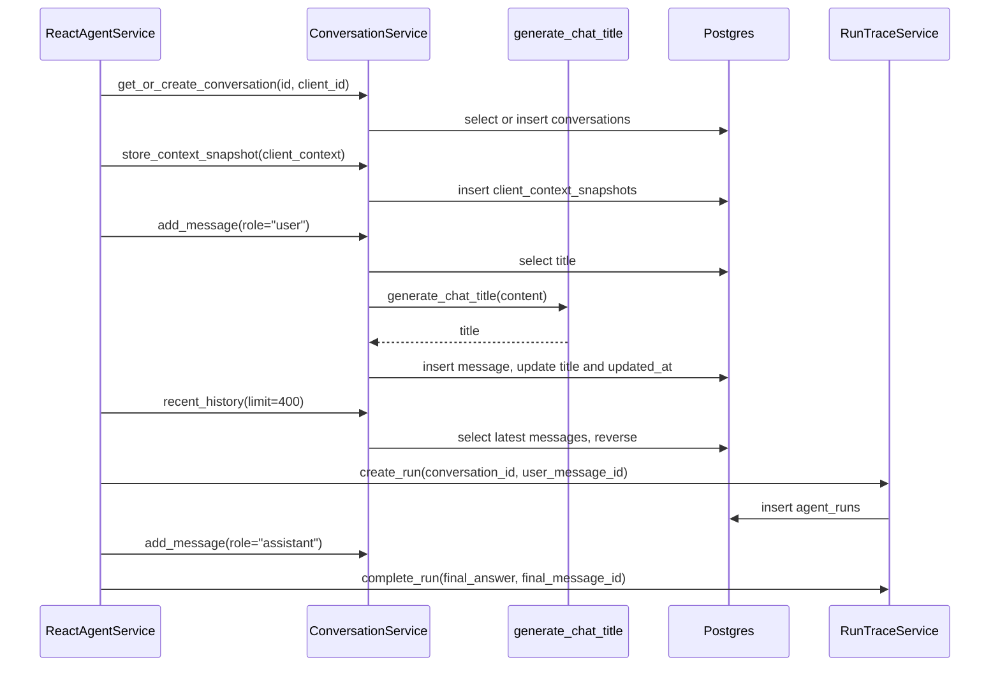
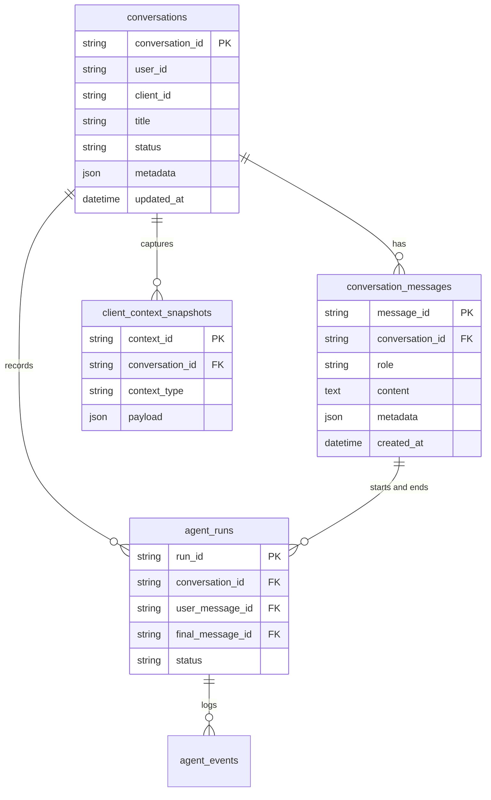
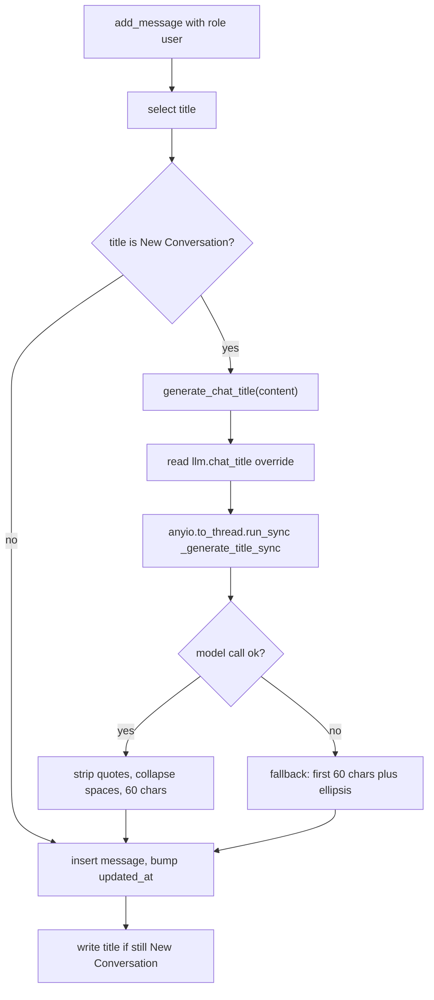
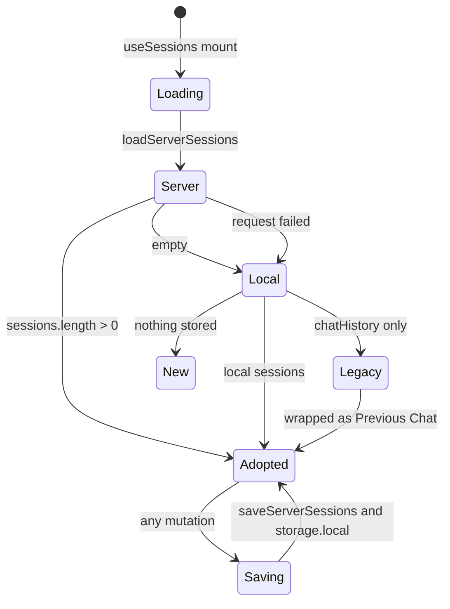
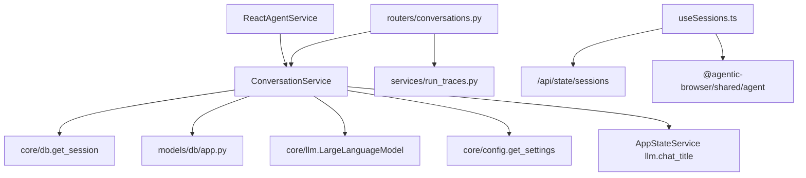

# Conversation persistence

Every chat turn starts with a Postgres write before the agent runs. `ConversationService` in `services/conversations.py` owns conversations, messages, and client context snapshots. `routers/conversations.py` exposes them under `/api`. `ReactAgentService` calls the service directly, so the user message survives a client disconnect even though the assistant message is written only after the run finishes.

The browser extension keeps a second, client-side record. `useSessions.ts` stores a session list locally and syncs it through `/api/state/sessions`, then links each local session to a server conversation through `serverConversationId` when the backend emits a `conversation` event.

Key capabilities:
- `conv_` and `msg_` identifiers generated from UUID4 hex.
- Conversation list ordered by `updated_at` descending.
- Title generation from the first user message, with a deterministic fallback.
- Message history reads in both directions: ascending for display, descending then reversed for prompt history.
- JSONB metadata on conversations and messages.
- Client context snapshots stored separately from messages.

## Repository layout

The persistence layer is three tables in `models/db/app.py`, one service, and one router. The extension hook and the shared fetch helpers sit on the client side.

## Building blocks

- `new_id(prefix)`: returns `f"{prefix}_{uuid.uuid4().hex}"`, used for `conv`, `msg`, and `ctx`.
- `_message_payload` and `_conversation_payload`: map rows to the public JSON shapes.
- `create_conversation`: inserts a row with a default title of "New Conversation".
- `get_or_create_conversation`: selects by id and creates one if missing, which makes a client-supplied id idempotent.
- `add_message`: inserts the message and bumps `conversation.updated_at`. It generates a title when the message is the first user turn.
- `list_messages` and `recent_history`: ascending display reads and newest-N prompt reads.
- `update_metadata`: shallow-merges keys into `metadata_`, used by compaction.

## How it fits together

`ReactAgentService._prepare_conversation` is the main writer. It calls `get_or_create_conversation`, stores the optional client context, adds the user message, reads history, compacts it, and creates a run trace. The assistant message is added after the answer is produced.

If the request carries no `conversation_id`, `get_or_create_conversation` creates one with a generated `conv_` id, and the service returns it in the `conversation` event. Clients that already have a session id pass it as `conversation_id`, and the same row is reused.

## Tables

The three conversation tables are independent of the run trace tables. `agent_runs` references the conversation and the user and final messages, so a run can be reconstructed without scanning message text.

`metadata_` is the Python attribute. The column is named `metadata` because `metadata` is reserved on SQLAlchemy models. Messages use a `Text` column for content, so there is no row-size ceiling from a long paste.

## Titles

A conversation starts as "New Conversation". On the first user message, `add_message` checks the title, and if it is still that literal it calls `generate_chat_title`. The generator reads `llm.chat_title` from `AppSetting`, falling back to `settings.chat_title_llm_provider`, model, and temperature.

The title model is built from `LargeLanguageModel` with the provider key resolved from settings, for example `google_api_key` for `google`. The prompt sends `content[:4000]` and asks for at most six words. `_clean_generated_title` strips surrounding quotes and backticks, collapses whitespace, removes a trailing period, and truncates to 60 characters. `_fallback_title` does the same truncation on the raw message without a model call.

## Reading history

Two reads serve different purposes. `list_messages` returns the conversation in display order for the UI, with a route limit between 1 and 500. `recent_history` returns the newest N messages and reverses them, because the prompt needs chronological order while the query needs a limit on the newest rows.

The default for `recent_history` is 20, but the service passes `max_history` from compaction settings, which defaults to 400. That is the only path that feeds the model, so a UI limit change does not affect prompt size.

## The extension session cache

The extension keeps its own `Session[]` with messages and events. On mount, `useSessions` tries the server first through `loadServerSessions()`, which calls `GET /api/state/sessions`. If that returns an empty list, it reads `sessions` from `browser.storage.local`, uploads non-empty local data with `saveServerSessions`, and then falls back to the legacy `chatHistory` key. If the server call throws, it uses the local cache and only creates a new chat when nothing is stored.

Every change writes both copies. `addMessage` derives a local title from the first 30 characters of the first user message, independent of the server-side title. `pushAgentEvent` appends an event and merges thinking deltas through the shared `appendEvent` helper. `linkServerConversation` stores the backend `conversation_id` on the session, which is then sent as `conversation_id` on the next turn.

The two records are not the same thing. The local session list is stored under `/api/state/sessions` in the `browser_sessions` tables, while the agent's record is `conversations` and `conversation_messages`. The link is `serverConversationId`. Deleting a local session calls `api.deleteSession`, which sends `DELETE /api/state/sessions/{id}` and removes the state row, not the conversation rows.

## Context snapshots

`store_context_snapshot` is called with `context_type="client_context"` and the payload the client sent, typically the active tab URL and tab context. The row has a nullable `conversation_id`, so a snapshot can be stored before a conversation exists. The route `POST /api/client-context` exposes the same operation for clients that want to record context without sending a message.

## Dependencies

The service depends on the SQLAlchemy session factory, the app models, the LLM factory for titles, and the settings table for the title override. The router depends on the service and the run trace readers.

## Performance and limits

- `list_conversations` has no limit. It returns every conversation for the user sorted by `updated_at`.
- `list_messages` caps at 500 through the route. `recent_history` caps at `max_history`, default 400.

## Troubleshooting

- The conversation id changes every turn: the client is not sending `conversation_id`. The extension must call `linkServerConversation` from the `conversation` event or pass `serverConversationId`.
- "conversation not found": `GET /api/conversations/{id}` returns 404 when the id does not exist.

## Appendix

### API endpoints

| Method | Path | Body | Response |
| --- | --- | --- | --- |
| POST | `/api/conversations` | optional title | `{"conversation_id": "conv_...", "title": "New Conversation"}` |
| POST | `/api/conversations/{id}/messages` | `{"role", "content"}` | `{"message_id": "msg_..."}` |
| GET | `/api/conversations/{id}/messages?limit=100` | none | `{"messages": [...]}` |
| POST | `/api/client-context` | context payload | `{"context_id": "ctx_..."}` |

### Implementation examples

- `ConversationService.recent_history(conv_id, limit=400)` returns oldest-first rows.

### Source files

- `services/conversations.py`
- `routers/conversations.py`
- `models/db/app.py`
- `clients/browser-extension/entrypoints/sidepanel/chat/hooks/useSessions.ts`
