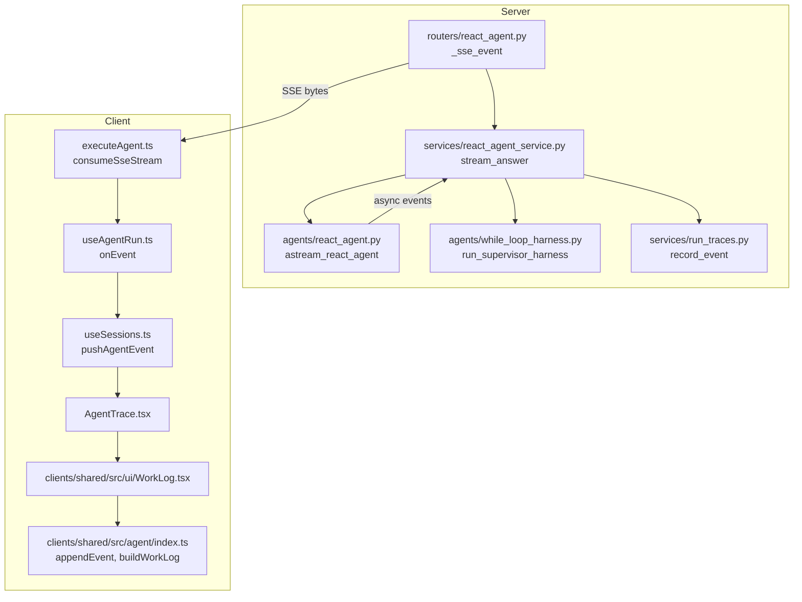
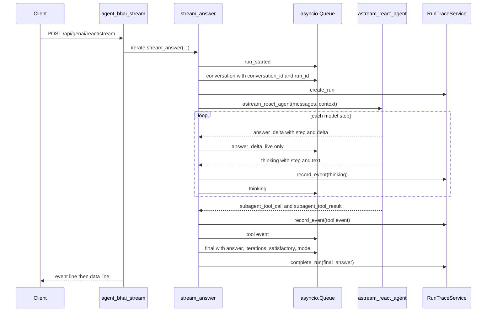
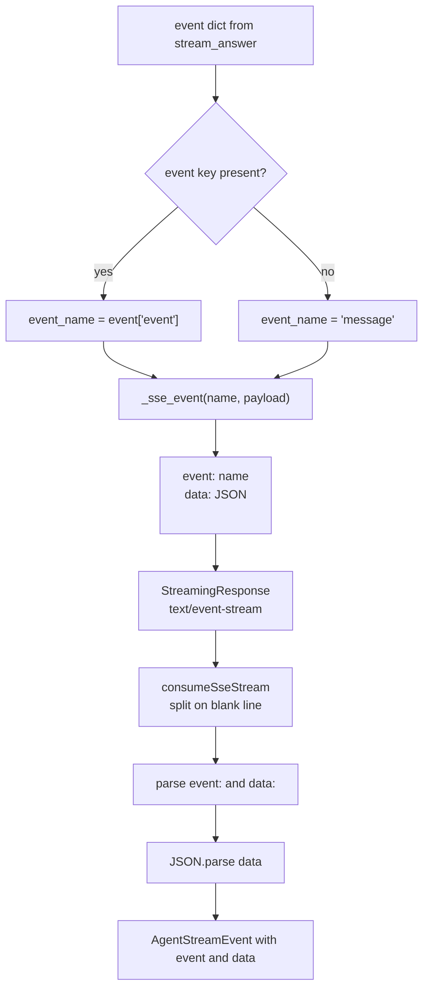
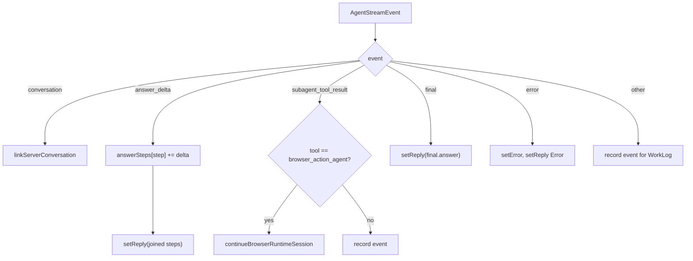
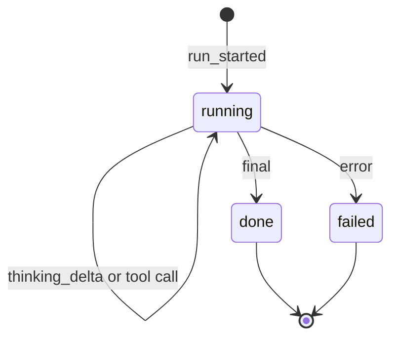
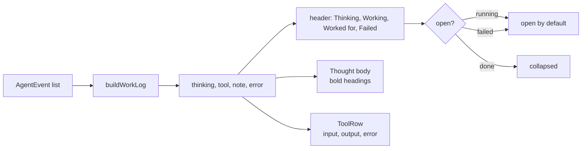
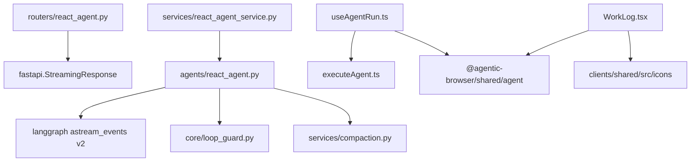

# Streaming and work log

A chat turn reaches the browser as a sequence of server-sent events. `routers/react_agent.py` frames them, `services/react_agent_service.py` decides which ones to persist, `agents/react_agent.py` produces the token-level ones from LangGraph, and the clients reduce the list into a collapsible work log beside the answer.

The important split is live versus recorded. `answer_delta` and `thinking_delta` go straight to the open connection and are never written to the trace, because one row per token would flood Postgres. Everything else is sent and stored, so a reloaded conversation can still show what the agent did.

Key capabilities:
- One framing function for every event, with the name on an `event:` line and the payload on `data:`.
- Stable event names across the ReAct agent, the supervisor, and the browser runtime loop.
- Per-step answer assembly so text before a tool call is not lost.
- A client reducer that merges thinking deltas and pairs tool calls with results.
- A work log that stays open while running, collapses after success, and stays open on failure.

## Repository layout

The stream starts in the route, is produced in the service and agent, and is consumed twice: once by the extension side panel and once by the shared work log component.

## Building blocks

- `routers/react_agent.py`: `_sse_event(event_name, payload)` returns `event: <name>\ndata: <json>\n\n`. `agent_bhai_stream` wraps the generator in `StreamingResponse` with `Cache-Control: no-cache`, `Connection: keep-alive`, and `X-Accel-Buffering: no`.
- `services/react_agent_service.py`: `stream_answer` runs the turn in an `asyncio.Task` and feeds an `asyncio.Queue`, so the route yields events as they arrive. Closing the response cancels the task.
- `agents/react_agent.py`: `astream_react_agent` consumes `graph.astream_events(..., version="v2")` and yields typed dictionaries.
- `clients/browser-extension/entrypoints/utils/executeAgent.ts`: `consumeSseStream` splits blocks on blank lines, reads `event:` and `data:` prefixes, and JSON-parses each payload.
- `clients/browser-extension/entrypoints/sidepanel/chat/hooks/useAgentRun.ts`: `onEvent` switches on the event name and updates the reply message.
- `clients/shared/src/agent/index.ts`: `appendEvent` stores events compactly. `buildWorkLog` turns them into thinking, tool, note, and error items.
- `clients/shared/src/ui/WorkLog.tsx`: renders the log header, timers, thought bodies, and expandable tool rows.

## How it fits together

The service creates the conversation and run before any model call, so the first events the client sees are `run_started` and `conversation`. It then picks a path and forwards events through `emit_and_record`, which writes to the trace and to the queue.

## SSE framing

The route does not use a library serializer. Each dictionary is serialized with `json.dumps(payload, ensure_ascii=True)`, and the event name comes from `event["event"]`, defaulting to `"message"`. Because the payload is on a single `data:` line and blocks end with a blank line, the client parser can treat the stream as newline-delimited blocks.

Headers matter for proxies. `X-Accel-Buffering: no` stops nginx from buffering the stream, and `Connection: keep-alive` keeps the socket open while the agent runs.

## Event vocabulary

The ReAct stream yields the core types below. `_split_chunk` separates answer text from reasoning blocks, so a provider that returns `{"type": "thinking"}` blocks does not leak them into the answer.

| Event | Payload | Source |
| --- | --- | --- |
| `thinking_delta` | `step`, `delta` | `_split_chunk` reasoning text |
| `thinking` | `step`, `text` up to 6000 chars | whole reasoning block at model end |
| `answer_delta` | `step`, `delta` | `_split_chunk` text |
| `subagent_tool_call` | `call_id`, `tool`, `args` clipped to 600 | `on_tool_start` |
| `subagent_tool_result` | `call_id`, `tool`, `result` | `on_tool_end` with non-error status |
| `subagent_tool_error` | `call_id`, `tool`, `error` | `on_tool_end` error status or `on_tool_error` |
| `loop_guard` | verdict fields | custom event named `loop_guard` |
| `compaction` | `messages_summarised`, `kept`, `budget_tokens` | service, from summary role |
| `final` | `answer`, `iterations`, `satisfactory`, `mode` | service or harness |
| `error` | `message` | service exception path |

The service adds lifecycle events around them: `run_started`, `conversation` with `conversation_id`, `run_id`, and `title`, `subagent_started` with `iteration`, `subagent`, and `task`, and `subagent_completed` with a result clipped to 500 characters.

Only events tagged `agent_turn` and attached to the `agent` node are allowed through the model filter. A tool such as `write_memory` runs its own model call for reconciliation. Without the filter those tokens would appear in the user's answer.

## Client reducers

The extension keeps the full event list per reply and rebuilds the visible answer from `answer_delta` events grouped by `step`. Steps are joined with a blank line, which keeps text written before a tool call separate from text written after it.

`appendEvent` in the shared package decides what is worth storing. It drops `answer_delta` and `conversation`, merges consecutive `thinking_delta` rows for the same step, and lets a completed `thinking` block replace its streamed pieces. That keeps a long reply's event list small enough to persist with the chat.

`buildWorkLog` then walks the list:
- A thinking event opens a thinking item. A tool call closes it.
- A tool call opens a running row. A result or error with the same `call_id` closes it.
- `answer_delta` closes any open thinking item.
- `error` marks the log failed and adds an error row.
- At the end, anything still running is marked `ok` or `error` depending on whether the run failed.

## Rendering the work log

`WorkLog` derives its header from the log status. While running it shows "Thinking" when the last item is an unfinished thought, the running tool's title when a tool is active, and "Working" otherwise. After success it shows "Worked for 12s" with a step count. After failure it shows "Failed after 12s" and forces the body open.

`AgentTrace.tsx` is the extension wrapper. It converts `AgentLoopEvent[]` with `toAgentEvents` and renders `WorkLog` in compact mode. The console renders the same component from its own event shape, so both clients show identical rows.

Thought text is split on blank lines or lines starting with `**`, and those headings render bold. Tool rows show the tool title from `TOOL_NAMES`, a short argument summary from `toolSummary`, and an expandable body with Input, Output, or Error blocks clipped at 4000 characters.

## Dependencies

The server stream depends on the LangGraph event API and the LLM client bound in the agent node. The clients depend on the shared agent reducer and the shared UI package.

No external streaming package is used. Framing, parsing, and buffering are all hand-written, which is why the blank-line separator logic appears on both sides.

## Performance and limits

- `json.dumps(..., ensure_ascii=True)` keeps each frame single-line and ASCII-safe.
- Tool arguments are clipped to 600 characters and results to 1500 in `_short`.
- Thinking blocks are clipped to 6000 characters before leaving the agent.
- Token deltas are not persisted. Only structural events reach `agent_events`.
- The service runs the turn in a task and yields from a queue, so a slow client does not block the agent, though the queue is unbounded.

## Troubleshooting

- Events arrive but the answer is empty: the client builds text only from `answer_delta` and `final`. A provider that streams no text and returns a non-final path leaves the reply blank.
- A tool row stays spinning after the run: `buildWorkLog` closes running rows when `live` is false or a terminal event arrived.
- Thinking text appears in the answer: the model client must be tagged `agent_turn`. An untagged nested model call is filtered out of the stream.
- The stream buffers behind a proxy: confirm `X-Accel-Buffering: no` survived the deployment and that the proxy does not gzip `text/event-stream`.

## Appendix

### Implementation examples

- `_sse_event("answer_delta", {"event": "answer_delta", "delta": "Hi"})` produces `event: answer_delta` plus one `data:` line.
- `astream_react_agent` yields `{"event": "subagent_tool_result", "call_id": run_id, "tool": name, "result": ...}`.
- `appendEvent` drops `answer_delta` and merges same-step `thinking_delta` in `clients/shared/src/agent/index.ts`.

### Source files

- `services/react_agent_service.py`
- `agents/react_agent.py`
- `routers/react_agent.py`
- `clients/browser-extension/entrypoints/sidepanel/chat/hooks/useAgentRun.ts`
- `clients/shared/src/ui/WorkLog.tsx`
- `clients/browser-extension/entrypoints/sidepanel/chat/AgentTrace.tsx`
