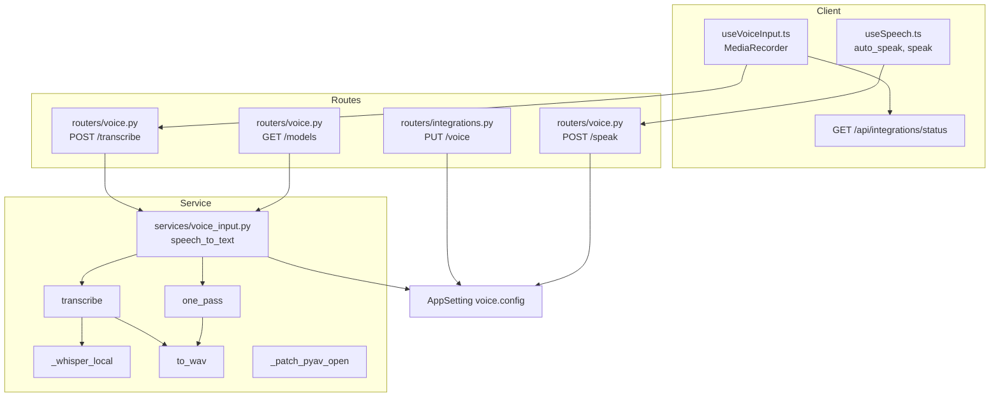
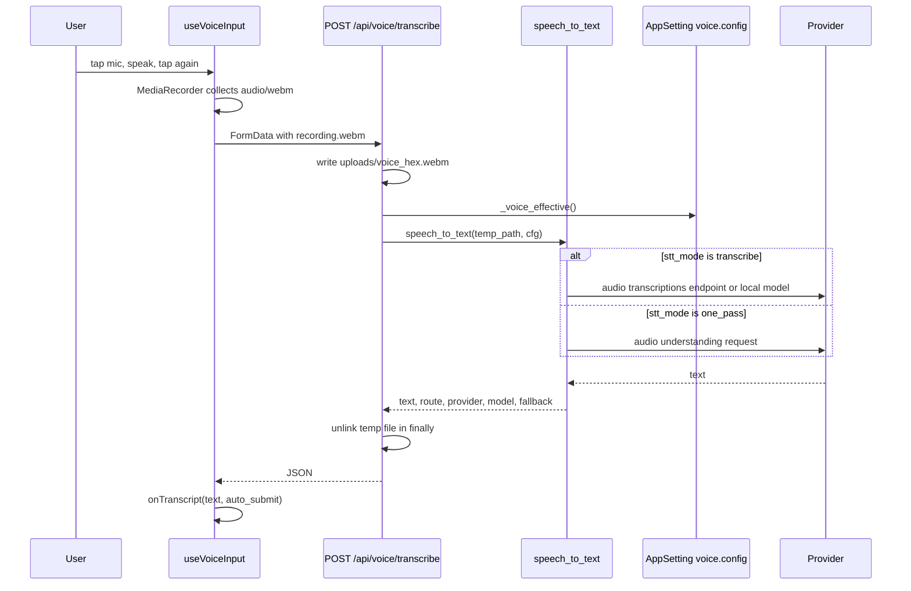
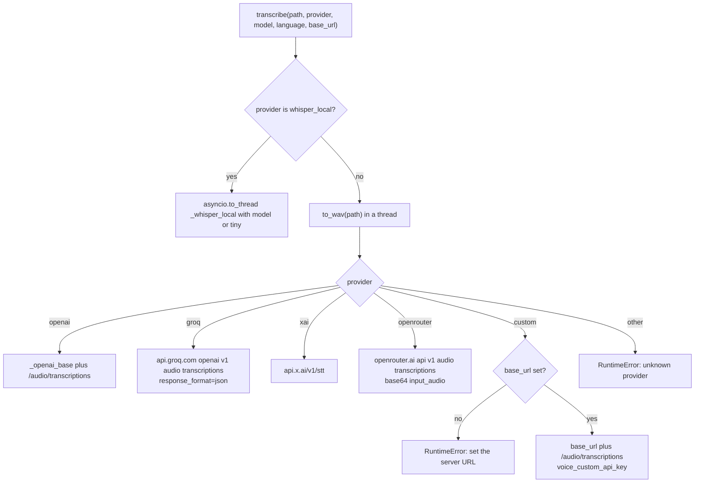
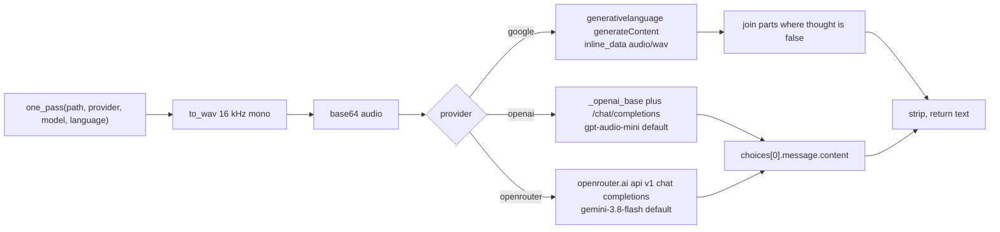
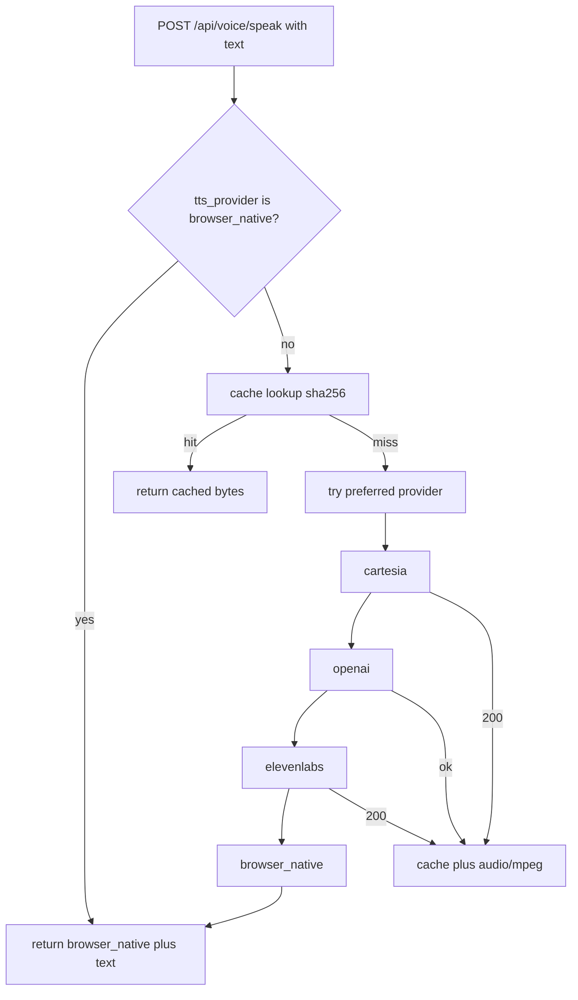
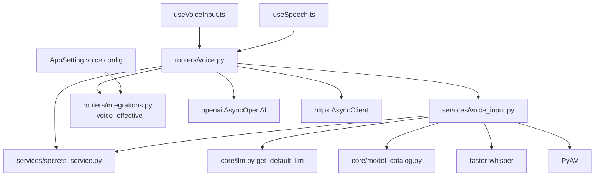

# Voice input and output

Dictation and read-aloud share one settings row, `voice.config`, and two routes: `POST /api/voice/transcribe` for speech in and `POST /api/voice/speak` for speech out. The recording route runs one of two pipelines from `services/voice_input.py`. `transcribe` writes down the audio and optionally cleans the text. `one_pass` sends the audio to a model that hears it and returns finished text.

The module also carries a compatibility shim. `faster-whisper` 1.2.1 still passes `metadata_errors` to `av.open`, an argument PyAV 15 removed, so importing `services/voice_input` patches `av.open` on PyAV 15 or newer to drop the keyword. `routers/voice.py` imports the module for that side effect, with a comment saying so.

Key capabilities:
- Provider dispatch for local Whisper, OpenAI, Groq, xAI, OpenRouter, and any OpenAI-compatible transcription server.
- A one-pass route for Gemini, GPT audio models, and OpenRouter audio models.
- Automatic fallback to local Whisper `base` when a cloud call fails.
- Configurable cleanup pass on the default chat model.
- TTS with a provider chain and a 50-entry in-memory cache.
- Browser speech synthesis as the final fallback on both ends.

## Repository layout

The server has a route module and a service module. Settings live in `routers/integrations.py` under `/api/integrations/voice`. The extension records with `MediaRecorder` and plays audio with an `Audio` element or `speechSynthesis`.

## Building blocks

- `VoiceConfig` in `routers/integrations.py`: the PUT body, with defaults for every field.
- `VOICE_SETTING_KEY = "voice.config"`: the `AppSetting` row merged over defaults by `_voice_effective`.
- `speech_to_text(path, cfg)`: chooses the route, runs it, normalizes the text, and returns a result dict.
- `transcribe` and `one_pass`: the two pipelines, one with an optional cleanup pass.
- `to_wav` and `_whisper_local`: audio conversion and cached local Whisper.
- `refine(text)`: cleanup with the default chat model.
- `model_options()`: provider model lists for the settings UI.

## How it fits together

The extension records a webm blob, posts it as multipart under the field name `file`, and reads back `{ok, text, route, provider, model, fallback}`. In parallel it fetches `/api/integrations/status` so the auto-submit decision uses the latest saved setting rather than a cached one.

The temp file is named `voice_<8 hex><original suffix>`, defaulting to `.webm` when the upload has no suffix. It is deleted in a `finally` block whether the provider succeeds or raises.

## Choosing a route

`stt_mode` selects the pipeline. `transcribe` is the default and works with every supported speech-to-text provider. `one_pass` skips transcription and sends the audio directly to a multimodal model. The cleanup flag only applies to the transcribe route, because a one-pass model already returns cleaned text by instruction. The transcribe route cleans up with `refine`, and a failure falls back to local Whisper `base` when `stt_fallback_local` is set.

`DEFAULT_MODELS` lists the suggestions per provider: `tiny` through `large-v3-turbo` for local Whisper, `gpt-transcribe` and `whisper-1` for OpenAI, two Groq Whisper models, `grok-voice-transcribe-2.0` for xAI, and an empty list for custom. `ONE_PASS_DEFAULTS` covers `google`, `openai`, and `openrouter`.

## The transcribe route

All cloud transcription providers except OpenRouter receive a multipart POST with a WAV file named `dictation.wav`. `_multipart` sets a 120 second timeout and a bearer token, then returns `resp.json()["text"]`. A status of 400 or above raises with the status and the first 300 characters of the body.

Local Whisper ignores the WAV conversion and hands the original file to `faster-whisper`, which can decode webm directly through PyAV. The model cache `_whisper` is module-level and keyed by model name, so the first request for a size pays the load cost and later requests reuse it.

## The one-pass route

One-pass sends a WAV plus a long instruction prompt. The prompt is `ONE_PASS_PROMPT`, built from `CLEANUP_RULES`: remove filler and false starts, apply spoken corrections such as "Thursday, sorry, Friday" becoming "Friday", keep every fact and number, write the user's requests as said rather than answering them, and never use an em dash.

Gemini receives `generateContent` with `inline_data` of type `audio/wav` and temperature 0.2. The response joins text parts that are not marked as thoughts, so Gemini reasoning does not end up in the composer. OpenAI and OpenRouter receive a chat completion with `modalities: ["text"]` and an `input_audio` content block.

Language handling is a single line appended to the prompt when `stt_language` is set: "The speaker uses language code 'xx'. Write the text in that language." For the transcribe route the same code is passed as the `language` form field or Whisper argument.

## Fallback behavior

The fallback is deliberately narrow. It runs when the selected route raises, `stt_fallback_local` is true, and the failing provider is not already `whisper_local` on the transcribe route. A one-pass failure always falls back when the flag is set, since the one-pass provider is never local.

The fallback model is always `base`, not the configured `stt_model`. The result keeps the original error in `error`, clipped to the first 300 characters, and sets `fallback: true`. The extension turns that into a visible note: "Cloud voice failed, so local Whisper wrote this instead".

After either route, `_no_em_dash` replaces an em dash, with or without surrounding spaces, by a comma and a space. This is a final guard on model output, not on the cleanup prompt alone.

## Speech output

`speak_text` returns JSON `{ok, method: "browser_native", text}` when the preferred provider is `browser_native` or when every cloud provider fails. Otherwise it returns an audio response. The cache key is `sha256("provider:voice:text")`, and the cache holds at most 50 entries with first-in-first-out eviction.

Provider details:
- Cartesia calls `https://api.cartesia.ai/tts/bytes` with `Cartesia-Version: 2024-06-10`, model `sonic-english`, and a 10 second timeout. The default voice id is `9fb269e7-70fe-4cbe-aa3f-28bdb67e3e84`.
- OpenAI uses `tts-1` through `openai.AsyncOpenAI` and accepts only a fixed voice whitelist, falling back to `alloy`.
- ElevenLabs posts to `/v1/text-to-speech/{voice_id}` with `eleven_monolingual_v1` and stability 0.5, 15 second timeout.

`useSpeech` mirrors this chain. When `auto_speak` is on, it splits the streaming reply into sentences, queues them, and speaks each one as it completes. It calls `/api/voice/speak` unless the provider is `browser_native`, and on any non-OK response or fetch failure it falls back to `SpeechSynthesisUtterance`. With auto-speak off it cancels audio and clears the queue.

## Dependencies

Voice depends on the secrets service for every provider key, the settings service for the config row, and the model catalog for the audio model lists. Local transcription depends on `faster-whisper` and PyAV.

## Performance and limits

- WAV conversion is fixed at 16 kHz mono 16-bit, the smallest format every cloud speech API accepts.
- Cloud calls use a 120 second timeout. TTS uses 10 seconds for Cartesia and 15 for ElevenLabs.
- Whisper models are cached across requests. The default local size is `tiny`, and the fallback is `base`.
- `WhisperModel` runs on CPU with int8 compute.

## Troubleshooting

- "open() got an unexpected keyword argument 'metadata_errors'": the PyAV shim did not run. Import `services.voice_input` before the first local transcription, which `routers/voice.py` does.
- "X API key isn't set. Add it in Settings, Voice": `_key` resolved an empty secret. The settings page writes through `PUT /api/integrations/secrets/{name}`.
- Local transcription is slow on first use: the `WhisperModel` load happens inside the request and is cached only after it completes.

## Appendix

### API endpoints

| Method | Path | Body | Response |
| --- | --- | --- | --- |
| POST | `/api/voice/transcribe` | multipart `file` | `{"ok": true, "text", "route", "provider", "model", "fallback"}` |
| GET | `/api/voice/models` | none | provider model lists |
| POST | `/api/voice/speak` | `{"text": "..."}` | audio bytes or `browser_native` JSON |
| PUT | `/api/integrations/voice` | partial `VoiceConfig` | merged voice config |

### Implementation examples

- `POST /api/voice/transcribe` returns `{"ok": true, "text": "...", "route": "transcribe", "provider": "whisper_local", "model": "tiny", "fallback": false}`.
- `speech_to_text(path, cfg)` with `stt_mode="one_pass"` returns `route: "one pass"`.

### Source files

- `services/voice_input.py`
- `routers/voice.py`
- `routers/integrations.py`
- `clients/browser-extension/entrypoints/sidepanel/chat/hooks/useVoiceInput.ts`
- `clients/browser-extension/entrypoints/sidepanel/chat/hooks/useSpeech.ts`
