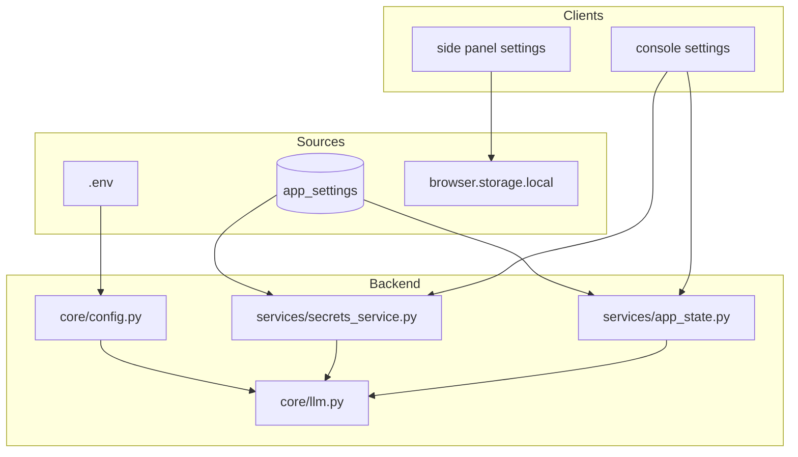
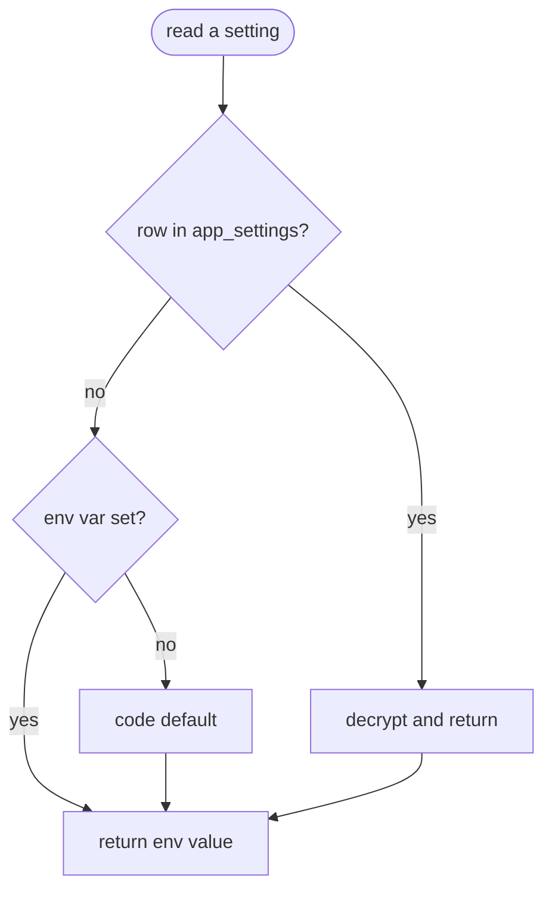
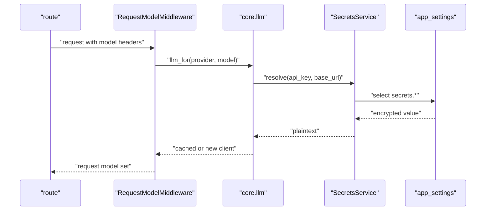
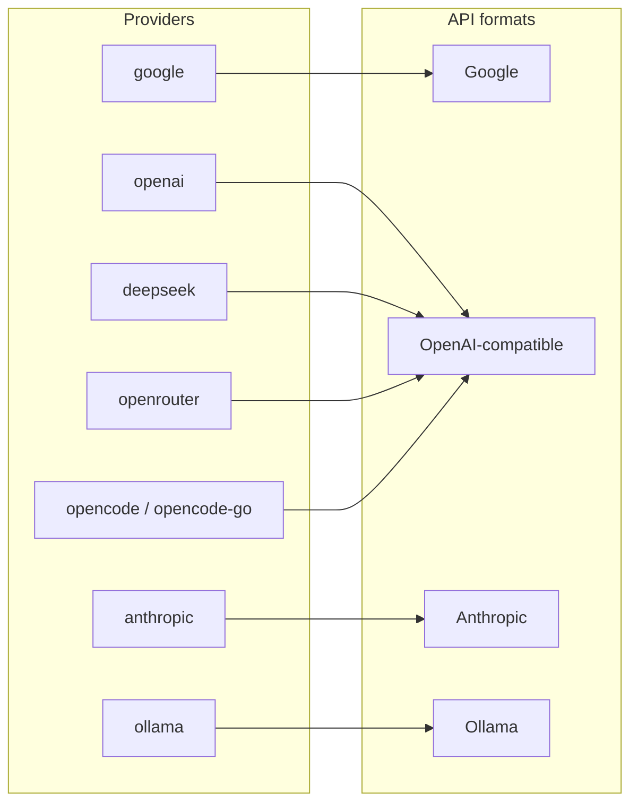
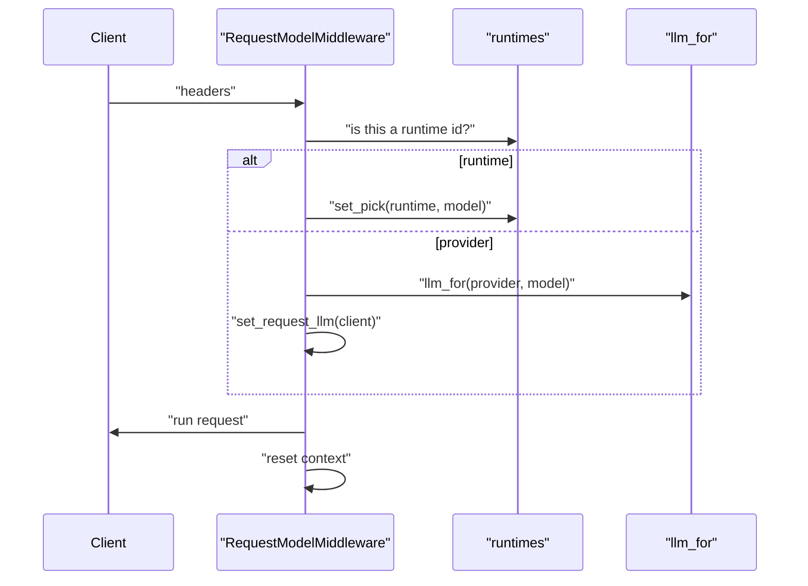
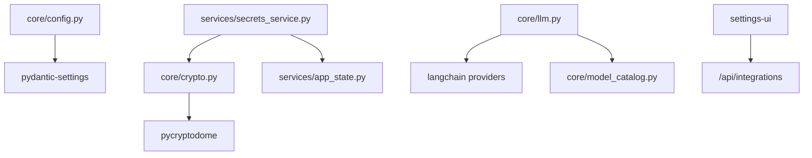

# Configuration management

Configuration comes from three places: `.env` for process settings, encrypted rows in `app_settings` for values set in the console, and `browser.storage.local` for client-side display state. The backend reads env through pydantic settings and resolves secrets from the database first, then the environment.

This page explains the hierarchy, what lives where, how provider endpoints are selected, and how to change configuration without restarting everything.

Key capabilities:
- One pydantic settings model for every env var
- Database overrides for model, secrets, OAuth clients and runtime settings
- Encrypted secret storage with a masked read API
- Per-request model selection from headers
- Custom base URLs for OpenAI, Anthropic and Google formats
- Client-side base URL and theme storage

## Repository layout



## Building blocks

- `core/config.py`: `Settings(BaseSettings)` with `env_file=".env"`, case-insensitive keys and `extra="ignore"`. Exposes `get_settings()` and `get_logger()`.
- `services/app_state.py`: CRUD over `app_settings`, keyed by `(user_id, key)`, with JSONB values.
- `services/secrets_service.py`: registry of API keys, base URLs and OAuth clients. Encrypts values with `core/crypto.py`.
- `core/llm.py`: provider registry, key and base URL resolution, default model, per-request model.
- `core/request_model.py`: reads `X-Agentic-Provider` and `X-Agentic-Model` for one request.
- `clients/browser-extension/entrypoints/sidepanel/components/UnifiedSettingsMenu.tsx`: extension settings UI.
- `clients/shared/src/settings-ui/`: shared settings sections used by both frontends.

## How it fits together

Precedence is database first, then environment, then code defaults. A model key saved in Settings wins over `GOOGLE_API_KEY`. A base URL saved in Settings wins over `OPENAI_BASE_URL`. If both are absent, the provider's default applies.



Secret reads happen per request for providers and OAuth clients. The service caches nothing by default; the LLM client cache is the exception.



## Environment variables

`Settings` groups variables by concern. Defaults match `docker-compose.yml`.

| Group | Variables |
| --- | --- |
| App | `ENV`, `DEBUG`, `BACKEND_HOST`, `BACKEND_PORT` |
| Default model | `DEFAULT_LLM_PROVIDER`, `DEFAULT_LLM_MODEL`, `DEFAULT_LLM_TEMPERATURE` |
| Chat title model | `CHAT_TITLE_LLM_PROVIDER`, `CHAT_TITLE_LLM_MODEL`, `CHAT_TITLE_LLM_TEMPERATURE` |
| Provider keys | `GOOGLE_API_KEY`, `OPENAI_API_KEY`, `ANTHROPIC_API_KEY`, `DEEPSEEK_API_KEY`, `OPENROUTER_API_KEY`, `OPENCODE_API_KEY` |
| Provider endpoints | `OPENAI_BASE_URL`, `ANTHROPIC_BASE_URL`, `GOOGLE_BASE_URL`, `OLLAMA_BASE_URL`, `BASE_URL` |
| Web and voice | `TAVILY_API_KEY`, `ELEVENLABS_API_KEY`, `CARTESIA_API_KEY`, `GROQ_API_KEY`, `XAI_API_KEY` |
| Composio | `COMPOSIO_API_KEY`, `COMPOSIO_USER_ID` |
| Telegram | `TELEGRAM_BOT_TOKEN`, `TELEGRAM_ALLOWED_USERS` |
| OAuth | `OAUTH_ENCRYPTION_KEY`, `GOOGLE_CLIENT_SECRET`, `GITHUB_CLIENT_ID`, `GITHUB_CLIENT_SECRET` |
| Postgres | `POSTGRES_HOST`, `POSTGRES_PORT`, `POSTGRES_DB`, `POSTGRES_USER`, `POSTGRES_PASSWORD` |
| Neo4j | `NEO4J_URI`, `NEO4J_USER`, `NEO4J_PASSWORD` |
| OpenSearch | `OPENSEARCH_HOST`, `OPENSEARCH_PORT` |

`ENV` accepts `development`, `production` or `test`. `DEBUG` sets the logging level.

## Database settings

The console writes JSONB rows keyed by name. Important keys:

| Key | Contents |
| --- | --- |
| `llm.default` | provider, model, temperature |
| `llm.chat_title` | provider, model, temperature |
| `chat.compaction` | enabled, trigger ratio, budget tokens, keep recent, max history |
| `runtimes` | Claude, Codex, Antigravity, OpenCode and custom ACP configs |
| `voice.config` | route, provider, model, cleanup, TTS |
| `secrets.*` | encrypted API keys and base URLs |
| `oauth_clients.*` | encrypted client id and secret |
| `pyjiit.credentials` | encrypted username and password |
| `composio.config` | encrypted API key and user id |

`GET /api/state/settings/{key}` reads any key. `PUT` writes one. The typed integration routes validate before writing.

## Provider selection

`PROVIDER_CONFIGS` in `core/llm.py` maps each provider to its LangChain class, key env var, default model and parameter names. Supported values: `google`, `openai`, `anthropic`, `ollama`, `deepseek`, `opencode`, `opencode-go`, `openrouter`.



A custom base URL points a provider at a gateway or local server. For OpenAI-compatible servers the URL usually ends in `/v1`. `llm_for` caches clients by provider, model, key and base URL.

## Per-request model

A client can override the saved model for one request:

```
X-Agentic-Provider: openrouter
X-Agentic-Model: qwen/qwen4-max
```

`RequestModelMiddleware` resolves the provider. If the id is a subscription runtime, it sets a runtime pick instead of an LLM. Otherwise it calls `llm_for` and stores the client in a context variable for the request. Background work keeps the default.



## Client-side settings

The extension keeps `baseUrl`, `theme`, `bridgeUrl`, `bridgeEnabled`, `googleUser` and session data in `browser.storage.local`. The console keeps `theme` and `nav-collapsed` in `localStorage`. Neither stores API keys or OAuth tokens; those live on the backend encrypted.

The side panel's base URL defaults to `http://localhost:5454`. The stream path reads `VITE_API_URL` at build time, while the API object reads storage, so the two can disagree after a host change.

## Dependencies



## Performance

- `get_settings()` is cached with `lru_cache(maxsize=1)`.
- `_key()` in `core/crypto.py` is cached, so AES setup happens once per process.
- LLM clients are cached up to 32 entries; the cache clears when it grows past that.
- Secret reads are one indexed query per key. There is no cache across requests.
- `reload_default_llm()` clears the provider cache and rebuilds the default after a settings change.

## Troubleshooting

- A key saved in Settings is ignored: the provider name may not match. `resolve_provider_secrets` uses `_PROVIDER_TO_SECRET`, which has `opencode` and `opencode-go` mapped to `opencode_api_key`.
- A base URL is ignored: only `google`, `openai`, `anthropic` and `ollama` have editable base URLs. DeepSeek, OpenRouter and OpenCode use fixed endpoints.
- `OAUTH_ENCRYPTION_KEY` errors: the key must decode to 32 bytes. A generated `.oauth_encryption_key` is fine for one machine.
- Settings changed but the model did not: the default is cached. Call `reload_default_llm()` or restart. Per-request headers bypass the cache.
- Extension points at the wrong backend: clear `baseUrl` in storage or set it to the right origin, then reload the panel.
- Console settings fail with 500: the secret store cannot decrypt. Check the encryption key.

## Appendix

### Implementation examples
- Read env: `get_settings().backend_port`.
- Read a DB setting: `await AppStateService().get_setting("llm.default")`.
- Resolve a secret: `await get_secrets_service().resolve("openai_api_key")`.
- Set a secret: `PUT /api/integrations/secrets/openai_api_key` with `{"value": "..."}`.
- Set the default model: `PUT /api/integrations/llm/model`.

### Source files
- `core/config.py`
- `core/llm.py`
- `core/request_model.py`
- `core/crypto.py`
- `services/app_state.py`
- `services/secrets_service.py`
- `routers/integrations.py`
- `clients/browser-extension/entrypoints/sidepanel/components/UnifiedSettingsMenu.tsx`
- `clients/shared/src/settings-ui/hooks.ts`
