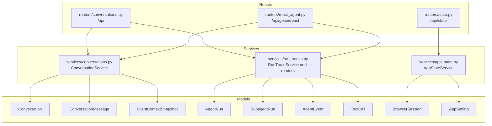
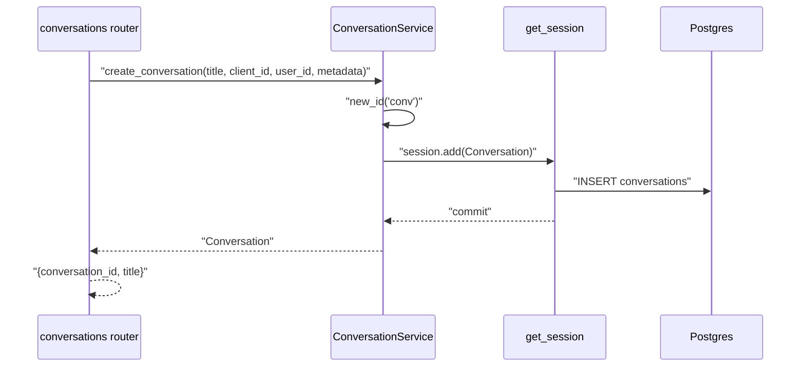
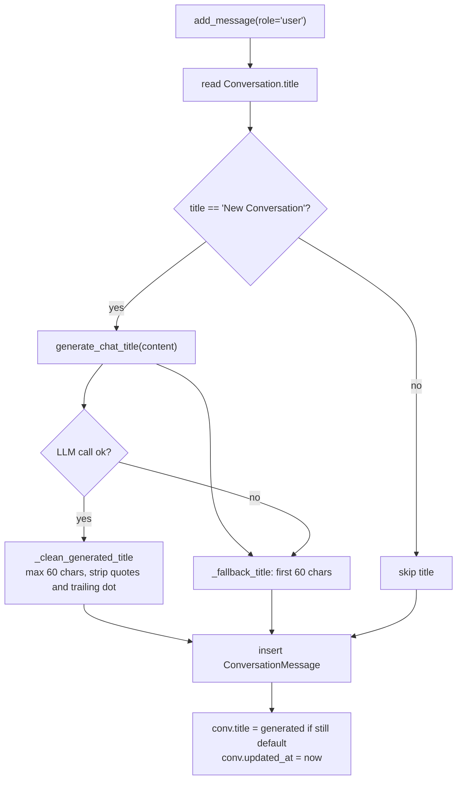
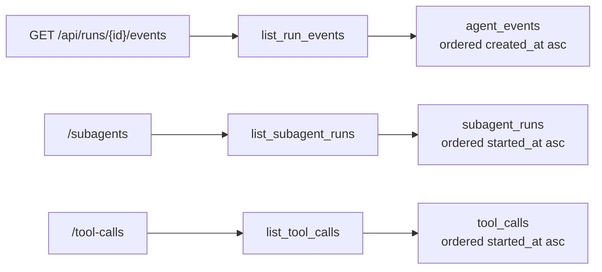
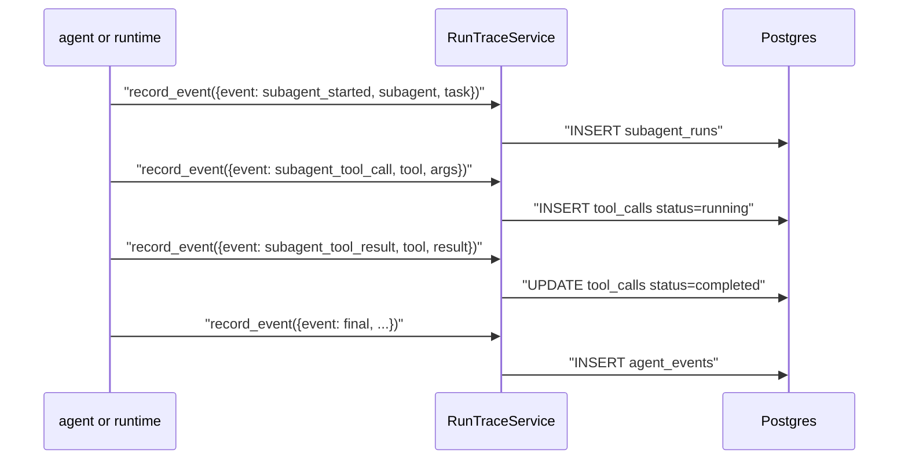
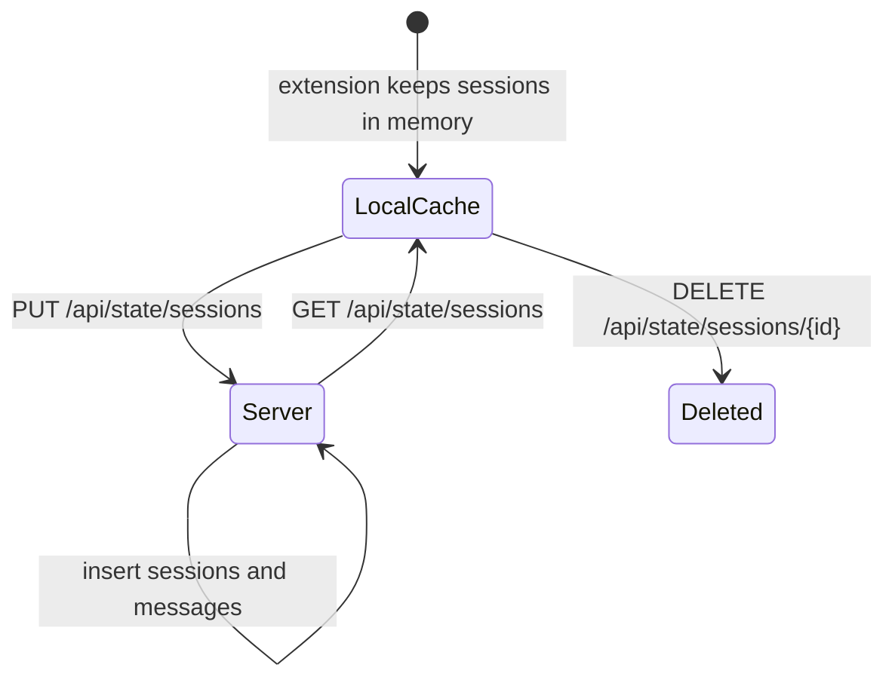
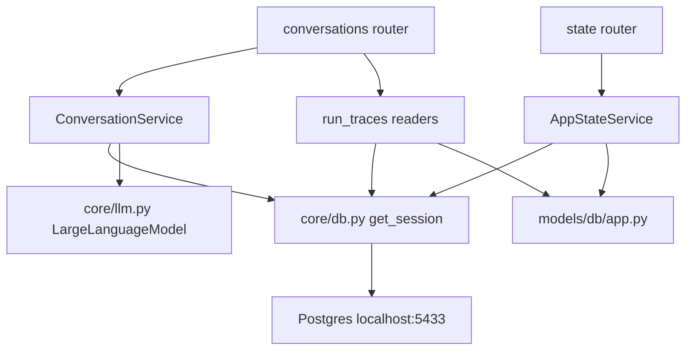

# Agent communication models

A chat turn is a conversation of messages plus a run that records what the agent did. `routers/conversations.py` (mounted at `/api`) exposes those rows as JSON; the chat routes in `routers/react_agent.py` write them while streaming SSE frames. `routers/state.py` (mounted at `/api/state`) mirrors the extension's local session cache and stores JSON settings.

This page covers the wire models: request bodies, response payloads, stream frames and status codes. The tables behind them are on [Conversations and Run Traces](Conversations%20and%20Run%20Traces).

Key capabilities:
- Create, list, read and append to conversations
- List the runs for a conversation and read one run with its event trace
- Store client context snapshots
- Replace or delete the extension's local session mirror
- Read and write arbitrary JSON settings per user
- SSE frames that carry server-owned conversation and run ids

## Repository layout

## Building blocks

- `routers/conversations.py`: eleven handlers. Bodies are inline Pydantic models: `CreateConversationRequest` (`title`, `client_id`, `metadata`), `AddMessageRequest` (`role`, `content`, `client_id`, `metadata`) and `ClientContextRequest` (`conversation_id`, `client_id`, `context_type`, `payload`).
- `services/conversations.py`: `ConversationService` plus `new_id(prefix)`, which returns `prefix_<uuid4hex>`. Ids are `conv_...` and `msg_...`. `DEFAULT_USER_ID = "default"`.
- `services/run_traces.py`: `RunTraceService` for writes, and module functions `get_run`, `list_runs_for_conversation`, `list_run_events`, `list_subagent_runs`, `list_tool_calls` for reads. Ids are `run_...`, `subrun_...`, `tool_...`, `evt_...`.
- `routers/state.py`: six routes over `AppStateService`, with `SessionsPayload` (`sessions: list[dict]`) and `SettingPayload` (`value: dict`).

## How it fits together

The conversation service is the write path used by chat, browser runtime and the conversation routes themselves. Reads go through the same class. Every method opens its own session with `get_session()`, which commits on clean exit and rolls back on exception.

The conversation payload is built by `_conversation_payload`: `conversation_id`, `client_id`, `title`, `summary`, `status`, `metadata`, `created_at`, `updated_at`. Message payloads from `_message_payload`: `message_id`, `conversation_id`, `client_id`, `role`, `content`, `metadata`, `created_at`. Timestamps are ISO strings.

## Conversation endpoints

All paths below are relative to the `/api` mount.

| Method | Path | Handler | Input | Response |
| --- | --- | --- | --- | --- |
| POST | `/conversations` | `create_conversation` | body + `user_id` query | `{"conversation_id", "title"}` |
| GET | `/conversations` | `list_conversations` | `user_id` query | `{"conversations": [...]}` |
| GET | `/conversations/{conversation_id}` | `get_conversation` | path | conversation payload |
| GET | `/conversations/{conversation_id}/messages` | `list_messages` | `limit` 1 to 500 | `{"messages": [...]}` |
| POST | `/conversations/{conversation_id}/messages` | `add_message` | body + `user_id` | `{"message_id"}` |
| GET | `/conversations/{conversation_id}/runs` | `list_conversation_runs` | path | `{"runs": [...]}` |
| POST | `/client-context` | `store_client_context` | body + `user_id` | `{"context_id"}` |
| GET | `/runs/{run_id}` | `read_run` | path | run payload |
| GET | `/runs/{run_id}/events` | `read_run_events` | path | `{"events": [...]}` |
| GET | `/runs/{run_id}/subagents` | `read_run_subagents` | path | `{"subagents": [...]}` |
| GET | `/runs/{run_id}/tool-calls` | `read_run_tool_calls` | path | `{"tool_calls": [...]}` |

Status codes are uniform:

- 404 for a missing conversation or run, raised before the generic catch.
- 422 for an out of range `limit`.
- 500 for any other exception, with `str(exc)` as `detail`.
- 200 with an empty list when a conversation or run exists but has no children. Missing parents are only checked on `GET /conversations/{id}` and `GET /runs/{id}`.

### Title generation

`add_message` checks the conversation title when `role == "user"`. If the stored title is still `New Conversation`, it calls `generate_chat_title(content)` before inserting the message, then writes the generated title in the same transaction that updates `updated_at`.

`generate_chat_title` reads the `llm.chat_title` setting from `AppStateService` and falls back to `chat_title_llm_provider`, `chat_title_llm_model` and `chat_title_llm_temperature`. The model call runs in a worker thread with `anyio.to_thread.run_sync`, so it does not block the loop. The prompt caps input at 4,000 characters and asks for at most six words.

### Reading history

`list_messages` orders ascending by `created_at` and limits. `recent_history` orders descending, takes `limit`, then reverses, which is what chat uses to feed the agent. The default limit for `recent_history` is 20, but chat passes the compaction setting instead.

## Run trace payloads

A run payload from `get_run`:

| Field | Type | Notes |
| --- | --- | --- |
| `run_id` | str | `run_<hex>` |
| `conversation_id` | str | parent conversation |
| `user_message_id` | str or null | message that started the run |
| `final_message_id` | str or null | assistant message written at completion |
| `client_id` | str | defaults to `unknown` |
| `entrypoint` | str | `react_agent` by default, `browser_runtime` for browser runs |
| `status` | str | `running`, `completed`, `failed` |
| `final_answer` | str or null | full answer text |
| `error` | str or null | failure text |
| `started_at` | str | ISO timestamp |
| `completed_at` | str or null | ISO timestamp |

Event payloads add `event_id`, `subagent_run_id`, `event_type` and `payload`. Subagent payloads add `subagent_run_id`, `name`, `task`, `status`, `result`, `started_at`, `completed_at`. Tool call payloads add `tool_call_id`, `tool_name`, `args`, `status`, `result`, `error` and timestamps.

`RunTraceService.record_event` is where trace rows come from. It inspects `payload["event"]`:

- `subagent_started` inserts a `SubagentRun` with a new id and remembers it by `subagent` name.
- `subagent_completed` closes that subagent with `result` and `completed_at`.
- `subagent_tool_call` inserts a `ToolCall` with `status="running"` and remembers it by `(subagent, tool)`.
- `subagent_tool_result` and `subagent_tool_error` close that call as `completed` or `failed`, storing `{"result": ...}` or `error`.
- Every event, including the four above, is also appended to `agent_events`.

## Chat stream frames

`POST /api/genai/react/stream` accepts `CrawlerRequest` and returns `StreamingResponse` with `Cache-Control: no-cache`, `Connection: keep-alive` and `X-Accel-Buffering: no`. Frames are written by `_sse_event(event_name, payload)` as `event: <name>` plus a JSON `data:` line.

The `conversation` frame carries `conversation_id`, `run_id` and `title`, which is how the side panel learns the server-owned ids. Other names include `run_started`, `compaction`, `subagent_started`, `thinking_delta`, `answer_delta`, `subagent_completed`, tool events, `final` and `error`.

Streaming failures stay at HTTP 200 because headers were already sent. The generator emits one `error` frame with `{"event": "error", "message": str(exc)}` and, when a run row exists, records an `error` event.

## Client context endpoint

`POST /api/client-context` stores a `ClientContextSnapshot` with a `ctx_<hex>` id and returns `{"context_id": ...}`. `context_type` defaults to `generic`. The chat service calls the same `store_context_snapshot` method directly when a request carries `client_context`, so this route exists for clients that want to record context outside a chat turn.

## State endpoints

Mounted at `/api/state` from `routers/state.py`. These mirror the extension's local session cache and store JSON settings.

| Method | Path | Handler | Body | Response |
| --- | --- | --- | --- | --- |
| GET | `/sessions` | `list_sessions` | `user_id` query | `{"sessions": [...]}` |
| PUT | `/sessions` | `replace_sessions` | `{"sessions": [...]}` | `{"ok": true}` |
| DELETE | `/sessions/{session_id}` | `delete_session` | `user_id` query | `{"ok": true}` |
| GET | `/settings/{key}` | `get_setting` | `user_id` query | `{"key", "value"}` |
| PUT | `/settings/{key}` | `set_setting` | `{"value": {...}}` | `{"ok": true}` |
| DELETE | `/settings/{key}` | `delete_setting` | `user_id` query | `{"ok": true}` |

`GET /settings/{key}` returns `{"key": key, "value": null}` when the key is absent. It does not 404.

`PUT /sessions` is a destructive replace, not a merge. `replace_sessions` deletes every `browser_session_messages` row for the user, then every `browser_sessions` row, then re-inserts what the client sent. Sessions without an `id` and messages without an `id` are skipped. `updatedAt` and `timestamp` are parsed by `_parse_dt`; unparseable values become `datetime.now(timezone.utc)`.

Session payloads use camelCase on purpose because they feed the extension state directly: `id`, `title`, `updatedAt`, `messages` with `id`, `role`, `content`, `timestamp` and optional `events`.

## Dependencies

External packages: `fastapi>=0.115.0`, `sqlalchemy[asyncio]>=2.0`, `asyncpg>=0.29`, `anyio` (pulled in by FastAPI) and `pydantic>=2.9.0`.

## Performance

- Every service method opens a fresh session; there is no request-scoped session. Keep list calls coarse rather than looping per message.
- `list_conversations` has no limit. It reads every conversation for the user ordered by `updated_at` descending, which the index on that column supports.
- `list_messages` is capped at 500 by the query parameter validator.
- `list_run_events` and the run readers have no limit. A long supervisor run can return thousands of tool call rows.
- Title generation costs one model call per conversation, only while the title is still the default. The call is off the event loop.
- `PUT /sessions` deletes and re-inserts the whole cache in one transaction. Large caches mean large transactions.

## Troubleshooting

- Duplicate `message_id` on `PUT /sessions`: the client sent the same message id twice. The table primary key rejects the second insert and the whole replace rolls back.
- Sessions disappear after a sync: `PUT /sessions` replaced the server set with what the client posted. There is no merge path.
- Title stays `New Conversation`: the first user message may have arrived through a path that did not call `add_message` with `role="user"`, or title generation returned an empty string and the fallback was also empty.
- `GET /runs/{run_id}/tool-calls` misses parallel calls to the same tool: `_open_tool_calls` is keyed by `(subagent_name, tool_name)`, so a second call with the same pair overwrites the first key and the first result closes the second row.
- Run stuck in `running`: `complete_run` never ran. Check the server log for an exception after `create_run`; `ReactAgentService` marks failed only when it still holds the trace object.
- `GET /api/state/settings/{key}` returns null for a key the UI shows as set: settings are per `user_id`; a non-default `user_id` on write and the default on read look at different rows.

## Appendix

### Implementation examples
- Id generation: `new_id("conv")` returns `conv_<32 hex chars>`.
- Conversation payload: `_conversation_payload` in `services/conversations.py`.
- Run readers: `list_runs_for_conversation`, `list_run_events`, `list_subagent_runs`, `list_tool_calls` in `services/run_traces.py`.
- Session replace: `AppStateService.replace_sessions` in `services/app_state.py`.
- Setting upsert: `AppStateService.set_setting` selects by `(user_id, key)`, updates in place or inserts.

### Source files
- `routers/conversations.py`
- `services/conversations.py`
- `services/run_traces.py`
- `routers/state.py`
