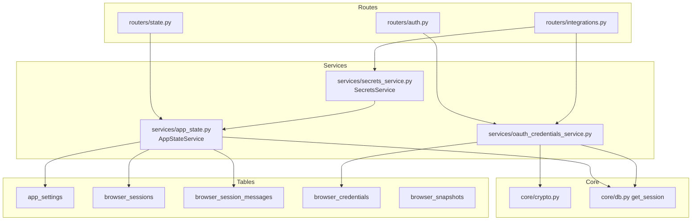
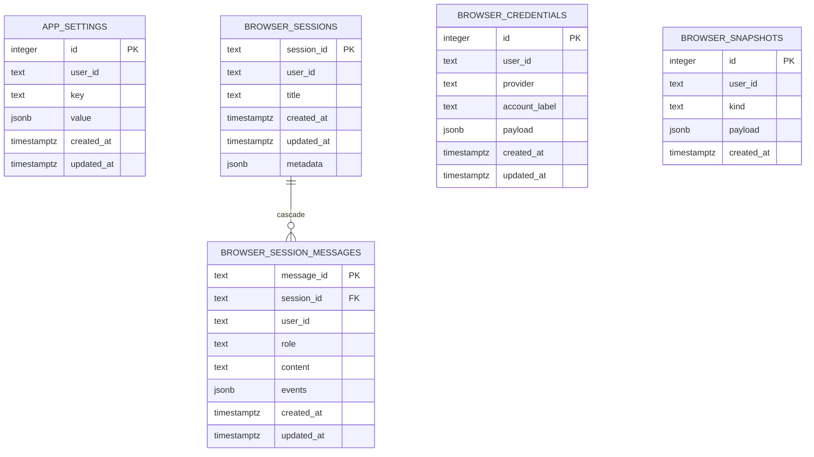
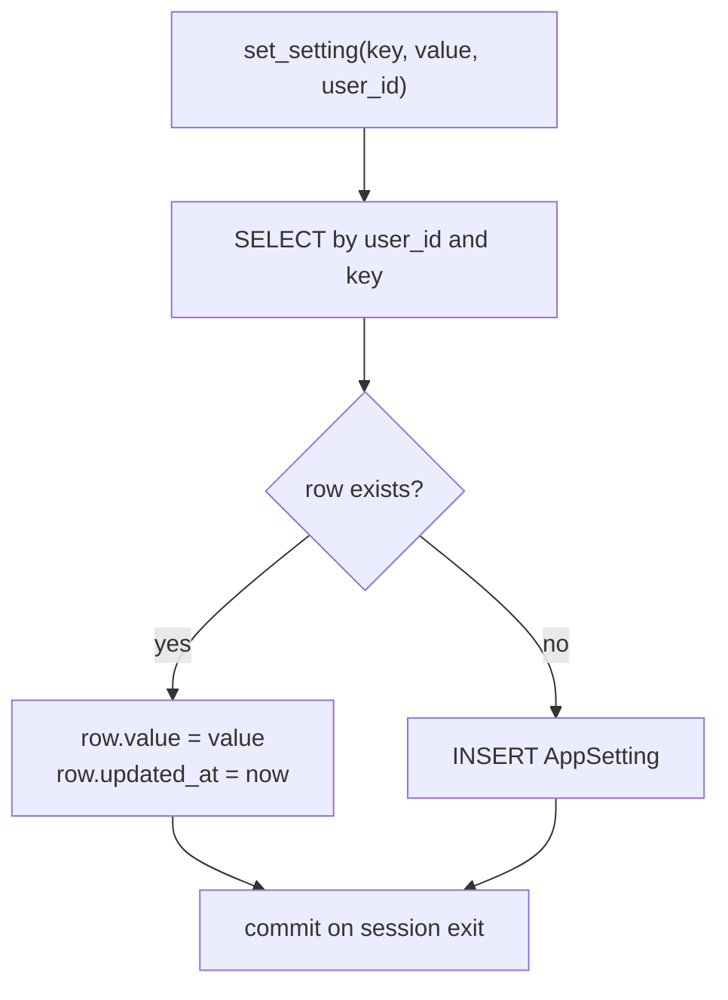
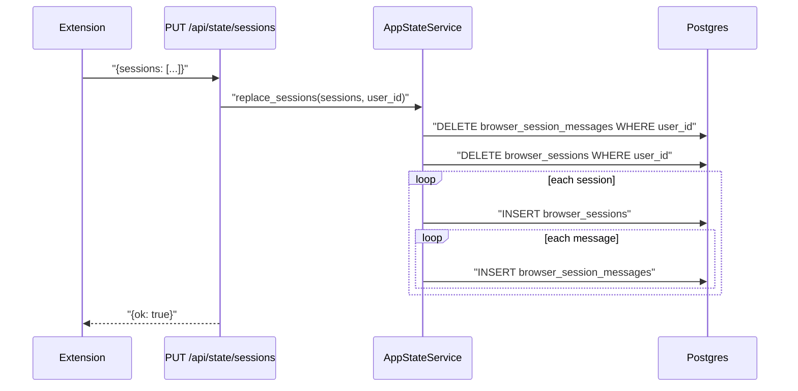
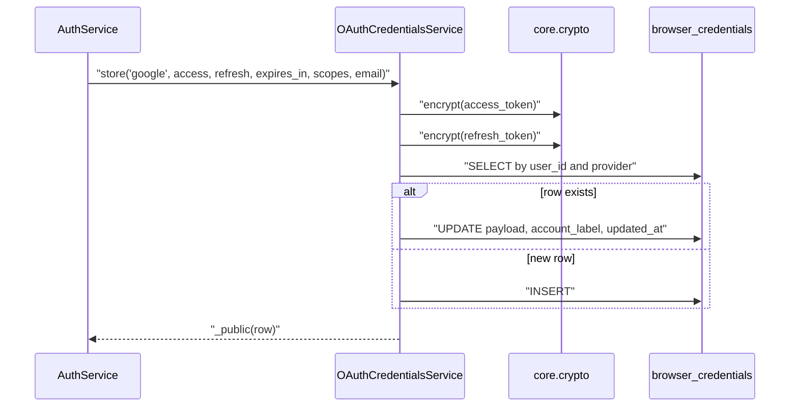
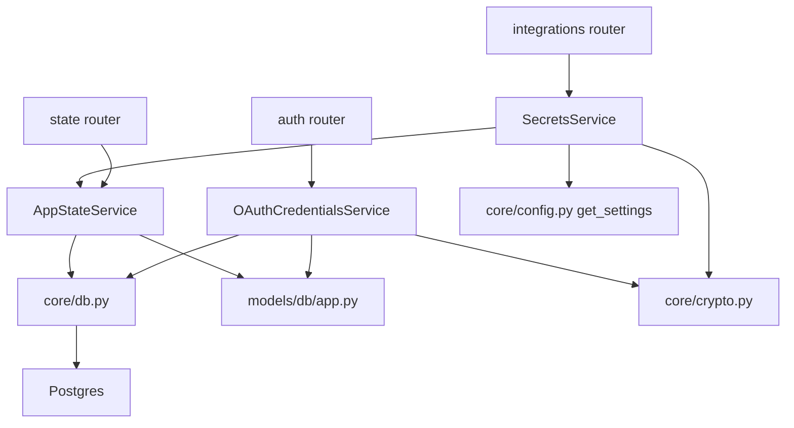

# Application state and credentials

Five tables hold state that is not a conversation: `app_settings` for key-value configuration, `browser_sessions` and `browser_session_messages` for the extension's chat cache, `browser_credentials` for encrypted OAuth payloads, and `browser_snapshots` for captured payloads. All are declared in `models/db/app.py` and created by migration 0001.

Writes go through `AppStateService` for settings and sessions, `OAuthCredentialsService` for credentials, and `SecretsService` as the encrypted layer above `AppSetting`.

Key capabilities:
- One JSONB value per `(user_id, key)`
- Upsert semantics for settings
- A destructive replace path for the session mirror
- AES-encrypted OAuth payloads with refresh metadata
- A public projection that never returns tokens
- Unique constraints that make each pair single-valued

## Repository layout

## Building blocks

- `models/db/app.py`: `AppSetting`, `BrowserSession`, `BrowserSessionMessage`, `BrowserCredential`, `BrowserSnapshot`, and `utcnow()`.
- `services/app_state.py`: `AppStateService` with session and setting methods, `_parse_dt`, `_session_to_payload`, `DEFAULT_USER_ID = "default"`.
- `services/oauth_credentials_service.py`: `OAuthCredentialsService`, `NeedsReauth`, `PROVIDER_ALIASES`, `resolve_google_token_optional`, `get_oauth_credentials_service`.
- `services/secrets_service.py`: `SECRET_REGISTRY`, `SecretsService`, `mask`, `get_secrets_service`.

## Columns and constraints

`app_settings`:

| Column | Type | Null | Notes |
| --- | --- | --- | --- |
| `id` | BIGSERIAL | no | PK |
| `user_id` | TEXT | no | default `default`, indexed |
| `key` | TEXT | no | indexed |
| `value` | JSONB | no | default `{}` |
| `created_at` | TIMESTAMPTZ | no | `utcnow()` |
| `updated_at` | TIMESTAMPTZ | no | `utcnow()` |

Unique constraint `uq_app_settings_user_key` on `(user_id, key)`. Migration 0001 also creates `ix_app_settings_user_id` and `ix_app_settings_key`.

`browser_sessions` uses `session_id` TEXT as PK, plus `user_id`, `title` default `New Chat`, `created_at`, `updated_at` and `metadata` JSONB. Indexes: `user_id` and `updated_at DESC`.

`browser_session_messages` uses `message_id` TEXT as PK, `session_id` FK with `ON DELETE CASCADE`, `user_id`, `role`, `content` TEXT, `events` JSONB default `[]`, `created_at`, `updated_at`. Indexes: `session_id`, `user_id`, `created_at`.

`browser_credentials` uses `id` BIGSERIAL, `user_id`, `provider`, `account_label`, `payload` JSONB, timestamps, with unique `uq_browser_credentials_user_provider` on `(user_id, provider)` and indexes on `user_id` and `provider`.

`browser_snapshots` uses `id` BIGSERIAL, `user_id`, `kind`, `payload` JSONB and `created_at`, with indexes on `user_id`, `kind` and `created_at DESC`.

## Settings key layout

`AppSetting` has no schema; the key naming is the schema. These prefixes are used by the services on this page and by integrations:

| Key pattern | Owner | Value shape |
| --- | --- | --- |
| `secrets.{name}` | `SecretsService` | `{"value": "<encrypted>"}` |
| `oauth_clients.{provider}` | `SecretsService` | `{"client_id": "<enc>", "client_secret": "<enc>"}` |
| `pyjiit.credentials` | `SecretsService` | `{"username": "<enc>", "password": "<enc>"}` |
| `composio.config` | `SecretsService` | `{"api_key": "<enc>", "user_id": "<enc>"}` |
| `llm.default` | integrations router | `{provider, model, temperature}` |
| `llm.chat_title` | integrations router | same shape |
| `voice.config` | integrations router | voice fields |
| `compaction.config` | `services/compaction.py` | compaction settings |

`value` is always an object, never a bare string. That is why `SettingPayload` in `routers/state.py` declares `value: dict[str, Any]`.

## How it fits together

`AppStateService.get_setting` returns the JSONB value or `None`. It does not distinguish a missing row from a stored JSON `null`, but the non-null column makes that unlikely. `set_setting` performs a read then update-or-insert inside one session, so two concurrent writers can still race to insert; the unique constraint then rejects the loser.

`replace_sessions` is the mirror sync used by the extension. It deletes all messages for the user, deletes all sessions for the user, then inserts the posted list. Message ids and session ids are taken from the payload; missing ids are skipped.

`list_sessions` reads sessions ordered by `updated_at` descending, then all messages for the user ordered by `created_at`, groups them by `session_id` in Python, and sorts each group by `(created_at, message_id)`. The payload uses camelCase `updatedAt` and message `timestamp` to match the extension state.

## Credential payload

`browser_credentials.payload` is a JSON object written by `OAuthCredentialsService.store`:

| Field | Encrypted | Meaning |
| --- | --- | --- |
| `access_token` | yes | bearer token |
| `refresh_token` | yes | refresh token, empty string when absent |
| `expires_at` | no | ISO timestamp or null |
| `scopes` | no | granted scope list |
| `account_email` | no | profile email or login |
| `status` | no | `active` or `needs_reauth` |
| `last_refreshed_at` | no | ISO timestamp |

`account_label` mirrors `account_email` as a plain column for display. `_public` exposes `provider`, `account_email`, `status`, `scopes`, `expires_at`, `last_refreshed_at` and `connected_at` (`created_at`). It never includes the payload.

When a provider returns no new refresh token, an existing one is preserved by copying the stored encrypted value into the new payload. That matters for Google, which issues a refresh token only on first consent.

## Access token resolution

`get_access_token` is the read path used by Gmail, Calendar and the agent. It canonicalises the provider, loads the row, raises `NeedsReauth` when the row is missing or marked `needs_reauth`, and refreshes Google tokens when the expiry is within 60 seconds. A failed refresh writes `status: "needs_reauth"` before raising.

`_is_expired` returns false when there is no `expires_at`, true when the timestamp cannot be parsed, and true when the expiry is within 60 seconds. `_refresh_google` reads the client id and secret from `SecretsService`, posts a refresh grant with a 10 second timeout, and returns a new payload with an encrypted access token and updated `last_refreshed_at`.

`resolve_google_token_optional` wraps the call and returns `None` on `NeedsReauth` or any unexpected error, which is what chat uses so a missing Google connection does not fail a turn.

## Snapshots

`browser_snapshots` has no service wrapper in the code read here. It stores `kind` plus a JSONB `payload` and is indexed for lookups by user, kind and newest first. Writes would use the same `get_session()` pattern; no route in the backend currently exposes it.

## Dependencies

External packages: `fastapi>=0.115.0`, `sqlalchemy[asyncio]>=2.0`, `asyncpg>=0.29`, `pycryptodome>=3.23.0` behind `core/crypto.py`, `pydantic>=2.9.0`.

## Performance

- Setting reads and writes are single-row operations on a unique index. They are cheap.
- `list_sessions` loads every message for the user, not just messages of the listed sessions, then groups in Python. On a large cache this is the dominant cost of the state routes.
- Credential reads decrypt only the access token in `get_access_token`; `list_all` and `status` decrypt nothing.
- Google refresh happens inline on the request that discovers expiry and can add up to 10 seconds.

## Troubleshooting

- `duplicate key value violates unique constraint "uq_app_settings_user_key"`: two writers inserted the same key concurrently. Retry, or route writes through one process.
- A secret is set in the UI but code reads empty: `SecretsService.get_raw` returns `None` when `CryptoNotConfigured`, which happens when `oauth_encryption_key` is missing or malformed. Set the key and re-save the secret.
- Token decrypt fails after changing the encryption key: ciphertext from the old key cannot be read. Delete the credential row and reconnect.
- Sessions vanish on the next sync: `PUT /api/state/sessions` replaces, never merges.
- Message order flips for same-timestamp rows: this service breaks ties by `message_id`, so lexicographic id order decides.

## Appendix

### Implementation examples
- Setting upsert: `AppStateService.set_setting` in `services/app_state.py`.
- Session payload: `_session_to_payload` returns `id`, `title`, `updatedAt`, `messages`.
- Credential encryption: `payload["access_token"] = encrypt(access_token)` in `OAuthCredentialsService.store`.

### Source files
- `models/db/app.py`
- `services/app_state.py`
- `services/oauth_credentials_service.py`
- `services/secrets_service.py`
