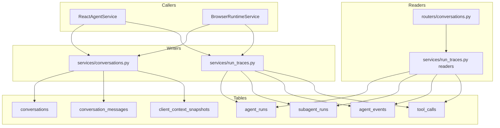
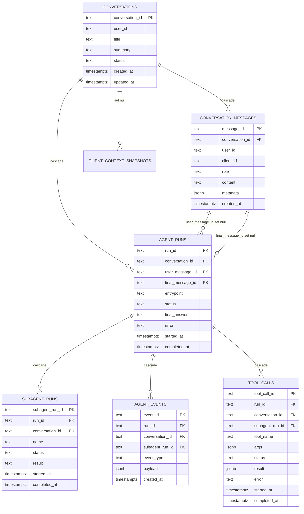
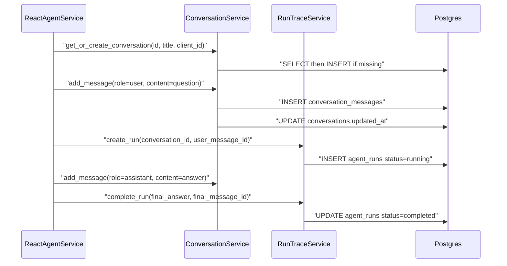
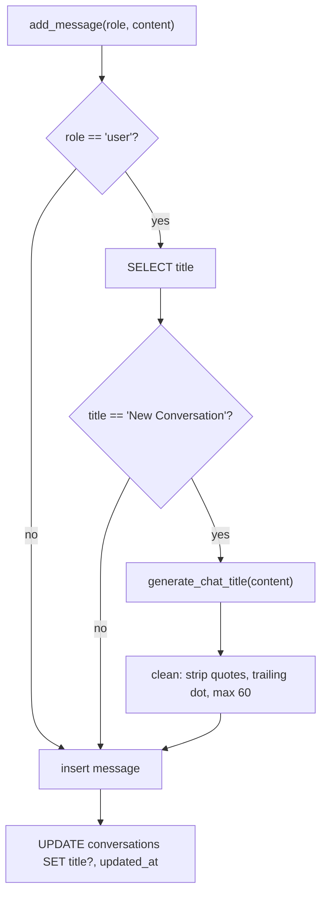
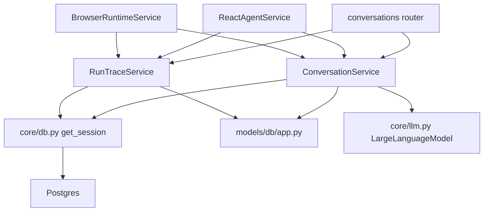

# Conversations and run traces

Six tables carry a chat turn: `conversations`, `conversation_messages`, `agent_runs`, `subagent_runs`, `agent_events` and `tool_calls`. A seventh, `client_context_snapshots`, stores the client payload attached to a turn.

The write path is `ConversationService` for chat rows and `RunTraceService` for trace rows. The read path is the same services plus the direct readers in `services/run_traces.py`, exposed by `routers/conversations.py`.

This page covers the table shapes and the write path. The HTTP payloads built from these rows are on [Agent Communication Models](Agent%20Communication%20Models).

Key capabilities:
- Conversation and message ids generated in Python with prefixes
- Cascading deletes from a conversation down to events and tool calls
- Optional links from a run to its first user message and final assistant message
- An append-only event log per run
- Subagent and tool call rows closed by event name
- Client context snapshots that may outlive the conversation link

## Repository layout

## Building blocks

- `models/db/app.py`: `Conversation`, `ConversationMessage`, `AgentRun`, `SubagentRun`, `AgentEvent`, `ToolCall`, `ClientContextSnapshot`.
- `services/conversations.py`: `new_id(prefix)`, `_now()`, payload builders, `ConversationService` and `generate_chat_title`.
- `services/run_traces.py`: `RunTraceService` with `create_run`, `complete_run` and `record_event`, plus five read functions.
- `routers/conversations.py`: the HTTP surface for both.

## Columns and keys

`conversations`:

| Column | Type | Null | Notes |
| --- | --- | --- | --- |
| `conversation_id` | TEXT | no | PK, `conv_<hex>` |
| `user_id` | TEXT | no | default `default` |
| `client_id` | TEXT | no | default `unknown` |
| `title` | TEXT | no | default `New Conversation` |
| `summary` | TEXT | yes | set by compaction |
| `status` | TEXT | no | default `active` |
| `metadata` | JSONB | no | merged by `update_metadata` |
| `created_at` | TIMESTAMPTZ | no | `utcnow()` |
| `updated_at` | TIMESTAMPTZ | no | touched on every message |

`conversation_messages` has `message_id` TEXT PK, `conversation_id` FK, `user_id`, `client_id`, `role`, `content` TEXT, `metadata` JSONB and `created_at`. There is no `updated_at` on messages.

`agent_runs` has `run_id` PK, `conversation_id` FK, optional `user_message_id` and `final_message_id` FKs to messages, `user_id`, `client_id`, `entrypoint` default `react_agent`, `status` default `running`, `final_answer`, `error`, `metadata` JSONB, `started_at` and `completed_at`.

`subagent_runs` has `subagent_run_id` PK, `run_id` FK, `conversation_id` FK, `name`, `task`, `status` default `running`, `result`, `started_at`, `completed_at`.

`agent_events` has `event_id` PK, `run_id` FK, `conversation_id` FK, optional `subagent_run_id` FK, `event_type`, `payload` JSONB and `created_at`.

`tool_calls` has `tool_call_id` PK, `run_id` FK, `conversation_id` FK, optional `subagent_run_id` FK, `tool_name`, `args` JSONB, `status` default `running`, `result` JSONB, `error` TEXT, `started_at`, `completed_at`.

## Indexes

These tables are created by migration 0002, not by `create_all`. Migration 0003 only adds memory indexes and triggers, so nothing in it touches chat or trace tables.

From migration 0002:

| Table | Index |
| --- | --- |
| `conversations` | `user_id`, `client_id`, `status`, `updated_at DESC` |
| `conversation_messages` | `conversation_id`, `user_id`, `client_id`, `role`, `created_at` |
| `agent_runs` | `conversation_id`, `user_message_id`, `final_message_id`, `user_id`, `client_id`, `status`, `started_at DESC` |
| `subagent_runs` | `run_id`, `conversation_id`, `name`, `status`, `started_at DESC` |
| `agent_events` | `run_id`, `conversation_id`, `subagent_run_id`, `event_type`, `created_at` |
| `tool_calls` | `run_id`, `conversation_id`, `subagent_run_id`, `tool_name`, `status`, `started_at DESC` |
| `client_context_snapshots` | `conversation_id`, `user_id`, `client_id`, `context_type`, `created_at DESC` |

The `(conversation_id, created_at)` pair is not a composite index. The planner combines the two single-column indexes or filters on one.

## How it fits together

A chat turn creates the conversation if needed, appends the user message, creates a run row, and later appends the assistant message and closes the run.

`get_or_create_conversation` reads first and inserts only when the id is missing. If the client supplies an id that exists, its title, client and user are not updated; only new messages and `updated_at` change.

Title generation uses the `llm.chat_title` override when present. It runs in a worker thread and falls back to the first 60 characters of the message when the model fails.

## Trace writes

`RunTraceService` is a per-run object holding two dictionaries: `_subagent_ids` by name and `_open_tool_calls` by `(subagent, tool)`. `record_event` branches on the event name, then always appends an `agent_events` row. `subagent_started` inserts a `subagent_runs` row; `subagent_completed` closes it; `subagent_tool_call` inserts a running `tool_calls` row; `subagent_tool_result` or `subagent_tool_error` closes it as completed or failed.

`complete_run` copies `status`, `final_answer`, `final_message_id`, `error` and sets `completed_at`. It does not check the current status, so a second call overwrites the first. `ReactAgentService` calls it once on success and once on failure paths.

## Read paths

`list_runs_for_conversation` reads `agent_runs` ordered by `started_at` descending, with no limit. `get_run` reads one run and returns null when missing. The route converts null to 404.

Event, subagent and tool call reads order ascending by `created_at` or `started_at`. None of them check that the parent run exists, so an unknown id returns an empty list with 200.

## Dependencies

External packages: `fastapi>=0.115.0`, `sqlalchemy[asyncio]>=2.0`, `asyncpg>=0.29`, `anyio` for title generation offload, `pydantic>=2.9.0`.

## Performance

- Every service method opens and commits its own session. One chat turn can open six or more sessions before the answer is stored.
- `list_runs_for_conversation` has no limit and reads full `final_answer` text for every run.
- Message reads use `created_at` indexes; the `list_messages` route caps at 500, `recent_history` at the compaction setting.

## Troubleshooting

- Duplicate conversation ids: `create_conversation` accepts a caller-supplied id and does not check for an existing row. Insert fails on the primary key, and the route returns 500.
- Messages appear in the wrong order: ordering is by `created_at` only. Two messages written in the same microsecond can order arbitrarily.
- Run detail shows no `final_message_id`: the assistant message insert and `complete_run` are separate transactions. A crash between them leaves the run completed without the link.
- A tool call stays `running`: `_open_tool_calls` is keyed by `(subagent_name, tool_name)`. A second call with the same pair overwrites the first entry, so the first result closes the second row and the first row never closes.
- `final_answer` is empty but `error` is set: the failed branch of `complete_run` writes `final_answer=""`.

## Appendix

### Implementation examples
- Ids: `new_id("conv")`, `new_id("msg")`, `_id("run")`, `_id("subrun")`, `_id("tool")`, `_id("evt")`.
- Run creation: `RunTraceService.create_run(conversation_id, user_message_id, client_id, user_id, entrypoint, metadata)`.
- Tool close: `call.status = "failed" if event_type == "subagent_tool_error" else "completed"`.

### Source files
- `models/db/app.py`
- `services/conversations.py`
- `services/run_traces.py`
- `routers/conversations.py`
