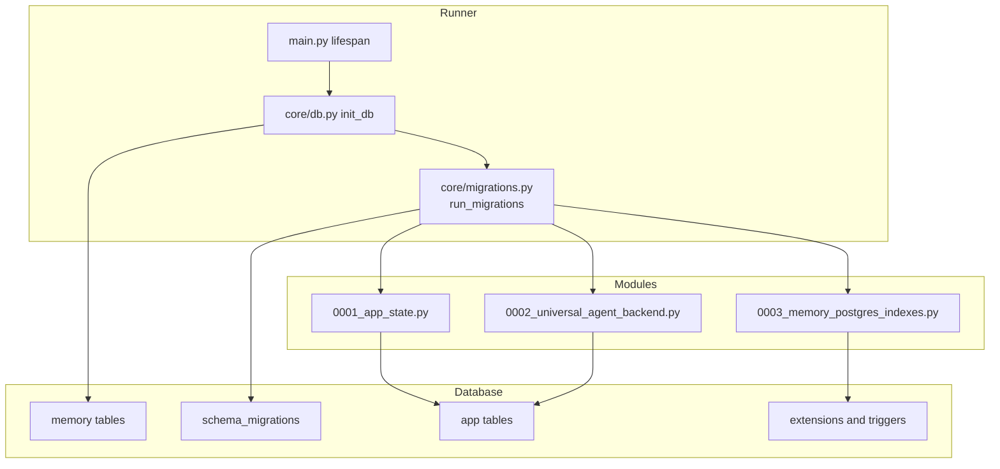
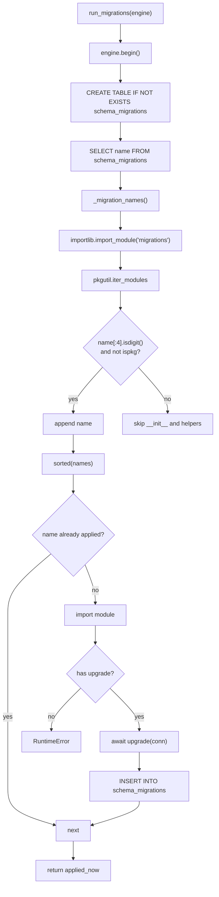
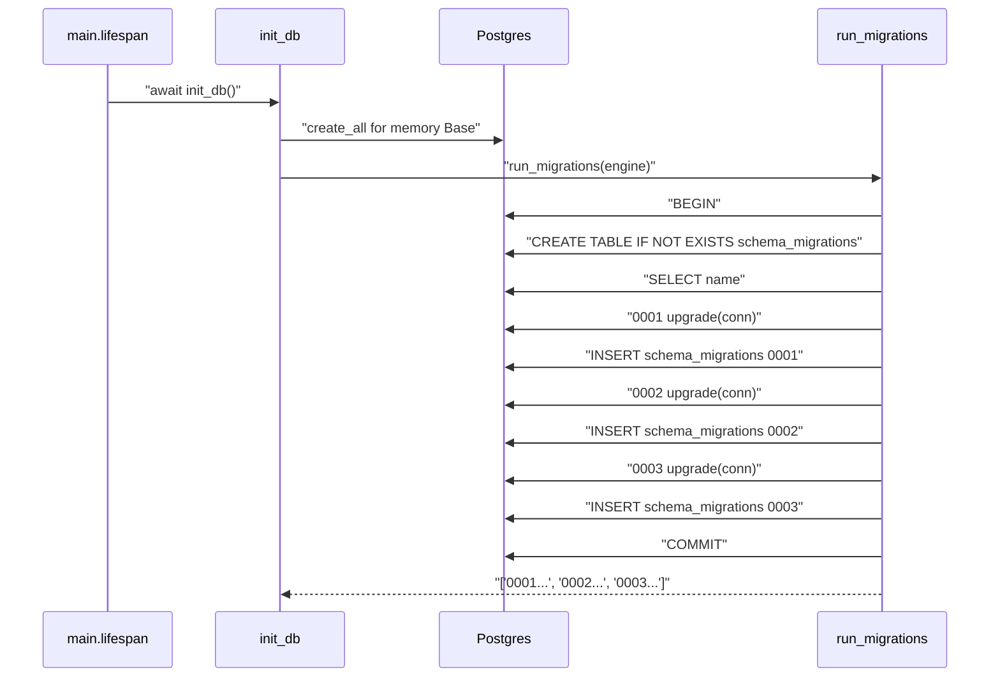
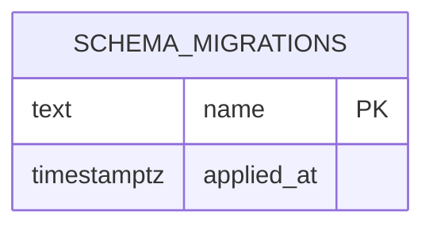
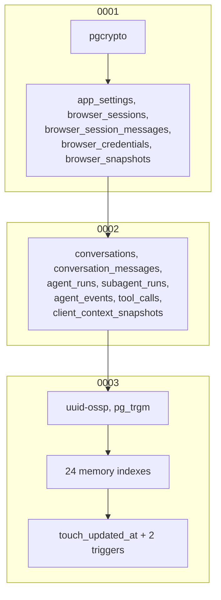
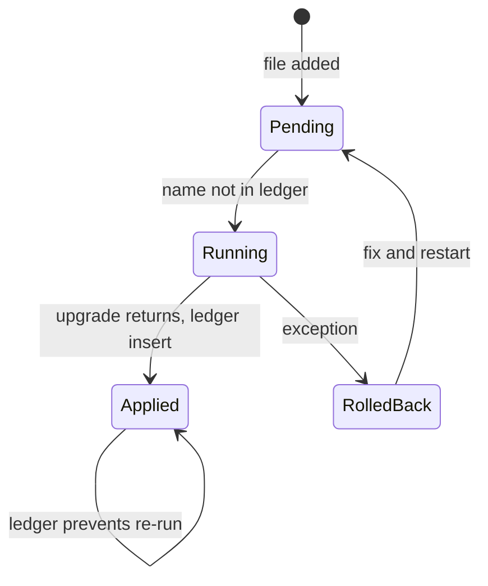
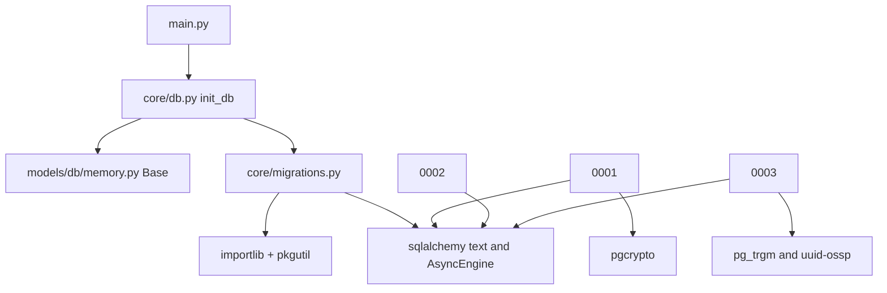

# Data migration strategy

Schema changes are numbered Python modules in `migrations/`. `core/migrations.py` discovers them, compares against a `schema_migrations` ledger, and runs each pending `upgrade(conn)` function once. There is no Alembic, no revision graph and no downgrade path.

Memory tables are not part of this system. `init_db()` creates them from SQLAlchemy metadata before migrations run. The migration files exist for the application schema, indexes and triggers that `create_all` cannot express.

Key capabilities:
- Filename ordered discovery with a four digit prefix
- A ledger table that records each applied module
- One transaction for the whole run
- Idempotent DDL through `IF NOT EXISTS`
- Extension creation for `pgcrypto`, `uuid-ossp` and `pg_trgm`
- A trigger function shared by two tables
- Forward-only changes

## Repository layout



## Building blocks

- `core/migrations.py`: `MIGRATION_PACKAGE = "migrations"`, `_migration_names()`, `run_migrations(engine)`.
- `core/db.py`: `init_db()` runs `Base.metadata.create_all` for the memory models, then `run_migrations(engine)`.
- `migrations/0001_app_state.py`: `pgcrypto`, `app_settings`, `browser_sessions`, `browser_session_messages`, `browser_credentials`, `browser_snapshots` and their indexes.
- `migrations/0002_universal_agent_backend.py`: `conversations`, `conversation_messages`, `agent_runs`, `subagent_runs`, `agent_events`, `tool_calls`, `client_context_snapshots` and their indexes.
- `migrations/0003_memory_postgres_indexes.py`: `uuid-ossp`, `pg_trgm`, 24 memory indexes, `touch_updated_at()` and two triggers.

## How it fits together

Discovery reads the package path with `pkgutil.iter_modules`, keeps module names whose first four characters are digits and that are not packages, and sorts them. Sorting is lexicographic, which works because every name has four digits.



The whole loop runs inside a single `async with engine.begin()`. On Postgres, DDL is transactional, so a failure in migration 0003 rolls back the pending changes from 0001 and 0002 in the same run, including their ledger inserts. Migrations already committed in an earlier run stay applied.



## Ledger



`name` is the module name without `.py`, for example `0001_app_state`. `applied_at` defaults to `now()`. The runner only ever inserts; it never updates or deletes ledger rows. Removing a migration file after it has run does not remove its ledger row, and re-adding it with the same name does not re-run it.

## What each migration does

### 0001 app state

Creates the extension `pgcrypto` and five tables. Every `CREATE TABLE` uses `IF NOT EXISTS`; every table has `TIMESTAMPTZ` timestamps with `now()` defaults. Unique constraints:

- `uq_app_settings_user_key` on `(user_id, key)`
- `uq_browser_credentials_user_provider` on `(user_id, provider)`

Indexes include `ix_browser_sessions_updated_at` descending and `ix_browser_snapshots_created_at` descending.

### 0002 universal agent backend

Creates seven tables with foreign keys and cascade rules:

- `conversation_messages.conversation_id` references `conversations` with `ON DELETE CASCADE`.
- `agent_runs.conversation_id` cascades; `user_message_id` and `final_message_id` use `ON DELETE SET NULL`.
- `subagent_runs.run_id` and `conversation_id` cascade.
- `agent_events.run_id` and `conversation_id` cascade; `subagent_run_id` sets null.
- `tool_calls.run_id` and `conversation_id` cascade; `subagent_run_id` sets null.
- `client_context_snapshots.conversation_id` sets null.

Indexes cover every foreign key plus status, name, type and descending time columns.

### 0003 memory indexes and triggers

Creates `uuid-ossp` and `pg_trgm`, then indexes the memory tables created by `create_all`. It does not create the memory tables themselves. If `create_all` did not run because Postgres was down, this migration fails on the first `CREATE INDEX` against a missing table.

Index groups:

| Table | Count | Kinds |
| --- | --- | --- |
| `sources` | 3 | source type, external id, created at |
| `artifacts` | 1 | source id |
| `entities` | 4 | type, canonical name, aliases GIN, name trigram GIN |
| `claims` | 9 | status, tier, segment, class, subject, validity pair, last access, importance desc, text trigram GIN |
| `evidence` | 2 | claim, source |
| `claim_relations` | 2 | from, to |
| `retrieval_log` | 2 | claim, created at |
| `feedback_events` | 1 | claim |

It also creates `touch_updated_at()` and drops then recreates `trg_entities_updated_at` and `trg_claims_updated_at`. The drop makes the trigger portion re-runnable, though the ledger still prevents a second run.



## Writing a new migration

The contract is one async function:

```python
async def upgrade(conn: AsyncConnection) -> None:
    await conn.execute(text("..."))
```

Rules the existing files follow and a new one should keep:

- Name it with a four digit prefix and a snake_case suffix, like the existing `0001_app_state.py`. Discovery ignores anything else.
- Use `IF NOT EXISTS` on every create so a re-run against a partially migrated database is safe.
- Keep it forward-only. There is no `downgrade`.
- Do not import application services. The runner passes a raw `AsyncConnection`.
- Order statements so later statements can depend on earlier ones in the same file.
- Prefer adding indexes with explicit names so a later drop or replace can target them.

`run_migrations` raises `RuntimeError(f"Migration {name} has no upgrade(conn) function")` when a numbered module lacks `upgrade`. That fails startup after the transaction rolls back; `main.py` logs `Postgres init skipped` only if `init_db()` itself is caught, which it is in the lifespan.

## Failure and recovery



Recovery is manual. Read the startup log for the failing module, fix the statement, and restart. Because the run is one transaction, a failure before 0003 leaves the app tables uncreated in that run. If an earlier run had committed 0001, only the new module reruns.

There is no checksum. Editing an already applied module has no effect on an existing database; the change only reaches fresh databases. That is the main drift risk in this design.

## Dependencies



External packages: `sqlalchemy[asyncio]>=2.0` and `asyncpg>=0.29`. The Postgres server must allow `CREATE EXTENSION`, which needs superuser or a trusted extension setup.

## Performance

- The runner imports every migration module on every startup, even applied ones, because it imports to inspect `upgrade` only for pending names. The discovery scan itself is cheap.
- All pending migrations run in one transaction. On a large existing database, 0003 builds 24 indexes in a single transaction, which holds locks for the duration.
- `CREATE INDEX` without `CONCURRENTLY` blocks writes to the indexed table. The memory tables are small during first install, which is the intended window.
- `CREATE EXTENSION IF NOT EXISTS pg_trgm` is fast when present, and a no-op check otherwise.
- The ledger read is a full scan of a tiny table. There is no index beyond the primary key on `name`.

## Troubleshooting

- `relation "claims" does not exist` in 0003: the memory `create_all` step did not run. Check the `Postgres init skipped` log line and restart with Postgres reachable.
- `permission denied to create extension "pg_trgm"`: the database user is not allowed to install extensions. Install it as a superuser or use a managed Postgres that provides it.
- A new migration never runs: the filename does not start with four digits, it is a package directory, or a ledger row with the same name already exists.
- `Migration NNNN has no upgrade(conn) function`: the module is missing `async def upgrade`. Add it or rename the file so it is not discovered.
- Migration changes do not appear in an existing database: the module was edited after it was applied. Add a new numbered module instead of editing history.
- Startup continues with no tables: the lifespan catches exceptions from `init_db()` and logs a warning. The API starts, but every database route fails. Check the log, not the HTTP status.
- Duplicate index error after a manual partial run: the index exists but the ledger row does not. Either drop the index and rerun, or insert the ledger row if the schema is complete.

## Appendix

### Implementation examples
- Discovery: `names.append(module.name)` when `module.name[:4].isdigit() and not module.ispkg`.
- Ledger read: `applied = {row[0] for row in result.fetchall()}`.
- Apply: `await upgrade(conn)` then `INSERT INTO schema_migrations (name) VALUES (:name)`.
- Startup: `async with engine.begin() as conn: await conn.run_sync(Base.metadata.create_all)` then `await run_migrations(engine)`.
- Idempotent table: `CREATE TABLE IF NOT EXISTS app_settings (...)`.
- Trigger reset: `DROP TRIGGER IF EXISTS trg_claims_updated_at ON claims` before create.

### Source files
- `core/migrations.py`
- `migrations/0001_app_state.py`
- `migrations/0002_universal_agent_backend.py`
- `migrations/0003_memory_postgres_indexes.py`
