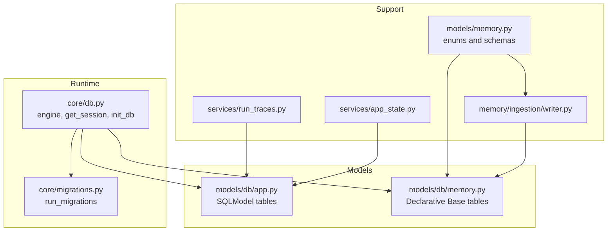
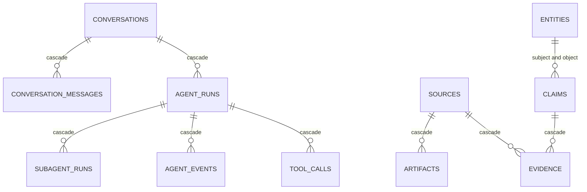
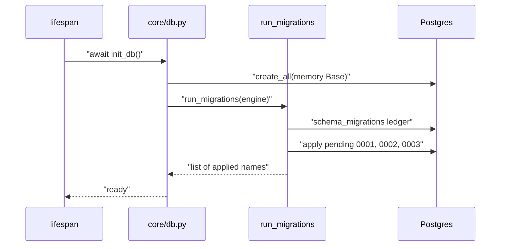
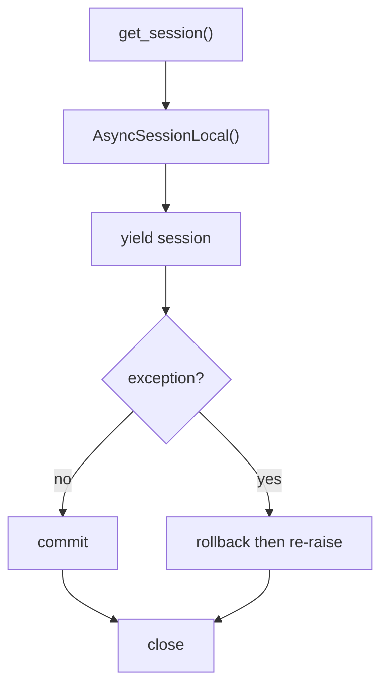
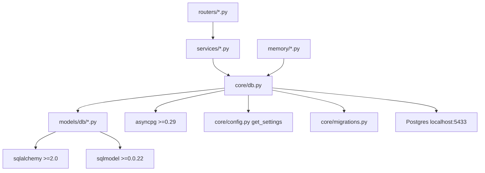

# Data models and schemas

The backend keeps its durable state in one Postgres database with two families of tables. Application tables (conversations, runs, sessions, settings, credentials) are SQLModel classes in `models/db/app.py`. Memory tables (sources, artifacts, entities, claims, evidence) are SQLAlchemy declarative classes in `models/db/memory.py`. Both share the async engine and session factory in `core/db.py`.

A numbered migration runner in `core/migrations.py` creates the application tables and the memory indexes. The memory tables themselves are created from model metadata on every startup.

This page is the folder index. It describes the two schemas, the shared persistence rules, and every page in this folder.

Key capabilities:
- Two model modules, one engine, one session factory
- String ids for app rows, UUID ids for memory rows
- JSONB for metadata, settings values and credential payloads
- Timezone-aware timestamps on every table
- A lightweight migration ledger in `schema_migrations`
- Cascading deletes from conversations down to events and tool calls

## Repository layout

## Pages in this folder

| Page | One line |
| --- | --- |
| [Schema Overview](Schema%20Overview) | both table families, column types, keys and indexes |
| [Conversations and Run Traces](Conversations%20and%20Run%20Traces) | messages, runs, events, subagent runs and tool calls |
| [Application State and Credentials](Application%20State%20and%20Credentials) | sessions, JSONB settings and encrypted credential payloads |
| [Memory Entities and Claims](Memory%20Entities%20and%20Claims) | sources, artifacts, entities, claims, evidence and relations |
| [Memory Search and Graph Stores](Memory%20Search%20and%20Graph%20Stores) | the OpenSearch and Neo4j stores and how they mirror Postgres |
| [Data Migration Strategy](Data%20Migration%20Strategy) | discovery, ledger, idempotency, extensions and triggers |
| [Agent Communication Models](Agent%20Communication%20Models) | conversation and run HTTP payloads, SSE frames and state routes |
| [Service Integration Models](Service%20Integration%20Models) | the mounted route groups and the request bodies they accept |
| [Validation and Error Handling](Validation%20and%20Error%20Handling) | gate rules, reconcile decisions and the validation error map |
| [YouTube Data Models](YouTube%20Data%20Models) | video metadata, transcript cleanup and the stateless YouTube route |
| [Data Models and Schemas](Data%20Models%20and%20Schemas) | this folder map and the shared persistence rules |

## Shared concepts

- One engine. `create_async_engine(get_settings().postgres_dsn, pool_size=10, max_overflow=20, pool_pre_ping=True)`. The DSN points at `postgres_host`, port 5433, database `agentic_memory`.
- One session pattern. `get_session()` commits on clean exit and rolls back on exception. Services open their own sessions; routers do not receive one.
- Two id styles. App tables use prefixed strings (`conv_`, `msg_`, `run_`, `subrun_`, `tool_`, `evt_`, `ctx_`). Memory tables use `UUID(as_uuid=True)` with `default=uuid.uuid4`.
- JSONB naming. SQLModel fields named `metadata_` map to a physical column `metadata`, because `metadata` is reserved on SQLAlchemy classes.
- Timestamps. App models default to `utcnow()` and declare `DateTime(timezone=True)`. Memory models use `server_default=func.now()`, with `onupdate` and triggers on entities and claims.
- Delete rules. Conversation and run children cascade. Optional links (`user_message_id`, `final_message_id`, `subagent_run_id`, `client_context_snapshots.conversation_id`) set null.
- Index style. App indexes come from `Field(index=True)` and migrations 0001 and 0002. Memory indexes come from migration 0003, including GIN and trigram indexes.

## Building blocks

- `models/db/app.py`, `models/db/memory.py`, `core/db.py` and `core/migrations.py` are the whole persistence layer.
- `models/memory.py` holds the memory enums (`MemoryClass`, `MemoryTier`, `MemorySegment`, `ClaimStatus`) and the Pydantic shapes used at service boundaries.
- `services/app_state.py` and `services/run_traces.py` are the only writers for most app rows.
- `memory/ingestion/writer.py` is the only writer for claims and evidence.

## How it fits together

Startup order matters. `init_db()` creates the memory tables from metadata, then runs migrations for the app schema, memory indexes and triggers.

If Postgres is unreachable, `main.py` logs `Postgres init skipped: ...` and the API still starts. Routes that need the database then fail at request time.

## Table families

Application tables hold product state and traces: `app_settings`, `browser_sessions`, `browser_session_messages`, `browser_credentials`, `browser_snapshots`, `conversations`, `conversation_messages`, `agent_runs`, `subagent_runs`, `agent_events`, `tool_calls` and `client_context_snapshots`.

Memory tables hold extracted knowledge: `sources`, `artifacts`, `entities`, `claims`, `evidence`, `claim_relations`, `retrieval_log`, `feedback_events` and `maintenance_runs`.

## Dependencies

## Performance

- Pool size 10 with `max_overflow=20` gives at most 30 concurrent connections per process. `pool_pre_ping=True` costs a round trip after idle time.
- Memory claims carry descending indexes on `base_importance` and `last_accessed_at`, plus a GIN trigram index on `claim_text`.
- JSONB columns are not indexed. Settings lookups use the `(user_id, key)` unique constraint.

## Troubleshooting

- Relation does not exist for `conversations` or `agent_runs`: migrations did not run because Postgres was down during startup. Restart with Postgres reachable.
- Relation does not exist for `claims` or `sources`: `create_all` did not run. Check for the `Postgres init skipped` line.
- A model field named `metadata` raises `InvalidRequestError`: SQLAlchemy reserves the name. Use `metadata_` with `Column("metadata", JSONB)`.
- A page here describes an API or a gate rather than a table. Those pages cover the shapes and rules that sit above these tables, and each one names its own source files.

## Appendix

### Implementation examples
- Engine: `create_async_engine(get_settings().postgres_dsn, pool_size=10, max_overflow=20, pool_pre_ping=True, echo=False)`.
- Startup: `conn.run_sync(Base.metadata.create_all)` then `run_migrations(engine)`.
- Base: `class Base(DeclarativeBase)` in `models/db/memory.py`; SQLModel subclasses in `models/db/app.py`.

### Source files
- `models/db/app.py`
- `models/db/memory.py`
- `core/db.py`
- `core/migrations.py`
