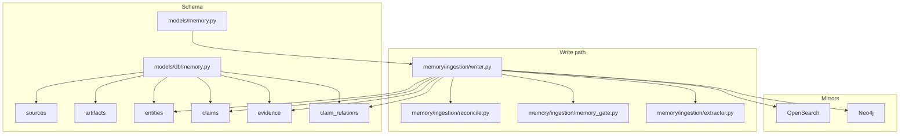
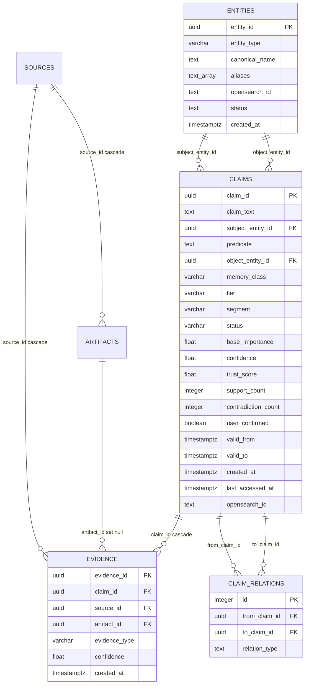
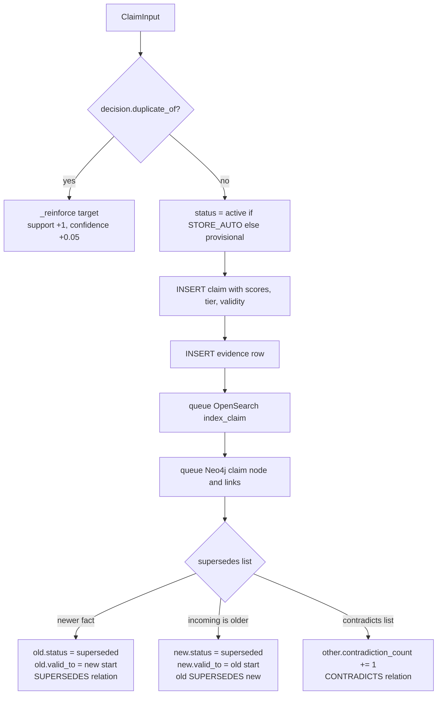
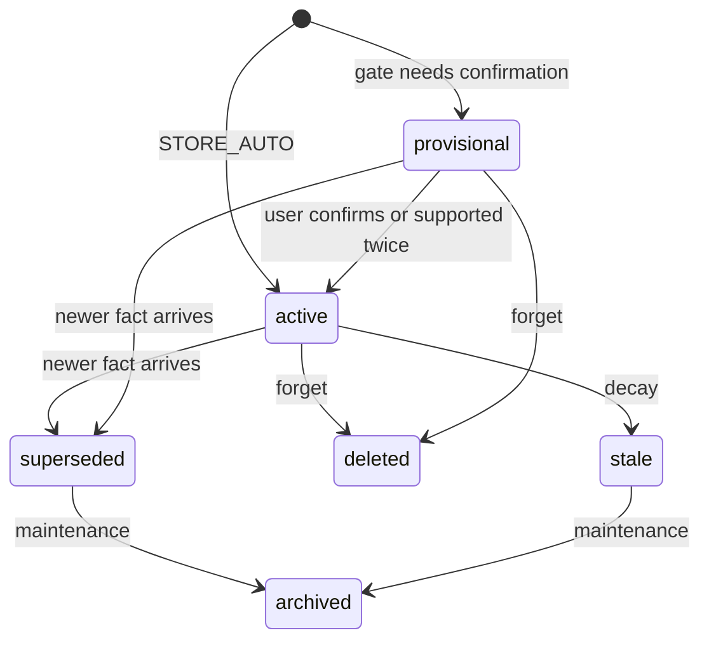
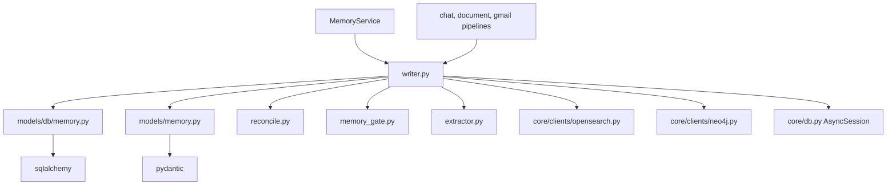

# Memory entities and claims

Claims are the unit of durable memory. A claim is one fact, stored with scores, validity dates, a tier and a segment, and linked to a subject entity, an optional object entity or literal, and evidence. `models/db/memory.py` defines the tables. `models/memory.py` defines the enums and Pydantic schemas. `memory/ingestion/writer.py` is the only write path.

The writer enforces two rules: reconcile before insert, and write Postgres first, with OpenSearch and Neo4j updated only after the commit.

Key capabilities:
- Nine tables covering provenance, entities, claims, evidence, relations and operational logs
- Six memory classes, four tiers, eight segments and six claim statuses
- Reconcile decisions that reinforce, supersede or contradict
- Deferred `SideEffects` for the secondary stores
- Evidence rows on every new or reinforced claim
- Database triggers that maintain `updated_at`

## Repository layout

## Building blocks

- `models/db/memory.py`: `SourceORM`, `ArtifactORM`, `EntityORM`, `ClaimORM`, `EvidenceORM`, `ClaimRelationORM`, `RetrievalLogORM`, `FeedbackEventORM`, `MaintenanceRunORM`, plus `Base` and `_uuid`.
- `models/memory.py`: enums and schemas. `TIER_DECAY_RATE` and `SEGMENT_DECAY_RATE` set default decay.
- `memory/ingestion/writer.py`: `SideEffects`, `upsert_entity`, `infer_tier`, `ClaimInput`, `WriteStats`, `write_claims`, `_reinforce`, `_relate`, `_graph_claim`.
- `memory/ingestion/reconcile.py`: `Decision` with `duplicate_of`, `supersedes` and `contradicts`.
- `memory/ingestion/memory_gate.py`: `GateDecision` and `GateResult` with `adjusted_confidence` and `adjusted_importance`.

## Enumerations

`MemoryClass`: `working`, `episodic`, `semantic`, `procedural`, `social`, `reflective`.

`MemoryTier`: `working`, `short_term`, `long_term`, `permanent`.

`MemorySegment`: `core_identity`, `preferences_and_corrections`, `projects_and_goals`, `people_and_relationships`, `skills_and_background`, `communications_and_commitments`, `contextual_incidents`, `reflections_and_summaries`.

`ClaimStatus`: `active`, `provisional`, `superseded`, `stale`, `archived`, `deleted`.

`EntityType`: `person`, `organization`, `project`, `skill`, `preference`, `constraint`, `task`, `event`, `document`, `topic`, `location`, `email_thread`, `resume_section`.

`EvidenceType`: `extracted`, `inferred`, `user_stated`, `user_confirmed`, `system_derived`.

Tier decay rates are `working 0.15`, `short_term 0.03`, `long_term 0.005`, `permanent 0.0`. Segment decay rates are `preferences 0.0`, `core_identity 0.001`, `skills 0.002`, `projects 0.01`, `people 0.003`, `communications 0.05`, `contextual 0.1`, `reflections 0.002`. Both maps live in `models/memory.py`.

## Columns

`claims` is the center table.

| Column | Type | Default | Notes |
| --- | --- | --- | --- |
| `claim_id` | UUID | `uuid4` | PK |
| `claim_text` | TEXT | required | the fact |
| `subject_entity_id` | UUID | null | FK, `SET NULL` |
| `predicate` | TEXT | null | relation verb |
| `object_entity_id` | UUID | null | FK, `SET NULL` |
| `object_literal` | TEXT | null | used when object is not an entity |
| `memory_class` | VARCHAR(32) | required | enum value |
| `tier` | VARCHAR(32) | `short_term` | enum value |
| `segment` | VARCHAR(64) | required | enum value |
| `status` | VARCHAR(32) | `active` | enum value |
| `base_importance` | FLOAT | 0.5 | gate adjusted |
| `confidence` | FLOAT | 0.5 | gate adjusted |
| `trust_score` | FLOAT | 0.5 | source trust |
| `decay_rate` | FLOAT | 0.01 | from segment rate |
| `access_count` | INTEGER | 0 | retrieval count |
| `retrieval_hit_count` | INTEGER | 0 | used-in-answer count |
| `support_count` | INTEGER | 0 | reinforcements |
| `contradiction_count` | INTEGER | 0 | contradictions seen |
| `user_confirmed` | BOOLEAN | false | user verified |
| `source_priority` | SMALLINT | 5 | provenance weight |
| `valid_from`, `valid_to` | TIMESTAMPTZ | null | stated validity |
| `created_at` | TIMESTAMPTZ | `now()` | observation time |
| `last_accessed_at` | TIMESTAMPTZ | `now()` | moved when used |
| `updated_at` | TIMESTAMPTZ | `now()` | trigger maintained |
| `neo4j_node_id`, `opensearch_id` | TEXT | null | mirror ids |

`EntityORM.aliases` is `ARRAY(Text)`, shown as `text_array` for Mermaid. `ClaimRelationORM` has a unique constraint on `(from_claim_id, to_claim_id, relation_type)`.

## How it fits together

`write_claims` takes a list of `ClaimInput` values, already reconciled and gated. The caller owns the session, so the Postgres writes commit or roll back together. Secondary writes are queued on `SideEffects` and run after the commit. The reconciler decides whether an item reinforces a stored claim, inserts a new one, or replaces an older fact.

## Claim lifecycle

A claim starts `active` when the gate says `STORE_AUTO` and `provisional` when it needs confirmation. A contradiction downgrades a new claim to `provisional` unless the evidence type is `USER_STATED` or `USER_CONFIRMED`. Reinforcement can promote a provisional claim when the new evidence is high trust or `support_count` reaches 2.

`_reinforce` raises confidence by 0.05 over the max of stored and gated confidence, capped at 0.95, or 1.0 when the claim or the new evidence is user confirmed. It also adds a new evidence row and links the source in Neo4j.

`valid_from` is only a date the user gave. `created_at` is when the fact was observed, and the supersede comparison uses `valid_from` when both sides have one, otherwise observation time. A late-arriving turn whose fact is older does not overwrite a newer stored fact; the incoming claim becomes the superseded one.

## Entities

`upsert_entity` matches on lowercased `canonical_name` or an alias, excluding rows with `status = "deleted"`, and takes the oldest match. On a match it merges aliases (dropping one equal to the canonical name) and fills a missing description. If anything changed, it queues a Neo4j upsert and an OpenSearch field update. On a miss it inserts with `opensearch_id = str(entity_id)` and queues the graph node and index document.

Entity ids are generated in Python with `uuid.uuid4()`, not by the database default. The memory service also creates a canonical `User` entity for facts written manually or by tools.

## Indexes

Migration 0003 creates the indexes this write path depends on:

| Purpose | Index |
| --- | --- |
| claim filtering | `idx_claims_status`, `idx_claims_tier`, `idx_claims_segment`, `idx_claims_memory_class` |
| subject lookup | `idx_claims_subject` |
| validity window | `idx_claims_valid (valid_from, valid_to)` |
| recency and importance | `idx_claims_last_accessed`, `idx_claims_importance (base_importance DESC)` |
| text pattern | `idx_claims_text_trgm` GIN `gin_trgm_ops` |
| entity lookup | `idx_entities_type`, `idx_entities_canonical`, `idx_entities_aliases` GIN, `idx_entities_name_trgm` GIN |
| evidence joins | `idx_evidence_claim`, `idx_evidence_source` |
| relations | `idx_claim_relations_from`, `idx_claim_relations_to` |

It also creates `trg_entities_updated_at` and `trg_claims_updated_at` using `touch_updated_at()`.

## Dependencies

Pinned: `sqlalchemy[asyncio]>=2.0`, `pydantic>=2.9.0`, `opensearch-py>=2.6`, `neo4j>=5.20`, `numpy>=1.26` for embeddings math elsewhere in memory.

## Performance

- `write_claims` flushes after every new claim to get its id, then queues side effects. A batch of 20 claims is 20 flushes.
- OpenSearch indexing runs with `refresh=True` per document, which is the most expensive part of ingestion.
- `SideEffects.run` executes sequentially and counts failures without raising, so a commit can succeed while a mirror write fails.

## Troubleshooting

- A duplicate fact created two claims: the reconciler's `duplicate_of` missed it, usually because embeddings were absent or below the similarity threshold. Check that `emb` was passed to `write_claims`.
- A claim is `superseded` immediately after insertion: the incoming fact had an older `valid_from` or observation time than the stored claim. Inspect `valid_to` on both rows.
- `opensearch_id` is set but the document is missing: the Postgres commit succeeded and the side effect failed. `SideEffects.run` logs `Memory side effect ... failed` and returns a count.
- Entity aliases go stale in search: alias merges queue a mirror update only when `effects` is passed. Pipelines that call `upsert_entity` without effects run the sync inline.
- A claim cannot be deleted: `forget` marks status `deleted` and removes mirrors; it never hard-deletes the row except through `clear_all`.

## Appendix

### Implementation examples
- Tier inference: `infer_tier` returns `permanent` for stated preferences, `long_term` for inferred preferences and identity, skills or people, else `short_term`.
- Evidence insert: `EvidenceORM(evidence_id=uuid.uuid4(), claim_id=..., source_id=..., evidence_type=..., extractor_version=EXTRACTOR_VERSION)`.

### Source files
- `models/db/memory.py`
- `models/memory.py`
- `memory/ingestion/writer.py`
