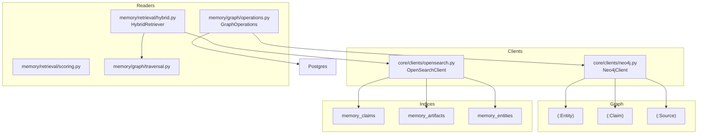
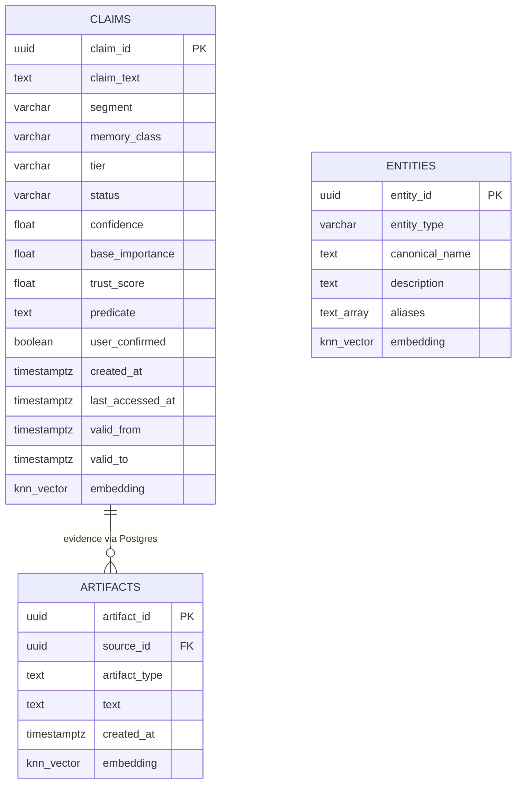
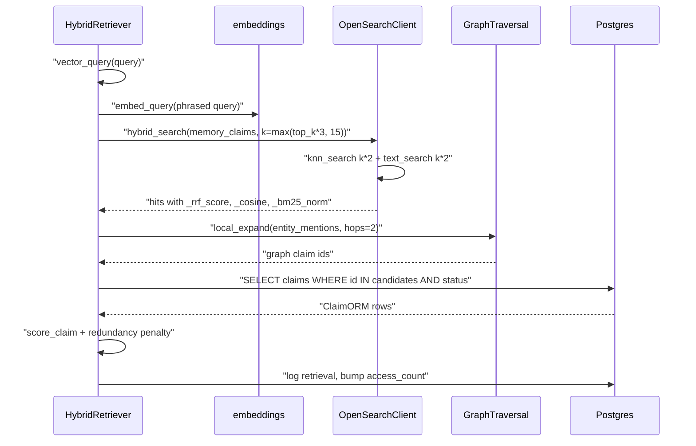
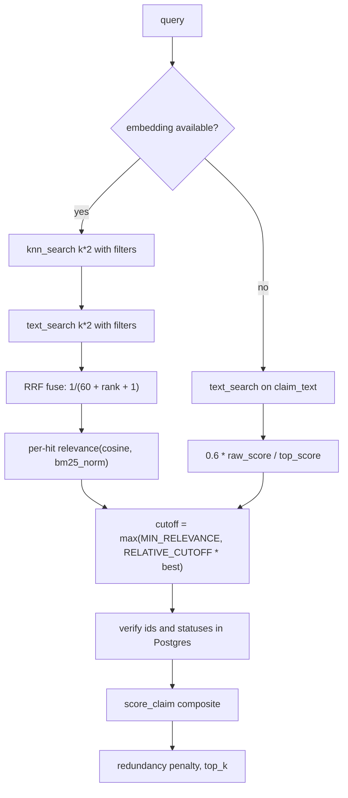
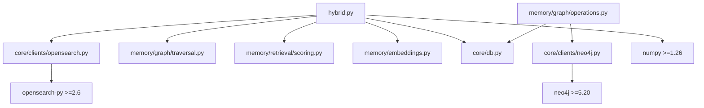

# Memory search and graph stores

Postgres is the record. OpenSearch holds vectors and BM25 text; Neo4j holds the entity and claim graph. Neither secondary store is authoritative: a claim deleted in Postgres is removed from both, and a failed mirror write does not roll back the row.

This page covers the two clients, the index and graph shapes they create, and the retrieval code that reads them.

Key capabilities:
- Three OpenSearch indices with 768 dimension HNSW vectors
- Lucene cosine similarity converted back to a cosine value
- Reciprocal rank fusion of vector and BM25 results
- Status, tier, segment and class filters pushed into OpenSearch
- Composite relevance scoring and a redundancy penalty in the retriever
- Neo4j uniqueness constraints for entities and claims
- One to four hop expansion with typed edges
- Dual-write helpers that keep ids aligned with Postgres

## Repository layout

## Building blocks

- `core/clients/opensearch.py`: `EMBEDDING_DIM = 768`, index name constants, three mappings, `OpenSearchClient` with `ensure_indices`, `clear_memory_indices`, `index_claim`, `index_artifact`, `index_entity`, `delete_document`, `update_document`, `knn_search`, `text_search`, `hybrid_search`, and the `get_opensearch()` singleton.
- `core/clients/neo4j.py`: `Neo4jClient` with `connect`, `create_constraints`, `clear_memory_graph`, entity and claim CRUD, relationship helpers, `expand_entity`, `get_claims_for_entity`, `find_entity_by_name`, `run_cypher`, and `get_neo4j()`.
- `memory/retrieval/hybrid.py`: `HybridRetriever.search`, `vector_query` and `_cos`.
- `memory/retrieval/scoring.py`: `relevance`, `score_claim`, `apply_redundancy_penalty`, `MIN_RELEVANCE`, `RELATIVE_CUTOFF`.
- `memory/graph/operations.py`: `GraphOperations` with sync and relation helpers.

## OpenSearch indices

Each index has `settings.index.knn = true` and one `knn_vector` field named `embedding` with dimension 768, method `hnsw`, space `cosinesimil`, engine `lucene`.

`memory_claims` fields:

| Field | Type | Notes |
| --- | --- | --- |
| `claim_id` | keyword | document id equals claim id |
| `claim_text` | text, english analyzer | BM25 field, boosted in queries |
| `segment`, `memory_class`, `tier`, `status` | keyword | filter fields |
| `confidence`, `base_importance`, `trust_score` | float | scoring fields |
| `predicate` | keyword | relation verb |
| `user_confirmed` | boolean | promotion signal |
| `created_at`, `last_accessed_at`, `valid_from`, `valid_to` | date | validity and recency |
| `embedding` | knn_vector 768 | HNSW cosine |

`memory_artifacts` has `artifact_id`, `source_id`, `artifact_type`, `text`, `created_at` and `embedding`. It has no claim scores, because artifacts are evidence chunks.

`memory_entities` has `entity_id`, `entity_type`, `canonical_name` (text with a `.keyword` subfield), `description`, `aliases` (keyword) and `embedding`.

The keyword and date fields mirror the Postgres columns exactly, so filters use the same values. `embedding` is the only field with no Postgres counterpart.

## How it fits together

The retriever owns the read path. It embeds the query, asks OpenSearch for fused candidates with filters applied, adds graph neighbours for mentioned entities, verifies every candidate in Postgres, scores the survivors, and logs the retrieval. The two clients are lazy singletons: `get_opensearch()` and `get_neo4j()` return objects that must be connected before use.

## Hybrid retrieval

`search` runs three things concurrently: the query embedding, the query plan (if the caller did not supply one) and, when the plan mentions entities, a graph expansion. OpenSearch calls run in a worker thread with `asyncio.to_thread`.

`vector_query` rewrites short keyword queries into a question, for example `editor` becomes `What do I know about the user's editor?`. The comment in the file records the reason: a bare keyword embedded at 0.19 against a matching claim, below the relevance floor, while the question form scored 0.47. BM25 still searches the original words.

Filters are built from the request and the plan:

- `status` is `["active"]`, plus `provisional` when requested, plus `superseded` when the plan asks for history.
- `tier`, `segment` and `memory_class` become term or terms filters when the request sets them.
- The filters are passed inside the kNN clause, so filtered-out documents do not consume the k slots.

If the embedding call fails, the retriever falls back to `text_search` over `claim_text` and scores with `0.6 * score / top_score`.

## Reciprocal rank fusion

`hybrid_search` requests `k * 2` vector hits and `k * 2` text hits, then fuses with `rrf_k = 60`:

- Each hit adds `1 / (60 + rank + 1)` per list it appears in.
- The merged hit keeps the raw `_score` and `_id`.
- BM25 hits get `_bm25_norm = score / top_bm25_score`.
- Vector hits carry `_cosine = 2 * lucene_score - 1`, because Lucene's `cosinesimil` returns `(1 + cos) / 2`.
- The final list is sorted by accumulated RRF score and cut to `k`.

`relevance(cosine, bm25_norm)` in `scoring.py` turns those two signals into one number. `score_claim` then adds recency, importance, trust and graph signals. Both constants and the exact weights live in `memory/retrieval/scoring.py`, which this page does not own; treat the values here as inputs, not the full formula.

Graph neighbours of mentioned entities are added as candidates even when search did not return them. The retriever fetches up to 30 missing vectors from the claims index with `mget`, scores them with cosine and a zero BM25 signal, and accepts them at half the normal floor.

A first-person question with no named entity downranks claims whose subject is not the canonical `User` entity by multiplying relevance by 0.35.

## Neo4j graph

`create_constraints` runs four statements at startup:

- Unique `Entity.entity_id`
- Unique `Claim.claim_id`
- Index on `Entity.canonical_name`
- Index on `Entity.entity_type`

Node labels and properties:

| Label | Properties | Created by |
| --- | --- | --- |
| `Entity` | `entity_id`, `entity_type`, `canonical_name`, `description`, `aliases`, `created_at`, `updated_at` | `upsert_entity` |
| `Claim` | `claim_id`, `claim_text`, `predicate`, `segment`, `confidence`, `created_at`, `updated_at` | `upsert_claim_node` |
| `Source` | `source_id` | `link_claim_to_source` |

Relationship types:

| Edge | Meaning |
| --- | --- |
| `(:Claim)-[:SUBJECT]->(:Entity)` | claim subject |
| `(:Claim)-[:OBJECT]->(:Entity)` | claim object |
| `(:Claim)-[:SUPPORTED_BY]->(:Source)` | provenance |
| `(:Claim)-[:SUPERSEDES]->(:Claim)` | replacement |
| `(:Claim)-[:CONTRADICTS]->(:Claim)` | conflict |
| `(:Claim)-[:SUPPORTS]->(:Claim)` | reinforcement if used |
| `(:Entity)-[:TYPE]->(:Entity)` | free-form entity relation via `create_entity_relation` |

`create_entity_relation` and `create_claim_relation` interpolate the relationship type into Cypher with an f-string. Callers pass values from the enum or from code, not user input. Every entity and claim node is unique on its id, so repeated writes merge instead of duplicating.

## Expansion and sync

`expand_entity(entity_id, hops, edge_types, limit)` builds a relationship clause. With edge types it becomes `[:TYPE1|TYPE2*1..hops]`, otherwise `[*1..hops]`. The Cypher uses a `CALL (seed) { ... }` subquery, unwinds nodes and relationships, and returns distinct node properties plus edge endpoints.

`find_entity_by_name` matches `canonical_name =~ (?i).*name.*` or an exact alias. `get_claims_for_entity` returns up to 100 claims linked by `SUBJECT` or `OBJECT`.

`GraphOperations` is the higher-level sync layer. `sync_entity_to_neo4j` copies an entity from Postgres and writes the returned node id back to `entities.neo4j_node_id`. `sync_claim_to_neo4j` upserts the claim node and its SUBJECT and OBJECT links. `create_claim_relation` writes the relation to Postgres and Neo4j. `mark_supersedes` also sets the old claim status to `superseded`; `mark_contradicts` increments `contradiction_count` on both claims. `delete_entity` deletes the node and marks the row `deleted`.

## Postgres indexes used by the readers

The retrievers verify candidate ids and statuses in Postgres before returning them. That lookup uses the claim primary key and `idx_claims_status` from migration 0003. Graph candidate verification and user-subject downranking use `idx_claims_subject` and the entity name indexes. Artifact fact search joins `artifacts` to `sources` through `idx_artifacts_source`.

## Dependencies

`OpenSearchClient.connect` builds the client with `http_compress=True`, `use_ssl=False`, `verify_certs=False` and `RequestsHttpConnection` against `opensearch_host:opensearch_port` (default `localhost:9201`). `Neo4jClient.connect` uses `bolt://localhost:7687` with `max_connection_pool_size=20` and notifications at warning severity.

## Performance

- Each `index_claim`, `index_entity` and `index_artifact` call uses `refresh=True`, so a write is immediately searchable at the cost of a segment refresh.
- `hybrid_search` makes two OpenSearch queries of `k * 2` and fuses in Python. A top_k of 20 is 40 vector and 40 text candidates by default.
- Graph expansion runs on a second connection while OpenSearch searches; both are awaited after the embedding.

## Troubleshooting

- `OpenSearch client not initialised`: call `connect()` first. `ensure_indices` and every document method go through the `client` property, which raises.
- `Neo4j driver not initialised`: same pattern; `get_neo4j()` returns a lazy client and `connect()` verifies connectivity.
- Vector search returns nothing after import: the index dimension must stay 768. A different embedding model with another dimension needs a new index and mapping.
- Scores look like 0.7 when cosine is 0.4: Lucene returns `(1 + cos) / 2`; `_cosine` converts it back.
- Filters do not exclude deleted claims: the status field in OpenSearch must be updated when Postgres changes. `forget` deletes the document; `update_claim` patches it and swallows errors.
- `expand_entity` with `edge_types` containing spaces or punctuation breaks the Cypher. Pass plain relationship names.

## Appendix

### Implementation examples
- Index creation: `ensure_indices` loops the three mappings and creates missing indices.
- Fusion: `scores[did] = scores.get(did, 0) + 1 / (rrf_k + rank + 1)` with `rrf_k = 60`.
- Constraints: four `CREATE CONSTRAINT` or `CREATE INDEX` statements in `create_constraints`.

### Source files
- `core/clients/opensearch.py`
- `core/clients/neo4j.py`
- `memory/retrieval/hybrid.py`
- `memory/graph/operations.py`
