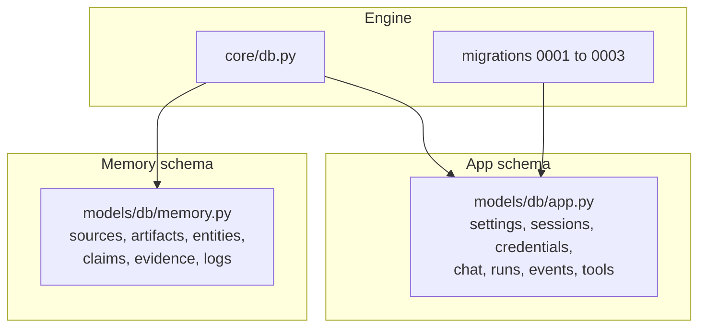
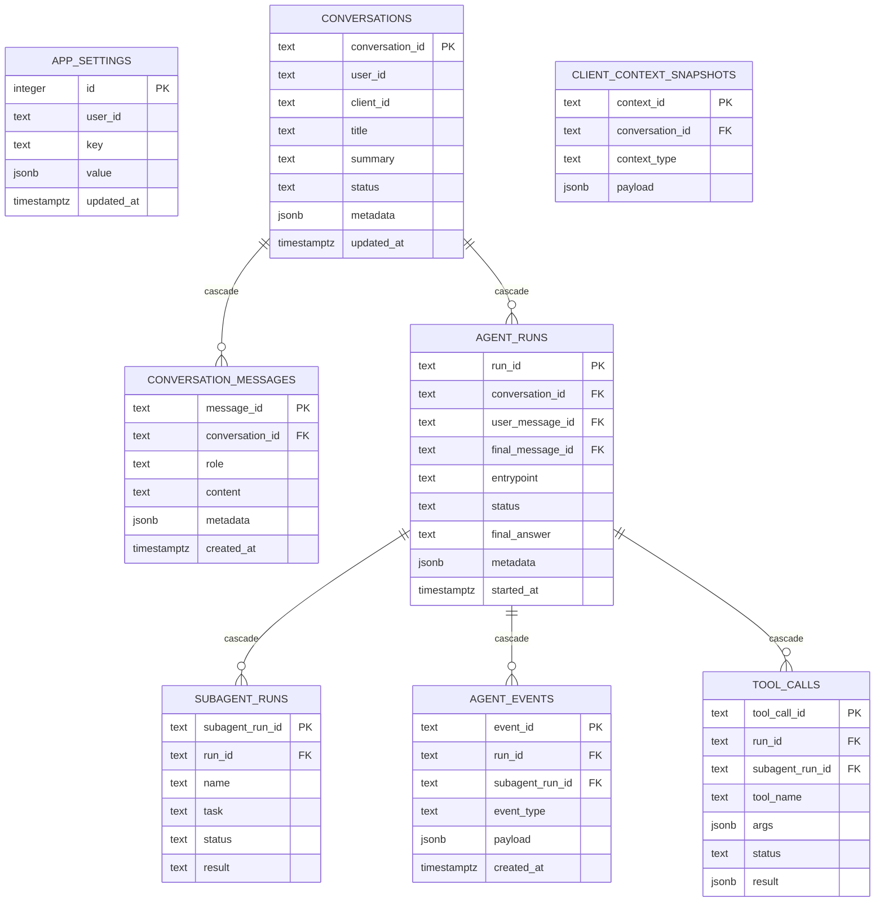
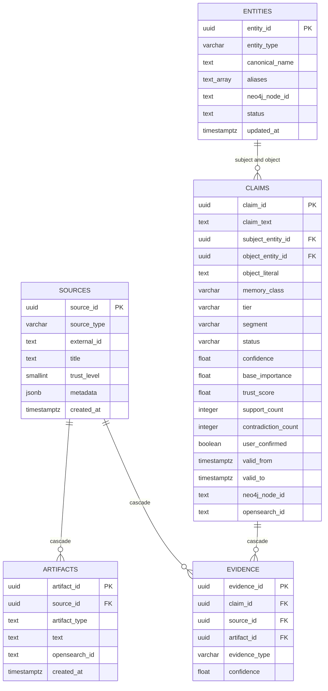
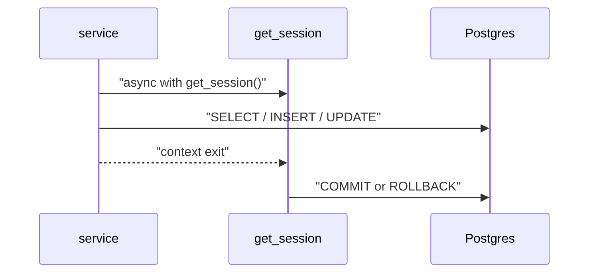
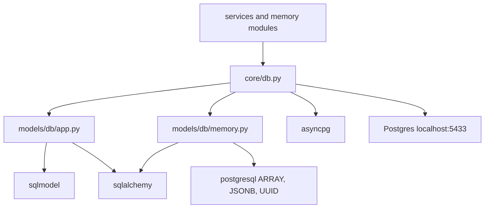

# Schema overview

Postgres holds two schemas in one database. Application tables are SQLModel classes in `models/db/app.py`, created by numbered migrations. Memory tables are SQLAlchemy declarative classes in `models/db/memory.py`, created from model metadata at startup. Both use the async engine in `core/db.py`.

This page is the column-level map. The other pages in this folder cover conversations and traces, credentials, claim writing, the secondary stores and the migration runner.

Key capabilities:
- Twelve application tables for settings, sessions, credentials, chat and run traces
- Nine memory tables including one relation table
- UUID primary keys in memory, prefixed string keys in the app schema
- JSONB payloads for flexible fields
- B-tree, GIN and trigram indexes from migration 0003
- Foreign keys with explicit cascade and set-null rules

## Repository layout

## Building blocks

- `models/db/app.py`: `utcnow()` and twelve `SQLModel, table=True` classes.
- `models/db/memory.py`: `Base(DeclarativeBase)`, `_uuid()`, and nine mapped classes with relationships.
- `core/db.py`: `engine`, `AsyncSessionLocal`, `get_session()` and `init_db()`.
- `migrations/0003_memory_postgres_indexes.py`: memory indexes, `touch_updated_at()`, and triggers on `entities` and `claims`.

App tables and their key columns:

| Table | Primary key | Notable columns |
| --- | --- | --- |
| `app_settings` | `id` BIGSERIAL | `user_id`, `key`, `value` JSONB, unique `(user_id, key)` |
| `browser_sessions` | `session_id` TEXT | `title`, `metadata` JSONB, indexed `updated_at` |
| `browser_session_messages` | `message_id` TEXT | `session_id` FK, `role`, `content`, `events` JSONB |
| `browser_credentials` | `id` BIGSERIAL | `provider`, `account_label`, `payload` JSONB |
| `browser_snapshots` | `id` BIGSERIAL | `kind`, `payload` JSONB |
| `conversations` | `conversation_id` TEXT | `client_id`, `title`, `summary`, `status` |
| `conversation_messages` | `message_id` TEXT | `conversation_id` FK, `role`, `content` |
| `agent_runs` | `run_id` TEXT | `entrypoint`, `status`, `final_answer`, `error` |
| `subagent_runs` | `subagent_run_id` TEXT | `run_id` FK, `name`, `task`, `status`, `result` |
| `agent_events` | `event_id` TEXT | `run_id` FK, `event_type`, `payload` JSONB |
| `tool_calls` | `tool_call_id` TEXT | `tool_name`, `args` JSONB, `status`, `result` JSONB |
| `client_context_snapshots` | `context_id` TEXT | optional `conversation_id` FK, `payload` JSONB |

## App schema

The SQLModel field `metadata_` maps to a physical column `metadata` through `Column("metadata", JSONB, nullable=False)`. Every app table also has `created_at` and `updated_at` TIMESTAMPTZ columns unless noted. `entrypoint` defaults to `react_agent`; the browser planner sets `browser_runtime`.

## Memory schema

`aliases` is `ARRAY(Text)`, shown as `text_array` for Mermaid. `segment` is `String(64)`; `source_type`, `entity_type`, `memory_class`, `tier`, `status` and `evidence_type` are `String(32)`. The full claim row also has decay, access counters, priority and three more timestamps. `retrieval_log`, `feedback_events` and `maintenance_runs` complete the memory schema with operation logs.

## Indexes and triggers

Migration 0003 enables `uuid-ossp` and `pg_trgm` and creates these indexes:

| Table | Indexes |
| --- | --- |
| `sources` | `source_type`, `external_id`, `created_at` |
| `artifacts` | `source_id` |
| `entities` | `entity_type`, `canonical_name`, `aliases` GIN, `canonical_name` trigram GIN |
| `claims` | `status`, `tier`, `segment`, `memory_class`, `subject_entity_id`, `(valid_from, valid_to)`, `last_accessed_at`, `base_importance DESC`, `claim_text` trigram GIN |
| `evidence` | `claim_id`, `source_id` |
| `claim_relations` | `from_claim_id`, `to_claim_id` |
| `retrieval_log` | `claim_id`, `created_at` |
| `feedback_events` | `claim_id` |

`touch_updated_at()` sets `NEW.updated_at = NOW()`, and `trg_entities_updated_at` and `trg_claims_updated_at` run it before every update. App indexes come from migrations 0001 and 0002, for example `ix_conversations_updated_at` descending and `ix_agent_runs_status`.

## How it fits together

Reads use `select()` against mapped classes. Raw SQL appears only in `core/migrations.py` and the migration modules.

## Dependencies

Pinned versions: `sqlalchemy[asyncio]>=2.0`, `sqlmodel>=0.0.22`, `asyncpg>=0.29`.

## Performance

- JSONB columns are write-friendly but unindexed. Do not filter trace payloads by JSON keys at scale.
- `claims` is the hot table. Migration 0003 gives it eight B-tree indexes plus a trigram GIN index, paid on every insert.
- `agent_events` is append-only, indexed by run, conversation, type and time.

## Troubleshooting

- `column "metadata" does not exist`: the model maps to a different physical name. Check `Column("metadata", ...)`.
- `null value in column "value" violates not-null`: `AppSetting.value` is non-nullable JSONB. Write `{}` rather than null.
- `operator does not exist: text[] && ...`: the aliases GIN index expects array operators, not string equality.
- Trigram search is slow: confirm migration 0003 ran, or run `CREATE EXTENSION IF NOT EXISTS pg_trgm`.
- `updated_at` does not change on update: triggers exist only on `entities` and `claims`.
- Duplicate key on `uq_app_settings_user_key`: a direct insert bypassed `set_setting`.

## Appendix

### Implementation examples
- JSONB value: `Field(default_factory=dict, sa_column=Column(JSONB, nullable=False))`.
- Array column: `aliases = Column(ARRAY(Text), nullable=False, default=list)`.
- Cascade: `ForeignKey("sources.source_id", ondelete="CASCADE")`.
- Trigger: `CREATE TRIGGER trg_claims_updated_at BEFORE UPDATE ON claims FOR EACH ROW EXECUTE FUNCTION touch_updated_at()`.

### Source files
- `models/db/app.py`
- `models/db/memory.py`
- `core/db.py`
