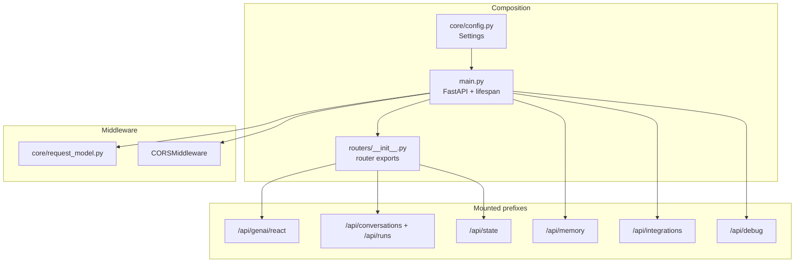
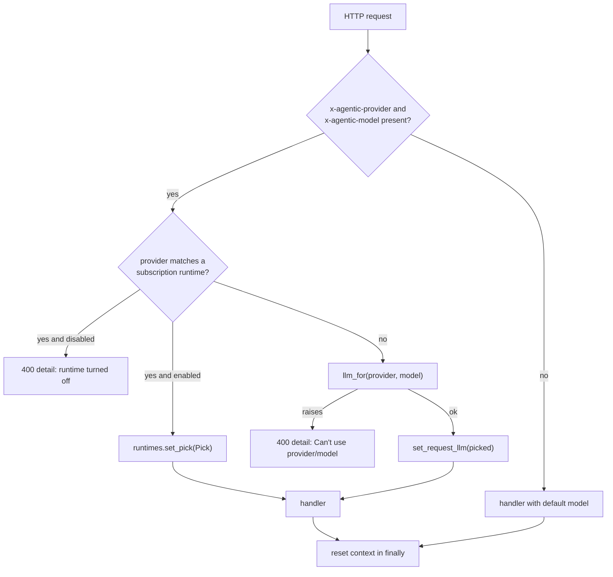
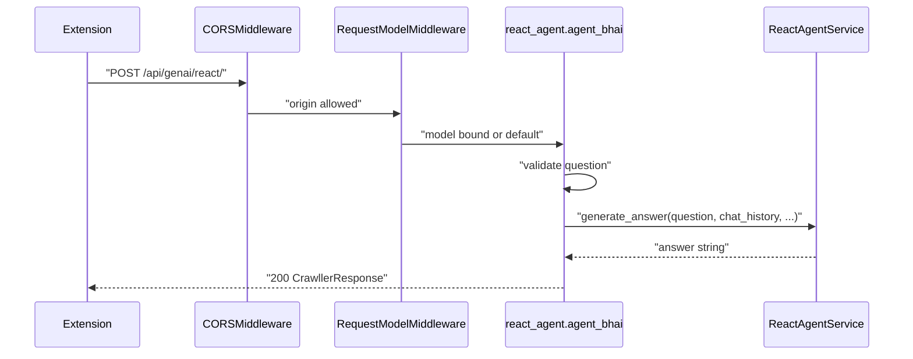
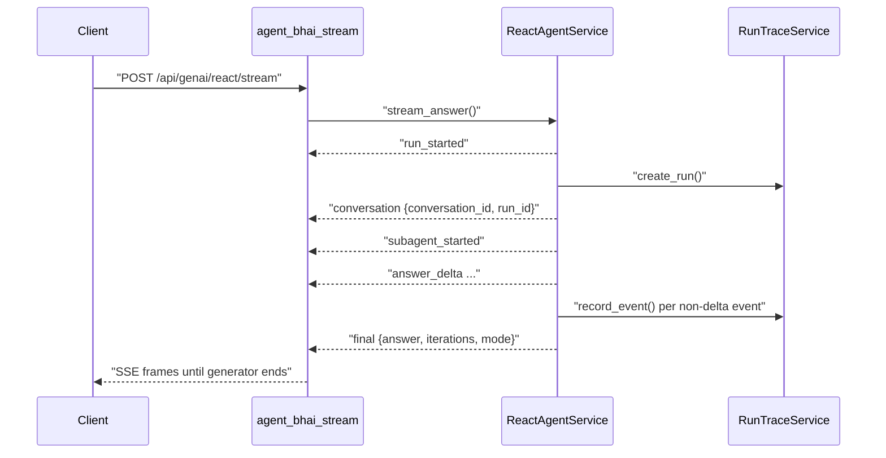
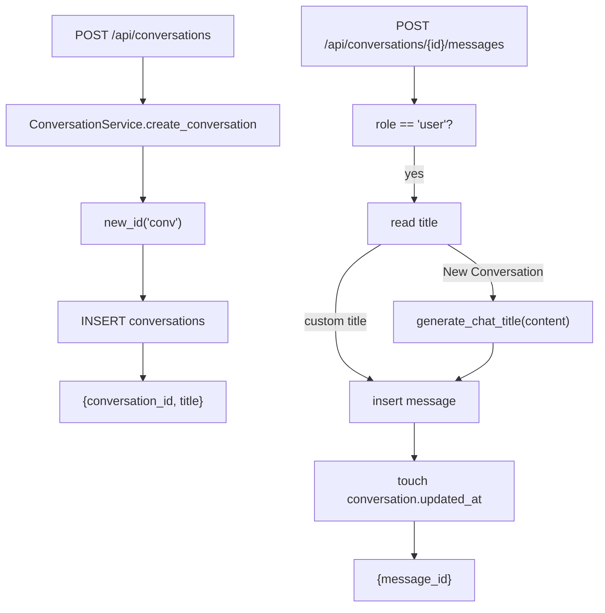
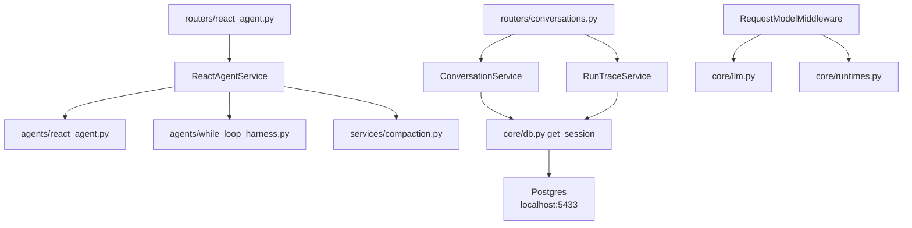

# Service integration models

The backend listens on `0.0.0.0:5454` by default (`main.py` `run()`, `core/config.py` `backend_port`). Every product route lives under `/api`, except `GET /`. This page covers the conventions every route shares, then the two route groups the rest of the API builds on: the chat endpoint in `routers/react_agent.py` and the conversation endpoints in `routers/conversations.py`.

The folder name says models, and that is the useful angle here: each mounted group owns a request and response shape, and the shape decides which service gets called.

Key capabilities:
- One prefix per router, mounted in `main.py`
- Per-request provider and model selection through two headers
- A single request model for chat, shared by REST and SSE
- `user_id` query scoping with a `"default"` fallback
- Consistent 400, 401, 404, 422 and 500 handling

## Repository layout

`main.py` is the composition root. It builds the app, adds middleware, imports 21 routers from `routers/__init__.py`, plus `memory_router` and `mcp_settings_router`, and mounts each one.



The prefix table below is the full mount list from `main.py`. It is the fastest way to find which file owns a path.

| Prefix | Router module | Representative routes |
| --- | --- | --- |
| `/api/mcp` | `routers/mcp_settings.py` | `GET /settings`, `PUT /settings`, `POST /restart` |
| `/api/genai/health` | `routers/health.py` | `GET /` |
| `/api/genai/github` | `routers/github.py` | `POST /`, `POST /archive/{upload_id}` |
| `/api/genai/website` | `routers/website.py` | `POST /` |
| `/api/genai/youtube` | `routers/youtube.py` | `POST /` |
| `/api/google-search` | `routers/google_search.py` | `POST /` |
| `/api/gmail` | `routers/gmail.py` | `POST /unread`, `/latest`, `/mark_read`, `/send` |
| `/api/calendar` | `routers/calendar.py` | `POST /events`, `/create` |
| `/api/pyjiit` | `routers/pyjiit.py` | `POST /login`, `/semesters`, `/attendence` |
| `/api/genai/react` | `routers/react_agent.py` | `POST /`, `POST /stream` |
| `/api/validator` | `routers/website_validator.py` | `POST /validate-website` |
| `/api/agent` | `routers/browser_use.py` | `POST /generate-script` |
| `/api/upload` | `routers/file_upload.py` | `POST /`, `GET /files/{path}` |
| `/api/skills` | `routers/skills.py` | `GET /`, `POST /execute`, `POST /execute/stream` |
| `/api/auth` | `routers/auth.py` | Google and GitHub OAuth |
| `/api/state` | `routers/state.py` | sessions and key-value settings |
| `/api` | `routers/conversations.py` | conversations, runs, client context |
| `/api/voice` | `routers/voice.py` | speech to text and text to speech |
| `/api/memory` | `memory/api/router.py` | search, claims, graph, ingestion |
| `/api/browser/automation` | `routers/automation.py` | `POST /step` |
| `/api/browser/runtime` | `routers/browser_runtime.py` | `POST /start`, `POST /step` |
| `/api/debug` | `routers/debug.py` | stats, runs, memory inspection |
| `/api/integrations` | `routers/integrations.py` | LLM, secrets, Composio, runtimes |

## Building blocks

- `main.py`: `lifespan` connects Postgres, Neo4j and OpenSearch, starts the Telegram task and memory scheduler, and ensures the MCP bridge on `127.0.0.1:5455`. `run()` calls `uvicorn.run("main:app", host, port=5454, reload=True)`.
- `core/request_model.py`: `RequestModelMiddleware`, a plain ASGI middleware. It looks for `x-agentic-provider` and `x-agentic-model`, checks subscription runtimes first, then calls `llm_for(provider, model)` and binds the result with `set_request_llm`.
- `routers/react_agent.py`: `agent_bhai` for `POST /` and `agent_bhai_stream` for `POST /stream`. Both accept `CrawlerRequest` and resolve a Google token with `resolve_google_token_optional()`.
- `routers/conversations.py`: eleven routes for conversations, messages, client context and run traces.
- `models/requests/crawller.py`: `CrawlerRequest`, the chat input contract.
- `models/response/crawller.py`: `CrawllerResponse` with a single `answer` field.

## How it fits together

The middleware runs before routing. A bad model choice returns 400 without touching a handler. If both headers are absent the saved default model from `core/llm.py` is used, so existing clients keep working.



`RequestModelMiddleware` is added before CORS in `main.py` on purpose: CORS is the outer layer, so the 400 from the middleware still carries CORS headers and the extension can read the detail.



## Chat request model

`POST /api/genai/react/` is handled by `agent_bhai` in `routers/react_agent.py`. Authentication is none at the HTTP layer. A Google access token is resolved from stored credentials if the user connected Google, and passed into the agent context.

Request body, `CrawlerRequest`:

| Field | Type | Default | Notes |
| --- | --- | --- | --- |
| `question` | str | required | Empty string returns 400 `question is required` |
| `chat_history` | list[dict] | `[]` | Ignored when the server has stored history for the conversation |
| `google_access_token` | str or null | null | Also accepted as `google_acces_token` through `AliasChoices` |
| `pyjiit_login_response` | object or null | null | Campus portal session, also accepted with the `pyjiit_login_responce` spelling |
| `client_html` | str or null | null | Raw page HTML, converted to markdown for page context |
| `attached_file_path` | str or null | null | Path returned by the upload route |
| `conversation_id` | str or null | null | Server creates one when omitted |
| `client_id` | str | `browser-extension` | Client label stored on messages and runs |
| `client_context` | dict or null | null | Stored as a `client_context_snapshots` row |

Response: `200` with `{"answer": "..."}`. The handler returns `CrawllerResponse(answer=answer)`.

Status codes:
- `400` when `question` is empty.
- `422` when the body fails Pydantic validation.
- `500` when the service raises. The handler logs and returns `detail="Internal server error \n<exception>"`. `generate_answer` catches most internal errors itself and returns a polite error string with status 200, so a 500 here means the failure escaped that catch.

## Chat stream endpoint

`POST /api/genai/react/stream` is handled by `agent_bhai_stream`. Same body, no response model. It returns `StreamingResponse` with these headers: `Cache-Control: no-cache`, `Connection: keep-alive`, `X-Accel-Buffering: no`.

Frames are written by `_sse_event(event_name, payload)`:

```
event: answer_delta
data: {"event": "answer_delta", "delta": "..."}
```

Event names produced by `ReactAgentService.stream_answer` and the agents behind it: `run_started`, `conversation`, `compaction`, `subagent_started`, `thinking_delta`, `answer_delta`, `subagent_completed`, `tool_started` and related tool events, `final`, and `error`. The `conversation` frame carries `conversation_id`, `run_id` and `title`, which is how the side panel learns the server-owned ids.



Streaming failure handling is inside the generator: any exception becomes one `error` frame with `{"event": "error", "message": str(exc)}`, and the HTTP status stays 200 because headers were already sent.

## Conversation endpoints

All eleven routes are mounted at `/api` from `routers/conversations.py`. `user_id` is a query parameter with default `"default"` on the routes that accept it.

| Method | Path | Handler | Body or query | Success response |
| --- | --- | --- | --- | --- |
| POST | `/api/conversations` | `create_conversation` | `title`, `client_id`, `metadata`, `user_id` | `{"conversation_id", "title"}` |
| GET | `/api/conversations` | `list_conversations` | `user_id` | `{"conversations": [...]}` |
| GET | `/api/conversations/{conversation_id}` | `get_conversation` | path id | conversation object |
| GET | `/api/conversations/{conversation_id}/messages` | `list_messages` | `limit` 1 to 500, default 100 | `{"messages": [...]}` |
| POST | `/api/conversations/{conversation_id}/messages` | `add_message` | `role`, `content`, `client_id`, `metadata`, `user_id` | `{"message_id"}` |
| GET | `/api/conversations/{conversation_id}/runs` | `list_conversation_runs` | path id | `{"runs": [...]}` |
| POST | `/api/client-context` | `store_client_context` | `conversation_id`, `client_id`, `context_type`, `payload`, `user_id` | `{"context_id"}` |
| GET | `/api/runs/{run_id}` | `read_run` | path id | run object |
| GET | `/api/runs/{run_id}/events` | `read_run_events` | path id | `{"events": [...]}` |
| GET | `/api/runs/{run_id}/subagents` | `read_run_subagents` | path id | `{"subagents": [...]}` |
| GET | `/api/runs/{run_id}/tool-calls` | `read_run_tool_calls` | path id | `{"tool_calls": [...]}` |

Status codes:
- `404` when a conversation or run id does not exist (`"conversation not found"`, `"run not found"`).
- `422` when `limit` is outside the declared range.
- `500` with `str(exc)` on any database failure.

Creating a conversation returns only the id and title; the full object is available from the GET route. Listing orders by `updated_at` descending, so the newest conversation is first. Adding a user message to a conversation still titled `New Conversation` triggers title generation in `ConversationService.add_message`, which is why the response can take a model call longer than a plain insert.



## Dependencies

The routes here depend on FastAPI for the HTTP layer, Pydantic for the body, `services/react_agent_service.py` for chat, `services/conversations.py` for storage, and `services/run_traces.py` for run rows.



## Performance

- Chat history in `_prepare_conversation` is loaded with `limit` from compaction settings, default 400 messages, then compacted by `services/compaction.py`.
- Memory context is budgeted at 1200 tokens by `_build_memory_prompt` (`token_budget=1200`).
- The stream endpoint buffers events through an `asyncio.Queue` and a single background task, so slow clients do not block the agent loop; the task is cancelled if the generator is closed.
- Postgres engine pool is 10 with `max_overflow=20` and `pool_pre_ping=True` (`core/db.py`).
- `list_messages` caps at 500 rows per call; `list_conversations` has no limit and returns every conversation for the user.

## Troubleshooting

- `question is required` on a valid looking body: the field is `question`, not `query` or `message`.
- Google token never reaches the agent: `resolve_google_token_optional()` swallows `NeedsReauth` and returns `None`. Reconnect Google in Settings, then check `GET /api/auth/status/google`.
- History sent by the client is ignored: once a conversation id exists, `generate_answer` and `stream_answer` use `server_history` from Postgres and only fall back to `chat_history` when the server has none.
- Duplicate last user message in the prompt: `_build_react_messages` removes the trailing history entry when it equals the current question, so this only appears when the client sends a differently spaced copy.
- SSE stream ends immediately with an `error` frame: read `message` in the frame; the trace also stores an `error` event when a run row exists.
- 400 from the middleware before any handler log line: the model headers named a provider that cannot be built or a disabled runtime. The detail names the provider and model.

## Appendix

### Implementation examples
- Model override: `RequestModelMiddleware.__call__` reads `PROVIDER_HEADER = b"x-agentic-provider"` and `MODEL_HEADER = b"x-agentic-model"` in `core/request_model.py`.
- Chat request validation: `agent_bhai` raises `HTTPException(400, "question is required")` in `routers/react_agent.py`.
- SSE framing: `_sse_event` writes `event: <name>\ndata: <json>\n\n`.
- Default user: `DEFAULT_USER_ID = "default"` in `services/conversations.py` and `services/app_state.py`.
- CORS regex: `^(chrome-extension|moz-extension)://[a-z0-9-]+$|^https?://(localhost|127\.0\.0\.1)(:\d+)?$`.

### Source files
- `main.py`
- `core/request_model.py`
- `routers/react_agent.py`
- `routers/conversations.py`
