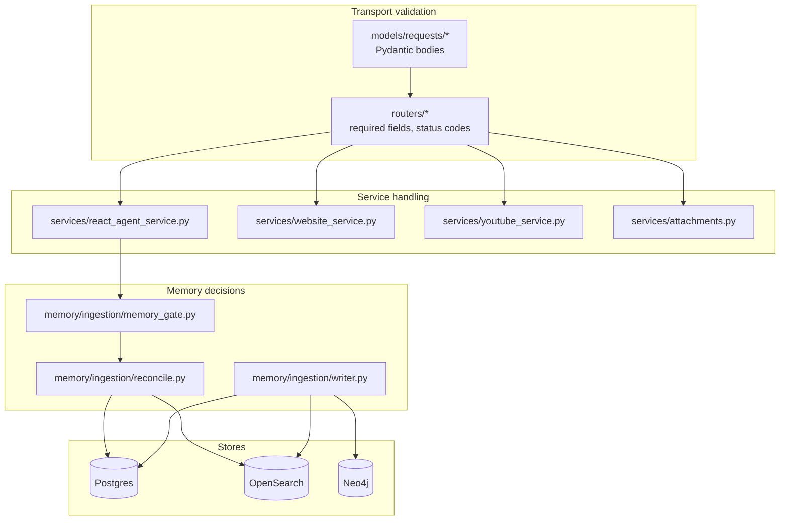
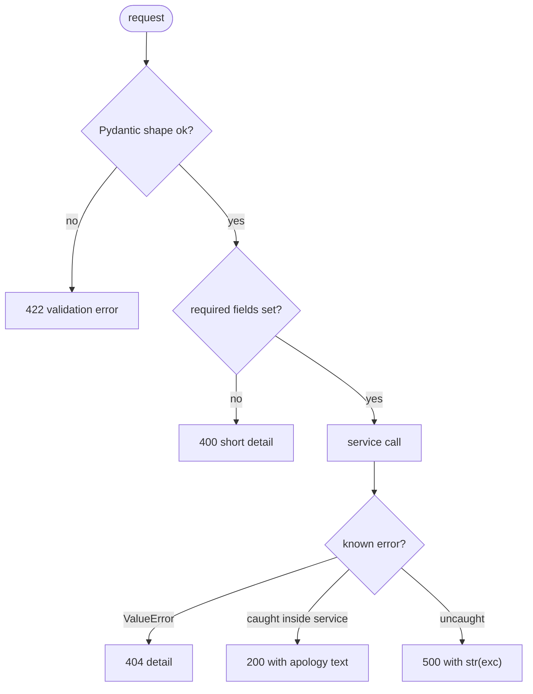
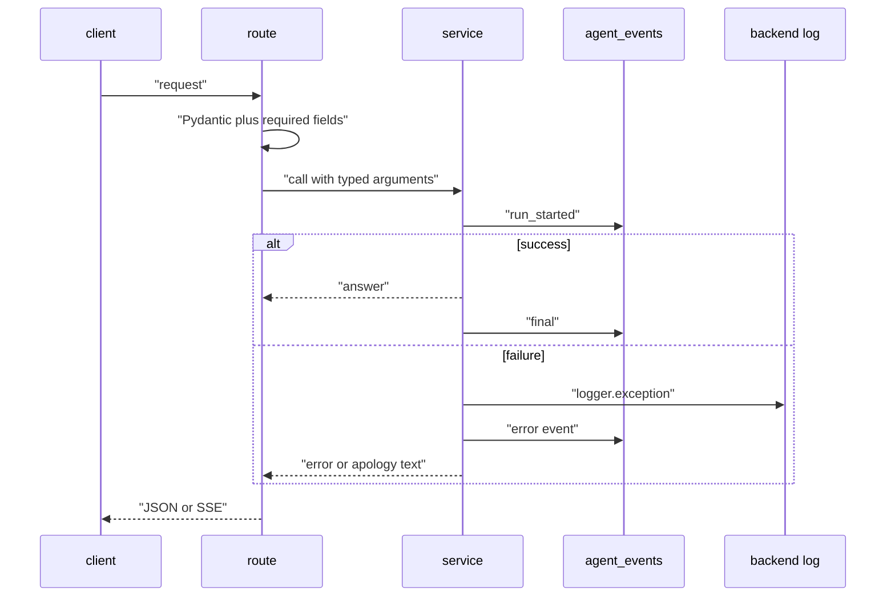
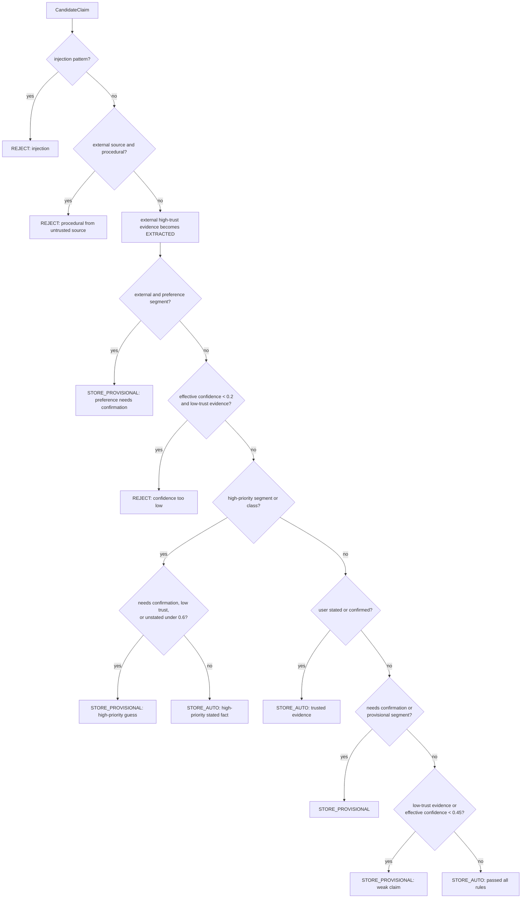
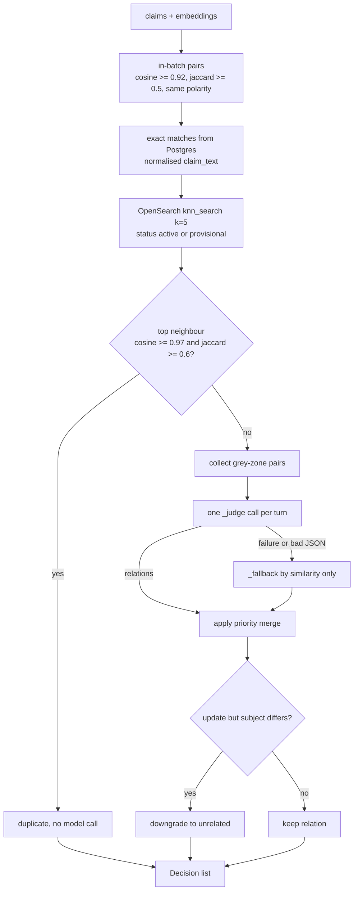
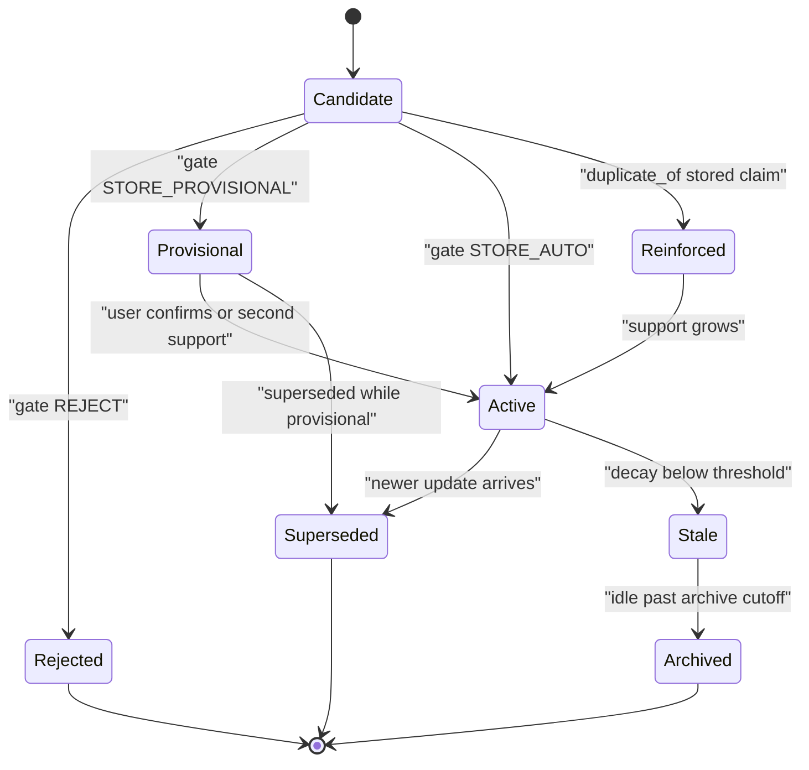
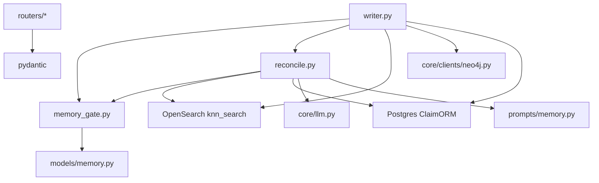

# Validation and error handling

Validation happens in four places, and each one owns a different kind of bad input. Pydantic models reject the wrong shape at the route. Router code checks required fields and translates exceptions into status codes. Services catch provider and store failures and return an apology string with HTTP 200. Memory has its own two-stage filter: `memory/ingestion/memory_gate.py` decides whether a candidate fact may be stored, and `memory/ingestion/reconcile.py` decides what it means next to existing facts.

This page maps those layers, then covers the gate and reconcile rules in detail, then lists the failure modes worth checking first.

Key capabilities:
- Typed request bodies with aliases for legacy spellings
- Route-level 400, 404 and 422 responses with short detail strings
- Service-level catch that returns 200 with an apology
- Hard rejection of prompt injection patterns in memory
- Confidence ceilings that separate confirmed facts from extracted ones
- Duplicate reinforcement instead of duplicate rows
- A consistent symptom, cause and fix table

## Repository layout

## Building blocks

- `models/requests/crawller.py`: `CrawlerRequest` with `AliasChoices` for `google_access_token` and `pyjiit_login_response`.
- `models/requests/ask.py`: `AskRequest` with `url`, `question`, `chat_history` and `attached_file_path`.
- `routers/react_agent.py`: `agent_bhai` and `agent_bhai_stream`.
- `routers/website_validator.py`: `validate_website_endpoint`, HTML to markdown plus the injection prompt.
- `memory/ingestion/memory_gate.py`: `MemoryGate.evaluate` returns `GateResult(decision, reason, adjusted_confidence, adjusted_importance)`.
- `memory/ingestion/reconcile.py`: `Reconciler.plan` returns one `Decision` per claim, with `duplicate_of`, `supersedes` and `contradicts`.
- `memory/ingestion/writer.py`: `write_claims`, `_reinforce`, `_relate` and `SideEffects`.

## Validation layers

| Layer | Rejects | Response |
| --- | --- | --- |
| Pydantic body | missing required fields, wrong types | 422 from FastAPI |
| Router checks | empty question or url, bad upload suffix, oversized body, path escape | 400 with a short detail |
| Router lookups | unknown conversation, run, skill or file | 404 with a short detail |
| Service catch | provider errors, chain errors, attachment errors | 200 with an apology string |
| Memory gate | injection, untrusted procedural claims, weak facts | claim dropped or stored provisional |
| Reconciler | near duplicates | reinforce, supersede or contradict |

The route and service split is deliberate but uneven. `generate_answer` catches most internal failures and returns text, so a 500 from the chat route means the failure escaped that catch. `routers/github.py` does the opposite and wraps its own `HTTPException` in a broad `except Exception`, so its missing-field errors surface as 500.

## Request-level checks

- Chat: `question` is required. The body is `CrawlerRequest`, and the legacy spellings `google_acces_token` and `pyjiit_login_responce` are accepted through `AliasChoices`.
- Website: `url` and `question` are required, else 400 `url and question are required`.
- YouTube: same two fields, same 400 message. `chat_history` is flattened into a `role: content` string before the service call.
- GitHub: `question` and `url` are checked individually, but the broad catch turns the 400 into a 500.
- Upload: the lowercased suffix must be in `ALLOWED_EXTENSIONS`, and the body must stay under `MAX_FILE_SIZE` (10 MB).
- Download: the resolved path must sit under `UPLOAD_DIR`, else 400 `Invalid file path.`
- SKILL.md execution: an unknown skill id returns 404 `Skill '<name>' not found.`
- Validator: `POST /api/validator/validate-website` takes `{"html": str}`, converts it to markdown, runs the prompt injection template, and compares the stripped, lowercased output to `"true"`. It returns `{"is_safe": bool}` and has no try/except, so a model error becomes a 500.

## How it fits together

A chat turn records a run before the model is called, so a later failure has a row even when the answer does not exist. The service writes an `error` event and completes the run as failed when its own catch fires.

## Memory gate

The gate is rules first and never calls a model. It returns one of three decisions. `STORE_AUTO` writes an active row. `STORE_PROVISIONAL` writes a provisional row, which normal retrieval excludes unless the request asks for provisional claims. `REJECT` drops the claim, and the chat pipeline counts it in `claims_rejected`.

Two numbers run through every branch. `effective_conf` is `claim.confidence * (0.5 + 0.5 * source_trust)`, so a low-trust source halves the confidence. `_cap` limits the stored value to 0.95 unless the evidence type is `USER_CONFIRMED`, which alone can reach 1.0.

Source type matters as much as evidence type. `_USER_SOURCES` is `{"chat", "manual"}`. Every other label, including `email`, `document`, `resume_pdf`, `linkedin_profile` and `google_profile`, is external. An external source cannot create a procedural claim, cannot keep a `USER_STATED` label, and cannot auto-store a preference.

Injection detection uses `_STRONG_INJECTION` for all sources: ignore previous instructions, disregard prior rules, forget everything, reveal the system prompt, jailbreak, developer mode. `_WEAK_INJECTION` adds new instructions, system prompt, you are now, act as, override and disregard, but only for external sources. A user who says "act as a strict reviewer" is setting a preference, not attacking the system.

## Reconciliation

The reconciler looks for three kinds of neighbour: claims in the same batch, exact text matches in Postgres, and the five nearest active or provisional claims in OpenSearch. Similarity comes from the kNN `_cosine` field. Word overlap comes from `jaccard`, which strips a fixed stop list and compares content word sets.

Thresholds live at the top of `reconcile.py`:

| Constant | Value | Used for |
| --- | --- | --- |
| `NEIGHBOURS` | 5 | kNN candidates per claim |
| `NEIGHBOUR_MIN_SIM` | 0.60 | minimum similarity to consider |
| `FAST_DUPLICATE_SIM` | 0.97 | skip the model call |
| `FALLBACK_DUPLICATE_SIM` | 0.92 | duplicate when the judge fails |
| `FALLBACK_UPDATE_SIM` | 0.75 | defined but never read |

`same_polarity` delegates to `memory.maintenance.dedup._negated`, so "takes the shuttle" and "no longer takes the shuttle" never count as duplicates. The subject check prevents a claim about an event from retiring the user's link to that event: "The talk is on Jan 14" does not supersede "User is giving a talk on Jan 14".

The judge prompt is `RECONCILE_SYSTEM_PROMPT` in `prompts/memory.py`. It defines four relations and demands one decision per pair. If the call fails or returns the wrong shape, `_judge` returns an empty map and `_fallback` runs. That fallback deliberately never supersedes. A missed update is fixed by the next mention. A wrong supersede silently loses a fact.

## Applying decisions

`write_claims` handles each item in order. A duplicate reinforces the target row. A new claim gets active or provisional status, an evidence row, a search document and a graph node. Supersede and contradiction decisions run after the insert.

For an update, the writer compares effective dates. If both claims have a `valid_from`, it compares dates, using day granularity when either date is midnight. Otherwise it compares the incoming observation time with the stored `created_at`. When the incoming fact is older, it is stored as superseded history and the stored claim keeps its status. When the incoming fact is newer, the stored claim becomes superseded and gets `valid_to` set to the new fact's start, or to now.

Contradictions keep both rows. The new claim is created with `contradiction_count = len(decision.contradicts)`, and each stored opposite gets `contradiction_count + 1`. `_relate` writes a `ClaimRelationORM` row only when the same edge does not already exist, then queues the Neo4j relation.

## Dependencies

No external package is pinned by the gate, reconciler or writer beyond SQLAlchemy, `langchain_core` messages and the standard library. The model is whatever `core/llm.py` resolves at runtime.

## Troubleshooting

Startup and stores:

- `Postgres init skipped` in the log: Docker is not running, the password in `.env` does not match the existing volume, or port 5433 is taken. The API still starts, but every database route fails. Check `docker compose ps` and `docker compose logs postgres`.
- `Neo4j init skipped`: the graph is optional at boot. Memory retrieval still works from Postgres and OpenSearch, but graph expansion and entity links are empty. Start the container, then restart the API so `connect()` and `create_constraints()` run again.
- `OpenSearch init skipped`: search falls back to keyword-only behaviour and memory context gets thinner. Check `curl http://localhost:9201/_cluster/health`.
- A migration fails halfway: each `upgrade(conn)` runs inside one `engine.begin()` block. The failure rolls back and is not recorded, so the next boot retries it. Fix the SQL and restart. Do not insert into `schema_migrations` by hand.

Models and providers:

- `API key for 'google' not found`: `LargeLanguageModel.__init__` checks the passed key, then the provider's environment variable. Add a key in Settings, Model, or set the variable and restart.
- `Unsupported LLM provider`: `PROVIDER_CONFIGS` keys are the only accepted values: `google`, `openai`, `anthropic`, `ollama`, `deepseek`, `opencode`, `opencode-go`, `openrouter`. A runtime id such as `claude` is handled by `core/request_model.py` before the LLM path.
- The model picker shows a model the provider rejects: the catalog comes from models.dev and may be newer than the key's entitlements. Pick another model or point the provider at a gateway with `openai_base_url`, `anthropic_base_url` or `google_base_url`.

Extension and bridge:

- The side panel says the backend is offline: the panel calls `http://localhost:5454` unless `baseUrl` is set in storage or `VITE_API_URL` at build time. Check `curl http://127.0.0.1:5454/`.
- `No browser is connected to the Agentic Browser bridge`: the bridge is up but no extension WebSocket is attached. Confirm the extension points at `ws://127.0.0.1:5455/bridge/ws`.
- Bridge close codes 4403 and 4400: 4403 means the extension origin or id is not allowed. 4400 means the first frame was not a `hello` within 10 seconds, usually an old build.
- `/bridge/call` returns 401 or 403: 401 means a token mismatch with `~/.agentic-browser/bridge-token`. 403 means the request carried an `Origin` header, which only a browser does.

Browser actions and memory:

- The agent plans an action but nothing happens: the backend only returns an action. The side panel must call `continueBrowserRuntimeSession` when the `runtime_step` result arrives.
- A login, captcha or permission prompt stops the run: `_detect_user_blocker` returns a message and the runtime finishes with `status="blocked"`. The agent does not solve captchas or type credentials.
- A ref like `e12` stopped working: refs live in the page's isolated world and are dropped on navigation. Take a new snapshot.
- Memory search returns nothing for a reasonable question: weak matches are dropped, and keyword matches only count when the vectors agree. If the embedding provider changed, old vectors are not comparable.
- A forgotten fact still appears in a document answer: the forget path redacts chat artifacts but does not delete imported documents. Forget the document source too.
- A changed preference does not replace the old one: the reconcile judge failed or returned an unexpected shape, so `_fallback` ran and it never supersedes. Look for `Reconcile judge failed` in the log, then mention the change again.
- A correction is merged into the fact it corrects: `same_polarity` blocks negation, so a merge means the polarity regex missed the wording. Use an explicit negative such as "no longer" or "don't".
- An email instruction becomes a stored preference: verify the `source_type` string passed into `evaluate_batch`. The gate rejects procedural claims from every external source.
- A superseded fact has `valid_to` before `valid_from`: imported dates can be inconsistent. Correct `valid_from` through `PATCH /api/memory/claims/{id}`.
- Two backend processes create duplicates: `WRITE_LOCK` is an in-process `asyncio.Lock`. Run one backend, or move the lock to a Postgres advisory lock.

Build:

- `pnpm build:extension` cannot find `.wxt` types: run `pnpm install`; the extension's `postinstall` runs `wxt prepare`.
- Type errors after pulling: `pnpm install` then `pnpm typecheck:extension`. The shared package has its own `tsc --noEmit`.
- Console builds but pages 404 on refresh: the router uses history routes. A static host must rewrite unknown paths to `index.html`.

## FAQ

**Does the backend have authentication?** No. It is a single-user local service. CORS limits browser origins and the MCP bridge has a token, but any local process can call the API. Bind it to `127.0.0.1` if that matters.

**Can two backends share the databases?** Not safely for memory writes. `memory/ingestion/reconcile.py` uses an in-process `WRITE_LOCK`; two processes can race. The roadmap calls for a Postgres advisory lock.

**How long are chats kept?** Until deleted. Conversations, messages, runs, events and tool calls live in Postgres. Compaction summarizes older messages but does not delete the originals.

**Where do API keys live?** Either `.env` or encrypted `app_settings` rows written by the settings UI. OAuth tokens live encrypted in `browser_credentials`. The extension stores only a profile object, no tokens.

**How do I wipe everything?** `POST /api/memory/clear` clears the three memory stores. Conversations and runs are separate tables; delete them with SQL or drop the database volume.

## Appendix

### Implementation examples
- `MemoryGate().evaluate(cand, source_trust=0.4, source_type="email")` returns `STORE_PROVISIONAL` for a preference and `REJECT` for a procedural claim.
- `Reconciler().plan([cand], [vector])` returns `Decision(duplicate_of="<uuid>")` for an exact repeat.
- `write_claims(session, items, source_id=..., artifact_id=..., source_trust=..., entity_map=..., effects=...)` returns `(WriteStats, rows)`.
- `SideEffects.run()` returns the number of failed operations and clears the queue.

### Source files
- `models/requests/crawller.py`
- `models/requests/ask.py`
- `routers/react_agent.py`
- `routers/website_validator.py`
- `memory/ingestion/memory_gate.py`
- `memory/ingestion/reconcile.py`
- `memory/ingestion/writer.py`
- `services/attachments.py`
