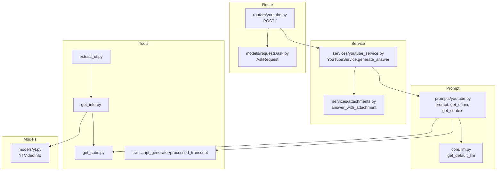
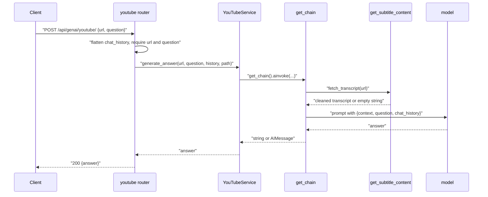
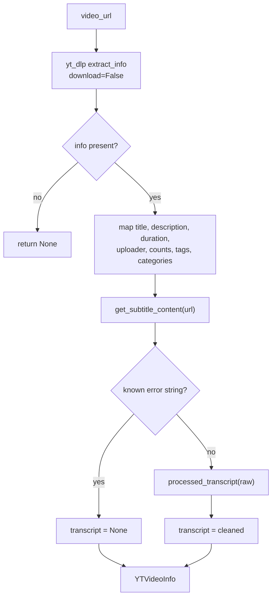
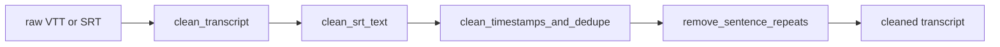
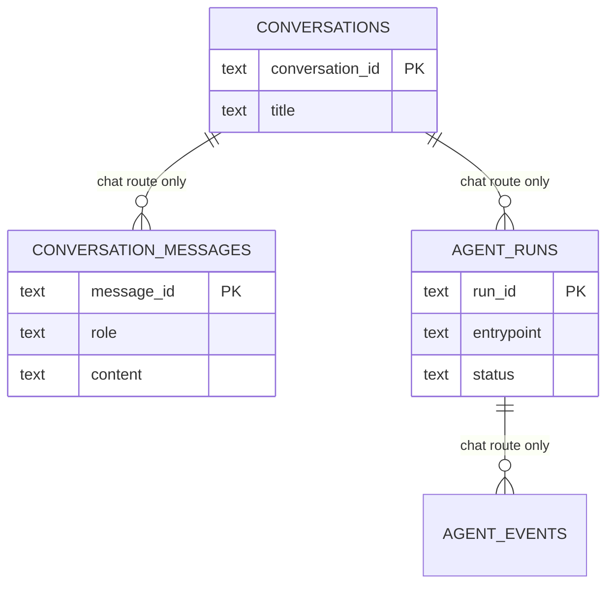
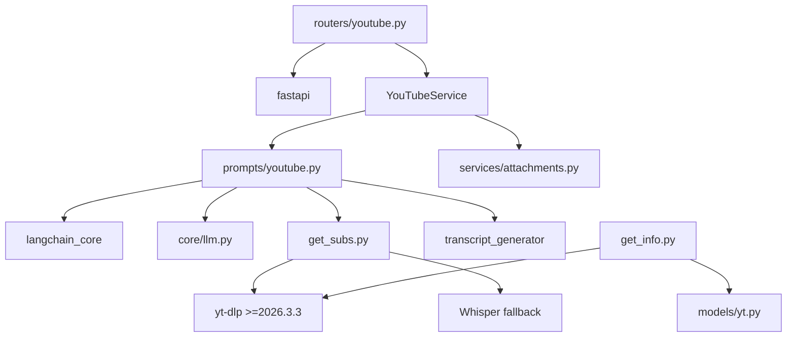

# YouTube data models

YouTube question answering is a single stateless call. `POST /api/genai/youtube/` takes a video URL and a question, fetches the video metadata and transcript, sends both to a prompt chain, and returns one answer string. No conversation row, run row or memory claim is written by this route.

That makes the YouTube page a useful counterexample to the schema pages: `YTVideoInfo` is a Pydantic model that never reaches Postgres. The transcript is cleaned in memory, used as prompt context and discarded.

Key capabilities:
- One request model, `AskRequest`, shared by the route and the service
- An optional `attached_file_path` that switches to the attachment path
- A `YTVideoInfo` metadata shape filled from `yt-dlp`
- Transcript retrieval with language fallback and Whisper as the last resort
- A four step cleaning pipeline for raw subtitle text
- A prompt chain rebuilt per request so the model picker applies
- No database rows and no trace rows

## Repository layout

## Building blocks

- `routers/youtube.py`: `ask`, the only handler, with `response_model=dict`.
- `models/requests/ask.py`: `AskRequest`, four optional fields plus `url` and `question`.
- `services/youtube_service.py`: `YouTubeService.generate_answer`, which returns a string and never raises to the route.
- `prompts/youtube.py`: `prompt` (`PromptTemplate`), `main_chain2` (`RunnableParallel`), `get_chain()`, `fetch_transcript()` and `get_context()`.
- `tools/youtube_utils/get_subs.py`: `get_subtitle_content(video_url, lang="en")`.
- `tools/youtube_utils/get_info.py`: `get_video_info(video_url)` returns `YTVideoInfo | None`.
- `tools/youtube_utils/transcript_generator/__init__.py`: `processed_transcript`.
- `models/yt.py`: `YTVideoInfo`.

## Request shape

`AskRequest`:

| Field | Type | Default | Notes |
| --- | --- | --- | --- |
| `url` | str | required | any YouTube URL form |
| `question` | str | required | the route checks both fields |
| `chat_history` | list[dict] | `[]` | flattened to `role: content` lines |
| `attached_file_path` | str or null | null | path from `/api/upload` |

The handler flattens each history entry into `role: content` and joins with newlines. It then checks `url` and `question` and raises 400 `url and question are required` when either is empty. A service exception becomes 500 `Internal server error \n<exception>`, but the service catches its own errors first, so the usual failure is a 200 with an apology string.

## YTVideoInfo

`models/yt.py` declares the metadata shape:

| Field | Type | Default |
| --- | --- | --- |
| `title` | str | `Unknown` |
| `description` | str | empty |
| `duration` | int | 0 |
| `uploader` | str | `Unknown` |
| `upload_date` | str | empty |
| `view_count` | int | 0 |
| `like_count` | int | 0 |
| `tags` | list[str] | `[]` |
| `categories` | list[str] | `[]` |
| `captions` | str or null | null |
| `transcript` | str or null | null |

`get_video_info` builds this object from a `yt_dlp.YoutubeDL(...).extract_info(url, download=False)` call. It defaults every missing key rather than raising, and it attaches a cleaned transcript when subtitles exist. The chat route does not call `get_video_info`; it only needs the transcript, so the metadata shape is used by tooling and by callers that want a full record.

## Transcript retrieval

`get_subtitle_content` uses `yt-dlp` to request `subtitleslangs=[lang]` with `writeautomaticsub`, `subtitlesformat="vtt/srt/best"` and `skip_download`. The priority order is written in the module docstring:

1. Manual, auto-generated or auto-translated subtitles in the preferred language, in one request.
2. The original language or any available subtitle, with one retry.
3. Whisper audio transcription.

It writes subtitle files into `tools/youtube_utils/temp_subs` and removes the directory in a `finally` block. The error vocabulary is part of the contract, because `prompts/youtube.py` checks for exact strings:

- `Video unavailable.`
- `Subtitles not available for the specified language.`
- `Subtitles were requested but could not be retrieved from file.`
- `Subtitles not available for the specified language or download failed.`
- `Error downloading subtitles: ...` prefix
- `An unexpected error occurred while fetching subtitles: ...` prefix

`fetch_transcript` treats those strings as "no transcript" and returns an empty string. A missing transcript is not an error at the chain level: the prompt still runs with an empty context, and the model is told to answer only from the data it has.

## Cleaning pipeline

`processed_transcript` composes four functions in a fixed order:

- `clean.py`: strips markup and normalises whitespace.
- `srt.py`: removes SRT cue numbers and timing lines.
- `timestamp.py`: removes leftover timestamps and dedupes adjacent lines.
- `duplicate.py`: removes repeated sentences, which auto-captions produce in long runs.

The order matters. Removing timestamps before dedupe keeps two identical lines from different moments distinguishable, and the final sentence pass cleans up what the earlier passes exposed.

## Prompt chain

`prompts/youtube.py` builds a `RunnableParallel` with three inputs: `context` from `RunnableLambda(get_context)`, `question`, and `chat_history`. That feeds `prompt`, then `_current_client()`, then `StrOutputParser`.

`_current_client()` calls `get_default_llm().client` at request time. `get_chain()` returns a fresh chain per call for exactly that reason: a module-level chain would pin the model that was configured at import time and ignore the per-request picker.

The system text names the assistant YTVideoChat and tells it to answer only from a `YTVideoInfo` object, reply "Data not available." for anything outside the schema, keep summaries under 150 words, convert duration from seconds, quote counts and dates, and base sentiment only on captions or transcript.

If `attached_file_path` is set, `generate_answer` takes the other branch. It calls `get_context({"url": url})` in a worker thread, renders the same prompt with `prompt.format(context=..., question=..., chat_history=...)`, and passes the result to `services.attachments.answer_with_attachment`. That path sends the file as a message part to the picked model.

## Where it fits in the schema

The YouTube route writes nothing. It does not call `ConversationService` or `RunTraceService`, so there is no `conversations` row, no `agent_runs` row and no `agent_events` row. Compare that with the chat route, which creates a conversation, a user message, a run and an assistant message for the same kind of question.

The `entrypoint` value `react_agent` appears on runs from the chat path. A YouTube question never produces one. If a feature needs history or an audit trail for video questions, the request has to go through `/api/genai/react` with the URL in the question, not through this route.

## Dependencies

`yt-dlp` is pinned at `>=2026.3.3` in the backend dependencies. `langchain-core` supplies `PromptTemplate`, `RunnableParallel`, `RunnableLambda` and `StrOutputParser`.

## Performance

- The transcript fetch happens inside the request and can take seconds on a long video. The chat route is not involved, so there is no run row to watch while it happens.
- `get_chain()` is rebuilt per request. That is one small object graph, not a network call; the model client itself is cached by `core/llm.py`.
- `get_subtitle_content` cleans its temp directory in `finally`, so a failed fetch does not leave files behind.
- Auto-generated captions are much larger than manual ones, and the cleaning passes are linear in transcript length.
- Whisper fallback is the slow path. It downloads audio and transcribes locally, so a request that hits it can run for minutes.

## Troubleshooting

- A 200 with an apology string: `generate_answer` caught an exception and logged it. Read the backend log for the provider or chain error.
- `url and question are required`: one of the two fields was empty after Pydantic parsing.
- Answers are empty or generic: the transcript fetch returned one of the known error strings, `fetch_transcript` turned it into an empty context, and the model had only the URL.
- A private or age-restricted video fails: `yt-dlp` cannot extract it without cookies. This route has no cookie configuration.
- The answer ignores the attached file: `attached_file_path` must be the exact `path` returned by `/api/upload`, and the resolved file must sit under `uploads/`.
- The model picker has no effect: check that `get_chain()` is the path being used. A cached module-level chain would pin the old model.
- Subtitles exist but the transcript is empty: check the four cleaning functions against the subtitle format. A new format can survive one pass and be eaten by the next.

## Appendix

### Implementation examples
- Route: `await service.generate_answer(url, question, chat_history_str, request.attached_file_path)`.
- Chain: `main_chain2 | prompt | _current_client() | parser`.
- Context: `get_context({"url": url})` returns `processed_transcript(raw)` or `""`.
- Video id: `extract_video_id("https://youtu.be/<id>")` returns `<id>`; `watch?v=` is read from the query string.

### Source files
- `routers/youtube.py`
- `models/requests/ask.py`
- `models/yt.py`
- `services/youtube_service.py`
- `prompts/youtube.py`
- `tools/youtube_utils/get_subs.py`
- `tools/youtube_utils/get_info.py`
- `tools/youtube_utils/extract_id.py`
- `tools/youtube_utils/transcript_generator/__init__.py`
