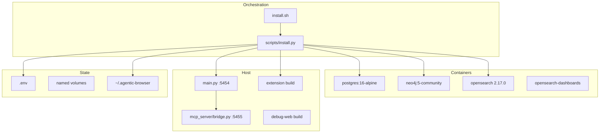
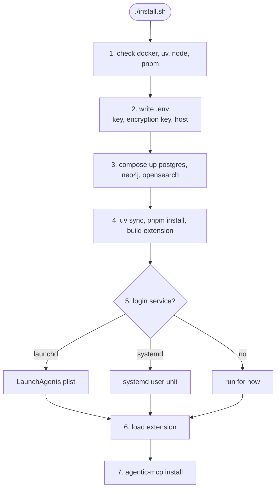
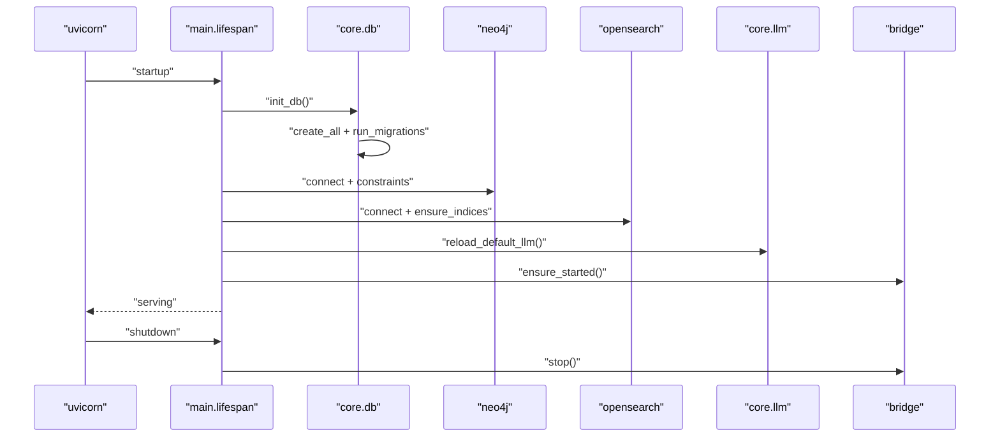
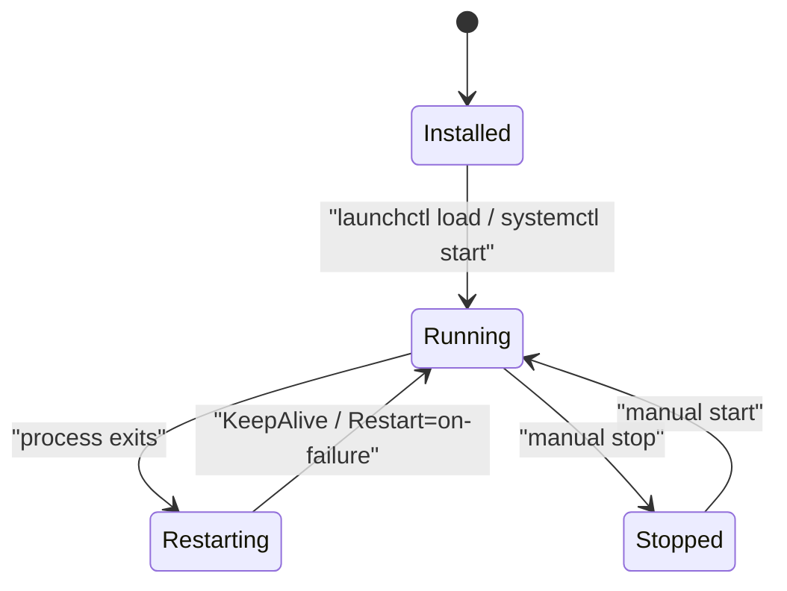
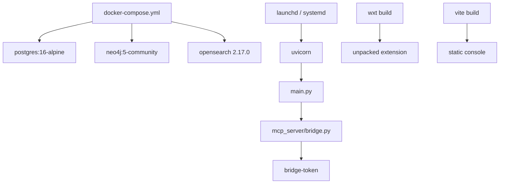

# Deployment and operations

Agentic Browser runs on one machine: Docker Compose for Postgres, Neo4j and OpenSearch; `uv run agentic-api-run` for the FastAPI backend; a built extension loaded unpacked in the browser; and an optional Vite console. The installer is the deployment tool.

There is no container image for the backend, no cloud deployment target, and no reverse proxy or TLS in the repo. The intended scale is one user.

Key capabilities:
- Four-service Compose stack with health checks
- Idempotent database bootstrap
- launchd and systemd user services for the backend
- Chromium MV3 and Firefox MV2 extension builds
- MCP registration for local coding agents
- Volume ownership, backup and rollback notes

## Repository layout



## Building blocks

- `docker-compose.yml`: four services on one bridge network, named volumes, health checks.
- `install.sh`: a thin wrapper. It execs `scripts/install.py` from a checkout, or clones the repo first.
- `scripts/install.py`: standard-library installer. Tools, env, databases, build, service, browsers, MCP.
- `main.py`: the process the service manager runs.
- `mcp_server/bridge.py`: owns the loopback bridge when the port is free.
- `pyproject.toml`: `agentic-api-run` and `agentic-mcp` console scripts.
- `package.json`: extension, console and screenshot scripts.

## How it fits together

The installer is a linear pipeline with each step skippable. It does not install the backend as a container; it runs it from the checkout with `uv`.



Startup inside the backend is defensive. Each dependency is wrapped in its own `try`, so a missing store logs a warning and the API still serves.



## Compose services

| Service | Image | Host port | Health check | Volume |
| --- | --- | --- | --- | --- |
| `postgres` | `postgres:16-alpine` | 5433 → 5432 | `pg_isready` every 10 s | `postgres_data` |
| `neo4j` | `neo4j:5-community` | 7474, 7687 | HTTP 7474 every 15 s | `neo4j_data`, `neo4j_logs`, `neo4j_plugins` |
| `opensearch` | `opensearchproject/opensearch:2.17.0` | 9201 → 9200, 9601 → 9600 | cluster health not red every 15 s | `opensearch_data` |
| `opensearch-dashboards` | `opensearchproject/opensearch-dashboards:2.17.0` | 5602 → 5601 | depends on healthy OpenSearch | none |

OpenSearch runs with the security plugin disabled and TLS off. That is acceptable only because the ports are local by default. On a shared network, bind the published ports to `127.0.0.1` or add a firewall.

Neo4j loads APOC with a 512 MB initial heap, 1 GB max heap and 512 MB page cache. OpenSearch uses `-Xms512m -Xmx1g` and `bootstrap.memory_lock`.

## Environment and secrets

`.env` is created from `.env.example` with mode 0600. The installer fills `OAUTH_ENCRYPTION_KEY`, optionally sets `BACKEND_HOST=127.0.0.1`, and stores one model key plus `DEFAULT_LLM_PROVIDER`.

Secrets added later through the console live encrypted in `app_settings`, not in `.env`.

## Login services

On macOS the installer writes `~/Library/LaunchAgents/sh.taf.agentic-browser.plist`, unloads any previous copy, then runs `launchctl load -w`. The plist runs `uv run agentic-api-run` with `WorkingDirectory` at the checkout, `RunAtLoad` and `KeepAlive`, and logs to `~/.agentic-browser/logs/backend.log`.

On Linux it writes `~/.config/systemd/user/agentic-browser.service` with `Restart=on-failure` and runs `systemctl --user enable --now agentic-browser.service`. Without a systemd user session it starts the backend in the foreground.



## Frontend builds

```sh
pnpm install
pnpm build:extension
pnpm build:extension:firefox
pnpm build:debug
pnpm zip:extension
```

The Chromium build is unpacked MV3. The Firefox build is MV2 and loads as a temporary add-on unless signed. The console is a static Vite bundle.

The build embeds `VITE_API_URL` at compile time. A build pointed at a remote backend keeps that host until rebuilt.

## Database migrations

`init_db()` creates missing tables from SQLAlchemy metadata, then `core/migrations.py` discovers `migrations/000*.py`, compares against `schema_migrations`, and calls each module's `upgrade(conn)` in one transaction. Migrations are additive and idempotent.

There is no migration command to run before boot, and no down migration. Roll back the application, keep the schema.

## Volumes and backup

| Volume | Contents |
| --- | --- |
| `postgres_data` | conversations, runs, settings, credentials, memory tables |
| `neo4j_data` | entities and claim links |
| `opensearch_data` | claim, artifact and entity indices |

Host state:

- `uploads/` for attachments and generated skill output.
- `~/.agentic-browser/bridge-token`, mode 0600.
- `~/.agentic-browser/mcp-settings.json` for MCP tool groups.
- `~/.agentic-browser/runtime-workspace/` for subscription agents.
- `~/.agentic-browser/antigravity/` for the Google AI profile.
- `~/.agentic-browser/logs/backend.log`.
- `.oauth_encryption_key` beside `main.py` when no env key is set.

Neo4j and OpenSearch can be rebuilt from Postgres with the maintenance repair job. Back up the Postgres volume.

## MCP registration

Step 7 runs `uv run agentic-mcp install`. It detects Claude Code, Codex, Cursor, Gemini CLI and OpenCode. `--dry-run` prints the diff. `agentic-mcp config` prints snippets for manual setup. Each file is backed up before editing.

For URL-only clients, `agentic-mcp serve` keeps the HTTP endpoint at `http://127.0.0.1:5455/mcp`.

## Rollback

1. Stop the login service.
2. Check out the previous commit, run `uv sync` and `pnpm install`.
3. Rebuild and reload the extension.
4. Leave the schema in place. Add a new migration if a rollback needs a change.
5. Restart and check `/` and `/bridge/status`.

## Dependencies



## Performance

- Compose health checks run every 10 to 15 seconds; the installer polls up to 90 times at 2 seconds.
- SQLAlchemy pool is 10 with 20 overflow.
- The bridge uses `SO_REUSEADDR` on POSIX for fast restarts.
- Neo4j and OpenSearch are capped at 1 GB heaps.
- The extension is loaded from disk; there is no hot reload in production.

## Troubleshooting

- A database is not healthy after 90 polls: check `docker compose ps` and port conflicts on 5433, 7474 or 9201.
- Memory search is empty: OpenSearch failed its startup block. Start the container and restart the API.
- The login service cannot reach the backend: the service inherits `PATH` but not your shell env. Put variables in `.env`.
- `launchctl load` fails: a previous plist is loaded. Unload it first.
- Firefox loses the extension: temporary add-ons are removed on quit.
- MCP install edits the wrong config: set `CODEX_HOME` or use `agentic-mcp config`.
- The API is reachable on the LAN: set `BACKEND_HOST=127.0.0.1`.

## Appendix

### Implementation examples
- Install: `./install.sh --yes --skip-browsers`.
- Backend: `uv run agentic-api-run`.
- Databases only: `docker compose up -d postgres neo4j opensearch`.
- Extension: `pnpm --filter @agentic-browser/browser-extension build`.
- MCP: `uv run agentic-mcp install --dry-run`.
- Health: `GET /api/genai/health/`.

### Source files
- `docker-compose.yml`
- `scripts/install.py`
- `install.sh`
- `main.py`
- `pyproject.toml`
- `package.json`
- `.env.example`
- `core/migrations.py`
- `mcp_server/bridge.py`
- `mcp_server/install.py`
