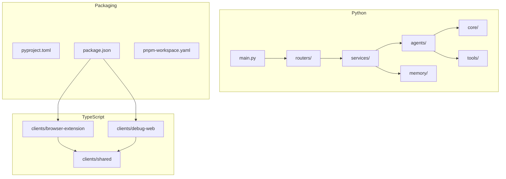
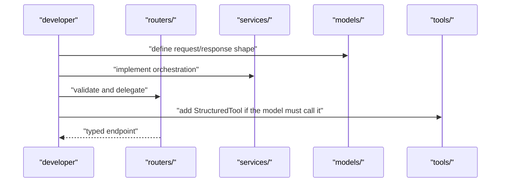
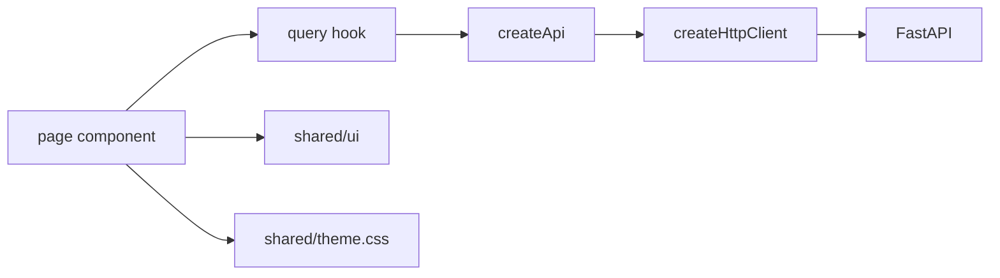
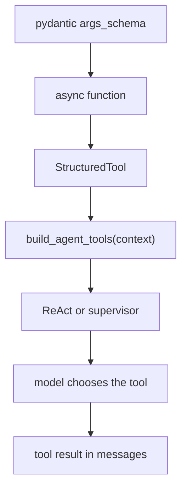
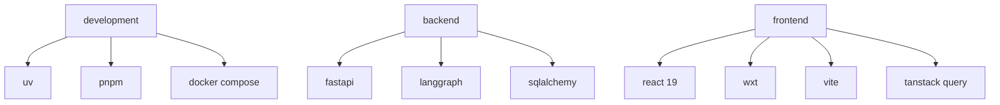

# Development guidelines

This page is the working guide for changing the repo: where code lives, how to run each app, how to add a tool or route, and what to check before handing work back. It is not a style manifesto. It describes the patterns the code already follows.

The repository is a Python backend plus a pnpm frontend workspace. The backend is plain FastAPI and LangGraph, not a framework with generated layers. The frontend is React 19 with WXT and Vite.

Key capabilities:
- One checkout, two package managers
- Clear layer boundaries on the backend
- Typed tools and pydantic request models
- Shared frontend API client and query hooks
- Type checks and manual verification steps
- Known gaps, including the missing test suite

## Repository layout



## Building blocks

- `pyproject.toml`: Python dependencies, the `agentic-api-run` and `agentic-mcp` scripts, and the package list for setuptools.
- `package.json`: pnpm workspace scripts. `dev:debug`, `dev:extension`, `build:extension`, `typecheck:extension`, `screenshots`.
- `pnpm-workspace.yaml`: includes `clients/*`.
- `main.py`: app creation and router mounts.
- `routers/`: one module per resource group. Routes validate and delegate.
- `services/`: orchestration. Business logic lives here, not in routes.
- `agents/`: LangGraph graphs and the tool registry.
- `memory/`: ingestion, retrieval, graph and maintenance.
- `core/`: config, DB, crypto, model clients, runtimes and loop guard.
- `tools/`: callable tools grouped by service.
- `clients/shared`: the single API client, query hooks, settings UI, markdown and primitives.

## How it fits together

A change usually crosses one boundary. A new endpoint adds a route, a service method, and a request or response model. A new tool adds a `StructuredTool` and wires it into `build_agent_tools`. A new frontend screen adds a route and a query hook.



## Local workflow

```sh
docker compose up -d
uv sync
uv run agentic-api-run

pnpm install
pnpm dev:extension
pnpm dev:debug
```

The extension dev server rebuilds on change. The console runs on Vite. The backend runs with reload from `main.run()`.

Useful checks:

```sh
pnpm typecheck:extension
pnpm --filter @agentic-browser/shared typecheck
uv run python -c "import main"
```

There is no linter or formatter configured in the repo. Match the surrounding style: type hints in Python, named exports in TypeScript, no default exports except entrypoints.

## Backend conventions

- Routes are thin. They validate with pydantic and map errors to `HTTPException`.
- Services own state and side effects. They use `async with get_session()` for Postgres.
- Use `get_logger(__name__)` and log exceptions with `logger.exception` or `logger.error`.
- Background work is an `asyncio.create_task` with a strong reference if it must survive.
- Blocking calls go through `asyncio.to_thread` or a subprocess.
- Optional dependencies fail soft at startup. Do not make Neo4j or OpenSearch mandatory.
- Tool functions return strings or JSON-safe dicts. Models see the text, not exceptions.
- Add a tool to `build_agent_tools`, not only to `AGENT_TOOLS`, if it depends on request context.

## Frontend conventions

- The shared API client lives in `clients/shared/src/utils/http.ts`. Add endpoints there, not in a one-off fetch.
- Query keys are scoped by base URL. Use `queryKeys` and the option factories in `query/hooks.ts`.
- Settings UI is shared. Add a section under `settings-ui/sections` and register it in the settings shell.
- Markdown rendering is shared. Do not fork the renderer for the console.
- The extension stores display state in `browser.storage.local`; tokens stay on the backend.
- Use `data-theme` for theme changes and the `ab-` classes for shared styling.



## Adding a tool

1. Define a pydantic input model in `agents/react_tools.py` or the tool module.
2. Implement an async function. Return a string or a JSON-safe value.
3. Wrap it in `StructuredTool` with a name, description and `args_schema`.
4. Add it to `build_agent_tools` and, if it is always available, to `AGENT_TOOLS`.
5. If the supervisor should route to it, add the name to a group in `_partition_tools`.
6. Add a trace event if the tool does long work.



## Adding an endpoint

1. Add request and response models under `models/requests` and `models/response` if the shape is new.
2. Add the service method.
3. Add the route and mount the router in `main.py`.
4. Add the client method in `clients/shared/src/utils/http.ts`.
5. Add a query hook if the console reads it.
6. Document the method, path, auth, body and errors.

## Type checks and tests

The only automated check is TypeScript compilation:

```sh
pnpm typecheck:extension
```

There is no pytest suite. `Testing Strategy` lists the first tests worth adding: loop guard, browser parser, message conversion, compaction and migrations. If you add tests, run them through `uv run pytest` so the project environment is used.

## Dependencies



## Performance

- Keep request handlers non-blocking. A synchronous `requests` call in a route blocks the loop.
- Reuse module-level clients for Neo4j, OpenSearch and the LLM.
- Do not add a database query inside a loop when one `IN` query works.
- The frontend polls stats every 4 seconds; do not add another global poller without a reason.
- The browser planner payload is truncated to 5000 characters of page text and 80 elements.

## Troubleshooting

- `ModuleNotFoundError` after adding a package: run `uv sync`; `pyproject.toml` is the source of truth.
- Extension types missing: run `pnpm install`; WXT's `postinstall` generates `.wxt/types`.
- A route is not reachable: confirm it is mounted in `main.py` and the router is exported from `routers/__init__.py`.
- A tool is not called: check it is in `build_agent_tools`, the model supports tool calling, and the description is specific.
- Settings UI blank: the component needs `ApiProvider` and a TanStack Query client above it.
- A doc page 404s after a rename: filenames are URL segments. Keep the old file or add a new page with the old name.

## Appendix

### Implementation examples
- Type check: `pnpm typecheck:extension`.
- Backend import check: `uv run python -c "import main"`.
- Add a route: `routers/`, `main.py`, `clients/shared/src/utils/http.ts`.
- Add a tool: `agents/react_tools.py` `build_agent_tools`.
- Add a settings section: `clients/shared/src/settings-ui/sections/`.

### Source files
- `pyproject.toml`
- `package.json`
- `pnpm-workspace.yaml`
- `main.py`
- `routers/__init__.py`
- `agents/react_tools.py`
- `clients/shared/src/utils/http.ts`
- `clients/shared/src/query/hooks.ts`
- `clients/shared/src/settings-ui/index.ts`
