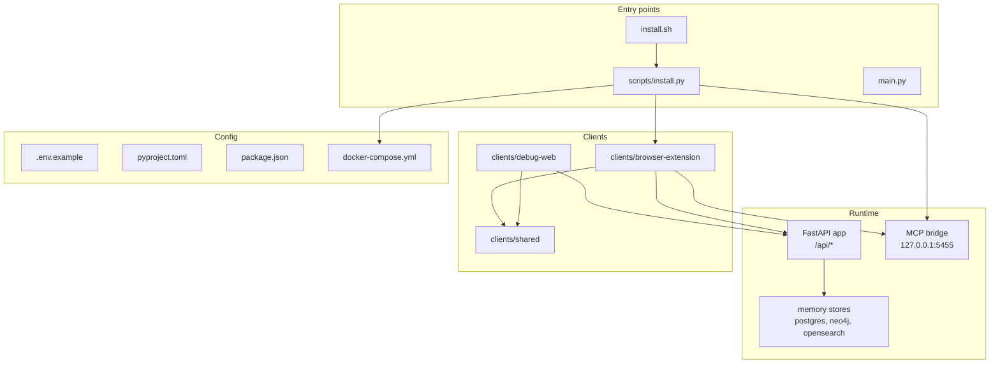
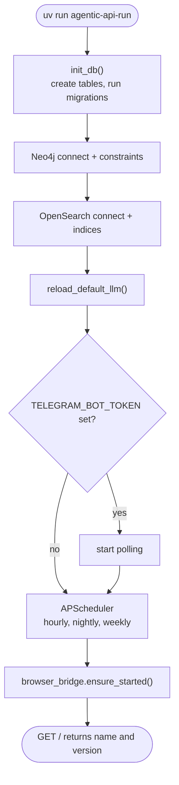
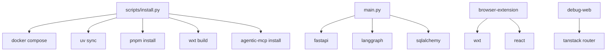

# Getting started

Agentic Browser is a browser extension, a FastAPI backend and an optional debug console. The extension reads the page you are on, sends it to the backend, and runs one checked browser action at a time until the task is done. Memory, MCP access and subscription runtimes are optional layers on top.

This page takes a fresh checkout to a working side panel: databases, backend, extension build, model key, and the first connected browser.

Key capabilities:
- One-command installer for macOS and Linux
- Manual setup path for a checkout you want to control
- Every environment variable the backend reads
- Port map for the backend, bridge and three databases
- First-run checks for the model, the extension and the MCP bridge

## Repository layout



## Prerequisites

| Tool | Version used | Where it is required |
| --- | --- | --- |
| Python | `>=3.12` (`pyproject.toml`) | backend, MCP server, installer |
| uv | any current release | `uv sync`, `uv run agentic-api-run` |
| Node | 20 or newer | WXT and Vite builds |
| pnpm | `9.0.0` (`package.json` `packageManager`) | extension and console workspace |
| Docker | Compose v2 | Postgres, Neo4j and OpenSearch |
| Chrome, Brave, Edge, Arc, Firefox or a Chromium fork | current | loading the unpacked extension |

The installer checks the first four and offers Homebrew installs on macOS. Windows is not supported. Linux works, including containers, where login-service setup is skipped when there is no systemd user session.

## Install with the script

```sh
bash <(curl -fsSL https://raw.githubusercontent.com/tashifkhan/agentic-browser/main/install.sh)
# or from a checkout
./install.sh
```

`install.sh` delegates to `scripts/install.py`. The installer runs seven steps and asks before anything that changes the machine:

1. checks docker, uv, node and pnpm
2. writes `.env`, asks for a model key, generates `OAUTH_ENCRYPTION_KEY`
3. starts postgres, neo4j and opensearch with Compose
4. runs `uv sync`, `pnpm install` and builds the extension
5. starts the backend at login or just for now
6. finds installed browsers and walks through loading the extension
7. registers `agentic-mcp` with local coding agents

Useful flags:

```sh
./install.sh --yes
./install.sh --dry-run
./install.sh --firefox
./install.sh --browser PATH
./install.sh --skip-docker
./install.sh --skip-browsers
./install.sh --skip-mcp
```

Browsers do not let a script install an unpacked extension silently. Step 6 opens each browser with the build folder on the clipboard and waits while you turn on developer mode, choose Load unpacked, and paste the path.

## Manual setup

```sh
docker compose up -d
cp .env.example .env
uv sync
uv run agentic-api-run

pnpm install
pnpm build:extension
pnpm dev:debug
```

Load `clients/browser-extension/.output/chrome-mv3` unpacked. `pnpm dev:extension` rebuilds on change. The Firefox build uses `pnpm build:extension:firefox` and outputs `firefox-mv2`.

## Environment variables

`core/config.py` defines a pydantic `Settings` model read from `.env` with case-insensitive names. Values saved through the console win over env values for secrets and OAuth clients.

| Variable | Default | Purpose |
| --- | --- | --- |
| `ENV` | `development` | `development`, `production` or `test` |
| `DEBUG` | `True` | debug logging level |
| `BACKEND_HOST` | `0.0.0.0` | bind address for `main.run()` |
| `BACKEND_PORT` | `5454` | backend port |
| `GOOGLE_API_KEY` | empty | Gemini and Google embeddings |
| `OPENAI_API_KEY` | empty | OpenAI models and embeddings |
| `ANTHROPIC_API_KEY` | empty | Claude models |
| `DEEPSEEK_API_KEY` | empty | DeepSeek |
| `OPENROUTER_API_KEY` | empty | OpenRouter |
| `OPENCODE_API_KEY` | empty | OpenCode Zen and Go |
| `OLLAMA_BASE_URL` | `http://localhost:11434` | local Ollama |
| `OPENAI_BASE_URL`, `ANTHROPIC_BASE_URL`, `GOOGLE_BASE_URL` | empty | gateways or vLLM |
| `CHAT_TITLE_LLM_PROVIDER` | `google` | chat title model |
| `CHAT_TITLE_LLM_MODEL` | `gemini-3.1-flash-lite` | chat title model name |
| `POSTGRES_HOST` | `localhost` | Postgres host |
| `POSTGRES_PORT` | `5433` | host port |
| `POSTGRES_DB` | `agentic_memory` | database |
| `POSTGRES_USER` | `agentic` | user |
| `POSTGRES_PASSWORD` | `agentic_secret` | password |
| `NEO4J_URI` | `bolt://localhost:7687` | graph connection |
| `NEO4J_USER` | `neo4j` | graph user |
| `NEO4J_PASSWORD` | `neo4j_secret` | graph password |
| `OPENSEARCH_HOST` | `localhost` | search host |
| `OPENSEARCH_PORT` | `9201` | host port |
| `OAUTH_ENCRYPTION_KEY` | generated file | 32-byte base64-url AES key |
| `GOOGLE_CLIENT_SECRET` | empty | Google OAuth exchange |
| `GITHUB_CLIENT_ID`, `GITHUB_CLIENT_SECRET` | empty | GitHub OAuth |
| `COMPOSIO_API_KEY`, `COMPOSIO_USER_ID` | empty | Composio |
| `TELEGRAM_BOT_TOKEN` | empty | starts the Telegram bot |
| `TELEGRAM_ALLOWED_USERS` | empty | allowed Telegram ids |
| `TAVILY_API_KEY` | empty | search provider |
| `ELEVENLABS_API_KEY`, `CARTESIA_API_KEY` | empty | read-aloud |
| `CORS_ORIGINS` | empty | extra allowed origins |

If `OAUTH_ENCRYPTION_KEY` is missing, `core/crypto.py` writes `.oauth_encryption_key` beside `main.py` with mode 0600. Set a stable value for anything beyond a single-user dev machine.

## Ports

| Service | Host port | Container port |
| --- | --- | --- |
| FastAPI backend | 5454 | none |
| MCP bridge and HTTP MCP | 5455 | none |
| Postgres | 5433 | 5432 |
| Neo4j Browser | 7474 | 7474 |
| Neo4j Bolt | 7687 | 7687 |
| OpenSearch REST | 9201 | 9200 |
| OpenSearch Dashboards | 5602 | 5601 |

The backend and bridge bind loopback for the bridge and all interfaces for the API by default. Set `BACKEND_HOST=127.0.0.1` on a network you do not trust. The API has no login; CORS only admits extension origins and localhost.

## First run



1. Start the backend and check `curl http://127.0.0.1:5454/`.
2. Open the side panel. Sign in with Google or GitHub, or skip and use a model key.
3. Open the console, go to Settings, confirm the model row.
4. Ask a page question. No tool rows means the model key is wrong. No page access means the extension or runtime is the problem.
5. For MCP, run `agentic-mcp status`, then `agentic-mcp install --dry-run`.

## Verification

```sh
curl http://127.0.0.1:5454/api/genai/health/
curl http://127.0.0.1:5454/api/auth/status
curl http://127.0.0.1:5455/bridge/status
uv run agentic-mcp status
pnpm typecheck:extension
```

## Dependencies



## Performance

- Compose health checks gate the installer: Postgres every 10 s, Neo4j every 15 s, OpenSearch every 15 s.
- The backend pool is 10 connections with 20 overflow.
- `init_db()` runs `create_all` then numbered migrations. Re-running is safe.
- The bridge waits 3 seconds for a browser before a call fails.
- Extension builds land in `.output/`; reload the unpacked folder after a rebuild.

## Troubleshooting

- `Postgres init skipped`: Docker is down or the password differs. Run `docker compose ps`.
- `Neo4j init skipped` or `OpenSearch init skipped`: the API still starts, but memory degrades.
- `API key for 'google' not found`: add a key in Settings or `.env`.
- Side panel says the backend is offline: check `BACKEND_PORT`, `VITE_API_URL`, and `baseUrl`.
- Extension missing: load `.output/chrome-mv3`, not the source folder.
- `agentic-mcp status` says no bridge: start the backend or run `agentic-mcp serve`.
- `OAUTH_ENCRYPTION_KEY` errors: the key must decode to 32 bytes.
- Login works but tools report `needs_reauth`: disconnect and sign in again.

## Appendix

### Implementation examples
- Server entry: `main.run(host="0.0.0.0", port=5454, reload=True)`.
- Installer entry: `install.sh` execs `python3 scripts/install.py`.
- Health: `GET /api/genai/health/`.
- Console scripts: `pnpm dev:debug`, `pnpm build:debug`, `pnpm screenshots`.

### Source files
- `README.md`
- `pyproject.toml`
- `package.json`
- `docker-compose.yml`
- `.env.example`
- `install.sh`
- `scripts/install.py`
- `main.py`
- `core/config.py`
- `core/db.py`
- `core/crypto.py`
- `mcp_server/bridge.py`
