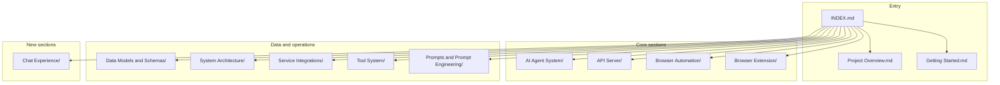
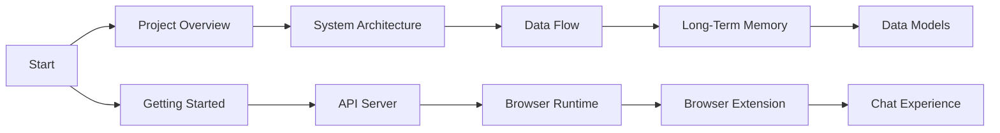
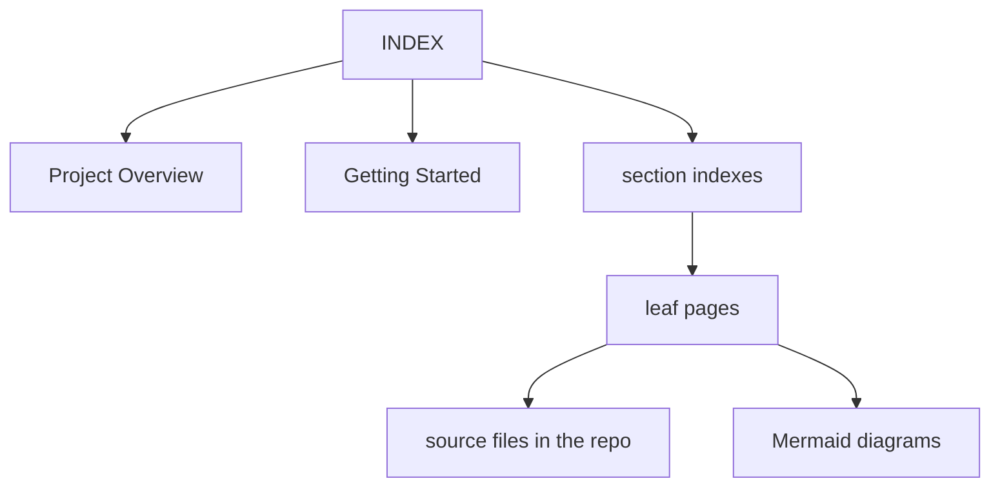

# Agentic browser documentation index

This is the entry point for the Agentic Browser docs. The tree keeps its original folders: AI Agent System, API Server, Browser Automation, Browser Extension, Data Models and Schemas, Prompts and Prompt Engineering, Service Integrations, System Architecture and Tool System. New pages for memory, MCP, chat and the console live inside those folders or in the Chat Experience section.

Start with Project Overview if you are new, or Getting Started if you want to run it.

## Repository layout

## Start here

| Page | What it covers |
| --- | --- |
| [Project Overview](Project%20Overview) | problem, approach, features, architecture at a glance |
| [Getting Started](Getting%20Started) | prerequisites, install, env vars, first run |
| [Testing Strategy](Testing%20Strategy) | what verification exists, manual QA, first tests |
| [Troubleshooting and FAQ](Troubleshooting%20and%20FAQ) | startup, model, bridge, browser and memory failures |

## AI and agents

| Page | What it covers |
| --- | --- |
| [AI Agent System](AI%20Agent%20System/AI%20Agent%20System) | ReAct agent, supervisor, tools, subscriptions, memory |
| [Reactive Agent Architecture](AI%20Agent%20System/Reactive%20Agent%20Architecture) | LangGraph graph, tool loop, loop guard |
| [While-Loop Supervisor](AI%20Agent%20System/While-Loop%20Supervisor) | supervisor, subagents, quality checks |
| [Tool Integration System](AI%20Agent%20System/Tool%20Integration%20System) | typed tool registry and conditional tools |
| [Subscription Runtimes](AI%20Agent%20System/Subscription%20Runtimes) | Claude, Codex, Antigravity and OpenCode plans |
| [Long-Term Memory](AI%20Agent%20System/Long-Term%20Memory) | three-store memory model |
| [Memory Ingestion](AI%20Agent%20System/Memory%20Ingestion) | extraction, gate, reconciliation |
| [Memory Retrieval](AI%20Agent%20System/Memory%20Retrieval) | hybrid search and context assembly |
| [Memory Maintenance](AI%20Agent%20System/Memory%20Maintenance) | decay, dedup, repair, promotion |
| [LLM Provider Abstraction](AI%20Agent%20System/LLM%20Provider%20Abstraction) | providers, keys, base URLs, per-request model |
| [Model Catalog](AI%20Agent%20System/Model%20Catalog) | models.dev, context windows, endpoint discovery |
| [Prompt Engineering System](AI%20Agent%20System/Prompt%20Engineering%20System) | prompts for planning, memory, website, YouTube |
| [Compaction and Context Management](AI%20Agent%20System/Compaction%20and%20Context%20Management) | long chats and tool output trimming |

## API and data

| Page | What it covers |
| --- | --- |
| [API Server](API%20Server/API%20Server) | every mounted route group |
| [API Overview](API%20Server/API%20Overview) | base paths, errors, SSE, model headers |
| [Agent System API](API%20Server/Agent%20System%20API) | chat and stream endpoints |
| [Conversations and Runs API](API%20Server/Conversations%20and%20Runs%20API) | conversations, messages, runs, traces |
| [Browser Runtime API](API%20Server/Browser%20Runtime%20API) | one-step browser planning |
| [Memory API](API%20Server/Memory%20API) | search, context, tools, ingest, maintenance |
| [Integrations and Settings API](API%20Server/Integrations%20and%20Settings%20API) | settings, Composio, runtimes, secrets |
| [Authentication and Security](API%20Server/Authentication%20and%20Security) | OAuth exchange and credential status |
| [Gmail Integration API](API%20Server/Gmail%20Integration%20API) | Gmail routes |
| [Calendar Integration API](API%20Server/Calendar%20Integration%20API) | Calendar routes |
| [GitHub Integration API](API%20Server/GitHub%20Integration%20API) | repo question and archive upload |
| [YouTube Integration API](API%20Server/YouTube%20Integration%20API) | video question route |
| [Website Processing API](API%20Server/Website%20Processing%20API) | page and validator routes |
| [Academic Portal API](API%20Server/Academic%20Portal%20API) | PyJIIT login, semesters, attendance |
| [Data Models and Schemas](Data%20Models%20and%20Schemas/Data%20Models%20and%20Schemas) | app and memory schema |
| [Schema Overview](Data%20Models%20and%20Schemas/Schema%20Overview) | tables, columns, keys |
| [Memory Entities and Claims](Data%20Models%20and%20Schemas/Memory%20Entities%20and%20Claims) | claims, evidence, relations |
| [Data Migration Strategy](Data%20Models%20and%20Schemas/Data%20Migration%20Strategy) | numbered migrations |

## Browser and frontend

| Page | What it covers |
| --- | --- |
| [Browser Automation](Browser%20Automation/Browser%20Automation) | planner, executor, snapshots, loop guard |
| [Browser Runtime Planner](Browser%20Automation/Dynamic%20Script%20Generation) | one action per step |
| [DOM Manipulation and Element Targeting](Browser%20Automation/DOM%20Manipulation%20and%20Element%20Targeting) | selectors, refs, input |
| [Page Snapshot and Refs](Browser%20Automation/Page%20Snapshot%20and%20Refs) | accessibility outline |
| [Remote Browser Tasks](Browser%20Automation/Remote%20Browser%20Tasks) | `task.run` from Telegram and MCP |
| [Browser Extension](Browser%20Extension/Browser%20Extension) | side panel, popup, worker, console |
| [Extension Architecture](Browser%20Extension/Extension%20Architecture) | WXT entrypoints and bridge socket |
| [Side Panel UI Components](Browser%20Extension/Side%20Panel%20UI%20Components) | chat shell, composer, settings |
| [Console Architecture](Browser%20Extension/Console%20Architecture) | routes, shell, telemetry |
| [State Management](Browser%20Extension/State%20Management) | sessions, settings, query cache |
| [UI Component Library](Browser%20Extension/UI%20Component%20Library) | primitives and composites |
| [Work Log and Chat Rendering](Browser%20Extension/Work%20Log%20and%20Chat%20Rendering) | streamed events and markdown |

## Integrations and operations

| Page | What it covers |
| --- | --- |
| [Service Integrations](Service%20Integrations/Service%20Integrations) | Google, GitHub, PyJIIT, Composio, skills |
| [Composio Toolkit Actions](Service%20Integrations/Composio%20Toolkit%20Actions) | connected apps and actions |
| [Skills Execution](Service%20Integrations/Skills%20Execution) | docx, pptx, xlsx, system info |
| [Secret Storage](Service%20Integrations/Secret%20Storage) | encrypted settings and OAuth clients |
| [Telegram Bot](Service%20Integrations/Telegram%20Bot) | remote tasks and allow list |
| [System Architecture](System%20Architecture/System%20Architecture) | process topology and ports |
| [Backend Server Design](System%20Architecture/Backend%20Server%20Design) | routes, services, agents, core |
| [Component Interactions and Data Flow](System%20Architecture/Component%20Interactions%20and%20Data%20Flow) | chat, browser, memory and trace flows |
| [MCP Protocol Implementation](System%20Architecture/MCP%20Protocol%20Implementation) | bridge and MCP transport |
| [AI_ML Architecture](System%20Architecture/AI_ML%20Architecture) | model layer, graphs, retrieval |
| [Deployment Architecture](System%20Architecture/Deployment%20Architecture) | processes, volumes, exposure |
| [MCP Server](MCP%20Server) | server tools, code mode, installation |
| [Configuration Management](Configuration%20Management) | env, settings, providers, secrets |
| [Deployment and Operations](Deployment%20and%20Operations) | compose, installer, services, rollback |
| [Development Guidelines](Development%20Guidelines) | layout, tooling, type checks, review |
| [Security Considerations](Security%20Considerations) | auth, origins, bridge token, memory gate |
| [Chat Experience](Chat%20Experience/Chat%20Experience) | streaming, compaction, attachments, voice |
| [API Client Libraries](API%20Client%20Libraries) | shared HTTP client, query hooks, SSE |

## How the documentation fits together

## Dependencies

## Source files
- `README.md`
- `main.py`
- `AGENTS.md` if the repo adds one
