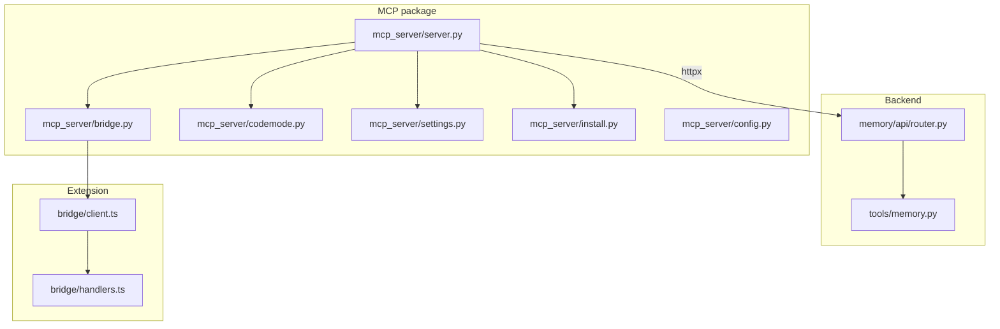
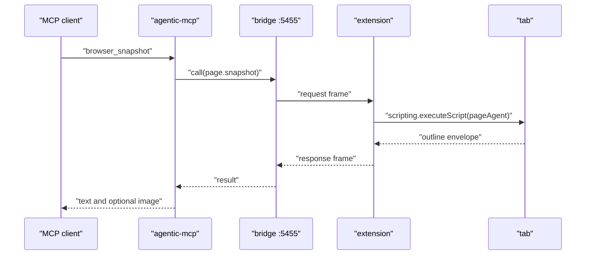
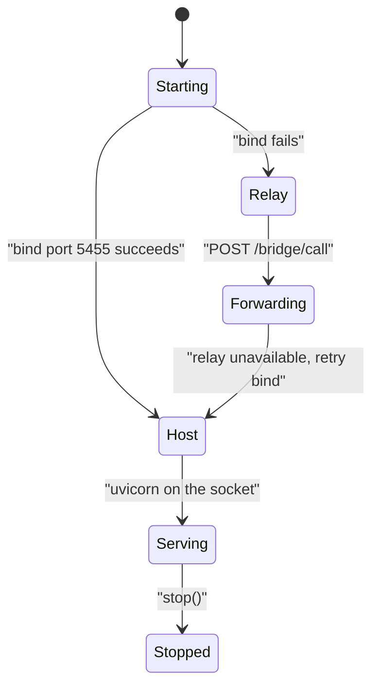
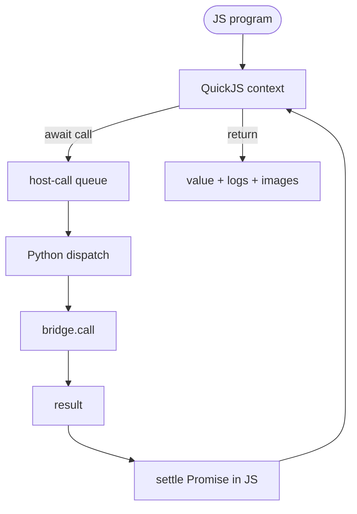
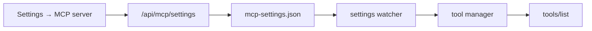
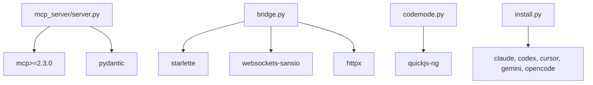

# MCP server

`agentic-mcp` lets a coding agent drive the user's real browser through MCP. It exposes four browser tools and five memory tools, and it runs as a standalone package so Claude Code, Codex, Cursor, Gemini CLI or OpenCode can use it without the full backend.

The browser tools go through a local bridge on `127.0.0.1:5455`. The extension dials that bridge over a WebSocket. Memory tools call the backend HTTP API, so they need the backend running; browser tools do not.

Key capabilities:
- Four browser tools with a shared bridge
- Five memory tools backed by the HTTP API
- Code mode with a QuickJS sandbox
- Host or relay election on port 5455
- Client registration for five coding agents
- Tool groups configurable from the console

## Repository layout



## Building blocks

- `mcp_server/server.py`: `MCPServer` instance, tool definitions, CLI, HTTP app, tool-group application.
- `mcp_server/bridge.py`: `LocalBridge` owns extension WebSockets; `RemoteBridge` relays over HTTP; `BridgeManager` elects host or relay.
- `mcp_server/codemode.py`: `CodeRunner` with QuickJS, a prelude that defines `browser` and `tab`, and a host-call event loop.
- `mcp_server/settings.py`: tool groups in `~/.agentic-browser/mcp-settings.json`, with env defaults.
- `mcp_server/install.py`: writes MCP config for Claude Code, Codex, Cursor, Gemini CLI and OpenCode.
- `mcp_server/config.py`: bridge host, port, state dir, token file, API URL and allowed extension ids.

## Browser tools

| Tool | Arguments | Returns |
| --- | --- | --- |
| `browser_tabs` | `action` list/open/close/focus, `tab_id`, `url`, `active` | connected browsers and tab lines, or a confirmation |
| `browser_snapshot` | `tab_id`, `screenshot`, `max_chars` 2000 to 100000 | accessibility outline with `[ref=eN]`, optional image |
| `browser_act` | action plus action-specific fields | tab line, ok or failed, note, dialog, optional snapshot |
| `browser_execute` | `code`, `timeout_s` 5 to 300 | return value, console output, call count, images |

`browser_act` supports click, type, press, hover, select, check, scroll, navigate, back, forward, reload, wait_for, evaluate and dialog. `target` is a snapshot ref, a CSS selector or `text=Visible text`.

## The bridge

One process owns `127.0.0.1:5455`. The extension connects to `/bridge/ws` and sends a `hello` frame. Tool calls are JSON frames with a request id and a timeout. A second process that wants the browser relays through `POST /bridge/call` with the token from `~/.agentic-browser/bridge-token`.





## Memory tools

| Tool | Behavior |
| --- | --- |
| `memory_recall` | hybrid search over active memories |
| `memory_save` | one durable fact, reconciled with existing claims |
| `memory_profile` | short identity and skills summary |
| `memory_documents` | source snippets and extracted facts from imported documents |
| `memory_forget` | deletes by claim id and redacts source chat turns |

These call `/api/memory/tools/*`, `/api/memory/profile` and `/api/memory/forget`. They reuse the same functions as the in-process agent tools, so classification and reconciliation match.

## Code mode

`browser_execute` runs an async JavaScript program in QuickJS. The program gets `browser.tabs()`, `browser.tab(id)`, `browser.open(url)`, `sleep(ms)`, `console` and a persistent `state` object. Each `tab` has snapshot, navigate, click, type, press, select, check, hover, scroll, waitFor, evaluate, text, screenshot, dialog, close and focus.

The sandbox has no network, file system or Node APIs. Each burst of JS between browser calls gets 5 seconds; the whole program gets the caller's timeout, capped at 300 seconds. Memory is limited to 256 MB and output to 40,000 characters.



## Installation

```sh
uv tool install ./mcp_server
agentic-mcp install
agentic-mcp install --dry-run
agentic-mcp config
agentic-mcp status
agentic-mcp serve
```

`install` detects clients and writes user-scope config. Codex gets a TOML table, Claude Code uses `claude mcp add`, Cursor and Gemini get JSON files, and OpenCode gets its JSON config. Files are backed up first.

## Tool groups

The console writes `browser_tools`, `memory_tools` and `browser_mode` to `~/.agentic-browser/mcp-settings.json`. `browser_mode` is `all`, `execute` (tabs and code mode only) or `plain` (no code mode). Every `agentic-mcp` process watches the file and re-applies the tool list within about two seconds.



## Security

- The bridge binds loopback.
- WebSockets are accepted only from `chrome-extension://` and `moz-extension://` origins, optionally restricted by `AGENTIC_BROWSER_EXTENSION_IDS`.
- `/mcp` rejects cross-site `Origin` and foreign `Host` headers.
- `/bridge/call` requires the bearer token and rejects requests with an `Origin` header.
- The token file is created with mode 0600.

## Dependencies



## Performance

- API call timeouts clamp between 1 and 1800 seconds.
- `browser_tabs open` uses a 45 second bridge timeout.
- The bridge waits 3 seconds for a browser before failing a call.
- Code mode gets 5 seconds per JS burst, 256 MB memory, 40k output.
- Settings changes apply in about 2 seconds; clients that ignore tool-list updates need a restart.

## Troubleshooting

- `No browser is connected`: the extension is not loaded or points at another bridge.
- WebSocket close 4403: origin rejected. Check `AGENTIC_BROWSER_EXTENSION_IDS`.
- WebSocket close 4400: first frame was not `hello`. Update the extension.
- `/bridge/call` 401: wrong or missing token.
- `/bridge/call` 403: a browser sent the request. Only local processes may relay.
- Memory tool error: the backend is not running at `AGENTIC_BROWSER_API_URL`.
- Tool list stale: restart the client, or apply settings again from the console.

## Appendix

### Implementation examples
- CLI: `agentic-mcp stdio`, `serve`, `status`, `install`, `config`.
- Bridge status: `GET http://127.0.0.1:5455/bridge/status`.
- MCP HTTP: `http://127.0.0.1:5455/mcp`.
- Tool groups: `GET /api/mcp/settings`, `PUT /api/mcp/settings`, `POST /api/mcp/restart`.

### Source files
- `mcp_server/server.py`
- `mcp_server/bridge.py`
- `mcp_server/codemode.py`
- `mcp_server/settings.py`
- `mcp_server/install.py`
- `mcp_server/config.py`
- `routers/mcp_settings.py`
- `tools/memory.py`
- `memory/api/router.py`
