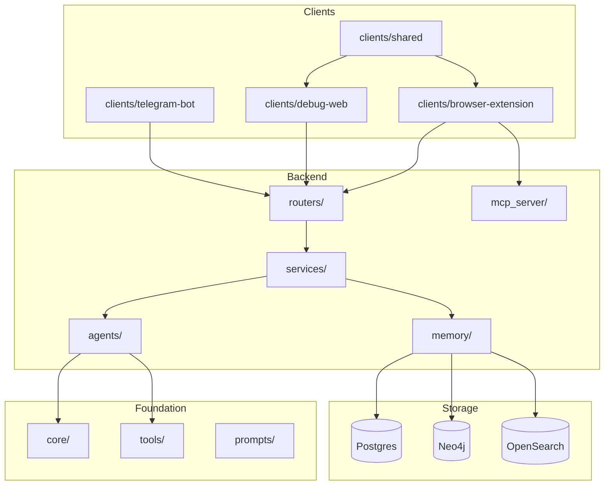
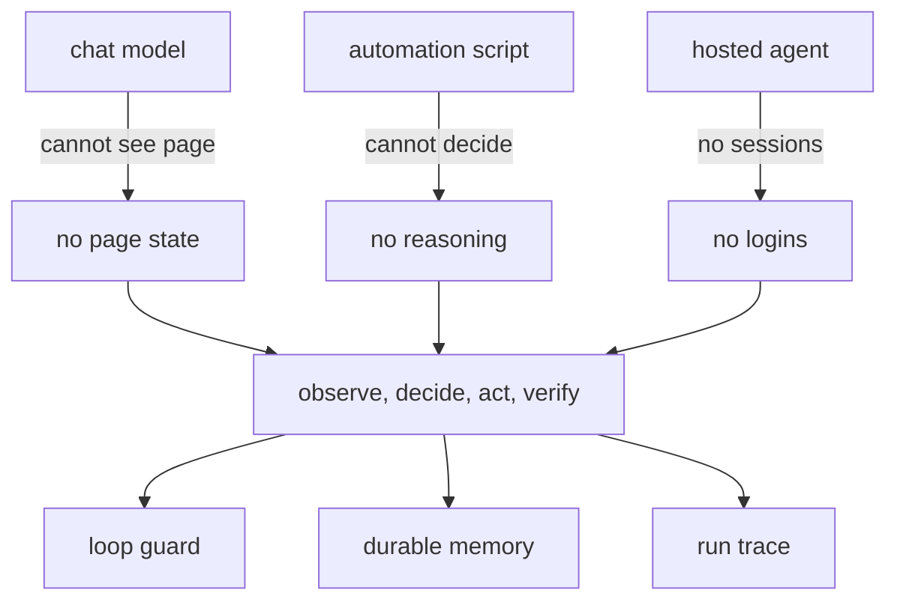
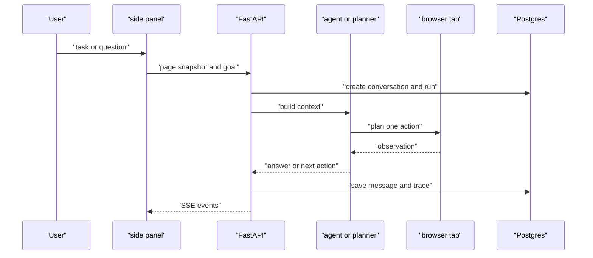
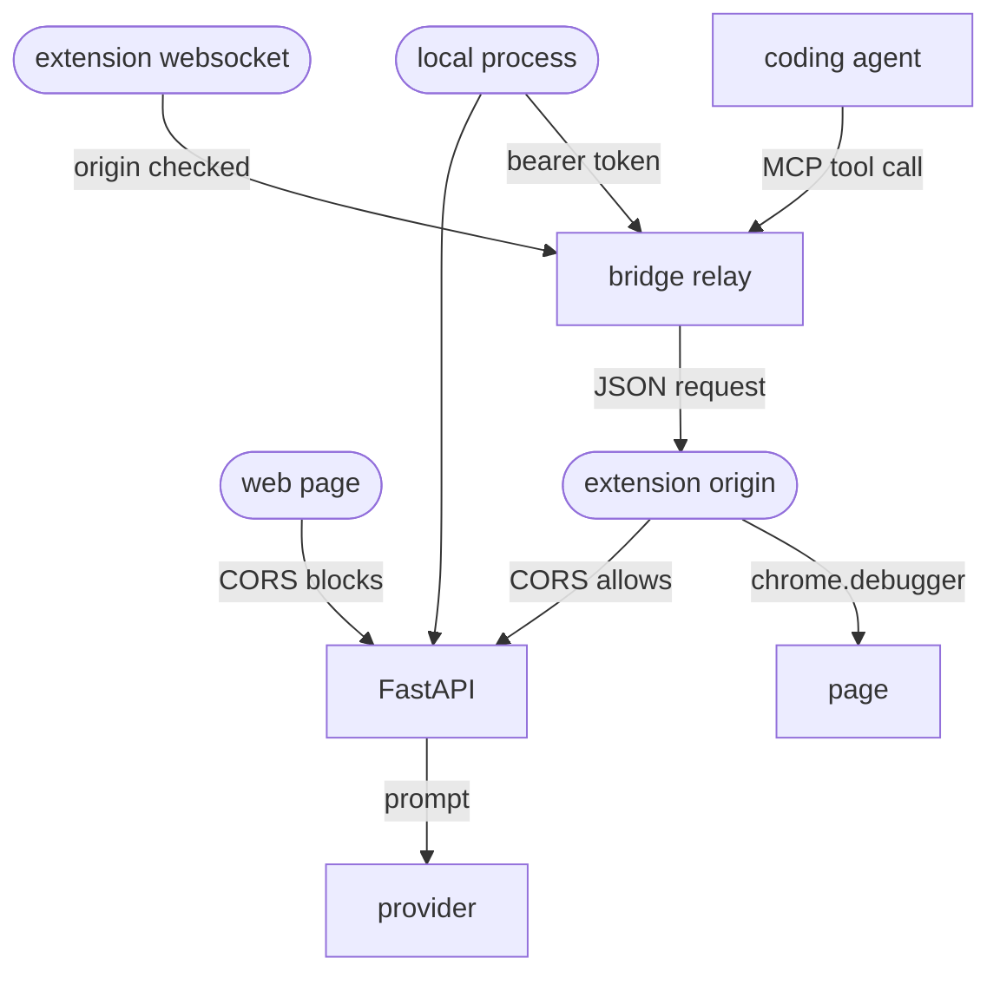
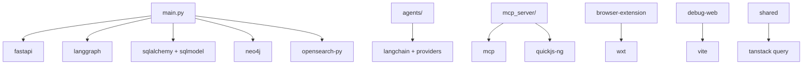

# Project overview

Agentic Browser is a local-first browser agent. A side panel reads the page you are on, a FastAPI backend plans the next step, and the extension executes it in the real browser. The same backend exposes long-term memory, MCP access, subscription runtimes, voice and a debug console.

The project started as a B.Tech major project at JIIT and grew beyond the rubric. It is single-user by design. There are no accounts, no hosted sandbox, and no separate browser profile. The agent uses the tabs, cookies and logins you already have.

Key capabilities:
- One-action browser automation with an observation after every step
- Eight API providers plus four subscription runtimes
- Long-term memory over Postgres, OpenSearch and Neo4j
- MCP tools for Claude Code, Codex, Cursor and other clients
- Telegram control, voice input and read-aloud
- A console for runs, memory, diagnostics and settings

## Repository layout

## Building blocks

- `clients/browser-extension`: WXT MV3 extension. Owns the side panel, popup, background worker, content script and bridge socket.
- `clients/debug-web`: Vite console with dashboard, runs, memory, diagnostics, settings and chat.
- `clients/shared`: API client, query hooks, settings UI, markdown renderer and UI primitives used by both frontends.
- `routers/`: FastAPI route modules mounted under `/api`.
- `services/`: orchestration. Chat, browser runtime, conversations, traces, compaction, secrets, OAuth, voice and Composio.
- `agents/`: LangGraph ReAct agent, supervisor harness and the tool registry.
- `memory/`: ingestion, gate, reconciliation, retrieval, graph and maintenance.
- `mcp_server/`: standalone MCP server, bridge and QuickJS code mode.
- `core/`: config, database, crypto, model clients, subscription runtimes and the loop guard.
- `tools/`: Gmail, Calendar, GitHub, PyJIIT, search, website, YouTube, shell, Python and memory tools.

## The problem it solves

A chat model cannot see the page you are on. A browser script can click but cannot decide. A hosted agent can decide and click but does not have your logins. Agentic Browser connects the three: the real page becomes input, the model plans one step, the extension acts, and the new page state goes back to the model.

## How a request moves

A chat turn uses the ReAct agent. A task with words like `browse`, `click`, `navigate` or `multi-step` uses the supervisor harness. A pure browser task uses the one-step runtime. All three record a run.

## Key feature map

| Feature | Main code |
| --- | --- |
| Chat with tools | `agents/react_agent.py`, `services/react_agent_service.py` |
| Supervisor loop | `agents/while_loop_harness.py` |
| Browser planning | `services/browser_runtime_service.py` |
| Action execution | `clients/browser-extension/entrypoints/utils/executeActions.ts` |
| Model providers | `core/llm.py`, `core/model_catalog.py` |
| Subscriptions | `core/runtimes.py`, `core/antigravity.py` |
| Memory | `memory/service.py` and `memory/ingestion/` |
| MCP | `mcp_server/server.py`, `mcp_server/bridge.py` |
| Voice | `services/voice_input.py`, `routers/voice.py` |
| Console | `clients/debug-web`, `routers/debug.py` |

## Design principles

1. **The client executes.** The backend never touches a page directly. It returns an action; the extension runs it. This keeps credentials and page access at the browser boundary.
2. **One step at a time.** A plan and an observation are one unit. Batching actions makes verification impossible.
3. **Progress replaces step counts.** `core/loop_guard.py` stops loops that repeat, cycle, fail or stall. A fixed cap is only an outer safety net.
4. **Memory is external state.** The agent is told not to treat model context as memory. Recall is injected, writes are reconciled, and forgotten facts are redacted from source turns.
5. **Everything is traceable.** Runs, subagents, events and tool calls are rows in Postgres, not log lines.

## Trust boundaries

The API has no login. CORS limits browser origins, the bridge checks extension origins and relay tokens, and the Telegram bot checks an allow list before enabling remote actions. None of that stops another local process.

## Known limits

- The agent stops at captchas, logins, 2FA and permission prompts.
- There is no per-action approval button yet.
- Memory writes use an in-process lock, so two backends can race.
- The backend binds all interfaces by default.
- Windows is not supported by the installer.

## Dependencies

## Performance

- One model call per browser step. The loop guard bounds a stuck run.
- Chat memory context is budgeted at 1200 tokens per turn.
- Compaction triggers at half the model window, keeping the last 8 messages verbatim.
- Postgres uses a pool of 10 with 20 overflow.
- The bridge waits 3 seconds for a browser and caps calls at 1800 seconds.

## Troubleshooting

- Backend starts with `Postgres init skipped`: Docker is down or credentials differ. Check `docker compose ps` and `.env`.
- Chat answers but no tool rows: the model key works but tools were not bound. Check the selected model and run trace.
- Browser action is planned but nothing happens: the client did not execute it. Check the extension's work log.
- Memory answers are thin: OpenSearch or Neo4j is down, or the embedding provider changed and old vectors are incompatible.
- MCP memory tools fail: they call the HTTP backend, which must be running.

## Appendix

### Implementation examples
- Run: `uv run agentic-api-run`.
- Build extension: `pnpm build:extension`.
- Console: `pnpm dev:debug`.
- Health: `GET /api/genai/health/`.
- Bridge status: `GET http://127.0.0.1:5455/bridge/status`.

### Source files
- `README.md`
- `main.py`
- `package.json`
- `pyproject.toml`
