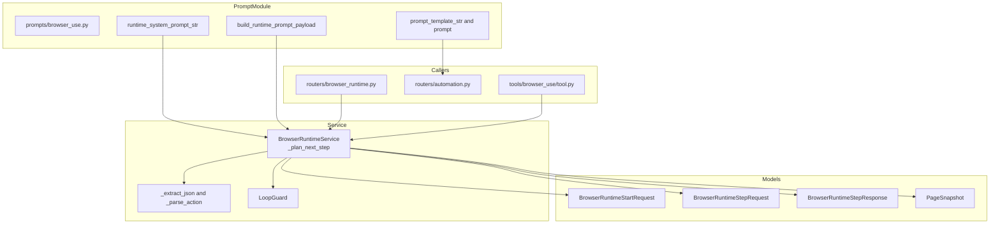
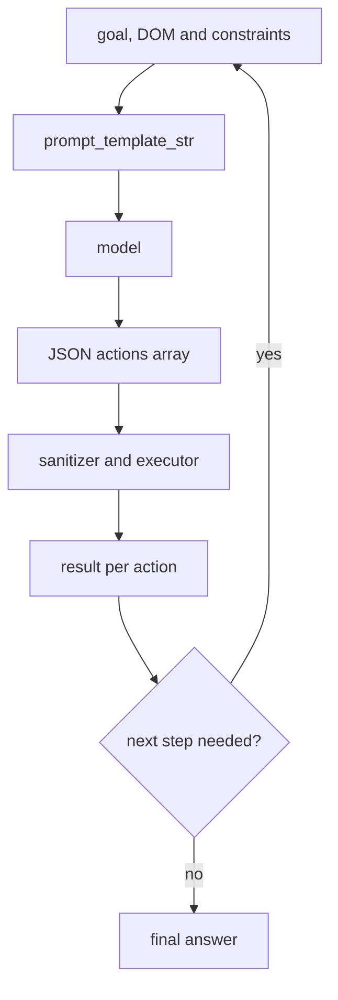
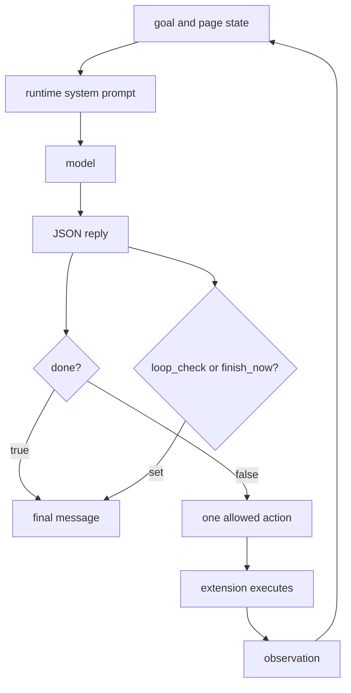
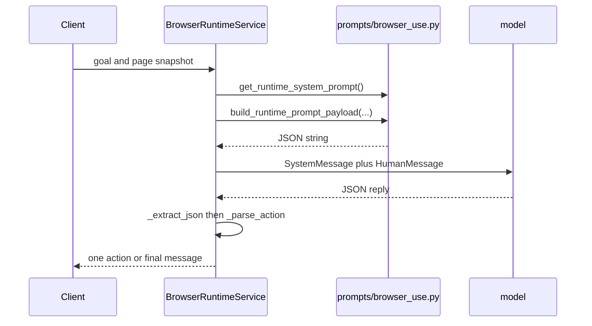
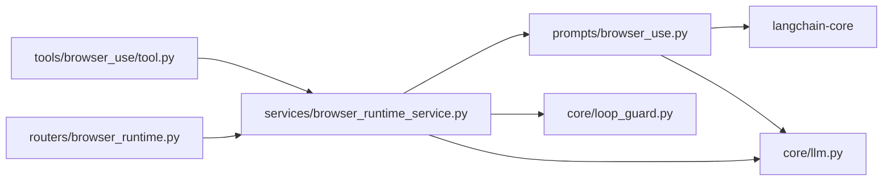

# Browser automation prompts

`prompts/browser_use.py` defines the text that turns a browser goal into JSON. It has two contracts. `prompt_template_str` asks for a full action plan from a page DOM, and is used by the one-shot automation path. `runtime_system_prompt_str` asks for exactly one action per step, and is used by the browser runtime loop.

The module also exposes `build_runtime_prompt_payload`, which serialises the goal, step, session state, page snapshot, latest result and extra context as one JSON document. `services/browser_runtime_service.py` sends that document as the human message and the runtime prompt as the system message.

Key capabilities:
- Six DOM actions and six tab actions in the one-shot vocabulary.
- Nine action types in the runtime loop, with one action per model call.
- An explicit `done` flag and a final message.
- Notes that carry facts across pages the browser has already left.
- Loop guard steering through `session.loop_check` and `session.finish_now`.
- JSON-only output with a tolerant parser on the service side.

## Repository layout



## Building blocks

- `prompt_template_str`: the full plan prompt. It lists the action vocabulary, four examples and seven rule groups.
- `prompt`: a `PromptTemplate` over `prompt_template_str` with the single input `input`.
- `runtime_system_prompt_str`: the one-step contract. It states the JSON shape and the runtime rules.
- `get_runtime_system_prompt()`: returns the stripped runtime string.
- `build_runtime_prompt_payload(...)`: returns `json.dumps` of five keys with `ensure_ascii=True, default=str`.
- `_build_chain(llm_options=None)`: builds `prompt | LargeLanguageModel(**llm_options).client | StrOutputParser()`.
- `get_chain(llm_options=None)`: public wrapper for `_build_chain`.

## The one-shot plan prompt

The one-shot prompt asks for a JSON object with an `actions` array. It separates DOM actions from tab control. The DOM set is `CLICK`, `TYPE`, `SCROLL`, `WAIT`, `SELECT` and `EXECUTE_SCRIPT`. The tab set is `OPEN_TAB`, `CLOSE_TAB`, `SWITCH_TAB`, `NAVIGATE`, `RELOAD_TAB` and `DUPLICATE_TAB`.

The examples cover a DOM action, a tab open, a direct search URL and a combined open, wait, type and click flow. The rules are specific:

- Prefer ids, then data attributes, then specific classes, then tag and type.
- Use placeholder, name or aria-label attributes when they exist.
- Never run DOM actions on `chrome://` URLs.
- For searches, build the full search URL in `OPEN_TAB` instead of opening a blank tab and typing.
- Break complex tasks into simple atomic steps and describe each action.



The prompt itself has no memory of earlier pages. It is a plan for one DOM snapshot, so the caller must re-plan after the page changes.

## The runtime prompt

The runtime prompt is a tighter loop. It plans one safe action, or finishes. The reply shape is fixed:

```text
done, message, action, expected_state, verification, reason, notes
```

`action` is either an object or null. The object can carry `type`, `selector`, `text`, `role`, `value`, `url`, `active`, `key`, `command`, `direction`, `amount`, `ms` and `description`. The allowed types are `NAVIGATE`, `OPEN_TAB`, `CLICK`, `TYPE`, `KEY_PRESS`, `HOVER`, `SCROLL`, `WAIT` and `MEDIA_CONTROL`.

The runtime rules add behaviour that the one-shot prompt does not need:

- Prefer direct navigation or an open tab when the destination is obvious.
- If the target result is already visible, click it instead of searching again.
- If the page is blocked by login, captcha, payments or permissions, finish with a concise message.
- Do not repeat the same failed action without a clear change in approach.
- There is no step limit in the prompt. Keep going while each step gets closer to the goal.
- Copy concrete facts into `notes`, because earlier pages are not visible later.
- Obey `session.loop_check` by changing approach or finishing.
- Obey `session.finish_now` by setting `done=true`, `action=null` and putting everything found so far in `message`.



## The payload

`build_runtime_prompt_payload` takes keyword arguments `goal`, `step`, `current_page`, `latest_result`, `session_state` and `extra_context`. It writes them under `goal`, `step`, `session`, `current_page`, `latest_result` and `extra_context`. The service serialises the page without its screenshot, cuts `visible_text` to 5000 characters and `interactive` to 80 entries.

`session` carries the guard state and the notes. The notes list is trimmed to 40 entries of at most 300 characters by the service. That list is the only memory that survives a page the browser has already left.



## Parsing and validation

`_extract_json` finds the first `{` and uses `json.JSONDecoder().raw_decode`, so trailing text or a second object does not break parsing. `_parse_action` uppercases the type and checks it against the allowed set. A malformed dictionary logs `Skipping invalid browser runtime action` and returns `None`. The caller then ends the run as blocked rather than sending an unknown action to the extension.

The model can still return a valid type with a missing field. The service and extension handle that as a failed action, not a prompt error. The next step sees the failure in `latest_result` and the loop guard records it.

## Dependencies



The module imports `json`, `typing.Any`, `core.llm`, `StrOutputParser` and `PromptTemplate`. The service imports `langchain_core.messages` and the local models, so it carries no provider-specific code.

## Performance

- The one-shot prompt is large but runs once per plan.
- The runtime prompt is sent on every step. The service bounds the page to 5000 characters, 80 interactive elements, four history entries and 40 notes, so the prompt stays roughly constant.
- A screenshot, when present, is a data URL already downscaled by the extension.
- `build_runtime_prompt_payload` uses `default=str`, so no custom encoder is needed for unusual page objects.
- The parser stops at the first complete JSON object, which avoids a second model call for trailing prose.

## Troubleshooting

- The planner returns prose instead of JSON: the model ignored the JSON-only instruction. Use a model that follows structured output, or retry with the runtime prompt.
- The planner repeats a failed action: `session.loop_check` was not passed in the payload. Set it from the loop guard state.
- A search opens a blank tab: the model used `OPEN_TAB` without a search URL. The prompt requires the full URL, so inspect the plan.
- Every action is dropped: the model used a type outside the runtime set, or `action` was not a dictionary. Read the `Skipping invalid browser runtime action` log line.
- Notes are missing from the final answer: the model omitted `notes`, or the list exceeded 40 and was trimmed.
- The plan targets a `chrome://` page: the one-shot prompt forbids DOM actions there. Navigate to a normal URL first.

## Appendix

### Implementation examples

- `get_runtime_system_prompt()`: the runtime prompt, stripped.
- `build_runtime_prompt_payload(goal=..., step=..., current_page=..., latest_result=..., session_state=..., extra_context=...)`: one JSON string.
- `get_chain({"provider": "openai", "model_name": "gpt-5-mini"})`: one-shot chain with an explicit model.
- `BrowserRuntimeService._plan_next_step(session, page, latest_result, extra_context)`: the runtime contract in one method.

### Source files

- `prompts/browser_use.py`
- `services/browser_runtime_service.py`
- `models/requests/browser_runtime.py`
- `models/response/browser_runtime.py`
