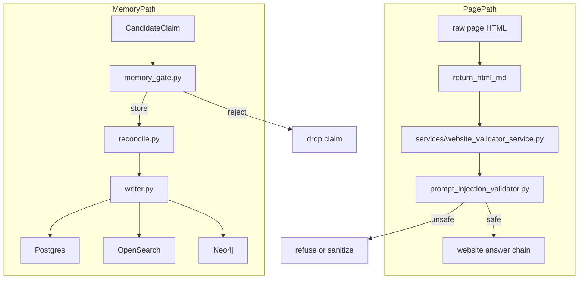
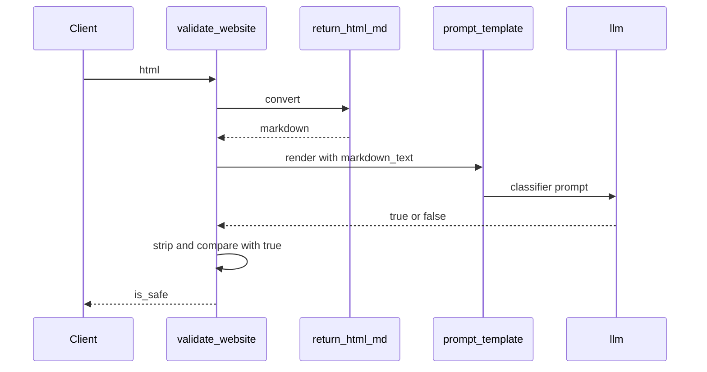
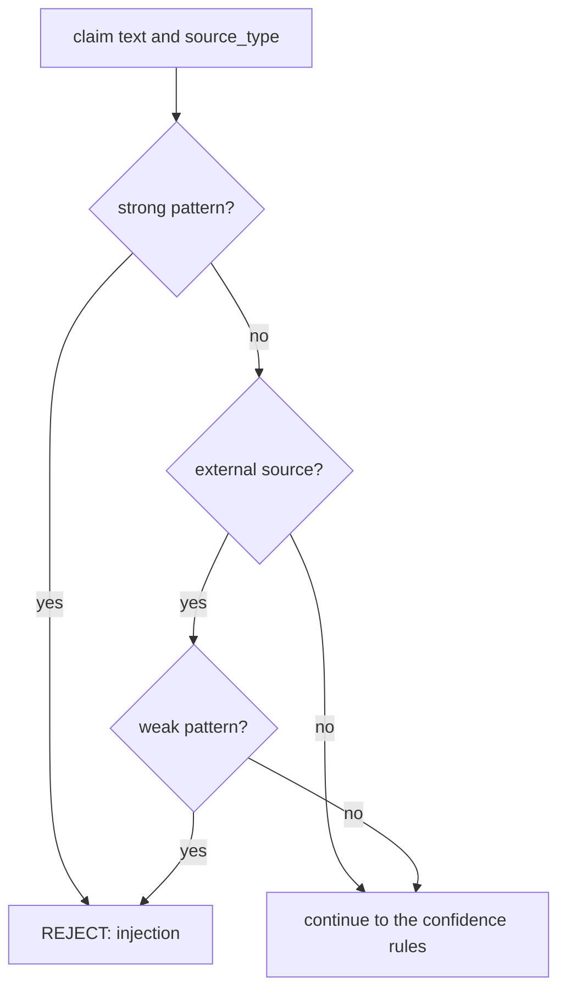
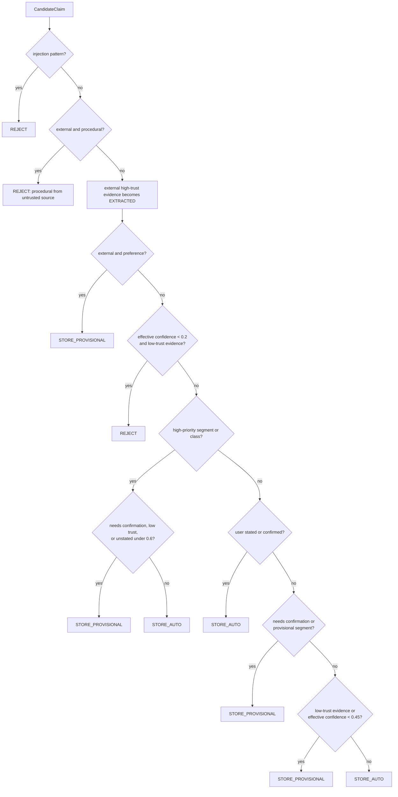
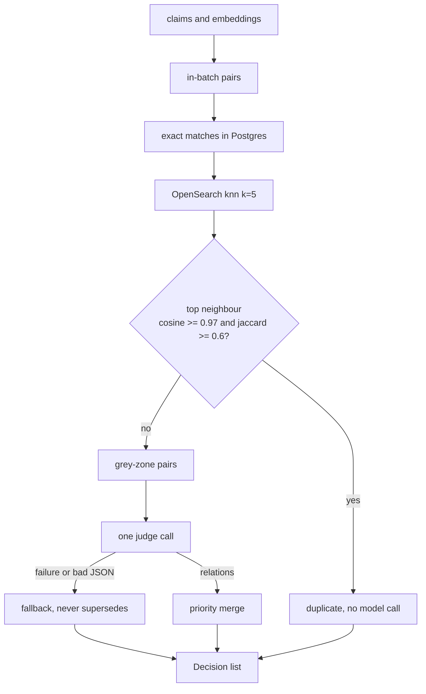
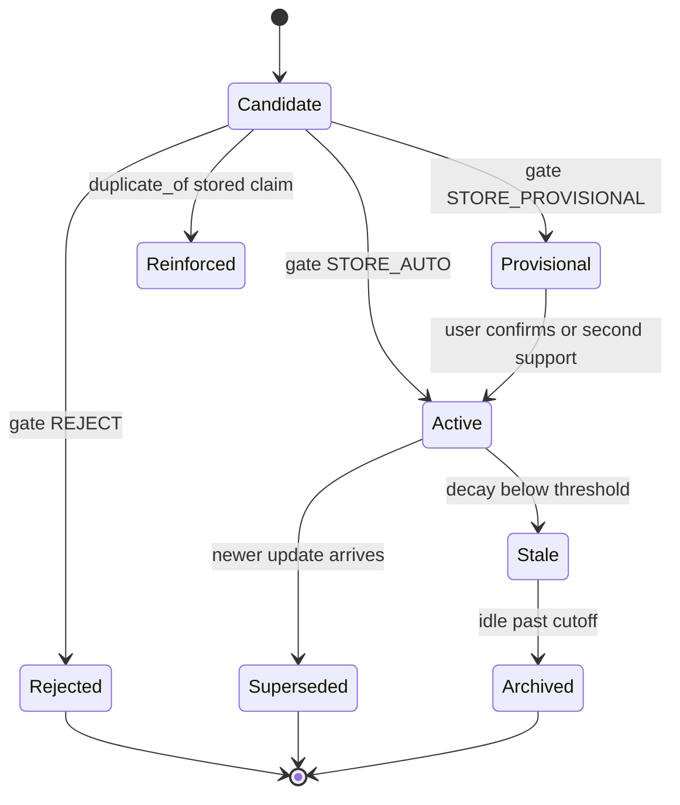
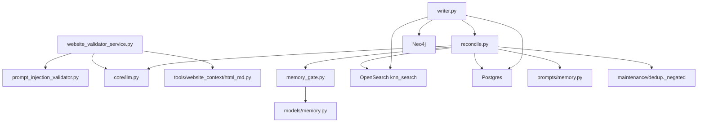

# Prompt security and validation

Two boundaries check untrusted text. Before a page is answered, `prompts/prompt_injection_validator.py` asks a model whether the markdown contains an injection attempt. Before a claim is stored, `memory/ingestion/memory_gate.py` applies deterministic rules, including injection patterns and source trust. The first is advisory and model-based. The second is mandatory and rules-based.

A third boundary protects stored state. `memory/ingestion/reconcile.py` compares a candidate with nearby claims so a hostile or mistaken statement cannot silently replace a good fact, and `memory/ingestion/writer.py` applies every change inside one Postgres transaction.

Key capabilities:
- A one-word safe or unsafe classifier for website markdown.
- Hard rejection of strong injection patterns from every source.
- Extra weak-pattern checks for email, documents and profiles.
- Confidence ceilings and provisional storage for claims from external sources.
- Duplicate reinforcement, dated supersede and contradiction records instead of blind overwrite.
- An in-process write lock shared by every writer.

## Repository layout

## The injection classifier

`prompts/prompt_injection_validator.py` is a single `prompt_template` string. It defines prompt injection as an attempt to manipulate model output by putting malicious instructions in the input. It asks the model to decide whether the text tries to make the model do something it should not. The output contract is one word: `true` for safe, `false` for a potential attack.

`services/website_validator_service.py` is the only consumer. It converts HTML to markdown with `return_html_md`, builds `PromptTemplate(template=prompt_template, input_variables=["markdown_text"])`, and invokes it with the shared `llm`. It then strips code fences, strips whitespace, lowercases the result, and compares it with `"true"`. Anything else, including an empty answer, becomes `is_safe=False`.

The classifier is advisory. The caller decides whether to block, sanitize or proceed. The route returns the boolean, and the answer chain is only as safe as the caller that checks it. Treat a `false` as a reason to stop, not as a warning to log and ignore.

## Gate injection patterns

`memory_gate.py` checks claim text with regular expressions before any other rule. `_STRONG_INJECTION` applies to every source and covers ignore previous instructions, disregard prior rules, forget everything, reveal the system prompt, jailbreak and developer mode. `_WEAK_INJECTION` adds new instructions, system prompt, you are now, act as, override and disregard, but only when the source is external.

The split matters. A user who says "act as a strict reviewer" is setting a preference, not attacking the system. An email that says the same thing is untrusted text trying to change behaviour. Chat and manual sources are checked only against the strong list. `_USER_SOURCES` is `{"chat", "manual"}`. Every other label, including `email`, `gmail`, `document`, `web`, `resume_pdf`, `profile_document`, `linkedin_profile` and `google_profile`, is external.

## Source trust and storage decisions

The gate returns `STORE_AUTO`, `STORE_PROVISIONAL` or `REJECT`. `STORE_AUTO` writes an active row. `STORE_PROVISIONAL` writes a row that normal retrieval excludes unless the request asks for provisional claims. `REJECT` drops the claim.

Two numbers drive the decision. `effective_conf` is `claim.confidence * (0.5 + 0.5 * source_trust)`, so a low-trust source halves the confidence. `_cap` limits the stored value to 0.95 unless the evidence type is `USER_CONFIRMED`, which alone can reach 1.0.

An external source cannot create a procedural claim, cannot keep a `USER_STATED` label, and cannot auto-store a preference. This is the rule that stops an email instruction from becoming a standing preference.

## Reconciliation as a check

The reconciler looks for claims in the same batch, exact text matches in Postgres, and the five nearest active or provisional claims in OpenSearch. It marks a pair as a fast duplicate when cosine similarity is at least 0.97 and Jaccard word overlap is at least 0.6. Grey-zone pairs go to one model call per turn, with `RECONCILE_SYSTEM_PROMPT` deciding `duplicate`, `update`, `contradicts` or `unrelated`.

`same_polarity` uses `memory.maintenance.dedup._negated`, so "takes the shuttle" and "no longer takes the shuttle" never count as duplicates. The subject check prevents a claim about an event from retiring the user's link to that event.

If the judge call fails or returns the wrong shape, `_fallback` runs. It only produces duplicates or unrelated, never supersedes. That is a safety choice: a missed update is fixed by the next mention, while a wrong supersede silently loses a fact.

## Applying a change

`write_claims` handles each item in order. A duplicate reinforces the target row. A new claim gets active or provisional status, an evidence row, a search document and a graph node. Supersede and contradiction decisions run after the insert.

For an update, the writer compares effective dates. When the incoming fact is older, it is stored as superseded history and the stored claim keeps its status. When the incoming fact is newer, the stored claim becomes superseded and gets `valid_to` set to the new fact's start, or to now. Contradictions keep both rows and set `contradiction_count` on each side.

`WRITE_LOCK` in `reconcile.py` is a module-level `asyncio.Lock`. Chat ingestion, `MemoryService.store_claim` and the API route all acquire it around plan and write. It serialises writers inside one process. Two backend processes can still race, which is why the README suggests a Postgres advisory lock for multi-process deployments.

## Dependencies

The validator prompt and `prompts/memory.py` are pure strings. The gate adds only `re` and the memory models. No external package is pinned by the gate, reconciler or writer beyond SQLAlchemy and the standard library.

## Performance

- The classifier is one short model call per page. Run it before the page text enters a larger prompt, not after.
- Gate evaluation is linear in claim count and costs no I/O.
- Exact-match lookup is one Postgres query per turn, restricted to the candidate texts and to active or provisional rows.
- Neighbour lookup is one kNN query per pending claim, run concurrently with `asyncio.gather`.
- The judge is one model call per turn, not one per pair.
- Index writes are sequential after the commit and failures are counted, not retried.

## Troubleshooting

- The validator marks every page unsafe: the model ignored the one-word contract. Check that the response is exactly `true`, not a sentence that contains it.
- A benign page is marked unsafe: the classifier is conservative. Review the page, or pass sanitized markdown instead of raw text.
- A user preference is rejected as injection: the phrase matched a weak pattern and the source was labelled external. Check the `source_type` passed into `evaluate`.
- A changed preference does not replace the old one: the judge failed or returned an unexpected shape, so `_fallback` ran and it never supersedes. Check for `Reconcile judge failed` in the log.
- A correction is merged into the fact it corrects: the polarity regex missed the wording. Use an explicit negative such as "no longer" or "don't", then edit the claim.
- A document preference becomes active without confirmation: the source label was `chat` or `manual`. Every other label forces provisional for preferences.
- Two backend processes create duplicates: `WRITE_LOCK` is in-process only. Run one backend, or move the lock to Postgres.

## Appendix

### Implementation examples

- `validate_website(WebsiteValidatorRequest(html=...))` returns `WebsiteValidatorResponse(is_safe=...)`.
- `MemoryGate().evaluate(cand, source_trust=0.4, source_type="email")` returns `STORE_PROVISIONAL` for a preference and `REJECT` for a procedural claim.
- `Reconciler().plan([cand], [vector])` returns `Decision(duplicate_of="<uuid>")` for an exact repeat.
- `write_claims(session, items, source_id=..., artifact_id=..., source_trust=..., entity_map=..., effects=...)` returns `(WriteStats, rows)`.
- `SideEffects.run()` returns the number of failed operations and clears the queue.

### Source files

- `prompts/prompt_injection_validator.py`
- `services/website_validator_service.py`
- `memory/ingestion/memory_gate.py`
- `memory/ingestion/reconcile.py`
- `memory/ingestion/writer.py`
