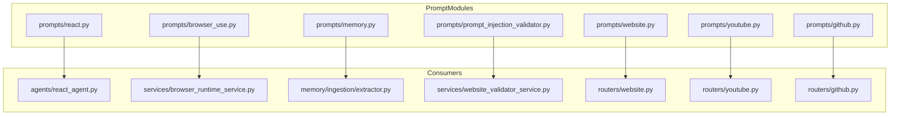
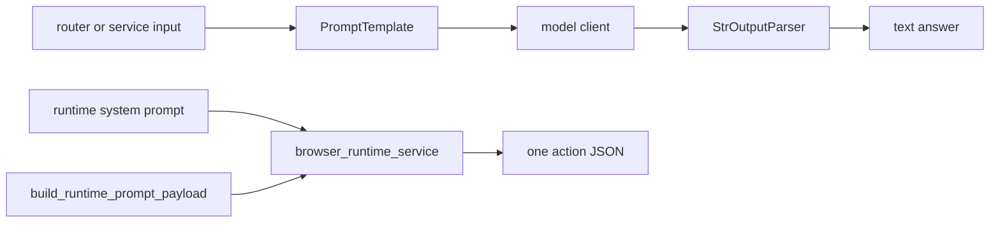
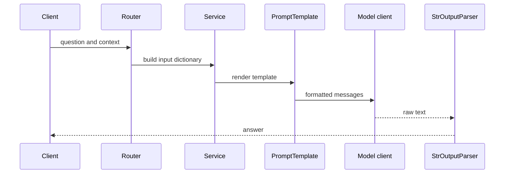
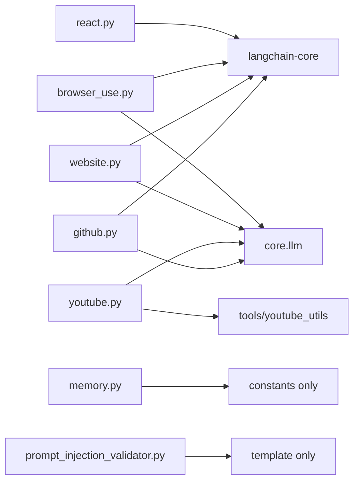

# Prompts and prompt engineering

The `prompts/` package holds the text the models see. Each module serves one consumer: the ReAct agent, the browser runtime, chat memory, or a service answer chain. Most modules expose either a `PromptTemplate` or a plain string constant, and the chain is built by the caller so the model client can be chosen at runtime.

Key capabilities:
- One module per prompt family, with no shared mega template.
- Explicit output contracts: JSON for the browser planner and the memory extractor, one word for the injection check.
- Chains built from `PromptTemplate`, a model client and `StrOutputParser`.
- Pure string modules for prompts that must import without provider packages.
- Prompt inputs that name every context block, so missing data is visible to the model.

## Repository layout

## Pages in this folder

| Page | What it covers |
| --- | --- |
| Prompts and Prompt Engineering | This folder map and the shared chain pattern. |
| Browser Automation Prompts | The one-shot action plan prompt, the single-step runtime prompt and the JSON payload builder. |
| Prompt Security and Validation | The injection classifier, the memory gate's injection patterns and source trust rules. |
| React Agent Prompts | `DEFAULT_SYSTEM_PROMPT`, the ReAct template, the loop guard stop message and the subagent prompt. |
| Service-Specific Prompts | The website, YouTube and GitHub answer prompts, their inputs and their failure behaviour. |

## How the prompts are built

Two shapes appear in the package. A chain module builds `prompt | llm.client | parser` and exposes a `get_chain` or `get_answer` helper. A pure module exports a string and lets the consumer build the chain. `browser_use.py` is a hybrid: it has a chain for the one-shot planner and plain strings for the runtime loop, where the service sends the system prompt and a JSON payload separately.

## How a prompt reaches a model

The service assembles the inputs, the router or tool calls the chain, and the model returns text. For agent prompts, the graph adds the system message once and then carries it through every tool turn. For service prompts, the chain is rebuilt per call because the default client can change at runtime.

## Shared conventions

- Every answer prompt names its context blocks and asks the model not to invent facts.
- JSON contracts state that the reply must be valid JSON with no markdown fences. The browser runtime service still extracts the first JSON object because models drift.
- Placeholder keys are declared in `input_variables`, so a missing input fails at render time rather than at the model call.
- Service prompts cap context upstream. The template does not truncate, so the caller controls token size.
- Memory and validator prompts are strings only, which keeps them importable in tests without provider packages.

## Where to change a prompt

- Agent policy: edit `DEFAULT_SYSTEM_PROMPT` in `agents/react_agent.py`. It affects every ReAct turn and every supervisor subagent that inherits the message.
- Browser loop: edit `runtime_system_prompt_str` for behaviour, or `build_runtime_prompt_payload` for the data the model sees.
- Memory extraction: edit `EXTRACTION_SYSTEM_PROMPT` for the schema and `CHAT_EXTRACTION_RULES` for chat-only behaviour.
- Service answers: edit `website.py`, `youtube.py` or `github.py`. Each module owns its own context blocks and formatting rules.
- Safety: edit `prompt_injection_validator.py` only after checking the consumer's exact-string comparison against `true`.

## Dependencies

`core.llm` is imported by the modules that build a chain, because they call `LargeLanguageModel` or `get_default_llm`. `youtube.py` also imports the subtitle helpers and calls `load_dotenv()` at import time.

## Troubleshooting

- A chain fails at render time: one of the declared `input_variables` was missing from the input dictionary.
- A JSON prompt returns prose: the model ignored the format instruction. Retry with a lower temperature or a model that supports structured output.
- A prompt change has no effect: the consumer may build its own chain or its own prompt. Search for the module import before editing.
- A service answer ignores the live page: the caller passed an empty `client_context`. The prompt cannot use context it did not receive.
- A prompt cannot be imported in a test: it pulls in `core.llm` and therefore a provider package. Use the pure string modules for tests that should not need a provider.

## Appendix

### Source files

- `prompts/react.py`
- `prompts/browser_use.py`
- `prompts/memory.py`
- `prompts/prompt_injection_validator.py`
- `prompts/website.py`
- `prompts/youtube.py`
- `prompts/github.py`
