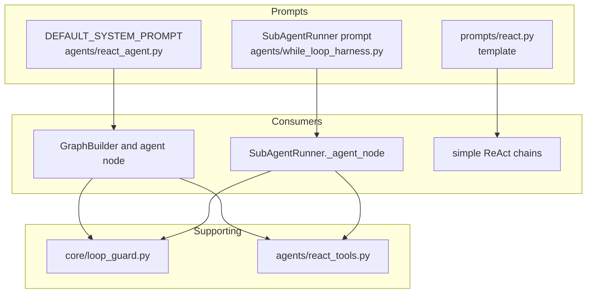
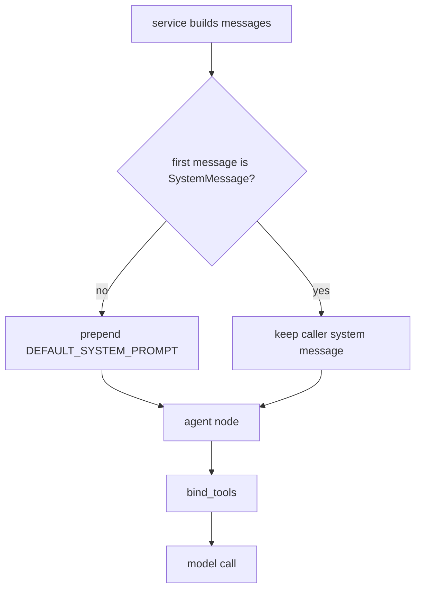
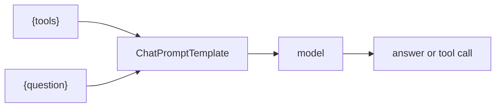
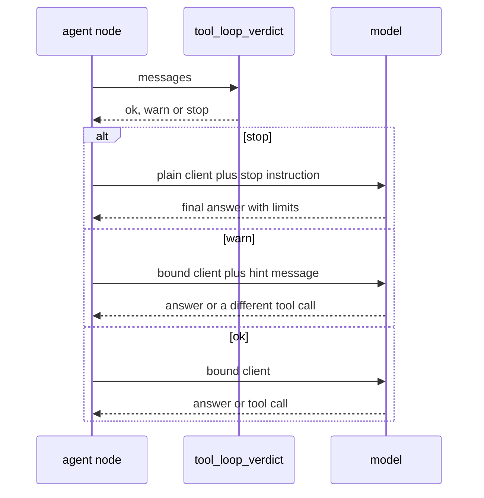
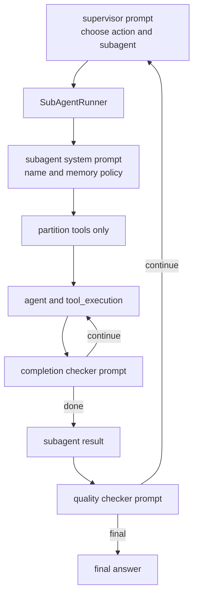
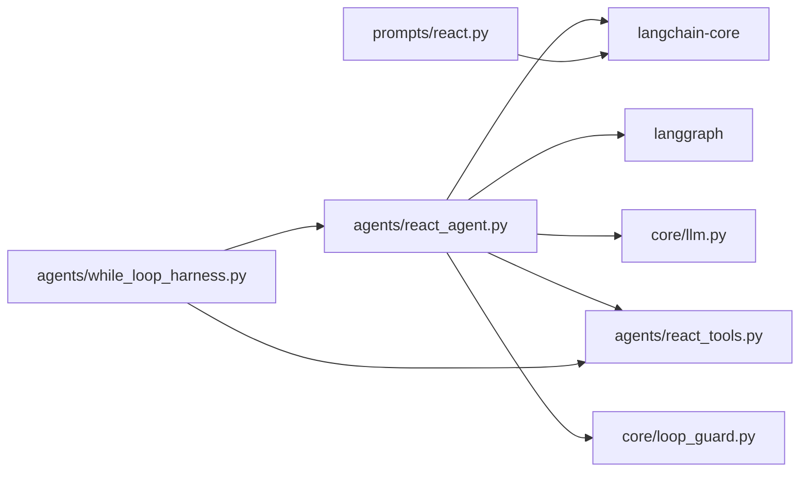

# React agent prompts

The ReAct agent sees two prompt sources. `DEFAULT_SYSTEM_PROMPT` in `agents/react_agent.py` is the policy layer, and `prompts/react.py` is the generic tool template used by simple ReAct chains. The graph prepends the system prompt only when the first message is not already a `SystemMessage`, so a caller can replace it.

The supervisor reuses the same idea with a different system prompt per subagent. Each runner starts its inner graph with a short paragraph that names the subagent, tells it to keep iterating, and restates the memory rules.

Key capabilities:
- One default system prompt with explicit memory, browser and credential policy.
- A caller-supplied system message that wins over the default.
- A stop instruction from the loop guard that turns a stuck run into a usable answer.
- Per-subagent prompts that narrow the role without changing the tool contract.
- A short generic template in `prompts/react.py` for chains outside the graph.

## Repository layout



## The default system prompt

`DEFAULT_SYSTEM_PROMPT` is a single string wrapped in a module-level `SystemMessage`. It covers four areas.

Memory policy. It says memory is external durable state, not model memory. It names `recall_memory` for preferences, identity, projects, relationships, history and prior decisions, `write_memory` for durable facts, and `recall_document_facts` for resume, LinkedIn, Google profile and uploaded PDF questions. It forbids storing secrets, tokens, temporary page state and transient feelings.

Browser and app policy. It says to use `browser_task` to act on a website, including behind a login, because the task runs in the user's own browser. For apps connected through Composio it says to prefer `composio_apps` then `composio_action`. It allows buy, pay, send, post or delete only when the user explicitly asked for exactly that.

Credential policy. It states that Google access tokens and PyJIIT login sessions are provided automatically, so the model must never request them. For JIIT attendance it must call `pyjiit_agent` immediately. If the session fails, it reports that the session expired and asks the user to refresh through the secure flow. It must not ask for a username or password.



The string ends with a general rule: use tools when they improve the answer, otherwise reply directly. That sentence is what keeps a simple question from turning into an unnecessary tool loop.

## The generic template

`prompts/react.py` is a `ChatPromptTemplate` built from a short string. It tells the model it is a helpful assistant that answers from tools, lists the tools under `TOOLS`, and places the question under `here is the question:`. It also says to respond that data is not available when the tools cannot supply it.

The template has two variables, `{tools}` and `{question}`. It does not name any specific tool, does not set a stop rule, and does not describe the answer format. Tool selection and termination live in the graph.



This module exists for chains that do not use the full agent. In the main graph, the model receives tools through `bind_tools`, and the system prompt carries the policy.

## The loop guard stop message

When `tool_loop_verdict` returns `stop`, the agent node switches to a plain client with no tools and adds this instruction:

```text
Loop check: <reason> Stop calling tools. Answer now with what you have found, and say plainly what you could not find.
```

The reply is returned as a normal assistant message. This is why a stuck run ends with a refusal to continue instead of an exception or an empty answer.

When the verdict is `warn` rather than `stop`, the node appends `verdict.hint` as a `HumanMessage` and keeps the tool-bound client. The hint names the repeated action so the model can change approach.



## Subagent prompts

`SubAgentRunner._agent_node` prepends a system message when the first message is not one. The text names the subagent and repeats the memory policy in a shorter form:

```text
You are the '<name>' subagent in a while-loop harness. Use tools when needed.
Keep iterating until the task is fully complete. Memory is external durable state:
call recall_memory early when the task may depend on the user's preferences,
identity, projects, relationships, history, or prior decisions. Call write_memory
only for durable facts worth preserving, never for secrets, tokens, temporary
page state, or transient feelings.
```

The name is the partition name, such as `research`, `browser`, `productivity`, `coding` or `general`. The prompt does not list tools. The runner binds only that partition's tools, so the available set is the constraint.

The supervisor node has its own prompt. It asks for JSON with `action`, `subagent`, `task`, `final_answer` and `reason`, and lists the five allowed subagent names. A parse failure falls back to `general`, which keeps the run alive.



## Prompt layering rules

- The first system message wins. A caller that supplies one is responsible for the memory and credential policy.
- Tool descriptions are part of the prompt. Changing a `StructuredTool` description changes model behaviour as much as editing a template.
- The loop guard message is appended to the same conversation, so the model sees its own failed calls and the reason to stop.
- The supervisor and subagent prompts are separate. A change to one does not change the other.
- Service answer prompts are not part of this path. Website, YouTube and GitHub use their own chains.

## Dependencies



`DEFAULT_SYSTEM_PROMPT` is a plain string, so it has no import cost. `prompts/react.py` imports only `ChatPromptTemplate`. The harness imports `RECURSION_LIMIT` and `tool_loop_verdict` from the agent module, which is why the two prompts stay close in behaviour.

## Performance

- The system message is built once at import and reused. There is no per-turn string formatting.
- `prompts/react.py` renders two variables, `{tools}` and `{question}`, and is used outside the graph.
- The subagent prompt is built per runner, not per tool call.
- The stop instruction adds one model call at the end of a stuck run, which is cheaper than continuing the loop.
- Tool descriptions add tokens to every bound call. Keep them specific but short.

## Troubleshooting

- The default policy is missing: the first message was already a `SystemMessage`. Remove it, or copy the policy into the caller's message.
- The agent asks for a Google token or password: the caller replaced the system prompt and dropped the credential rule.
- The agent refuses to use tools after a warning: the guard returned `stop`, not `warn`. Read the `loop_guard` event for the reason.
- A subagent ignores memory: its prompt names `recall_memory`, but the partition may not include the memory tools. `_partition_tools` prepends them to every group, so check that the tool names exist in the registry.
- The supervisor picks `general` every round: the JSON failed to parse or the model named an unknown subagent. Check the `supervisor_iteration` reason.
- The generic template returns a tool call as text: `prompts/react.py` is not a tool-binding prompt. Use the graph if the model must call tools.

## Appendix

### Implementation examples

- `DEFAULT_SYSTEM_PROMPT` in `agents/react_agent.py`: the policy string.
- `_system_message = SystemMessage(content=DEFAULT_SYSTEM_PROMPT)`: the cached message.
- `template` in `prompts/react.py`: the generic two-variable prompt.
- `SubAgentRunner._agent_node`: the per-subagent system message.
- `_supervisor_node`: the JSON supervisor prompt.

### Source files

- `agents/react_agent.py`
- `agents/while_loop_harness.py`
- `prompts/react.py`
