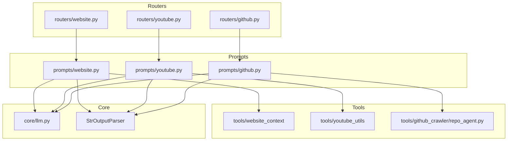
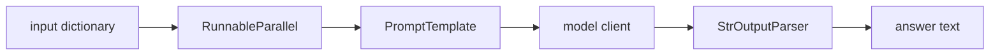
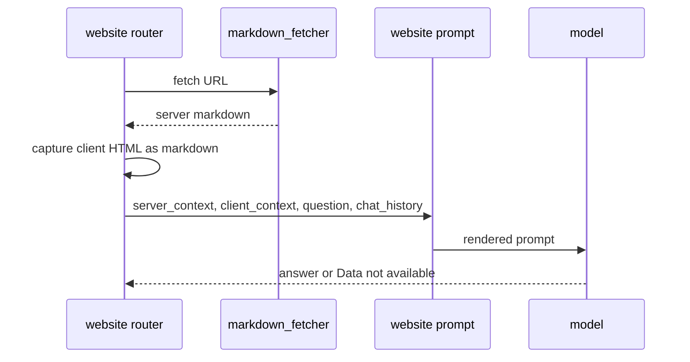
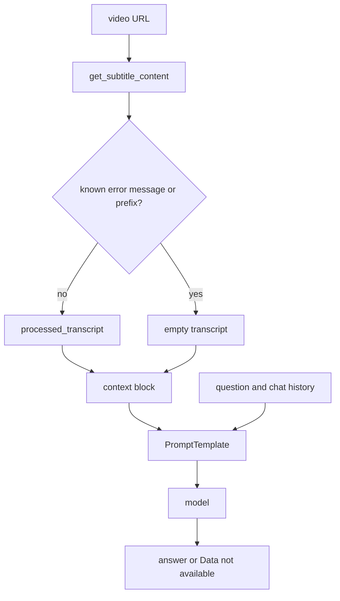
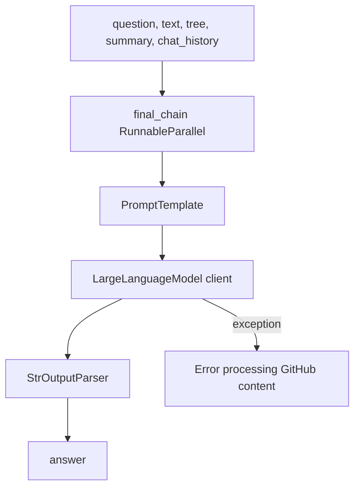
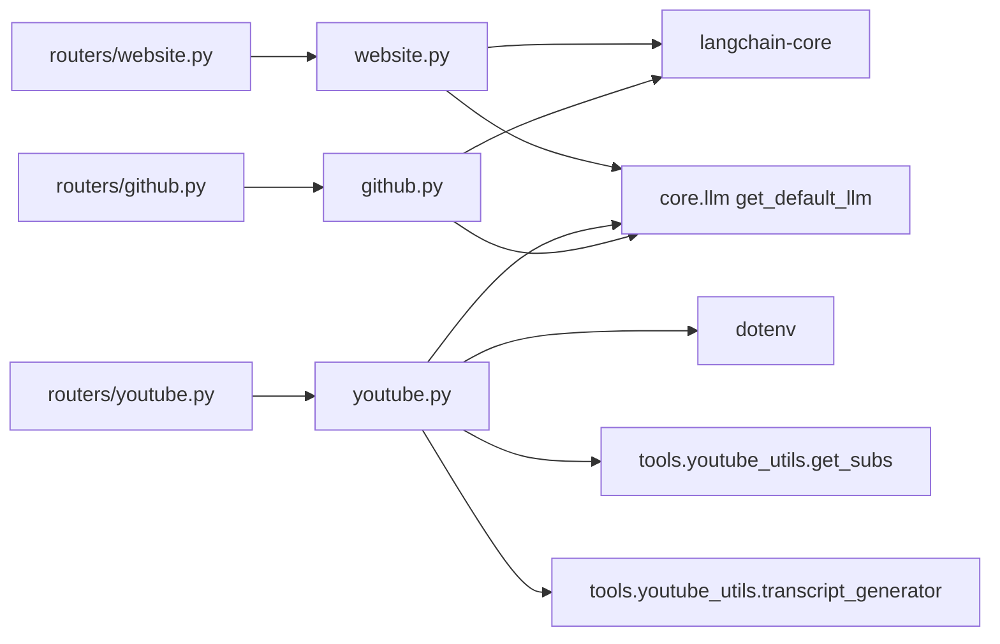

# Service-specific prompts

Three retrieval services have their own answer prompts. `prompts/website.py` answers from server-fetched and client-rendered page context. `prompts/youtube.py` answers from a video transcript. `prompts/github.py` answers from a repository summary, file tree and relevant file content. Each module builds a chain, or a helper that builds one, and each one refuses to answer outside the supplied context.

Key capabilities:
- A named assistant for each service, with an explicit no-invention rule.
- Context blocks that mirror what the router or tool actually fetched.
- A fixed out-of-scope answer, so missing data is visible instead of guessed.
- A website prompt that prefers the client-rendered page when the two contexts conflict.
- A YouTube prompt that treats transcript errors as an empty transcript.
- A GitHub prompt that requires file references and Markdown code fences.

## Repository layout

## Shared chain shape

All three modules build a `RunnableParallel` that maps the caller's input dictionary onto the template variables, then pipe through `PromptTemplate`, a model client and `StrOutputParser`. Website and YouTube resolve the client through `get_default_llm()` at call time. GitHub builds a `LargeLanguageModel` from the `llm_options` argument.

## Website prompt

`website.py` calls the assistant `MDPageChat`. The prompt receives two context blocks for the same page. `server_context` is markdown fetched server-side, which is usually clean but may miss JavaScript-rendered content. `client_context` is the DOM converted to markdown, which captures dynamic, authenticated and script-generated content. The prompt tells the model to use both and to prefer the client context when they conflict.

The guidelines cover summaries, structure, links and media, code, metadata, data analysis, math and out-of-scope questions. A summary uses the title, description and first paragraphs and stays under 150 words unless the user asks for more. Headings become a table of contents. Code blocks are quoted exactly. Tables preserve headers and rows. Math uses LaTeX. Anything not covered by either context gets `Data not available.`

`prompt` declares four variables: `server_context`, `client_context`, `question` and `chat_history`. `simple_chain` fills them from the input dictionary, defaulting the optional ones to empty strings. `get_chain()` pipes `simple_chain | prompt | _current_client() | parser`.

`get_answer(chain, question, server_context, chat_history="", client_markdown="")` does not use the passed chain. It builds `prompt | _current_client() | parser` directly and substitutes `Not available (no client HTML provided).` when `client_markdown` is empty. The `chain` argument is unused, which matters if a caller passes a custom chain.

## YouTube prompt

`youtube.py` calls the assistant `YTVideoChat`. It fetches a transcript before the prompt is rendered. `fetch_transcript(video_url)` calls `get_subtitle_content`, checks the result against four fixed error strings and two error prefixes, and returns an empty string for any known failure. A successful raw transcript goes through `processed_transcript`. `get_context(d)` reads `url` from the input and returns the transcript or an empty string.

The four error strings are `Video unavailable.`, `Subtitles not available for the specified language.`, `Subtitles were requested but could not be retrieved from file.` and `Subtitles not available for the specified language or download failed.` The two prefixes are `Error downloading subtitles:` and `An unexpected error occurred while fetching subtitles:`. An unknown error string is treated as a transcript, which is the weak point of the check.

The prompt guidelines cover summaries, length, statistics, themes, sentiment and related videos. A summary uses the description and transcript and stays under 150 words unless more detail is requested. Length converts seconds to `X min Y sec`. Statistics quote `view_count`, `like_count`, `upload_date` and `uploader`. Theme and sentiment analysis may use tags, categories, captions and transcript. Related-video answers suggest topics or tags and must not invent other video titles. Anything outside the schema gets `Data not available.`

`prompt` declares `context`, `question` and `chat_history`. `main_chain2` fills `context` with `get_context`, which performs the transcript fetch inside the chain. `get_chain()` returns `main_chain2 | prompt | _current_client() | parser`. `get_answer(chain, question, url=None, chat_history="")` invokes the supplied chain with those keys.

## GitHub prompt

`github.py` calls the assistant `GitHub Coding Assistant`. The prompt receives five blocks: `summary`, `tree`, `content`, `chat_history` and `question`. The rules say to use only the provided repository context, never external knowledge. A missing answer becomes `Data not available.` or `I cannot answer this question with the provided information.`

The guidelines ask for concise answers, file and block references when explaining code, use of the tree for navigation questions, and use of the summary for high-level overviews. Code generation must follow patterns and libraries already present in the repository. Responses use Markdown, language-tagged code blocks and bullet lists.

`final_chain` maps `text` to `content`, `question`, `chat_history`, `tree` and `summary`. `_build_chain(llm_options=None)` constructs `LargeLanguageModel(**llm_options)` and returns `final_chain | prompt | llm.client | parser`. `get_chain` is the public wrapper.

`github_processor_optimized(question, text, tree, summary, chat_history="", llm_options=None)` catches every exception, prints it, and returns `Error processing GitHub content: <message>` instead of raising. The router can therefore return a string error to the client without a stack trace.

## Input handling

| Module | Required inputs | Optional inputs | Missing-data answer |
| --- | --- | --- | --- |
| `website.py` | `server_context`, `question` | `client_context`, `chat_history` | `Data not available.` |
| `youtube.py` | `question` | `url`, `chat_history` | `Data not available.` |
| `github.py` | `question`, `text`, `tree`, `summary` | `chat_history`, `llm_options` | `Data not available.` or the cannot-answer line |

Website and GitHub cap their context upstream. The templates do not truncate, so the router or tool controls token size. YouTube passes the processed transcript whole.

## Dependencies

`youtube.py` has an import fallback that appends the repository root to `sys.path` when the `tools.youtube_utils` imports fail. It also calls `load_dotenv()` at import time. The other two modules have no such side effect.

## Performance

- Each request makes one model call. The transcript fetch in the YouTube chain is the only extra network work.
- `RunnableParallel` merges inputs before rendering, so missing optional keys do not fail the chain.
- Website and GitHub prompts are module constants, so no template is rebuilt per request unless the caller uses `get_chain`.
- The website `get_answer` path rebuilds the prompt pipeline per call, which is cheap but bypasses any custom chain.
- The GitHub helper catches exceptions, so a provider failure costs one call and returns text rather than raising.

## Troubleshooting

- Website answers ignore the visible page: `client_context` was empty, so the prompt used only the server fetch. Pass the rendered HTML.
- Website answers cite the wrong version of a page: the server and client contexts conflict and the model did not prefer the client copy. Check that both blocks are labelled correctly.
- YouTube answers say data is not available: the transcript fetch returned an empty string. Check the fixed error list and the subtitle helper output.
- YouTube answers invent related videos: the model ignored the rule. Lower the temperature or tighten the prompt.
- GitHub answers use outside knowledge: the model ignored the no-external-data rule. Check that `content` and `summary` are populated.
- GitHub returns `Error processing GitHub content`: the helper caught a provider or parsing exception. The message includes the cause.
- A custom chain passed to `website.get_answer` has no effect: the function ignores its `chain` argument and rebuilds the pipeline.

## Appendix

### Implementation examples

- `website.get_answer(None, question, server_context, client_markdown="...")` returns the answer text.
- `youtube.fetch_transcript("https://www.youtube.com/watch?v=...")` returns a cleaned transcript or an empty string.
- `youtube.get_answer(chain, question, url=url, chat_history="")` invokes the transcript chain.
- `github.github_processor_optimized(question, text, tree, summary)` returns an answer or an error string.

### Source files

- `prompts/website.py`
- `prompts/youtube.py`
- `prompts/github.py`
- `routers/website.py`
- `routers/youtube.py`
- `routers/github.py`
