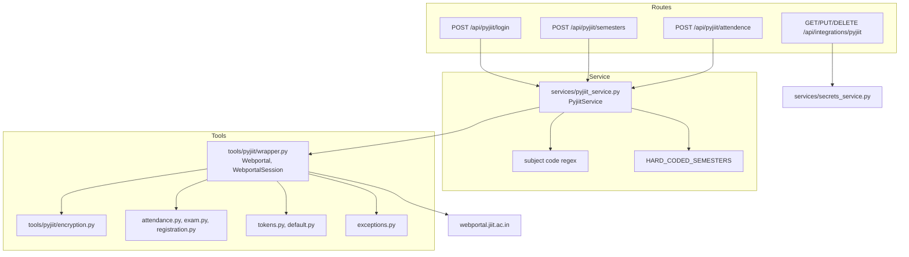
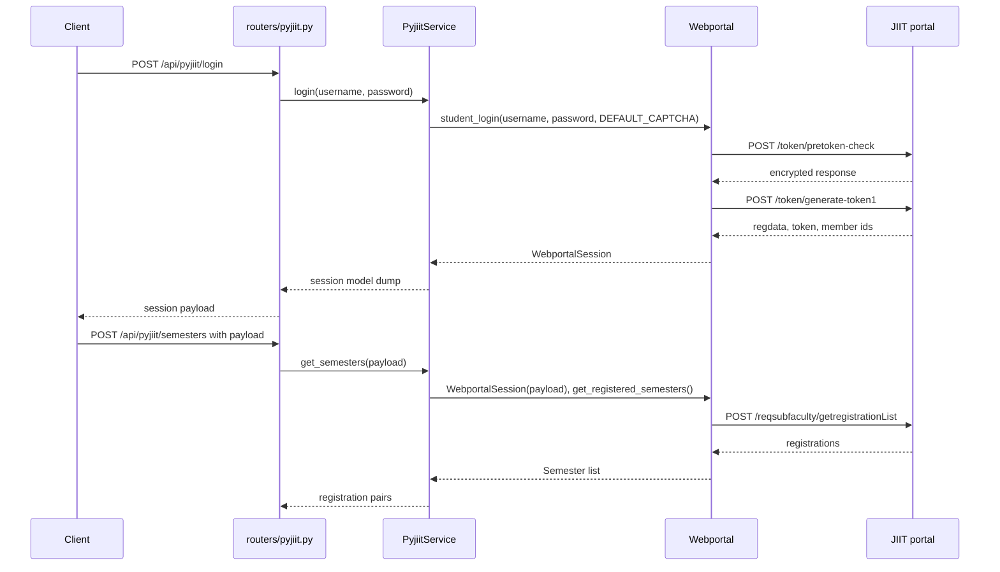
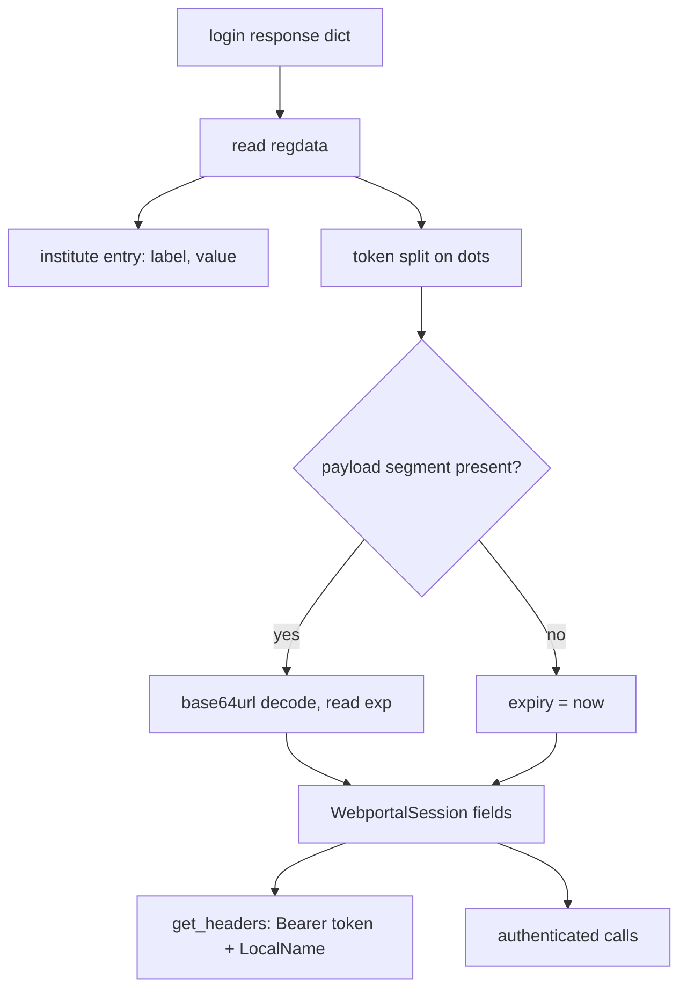
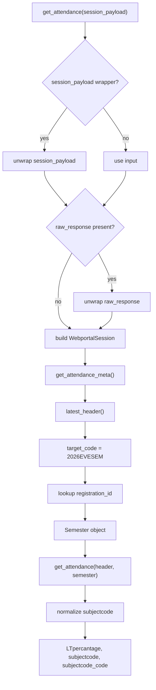
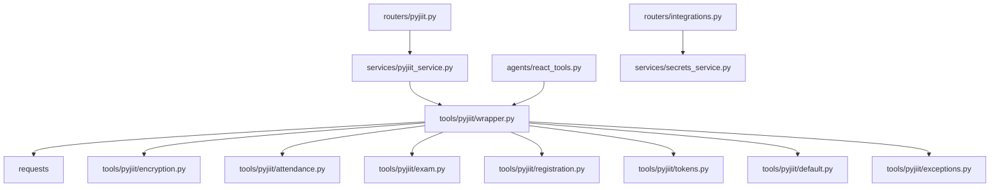

# Academic portal integration

PyJIIT is the campus portal client behind the academic routes. `routers/pyjiit.py` exposes login, semester discovery, and attendance under `/api/pyjiit`, `services/pyjiit_service.py` shapes the responses, and `tools/pyjiit/wrapper.py` speaks to the JIIT web portal API.

The integration is session based. A login returns a `WebportalSession` payload with a bearer token, an institute id, a member id, and a client id. Later calls rebuild that session from the payload instead of asking for the password again. The password is used once per login.

Key capabilities:
- Two step token exchange against `https://webportal.jiit.ac.in:6011/StudentPortalAPI`.
- A `WebportalSession` model that decodes token expiry and builds authorization headers.
- Registered semester discovery with `registration_id` and `registration_code`.
- Attendance retrieval with subject name and subject code normalization.
- A hardcoded semester map used by the service and by the agent tool.
- Portal credentials stored through the secret service and exposed at `/api/integrations/pyjiit`.

## Repository layout

The route module is thin. The service owns response shaping, and the wrapper owns portal endpoints, payload serialization, and error types.

## Building blocks

- `BasicAuthRequest`: `username` and `password`.
- `SemesterReq`: the auth fields plus `registration_id` and `registration_code`.
- `AttendanceReq`: `session_payload` and an optional `registration_code`.
- `PyjiitService.login`: builds `Webportal`, calls `student_login` with `DEFAULT_CAPTCHA`, and returns `session.model_dump()`.
- `PyjiitService.get_semesters`: accepts the full login response or its `raw_response`, then returns `{registration_id, registration_code}` pairs.
- `PyjiitService.get_attendance`: rebuilds the session, reads attendance metadata, selects the latest header, and normalizes each subject row.
- `WebportalSession`: pydantic model with `raw_response`, `regdata`, `institute`, `instituteid`, `memberid`, `userid`, `token`, `expiry`, `clientid`, `membertype`, and `name`.
- `Webportal.student_login`: posts to `/token/pretoken-check`, then `/token/generate-token1`.
- `Webportal.get_registered_semesters`: posts to `/reqsubfaculty/getregistrationList`.
- `Webportal.get_attendance_meta`: posts to `/StudentClassAttendance/getstudentInforegistrationforattendence`.
- `Webportal.get_attendance`: posts to `/StudentClassAttendance/getstudentattendancedetail`.
- `authenticated`: refuses calls when `self.session` is `None` and raises `NotLoggedIn`.

## How it fits together

Login is the only route that touches the password. The response is a plain dictionary, and the client is expected to send it back on the next two calls. The service unwraps either the full response or the nested `raw_response` before building the session.

Login failures return 400 with the exception text. Semester and attendance failures return 500. That split is deliberate: bad credentials are a client error, while a broken portal session or an upstream failure is not.

## Sessions and headers

`WebportalSession.__init__` reads `regdata`, picks the first institute entry, and decodes the middle segment of the token as a JWT-like payload. It reads `exp`, converts it with `datetime.fromtimestamp`, and falls back to the current time when decoding fails. The expiry check in the `authenticated` decorator is commented out because the portal returns unreliable expiry values for valid cookies.

Every request carries a `LocalName` header from `generate_local_name`, and authenticated requests add `Authorization: Bearer <token>` from `get_headers`. Payloads that the portal expects to be encrypted go through `serialize_payload`.

## Semesters and attendance

Semester discovery returns only the two fields the service uses: `registration_id` and `registration_code`. Attendance needs both, plus a `stynumber` from the latest attendance header. The service does not use the semester list for attendance. It uses a fixed map from registration code to registration id.

The target code is always `2026EVESEM` in the service. The `registration_code` argument accepted by `PyjiitService.get_attendance` and by the route is ignored. The map still holds nine semesters, from `2022ODDSEM` through `2026EVESEM`, so a future change has data to work with. The agent tool differs here: `pyjiit_agent` uses the requested code when one is passed and defaults to `2026EVESEM` otherwise.

Subject normalization runs two regexes. The first pulls a trailing bracketed code such as `(CSE101)` into `subjectcode_code`. The second removes that bracket from the display name. `LTpercantage` keeps the portal spelling and is passed through unchanged.

## Agent tool and stored credentials

The ReAct agent gets `pyjiit_agent`, a `StructuredTool` that accepts an optional `registration_code` and an optional `session_payload`. If the turn context carries `pyjiit_login_response`, `build_agent_tools` binds it as the default payload. The tool refuses to call the portal when no session is available and returns a message asking the user to log in.

```mermaid
graph LR
  Ctx["context.pyjiit_login_response"] --> Build["build_agent_tools"]
  Build --> Tool["pyjiit_agent"]
  Tool --> Unwrap["unwrap session_payload / raw_response"]
  Unwrap --> Fetch["WebportalSession + Webportal"]
  Fetch --> Meta["get_attendance_meta"]
  Meta --> Sem["hardcoded Semester"]
  Sem --> Att["get_attendance"]
  Att --> Text["subject, code, percentage text"]
  Secrets["/api/integrations/pyjiit"] --> Ctx
```

The settings route stores `username` and `password` under `pyjiit.credentials`. The public view returns the username in clear text because it is an identifier and masks the password. The login route itself does not read that row. It takes credentials in the request body.

## Dependencies

The wrapper depends on `requests` and the local encryption, model, and exception modules. The service depends on the wrapper and the logger. The router depends on the service.

## Performance and limits

- Every login performs two portal POSTs and a default captcha payload. There is no session cache in the router.
- Semester and attendance calls are synchronous `requests` calls made from async handlers, so a slow portal blocks the worker until the call returns.
- Attendance does two portal reads: metadata, then the attendance detail. The semester list is not reused.
- The hardcoded map shortens attendance resolution but goes stale when the institute adds a semester.
- Normalization is two regex passes per subject row, negligible beside the network calls.
- The portal is external infrastructure. Timeouts, TLS errors, and 5xx responses surface as 500 unless they happen during login.

## Troubleshooting

- Login returns 400: the portal rejected the credentials or the captcha. The service logs the exception and the route returns its text.
- `NotLoggedIn` on a semester or attendance call: the session payload was empty or not the object returned by login.
- Attendance returns an empty list: the portal returned no `studentattendancelist` rows for the hardcoded semester.
- Attendance ignores the requested semester: the service always uses `2026EVESEM`. Call the agent tool with `registration_code` if a different semester is needed.
- `SessionExpired` is raised: the portal answered with status 401. Log in again and replace the payload.
- `Registration ID for '...' not found`: the agent tool was given a code outside the map.
- Subject codes are blank: the portal name had no trailing bracket. The display name still comes through.
- The username is visible in settings but the password is masked: that is the public view for `pyjiit.credentials`, not a failed save.

## Appendix

### API endpoints

| Method | Path | Body | Response |
| --- | --- | --- | --- |
| POST | `/api/pyjiit/login` | `{"username", "password"}` | session object |
| POST | `/api/pyjiit/semesters` | session payload dict | `[{registration_id, registration_code}]` |
| POST | `/api/pyjiit/attendence` | session payload dict | `[{LTpercantage, subjectcode, subjectcode_code}]` |
| GET | `/api/integrations/pyjiit` | none | masked config view |

The attendance path is spelled `/attendence`, matching the router docstring. Clients should not correct it.

### Implementation examples

- `PyjiitService.login("user", "pass")` returns `WebportalSession.model_dump()`.
- `Webportal().student_login(username, password, DEFAULT_CAPTCHA)` returns the session object.
- `get_attendance` maps `2026EVESEM` to `JIRUM25100000001`.
- `pyjiit_agent` accepts `registration_code` and `session_payload`.

### Source files

- `routers/pyjiit.py`
- `services/pyjiit_service.py`
- `tools/pyjiit/wrapper.py`
- `tools/pyjiit/attendance.py`
- `tools/pyjiit/encryption.py`
- `tools/pyjiit/exceptions.py`
- `agents/react_tools.py`
