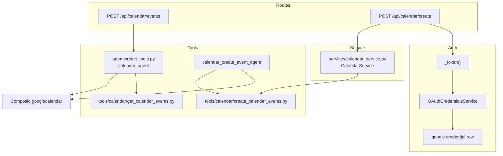
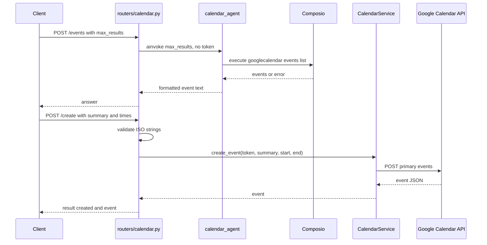
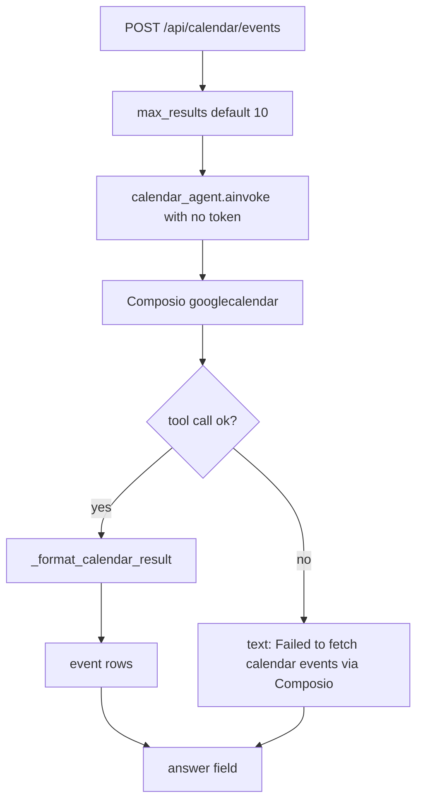
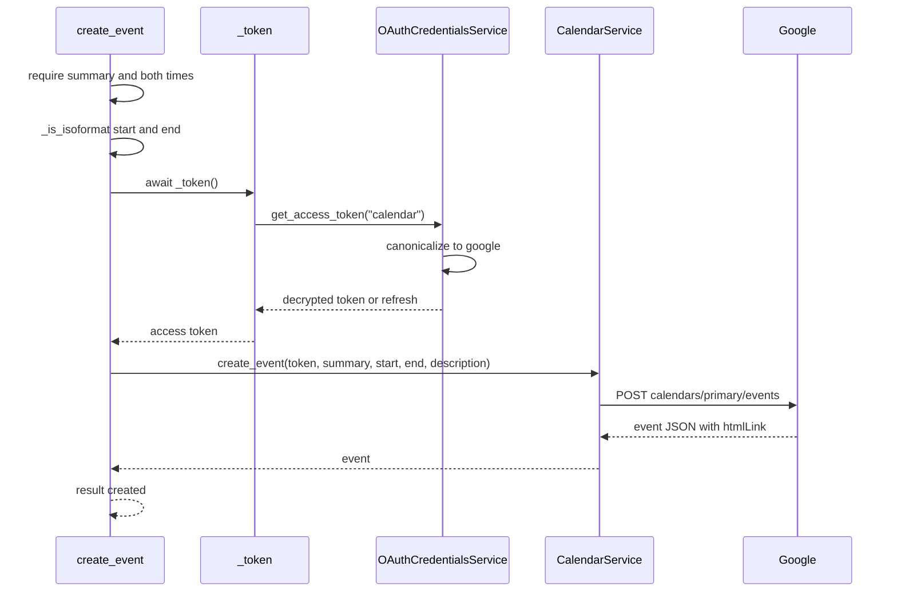
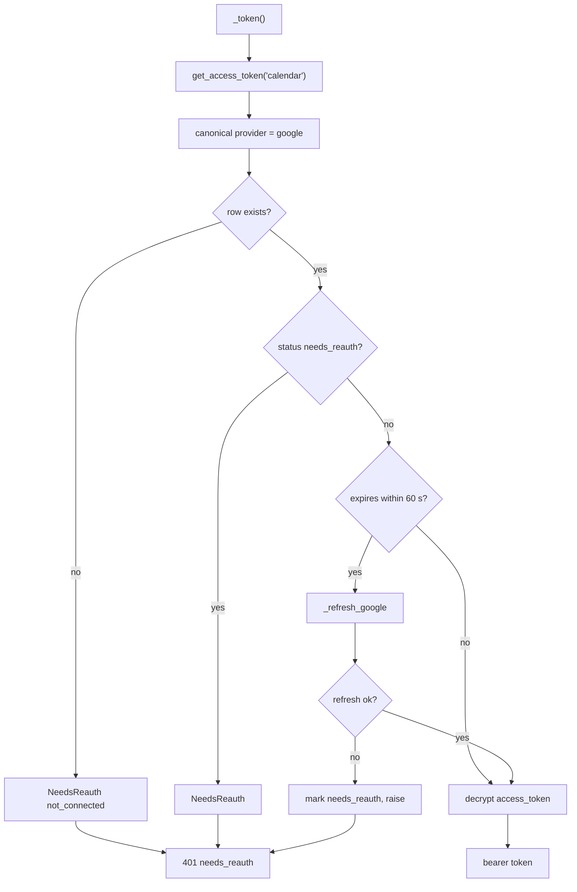
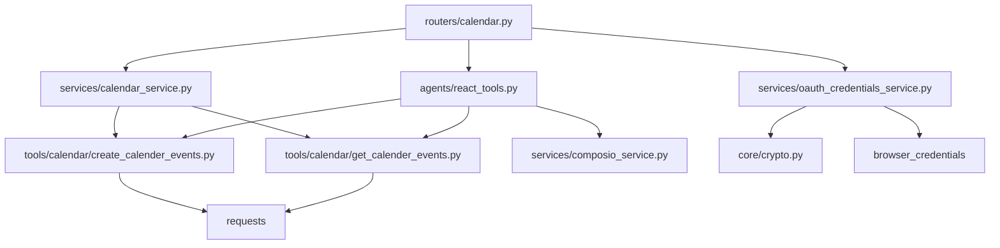

# Calendar integration

The calendar integration lists upcoming events and creates new ones on the user's primary Google Calendar. `routers/calendar.py` exposes `/api/calendar/events` and `/api/calendar/create`. The create route resolves a Google access token from the credential store. The list route does not take a token and goes through Composio.

The list route and the create route do not share a service path. `/events` calls the `calendar_agent` tool with no access token, so the route goes through Composio's `googlecalendar` toolkit. `/create` calls `CalendarService`, which always uses the Google Calendar REST API with the stored OAuth token.

Key capabilities:
- Upcoming event listing through Composio, ordered by start time and single events expanded.
- Event creation with summary, start, end, and description.
- ISO 8601 validation on both timestamps before any network call.
- One Google credential shared with Gmail, YouTube, and Google Search.
- A 401 `needs_reauth` response when the stored token cannot be refreshed.
- Agent tools for reading and creating events.

## Repository layout

The route module owns validation. The service owns the Google tool call. The `calendar_agent` tool is shared with the agent and has a Composio fallback.



## Building blocks

- `EventsRequest`: `max_results` defaults to 10.
- `CreateEventRequest`: `summary`, `start_time`, `end_time`, and `description` with a default of `Created via API`.
- `_token`: resolves `get_access_token("calendar")` and maps `NeedsReauth` to HTTP 401 with `{"code": "needs_reauth", "provider": "google", "reason": ...}`.
- `_is_isoformat`: accepts anything `datetime.fromisoformat` can parse.
- `CalendarService.list_events`: calls `get_calendar_events` with a max result count.
- `CalendarService.create_event`: calls `create_calendar_event` with the summary, times, and description.
- `get_calendar_events`: GETs `https://www.googleapis.com/calendar/v3/calendars/primary/events`.
- `create_calendar_event`: POSTs to the same collection with a UTC event body.
- `calendar_agent`: `StructuredTool` named `calendar_agent`, bounded to 1 through 25 results.
- `calendar_create_event_agent`: `StructuredTool` named `calendar_create_event`.

## How it fits together

The two routes take different paths, and that difference matters when debugging. The list route invokes `calendar_agent` without a token, so it only has the Composio branch. The create route resolves the Google token and calls `CalendarService`.



The `description` field defaults at the model layer and again in `CalendarService.create_event`. An omitted description becomes `Created via API` before it reaches the tool.

## Listing events

The list tool asks for `maxResults`, `orderBy=startTime`, `singleEvents=true`, and `timeMin` set to the current UTC time with a trailing `Z`. It returns `response.json()["items"]` and raises on any non-200 response. The request timeout is 8 seconds.



The route wraps the tool result in `{"answer": ...}`. It does not return the raw Google event objects, unlike `/create`. The Google tool `get_calendar_events` is only used when the same `calendar_agent` runs inside an agent turn with `google_access_token` in context.

## Creating events

The create route validates presence of `summary`, `start_time`, and `end_time`, then checks both timestamps with `datetime.fromisoformat`. A value such as `2026-11-21T10:00:00Z` or `2026-11-21T10:00:00+05:30` passes. A date-only string also passes Python's parser, so the validator is looser than the Google API.



The request body is:

```json
{
  "summary": "Standup",
  "start_time": "2026-11-21T10:00:00Z",
  "end_time": "2026-11-21T10:30:00Z",
  "description": "Created via API"
}
```

The route passes those strings to `CalendarService`, which passes them to `create_calendar_event`. That tool wraps each one in a `dateTime` field and always sets `timeZone` to `UTC`. A timestamp with no offset is interpreted as UTC, which is the most common cause of an event landing at the wrong local hour. The POST timeout is 10 seconds, and anything other than status 200 raises with the status and body.

## Token resolution

The calendar provider name is an alias. `OAuthCredentialsService._canon("calendar")` returns `google`, so the route reads the same row as Gmail and YouTube. That row is encrypted with AES-GCM in `browser_credentials`. The shared rules for token masking, key resolution, and rotation are in [Secret Storage](Secret%20Storage).



Agent turns use a different resolver. `resolve_google_token_optional` returns `None` instead of raising, so a missing Google connection does not fail the turn. It is placed in `context["google_access_token"]` and bound into the Gmail and Calendar tools.

## Agent integration

`build_agent_tools` always adds the calendar tools. When a Google token is present it binds the token as the default for both tools. Without one, `calendar_agent` calls `execute_toolkit_action("googlecalendar", ...)` with preferred terms `calendar`, `upcoming`, `get`, and `search`, and `calendar_create_event_agent` uses required terms `event` and `create`.

`calendar_create_event_agent` accepts summary, start, end, description, and optional account id. Its Composio payloads use `summary`, `start_time`, `end_time`, and `description`, with `title`, `start`, and `end` as the alternate shape. It returns a plain text result, so the agent does not see the raw event object.

## Dependencies



## Performance and limits

- List calls cap at 25 results through the agent tool and default to 10 at the route.
- Google list calls use an 8 second timeout, create calls use 10 seconds.
- The Google tools use synchronous `requests`, so the handler thread waits for Google.
- `/events` makes a Composio round trip only. It has no Google token to fall back to.
- The OAuth token is decrypted on every call and refreshed inside the request when it expires within 60 seconds.

## Troubleshooting

- 401 with `needs_reauth`: the Google row is missing or a refresh failed. Reconnect Google in settings.
- `start_time and end_time must be valid ISO 8601 strings`: `datetime.fromisoformat` rejected the value. Use an offset or `Z`.
- Event lands at the wrong hour: the tool sends `timeZone: "UTC"`. Send an aware timestamp or pre-convert.
- `/events` returns a "Failed to fetch calendar events via Composio" string: the route passes no Google token, so there is no REST fallback. Connect the Composio Google Calendar account or ask through the agent with Google connected.
- `Failed to create event: 403`: the `calendar` scope was not granted. Reconnect and check consent.
- Event created but no `htmlLink` in the agent reply: the agent tool formats text. Use `/create` for the raw JSON.

## Appendix

### API endpoints

| Method | Path | Body | Response |
| --- | --- | --- | --- |
| POST | `/api/calendar/events` | `{"max_results": 10}` | `{"answer": str}` |
| POST | `/api/calendar/create` | `{"summary", "start_time", "end_time", "description"}` | `{"result": "created", "event": {...}}` |

### Implementation examples

- `_token()` returns a decrypted token and raises HTTP 401 on `NeedsReauth`.
- `create_calendar_event(token, "Standup", start, end)` returns the Google event JSON with `htmlLink`.
- `calendar_agent.ainvoke({"max_results": 10})` returns formatted event text.

### Source files

- `routers/calendar.py`
- `services/calendar_service.py`
- `tools/calendar/get_calender_events.py`
- `tools/calendar/create_calender_events.py`
- `agents/react_tools.py`
- `services/oauth_credentials_service.py`
