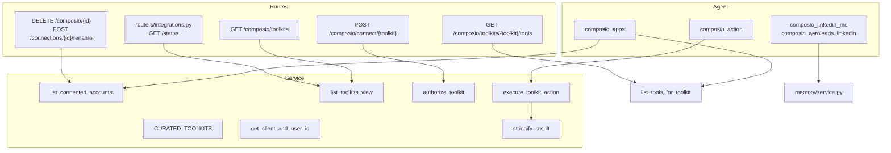
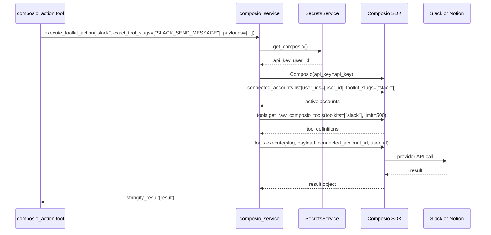
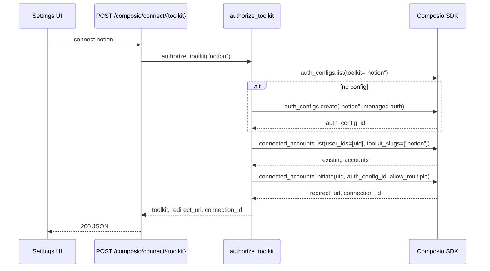
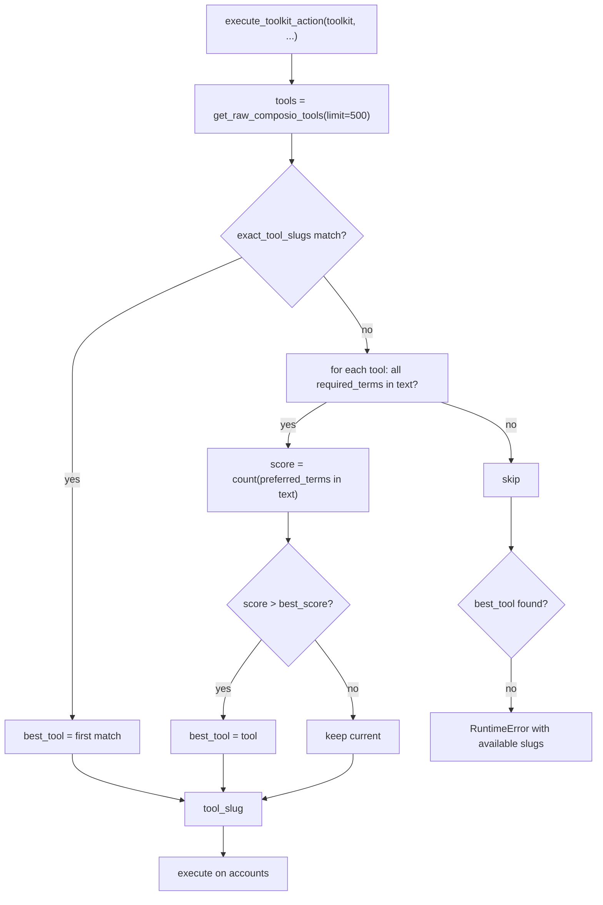
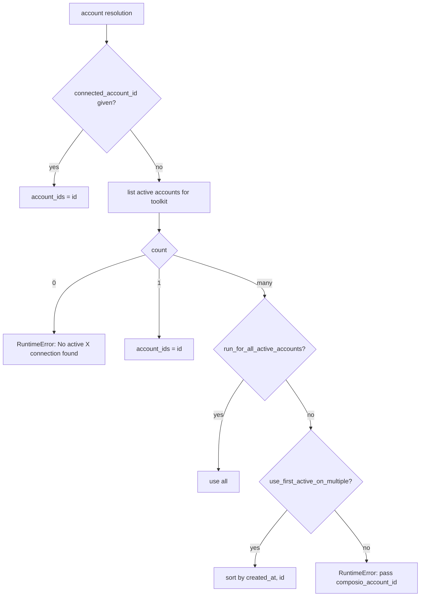
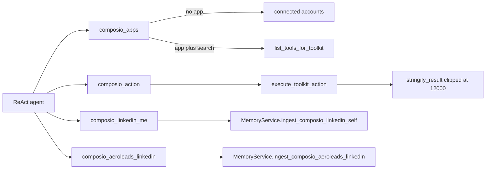
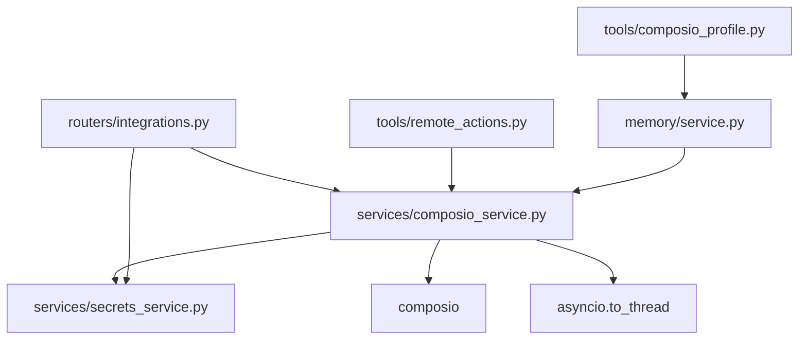

# Composio toolkit actions

Composio gives the agent typed actions on apps that have an API: Slack, Notion, GitHub, Linear, Gmail, and about twenty more. `services/composio_service.py` keeps a curated catalog, resolves an active connected account, picks a tool by exact slug or by term matching, and executes it on a worker thread.

The route layer exposes the same operations to the settings UI. `tools/remote_actions.py` exposes two agent tools. `composio_apps` lists connected apps and their actions, and `composio_action` runs one exact action slug. The model is told to call `composio_apps` first so it does not guess tool names.

Key capabilities:
- A fixed catalog of 25 toolkits with managed auth, except Twitter and X which are bring-your-own.
- Auth config creation on demand using Composio managed auth.
- Multiple connected accounts per toolkit, with an explicit account id required when ambiguous.
- Tool selection by exact slug first, then required and preferred terms.
- Per-account execution with an optional fan-out across all active accounts.
- Errors returned as text to the agent instead of raised.

## Repository layout

The service centralizes the Composio SDK calls used by the routes and the agent tools. The route module maps HTTP to service calls, and the tools wrap the service for the agent.

## Building blocks

- `CuratedToolkit`: frozen dataclass with `slug`, `display_name`, and `auth_mode`.
- `CURATED_TOOLKITS`: 25 entries. `twitter` is the only `byo`; the rest are `managed`.
- `get_client_and_user_id`: reads the `composio` config, imports `Composio` lazily, and returns `(client, user_id)`.
- `_extract_identity`: pulls email, name, avatar, and label out of several possible SDK shapes.
- `list_toolkits_view`: joins the curated list with live metadata, auth config presence, and connections.
- `execute_toolkit_action`: the execution core, synchronous inside `asyncio.to_thread`.
- `stringify_result`: unwraps `data`, `response_data`, or `result` and serializes with indent 2.

## How it fits together

Every call starts by resolving the client and the optional user id. The user id scopes connected accounts. Without it, the SDK lists every account the project key can see. That distinction matters when one Composio project serves several users.

## The curated catalog

The catalog is a static list, not a fetch. It exists so the settings UI can show a stable set of apps with sensible names even when the upstream metadata call fails. `list_toolkits_view` starts from the curated entries, groups live connections by toolkit, joins metadata from `toolkits.list(limit=500)` and auth config presence from `auth_configs.list(limit=200)`, then appends any connected toolkit that is not in the list.

Auth mode shown for a curated app comes from the catalog. For an extra app, the mode is `byo` when an auth config exists and `managed` otherwise. That is a heuristic, not a statement from Composio.

## Connecting an account

`authorize_toolkit` requires a configured user id. It looks for an existing auth config for the toolkit, creates one with `type: "use_composio_managed_auth"` when none exists, and then initiates a connected account. If an active account already exists, `allow_multiple` is true, so the user can add a second account instead of replacing the first.

Failure mapping in `routers/integrations.py`:
- `ComposioNeedsAuthConfigError` becomes 409 with code `composio_auth_config_required` and `setup_url: https://dashboard.composio.dev`.
- `ComposioNotConfigured` becomes 400 with code `composio_not_configured`.
- Anything else becomes 500 with the exception text.

The create call catches an exception and treats status 400 or a message containing "auth config" as the BYO case. Other exceptions propagate.

## Selecting the tool

Execution accepts an exact slug list, required terms, and preferred terms. Exact slugs win in order. Otherwise every tool whose slug, name, and description contain all required terms is a candidate, and the one with the most preferred-term hits wins. Ties keep the first candidate because the comparison is strictly greater than the best score.

When no tool matches, the error lists every available slug for that toolkit. That message is what the agent sees, and it is usually enough for the model to retry with a corrected slug.

## Accounts and payloads

Account resolution has three modes. An explicit `connected_account_id` is used alone. Otherwise the service lists active accounts for the toolkit and fails if there are none. If there are several, it either fans out when `run_for_all_active_accounts` is true, picks the oldest when `use_first_active_on_multiple` is true, or raises and asks for an explicit id.

For each account, payloads are tried in order. The first successful payload for an account ends that account's loop, unless fan-out is on, in which case every account gets a result or an error entry. A result counts as failed when `successful` is false at the top level or inside `data`.

`client.tools.execute` is called with `dangerously_skip_version_check=True`. The flag skips the SDK's tool version validation, which would otherwise reject a slug pinned to a different version than the installed SDK expects.

## Agent-facing tools

`composio_apps` has two modes. With no `app`, it lists active accounts grouped by toolkit, labeling each with alias, email, username, or id in that order. With an `app`, it lists up to 40 actions as `slug: description`, and appends a count when more exist. `search` splits on whitespace and requires every word to appear in the slug, name, or description.

`composio_action` requires `app` and `action`, accepts an `arguments` object and an optional `account_id`, and passes the slug through `exact_tool_slugs`. It truncates the stringified result at 12000 characters before returning it to the model.

The two profile tools are separate because they write to long-term memory rather than returning a one-off result. They call `MemoryService.ingest_composio_linkedin_self` and `ingest_composio_aeroleads_linkedin`, and both return the ingestion result as JSON.

## Dependencies

## Performance and limits

- Tool and toolkit listings request 500 rows, the SDK's practical page for these calls.
- All SDK calls run in `asyncio.to_thread`, so a slow Composio response does not block the event loop.
- `composio_apps` caps its rendered action list at 40 and the agent result at 12000 characters.
- Fan-out across accounts runs accounts sequentially inside one thread, not in parallel.

## Troubleshooting

- "Composio API key is not configured": the `composio` settings row has no `api_key`. Set it through `PUT /api/integrations/composio-config`.
- "Composio user ID is not configured": `authorize_toolkit` needs a `user_id`. Execution can work without one only if the SDK lists accounts project-wide.
- "No active Slack connection found": all accounts for the toolkit are in a non-ACTIVE state. Reconnect from the settings page.
- "Multiple Slack accounts are connected": pass `account_id` from `composio_apps`, or use the service option that selects the first active account.
- "No matching Composio tool found": the slug is wrong. The error lists available slugs. Call `composio_apps` with a search first.
- A 409 on connect: the toolkit needs a BYO auth config in the Composio dashboard. Follow `setup_url`.

## Appendix

### Implementation examples

- `CURATED_TOOLKITS` includes `CuratedToolkit("slack", "Slack", "managed")` and `CuratedToolkit("twitter", "Twitter / X", "byo")`.
- `authorize_toolkit("notion")` returns `{"toolkit": "notion", "redirect_url": "...", "connection_id": "..."}`.

### Source files

- `services/composio_service.py`
- `routers/integrations.py`
- `tools/remote_actions.py`
- `tools/composio_profile.py`
