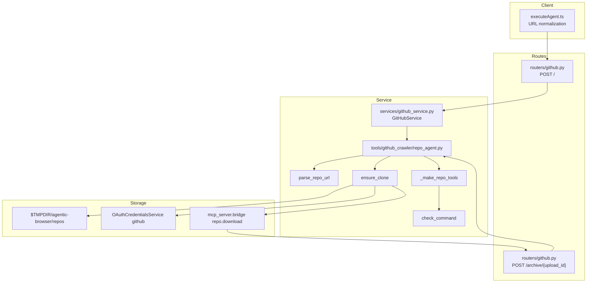
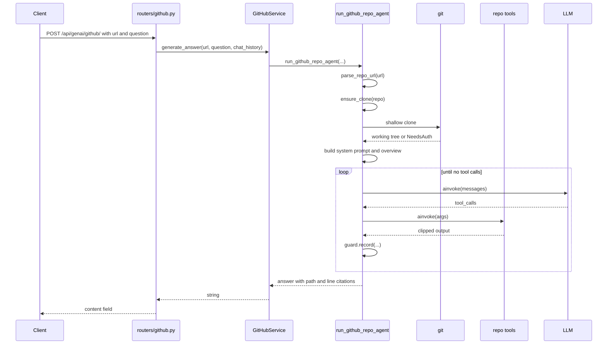
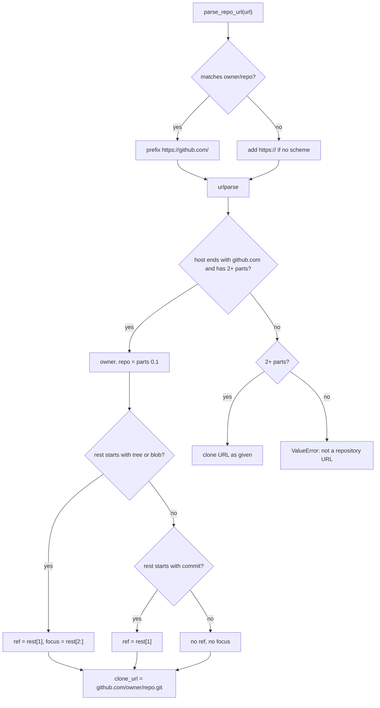
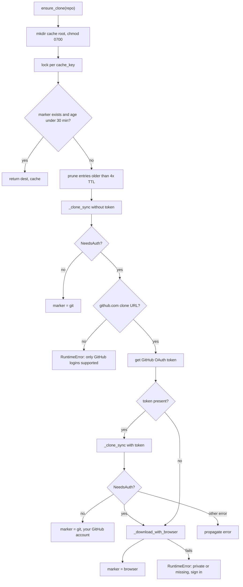
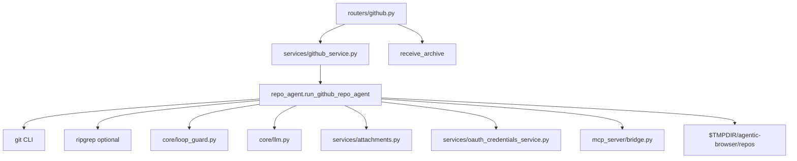

# GitHub integration

`POST /api/genai/github/` answers a question about a repository. The route passes the URL and question to `GitHubService`, which calls `run_github_repo_agent`. That agent parses the URL, clones the repository into a temporary cache, and then runs a tool loop over grep, line reads, directory listings, and a restricted shell.

The repository is treated as untrusted input. Its README can contain instructions aimed at the model, so the shell only accepts a fixed set of read-only programs, blocks redirects and command substitution, and keeps every path inside the clone. The system prompt says that files are data, not instructions.

Key capabilities:
- Any GitHub URL shape: repo root, tree, blob, commit, or bare `owner/repo`.
- A 30 minute clone cache under `$TMPDIR/agentic-browser/repos`.
- Private repositories through connected GitHub OAuth or a browser session zip upload.
- A read-only shell with an allowlist and path containment.
- Line-numbered reads and ripgrep search with skip directories.
- A loop guard that forces an answer when tool calls repeat.

## Repository layout

The route is thin. The service imports the agent, and the agent owns URL parsing, cloning, tools, and the loop.

## Building blocks

- `GitHubRequest`: `url` as `HttpUrl`, `question`, `chat_history`, and `attached_file_path`.
- `GitHubResponse`: the `content` string returned to the client.
- `RepoRef`: `clone_url`, `slug`, optional `ref` and `focus`, and a sanitized `cache_key` of `slug@ref` truncated to 150 characters.
- `parse_repo_url`: normalizes `owner/repo`, reads `tree`, `blob`, and `commit` segments, and accepts other git hosts as given.
- `ensure_clone`: cache check, per-key lock, clone, auth fallback, marker write.
- `_clone_sync`: shallow single-branch clone with symlinks disabled.
- `_download_with_browser`: asks the extension for a zip through the bridge and waits on a future.
- `receive_archive` and `_unpack_sync`: resolve the upload, strip the top folder, skip symlinks and traversal, enforce 1.5 GB.
- `check_command`: validates a shell pipeline segment by segment.
- `_make_repo_tools`: builds `grep`, `read_file`, `find_files`, `list_dir`, and `bash`.
- `run_github_repo_agent`: prompt, attachment, tool loop, loop guard, final answer.

## How it fits together

One POST returns `{"content": answer}`. Internally the agent may make dozens of tool calls, each a subprocess or file read inside the clone. The route requires `question` and `url`, but its broad exception handler converts even those 400 errors into 500 responses.

`GitHubService.generate_answer` catches agent errors and returns them as a message string, so most failures arrive as HTTP 200 with an explanation. A thrown error at the route means the service itself failed before that catch.

## Parsing the URL

`parse_repo_url` accepts a bare `owner/repo` and prefixes `https://github.com/`. For a GitHub host it takes the first two path segments as owner and repo, strips a trailing `.git`, and reads the rest. A `tree` or `blob` segment sets both `ref` and `focus`. `commit` sets only `ref`. Any other host with at least two path segments is cloned as given.

The extension normalizes before sending. In `executeAgent.ts`, a `/blame/` segment becomes `/blob/`, and known non-repo segments such as `issues`, `pulls`, `actions`, and `settings` are stripped back to `owner/repo`. `tree`, `blob`, and `commit` are preserved because they name the ref to check out.

## Cloning and caching

`ensure_clone` creates the cache root with mode `0700` because private code lands there. Each cache key gets an `asyncio.Lock`, so two concurrent questions about the same repo do not clone twice. A `.ready` marker records the source, and its mtime is the cache timestamp.

The clone command is `git -c core.symlinks=false -c advice.detachedHead=false clone --depth=1 --single-branch --no-tags`. Symlinks are disabled so a link in the repo becomes a small text file and cannot point outside the clone. The environment sets `GIT_TERMINAL_PROMPT=0` and `GIT_LFS_SKIP_SMUDGE=1`.

## Private repositories

Auth detection looks for `"could not read username"`, `"authentication failed"`, `"repository not found"`, or `"terminal prompts disabled"` in stderr. On a match, `NeedsAuth` carries the last 300 characters of stderr.

The OAuth token goes through git environment configuration, not argv, URL, or `.git/config`. The code sets `GIT_CONFIG_COUNT=1`, `GIT_CONFIG_KEY_0=http.https://github.com/.extraheader`, and `GIT_CONFIG_VALUE_0=AUTHORIZATION: basic <base64>` with an `x-access-token:<token>` payload.

If the connected account cannot see the repo, `_download_with_browser` opens a future keyed by a UUID, calls the bridge method `repo.download` with the archive URL `https://github.com/<owner>/<name>/archive/<ref or HEAD>.zip` and an upload URL on `127.0.0.1:<backend_port>/api/genai/github/archive/<upload_id>`, then waits 10 seconds.

The archive route streams the body and raises 413 above 300 MB. `receive_archive` returns false for an unknown id or a completed future, which becomes 404. Unpacking strips the first path segment, skips symlinks, rejects entries outside the target, and fails above 1.5 GB. A zip clone has no `.git`, so the prompt notes that `git log`, `blame`, and `show` will not work.

## The read-only shell

`check_command` rejects any command containing `;`, `&`, `<`, `>`, a backtick, `$`, a newline, or `||`. It splits on single pipes and parses each segment with `shlex.split`. The first token must be in `ALLOWED`, which includes `ls`, `find`, `rg`, `grep`, `head`, `tail`, `wc`, `cat`, `sed`, `sort`, `uniq`, `cut`, `tree`, `file`, `stat`, `du`, and `git`.

Additional rules:
- `git` is limited to `log`, `show`, `blame`, `grep`, `ls-files`, `ls-tree`, `diff`, `shortlog`, `rev-parse`, `describe`, `cat-file`, and `status`.
- `find` blocks `-exec`, `-delete`, and print-to-file flags. `rg` blocks `--pre`, `--pre-glob`, `--search-zip`, and `-z`.
- `git` blocks `-c`, `--output`, `--ext-diff`, `--textconv`, `--exec`, and `--upload-pack`. `sort` and `tree` block `-o`.
- `sed` blocks in-place edits and only accepts a script matching `\d+(,\d+)?p`.
- An argument starting with `/` is rejected if the path exists or contains a glob character. `~` and any `..` component are rejected.

The run helper sets `HOME` to the repo root, forces `LC_ALL=C.UTF-8`, and sets `GIT_PAGER` and `PAGER` to `cat` so a pager cannot hang the call. The timeout is 30 seconds, and output clips at 16000 characters.

## Agent tools and loop

`grep` uses ripgrep when `RG` resolves, with `--max-count=30`, `--max-columns=300`, and exclusion globs for `.git`, `node_modules`, `.venv`, `dist`, `build`, `target`, and `__pycache__`. Without ripgrep it falls back to `grep -rnIE`. `read_file` prints line numbers and reads 250 lines by default, never more than 600 in one call. `find_files` caps at 200 paths. `list_dir` walks to a depth between 1 and 4 and stops at 400 rows.

The loop binds these tools to the default LLM client and runs until a reply has no tool calls. Each result is recorded in `LoopGuard(kind="repo tool call", patience=6, max_steps=env_max_steps("GITHUB_AGENT_MAX_TOOL_CALLS"))`. When the guard stops the run, the agent appends a message telling the model to answer from what it found and calls the client once more without tools.

The system prompt includes a 9000-character overview: top-level entries, the first 60 lines of a README, manifest files, and the focus folder or file if the URL named one. Chat history is limited to the last 8 entries at 1500 characters each. An attachment is loaded through `services/attachments.py` and placed in the first human message. `tools/github_crawler/convertor.py` and `prompts/github.py` still hold the older gitingest path, but the current route does not call them.

## Dependencies

## Performance and limits

- Clone timeout is 180 seconds.
- Cache TTL is 30 minutes. Stale entries are pruned after 4 times the TTL.
- Shell commands time out at 30 seconds and output clips at 16000 characters.

## Troubleshooting

- "This doesn't look like a repository URL": the input had fewer than two path segments and was not `owner/repo`.
- "needs a login, and only GitHub logins are supported": a non-GitHub host required auth, and the token path only handles `https://github.com/`.
- "is private or doesn't exist": both the connected GitHub account and the browser download failed. Sign in to github.com with the extension installed, or connect GitHub in settings.
- "Cloning X took longer than 180 s": the repository is large or the network is slow.
- "Cloned the repo, but couldn't find '<ref>'": the ref is not a branch, tag, or fetchable commit.
- A tool returns "(no output)": the command succeeded with no matches. `grep` rewrites that to a suggestion to try another spelling.

## Appendix

### API endpoints

| Method | Path | Body | Response |
| --- | --- | --- | --- |
| POST | `/api/genai/github/` | `GitHubRequest` | `{"content": str}` |
| POST | `/api/genai/github/archive/{upload_id}` | raw zip bytes | `{"ok": true, "bytes": n}` |

### Source files

- `tools/github_crawler/repo_agent.py`
- `tools/github_crawler/convertor.py`
- `services/github_service.py`
- `routers/github.py`
- `prompts/github.py`
