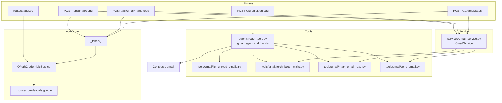
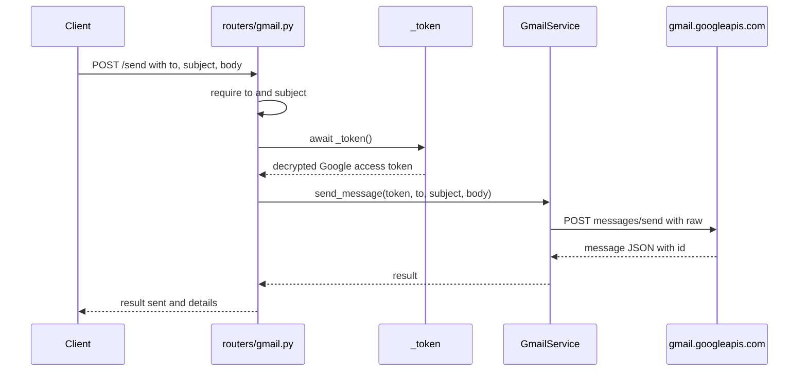
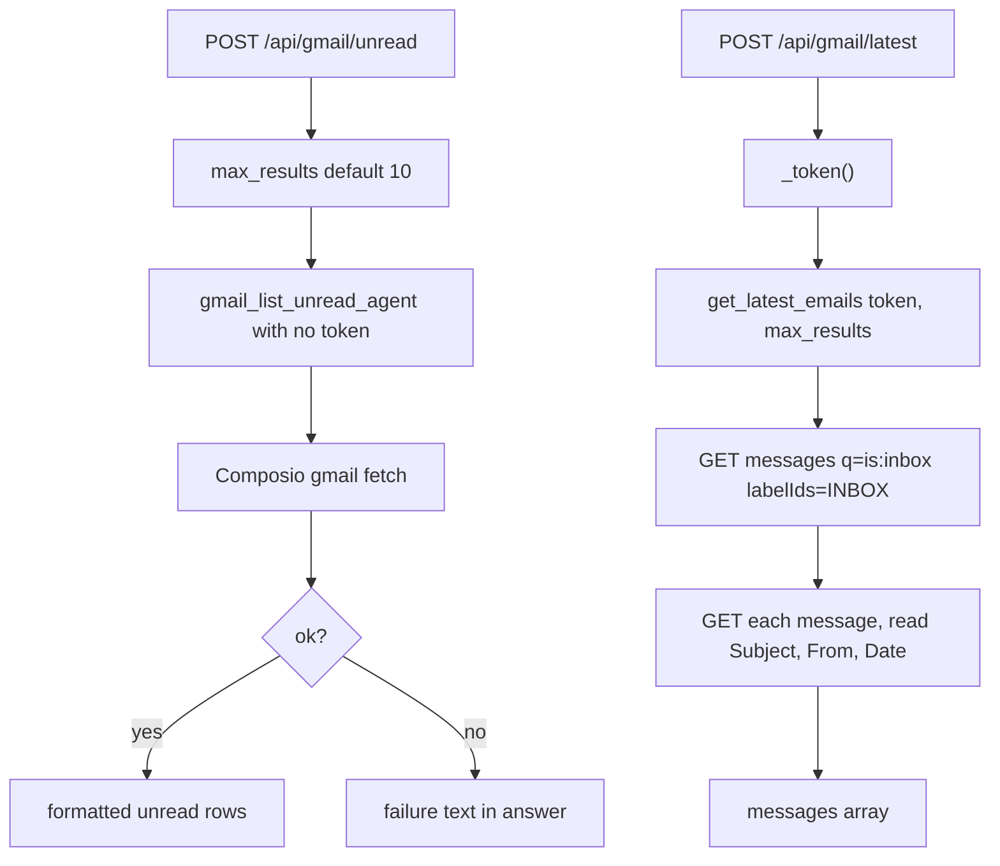
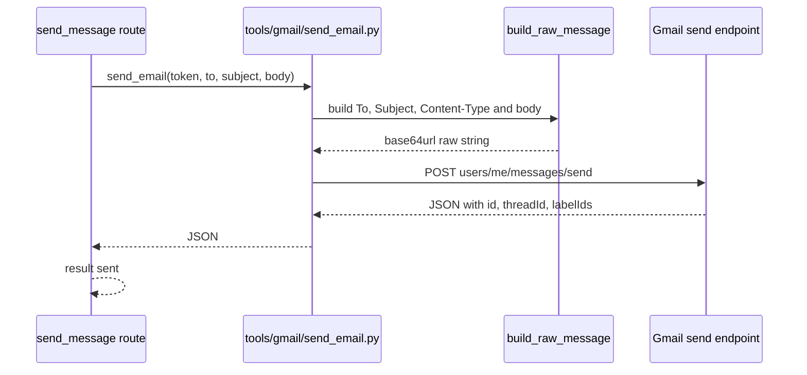
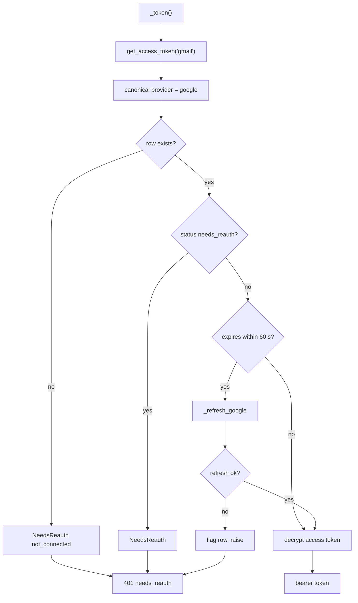
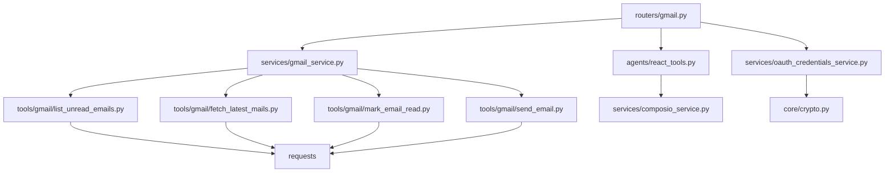

# Gmail integration

The Gmail integration gives the app four mail operations: list unread, fetch recent messages, mark one as read, and send a plain-text email. `routers/gmail.py` exposes them under `/api/gmail`, and `services/gmail_service.py` wraps the small request functions in `tools/gmail/`.

Three of the four routes use a Google access token. The unread route is the exception: it calls the `gmail_list_unread` agent tool without binding a token, so it takes the Composio branch. The other three routes resolve the stored Google credential and call the Gmail REST API directly.

Key capabilities:
- Unread listing with a default of 10 and a positive value guard.
- Recent inbox listing with a default of 5.
- Mark read by message id through label modification.
- Plain-text send with base64url encoding.
- One Google credential shared with Calendar, YouTube, and Google Search.
- Agent tools for read, send, list, and mark, with Composio fallbacks.

## Repository layout

The route module holds the request models and token resolution. The service is a thin error-logging layer over four tool functions.

## Building blocks

- `UnreadRequest`: `max_results` defaults to 10.
- `LatestRequest`: `max_results` defaults to 5.
- `MarkReadRequest`: required `message_id`.
- `SendEmailRequest`: `to`, `subject`, and `body` with an empty default.
- `_token`: calls `get_access_token("gmail")` and maps `NeedsReauth` to HTTP 401.
- `GmailService`: wraps `list_unread`, `get_latest_emails`, `mark_read`, and `send_email` with logging and re-raise.
- `list_unread`: searches with `q=is:unread`, then fetches metadata headers for each id.
- `get_latest_emails`: searches the inbox with `labelIds=["INBOX"]` and `q=is:inbox`.
- `mark_read`: POSTs `{"removeLabelIds": ["UNREAD"]}` to the message modify endpoint.
- `send_email`: builds a `To`, `Subject`, `Content-Type` message and posts `{"raw": ...}`.

## How it fits together

A request arrives with a small JSON body. Routes that need the REST API resolve the token first. The service logs and re-raises any tool error, and the route turns it into a 500 unless it is already an HTTP error.

The unread route skips the service. It awaits `gmail_list_unread_agent.ainvoke({"max_results": ...})` and returns the tool text in `answer`. The agent tool has no token in this call, so it goes straight to Composio and returns either formatted messages, `No unread messages found.`, or a failure string.

## Listing messages

Unread and latest use different Gmail queries. Both cap their per-message detail requests with an 8 second timeout and skip a message when the detail request fails, so a partial list is possible.

`list_unread` asks for `format=metadata` and the three display headers. `get_latest_emails` fetches each full message and reads the same headers from `payload.headers`, then adds `snippet`. Neither tool downloads message bodies or attachments.

The route guards are permissive: any value above zero is used as given, and a missing or non-positive value falls back to the default. There is no upper clamp in the route. The agent tool clamps unread to 50 and recent to 25.

## Marking and sending

`mark_read` is a label change, not a delete. It removes `UNREAD` from the message and accepts status 200 or 204. An empty response body becomes `{}`. The route returns `{"result": "ok", "details": ...}`.

`send_email` builds a minimal RFC 2822-like message with CRLF line endings, base64url-encodes the UTF-8 bytes, and posts it to `messages/send`. The sender is always the authenticated account. There is no CC, BCC, HTML body, or attachment support in this tool.

The send tool raises on any status other than 200 with the status and response text. The route does not retry. A missing `to` or `subject` returns 400 before the token is read.

## Token resolution

Gmail is an alias for the shared Google credential. `_canon("gmail")` returns `google`, so the route reads the row that `/api/auth/google/start` created. The OAuth scopes requested are `gmail.readonly` and `gmail.send`, alongside `openid`, `email`, `profile`, `calendar`, and `youtube.readonly`.

The 60 second skew avoids handing out a token that expires during the request. If refresh fails, the row status becomes `needs_reauth` and the user must reconnect. Agent turns use `resolve_google_token_optional`, which returns `None` instead of raising, so a missing Gmail connection does not stop the turn. The shared credential rules are in [Secret Storage](Secret%20Storage).

## Agent integration

`build_agent_tools` always includes the four Gmail tools. With a Google token it wraps each one with `_default_token`, so the model does not pass a token. Without one, the tools use Composio and may return a failure string instead of raising.

`gmail_agent` lists recent messages and accepts `max_results` plus an optional `composio_account_id`. `gmail_send_email` requires `to`, `subject`, and `body`. `gmail_list_unread` accepts a count and clamps it to 50. `gmail_mark_read` requires a message id and searches Composio actions with required term `read` and preferred terms `mark`, `message`, `gmail`, and `modify`.

Tool errors are returned as text with a `Failed to ...` prefix. The agent can recover in the same run instead of aborting the turn.

## Dependencies

## Performance and limits

- Every Gmail REST call uses an 8 second timeout.
- Listing fetches message metadata with one request per message. A list of 50 is 51 requests.
- Unread defaults to 10 and latest to 5. The agent tool clamps unread to 50 and recent to 25.
- The unread route depends on Composio availability even when Google is connected.

## Troubleshooting

- 401 with `needs_reauth`: reconnect Google in settings. A plain retry keeps raising.
- `to and subject are required`: the send body was missing one of them.
- `message_id is required`: the mark route got an empty id.
- Send returns 403: the `gmail.send` scope was not granted. Reconnect and check consent.
- Unread returns `Failed to list unread messages via Composio`: the route does not bind a Google token, so there is no REST fallback.
- Latest returns an empty list: the inbox query found nothing, or each detail request failed and was skipped.
- Mark read returns 404: the id is not in the authenticated mailbox.

## Appendix

### API endpoints

| Method | Path | Body | Response |
| --- | --- | --- | --- |
| POST | `/api/gmail/unread` | `{"max_results": 10}` | `{"answer": str}` |
| POST | `/api/gmail/latest` | `{"max_results": 5}` | `{"messages": [...]}` |
| POST | `/api/gmail/mark_read` | `{"message_id": "..."}` | `{"result": "ok", "details": {...}}` |
| POST | `/api/gmail/send` | `{"to", "subject", "body"}` | `{"result": "sent", "details": {...}}` |

### Implementation examples

- `list_unread(token, 10)` returns id, subject, from, date, and snippet rows.
- `get_latest_emails(token, 5)` returns the same shape for the inbox.

### Source files

- `routers/gmail.py`
- `services/gmail_service.py`
- `tools/gmail/list_unread_emails.py`
- `tools/gmail/fetch_latest_mails.py`
- `tools/gmail/mark_email_read.py`
- `tools/gmail/send_email.py`
- `agents/react_tools.py`
