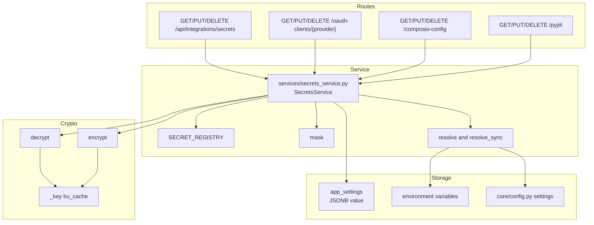
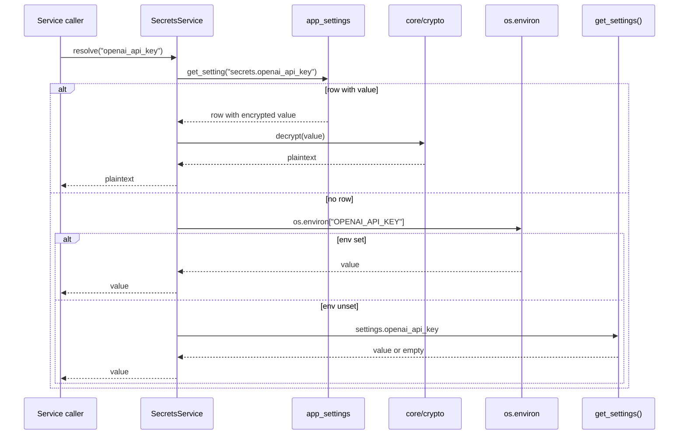
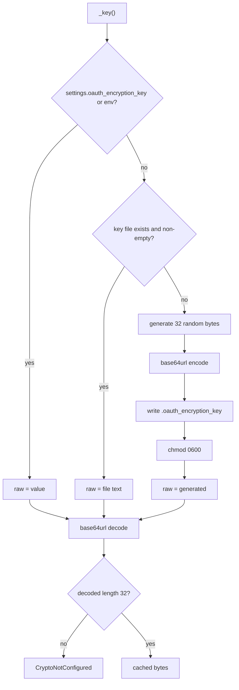
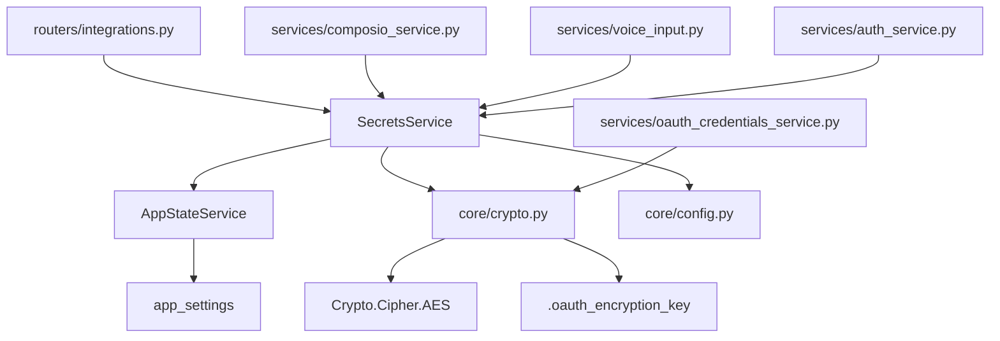

# Secret storage

`services/secrets_service.py` stores API keys, OAuth client pairs, Composio config, PyJIIT credentials, and Telegram settings as encrypted values in the `app_settings` table. `core/crypto.py` does the encryption with AES-GCM and a 32-byte key from `OAUTH_ENCRYPTION_KEY` or a local key file.

The service is the one place that decrypts named secrets. Callers either ask `resolve(name)` for a usable value or `list_status()` for masked metadata. The HTTP routes never return a stored secret in plaintext. Identifiers such as the PyJIIT username and the Composio user id are returned in clear.

Key capabilities:
- A registry of 18 named secrets, each mapped to a setting key, env var, and settings attribute.
- Resolution order: database override, then environment, then the pydantic settings attribute.
- AES-GCM with a random 12-byte nonce per value, base64-url encoded.
- Masked previews that reveal at most the first three and last four characters.
- Separate encrypted fields for OAuth clients, Composio, and PyJIIT.
- A sync resolver for hot paths that cannot await a database read.

## Repository layout

The storage is one table, one service, one crypto module, and one route module. Every other integration imports the service rather than reading settings directly.

## Building blocks

- `SECRET_REGISTRY`: maps a public name to `(AppSetting key, env var, settings attr)`.
- `mask(value)`: `None` for empty, all bullets for 8 characters or fewer, otherwise the first three and last four characters with bullets between.
- `get_raw(name)`: reads `secrets.<name>`, decrypts, and returns `None` on any failure.
- `set(name, value)`: encrypts and writes `{"value": ...}`, rejecting unknown names.
- `clear(name)`: deletes the setting row.
- `resolve(name)`: the ordered lookup used by every service.
- `resolve_sync(name)`: environment and settings only, no database read.
- `list_status()`: one row per registry entry with source and masked preview.
- `get_oauth_client`, `set_oauth_client`, `list_oauth_clients`: the `oauth_clients.*` family.
- `get_composio`, `get_pyjiit`, `telegram_public`: the other grouped configs.

## How it fits together

A read starts at the database. If the encrypted value decrypts, it wins. Otherwise the environment variable is checked, then the settings attribute, which may itself carry a default or an env-derived value. A write always goes to the database and never touches the environment.

`resolve` never raises. An unknown name returns an empty string, a decryption failure is logged and treated as unset, and a missing settings attribute uses `""`. That keeps a missing key from crashing a status page, at the cost of hiding configuration errors until a provider call fails.

## The registry

Each entry has three fields. The setting key is always `secrets.<name>`. The env var is the upper-case name for the API keys, with explicit names for the base URLs.

| Group | Names |
| --- | --- |
| LLM keys | `google_api_key`, `openai_api_key`, `anthropic_api_key`, `deepseek_api_key`, `openrouter_api_key`, `opencode_api_key` |
| Base URLs | `openai_base_url`, `anthropic_base_url`, `google_base_url`, `ollama_base_url` |
| Search | `tavily_api_key` |
| Voice | `elevenlabs_api_key`, `cartesia_api_key`, `groq_api_key`, `xai_api_key`, `voice_custom_api_key` |
| Telegram | `telegram_bot_token`, `telegram_allowed_users` |

The settings attribute matters for values that pydantic resolves from the environment with a default, such as `google_oauth_client_id`. It also lets a `.env` value be seen without an explicit `os.environ` entry.

## Encryption format

`encrypt` generates a 12-byte nonce, runs AES-GCM over the UTF-8 plaintext, and returns `base64url(nonce || ciphertext || tag)`. `decrypt` base64-decodes, slices the first 12 bytes as the nonce and the last 16 as the tag, and calls `decrypt_and_verify`.

Because GCM verifies the tag, a wrong key or a tampered value raises rather than returning garbage. Callers catch that and treat the secret as unset.

The key itself comes from `OAUTH_ENCRYPTION_KEY`, either through `get_settings()` or `os.environ`. If neither is set, `_load_or_create_local_key` reads or creates `.oauth_encryption_key` at the repository root, writes it with mode `0600`, and logs a warning recommending an explicit key for production. The decoded key must be exactly 32 bytes or `CryptoNotConfigured` is raised.

`_key` is wrapped in `lru_cache(maxsize=1)`, so the key is read once per process. Rotating the env var requires a restart.

## Grouped credentials

Four setting keys hold objects with several encrypted fields rather than a single value.

`oauth_clients.{provider}` holds `client_id` and `client_secret`. `set_oauth_client` merges into the existing row and encrypts each field that was provided. An empty string stores an empty string, which clears that field without deleting the row. `get_oauth_client` decrypts each field and fills gaps from settings and env:
- Google: `settings.google_oauth_client_id`, then `settings.google_client_secret` or `GOOGLE_CLIENT_SECRET`.
- GitHub: `settings.github_client_id` or `GITHUB_CLIENT_ID`, then `settings.github_client_secret` or `GITHUB_CLIENT_SECRET`.

`composio.config` holds `api_key` and `user_id`, both encrypted. `get_composio` decrypts them and falls back to `settings.composio_api_key` and `settings.composio_user_id`.

`pyjiit.credentials` holds `username` and `password`. The public view returns the username in clear text because it is an identifier, and masks the password. `configured` is true only when both are present.

`secrets.telegram_allowed_users` is a comma-separated list. `telegram_public` resolves it and splits on commas, trimming whitespace and dropping empty entries.

OAuth access and refresh tokens are not stored here. They live in `browser_credentials` and use the same `core.crypto` functions through `OAuthCredentialsService`. The two stores share a key but not a schema.

## HTTP surface

`routers/integrations.py` exposes the service. Unknown secret names return 404 with `{"code": "unknown_secret", "name": ...}`. An empty value on PUT returns 400. OAuth client routes accept only `google` and `github` and return 404 for any other provider.

Every named secret write or clear triggers `reload_default_llm`. OAuth client changes do not. The reload failure is logged and swallowed, so the write still reports success. `GET /secrets` returns `list_status()`: name, env var, `db_set`, `env_set`, `source`, and a masked preview.

`GET /oauth-clients` returns only google and github, each with `client_id_masked`, `client_secret_masked`, and a source per field. A value that exists only in the environment reports `env` and never appears in the database.

## Dependencies

## Performance and limits

- `_key` is cached for the process lifetime. Each encrypt or decrypt still creates a new AES object.
- `list_status` performs one `get_setting` per registry entry, so 18 reads per call, and decrypts every set value.
- `resolve` performs one database read on each call and does not cache the result.
- `resolve_sync` avoids the database but cannot see database overrides.
- Masking keeps at most 7 characters of a value. Short values are fully hidden.
- The encrypted payload grows by a 12-byte nonce and a 16-byte tag before base64 expansion.

## Troubleshooting

- A key saved in the UI has no effect: confirm the name is in `SECRET_REGISTRY` and that the provider reads the same name. `voice_custom_api_key`, for example, is read only by the custom transcription provider.
- "Cannot decrypt X: encryption key not configured": `_key` raised `CryptoNotConfigured`, usually because the env var is not valid base64-url or does not decode to 32 bytes.
- Secrets vanish after a restart on a new machine: the local `.oauth_encryption_key` did not travel with the database. Set `OAUTH_ENCRYPTION_KEY` explicitly for any deployment with persistent data.
- An environment value overrides nothing: the database always wins. Clear the row with `DELETE /api/integrations/secrets/{name}` to fall back to env.
- A masked preview shows only bullets: the stored value failed to decrypt during `list_status`, and the service substituted bullets rather than failing the request.
- OAuth client changes do not take effect: `get_oauth_client` has no cache and reads per call, so check that the saved provider string matches `google` or `github` after lowercasing.
- `resolve_sync` misses a UI-set key: by design, it skips the database. Use the async path for anything the settings page can change.
- A 404 on PUT: the name is not in the registry. The route does not create arbitrary keys.

## Appendix

### API endpoints

| Method | Path | Purpose |
| --- | --- | --- |
| GET | `/api/integrations/secrets` | masked list with sources |
| PUT | `/api/integrations/secrets/{name}` | set an encrypted value |
| DELETE | `/api/integrations/secrets/{name}` | clear a value |
| GET | `/api/integrations/oauth-clients` | masked Google and GitHub clients |
| PUT | `/api/integrations/oauth-clients/{provider}` | partial client update |
| GET | `/api/integrations/composio-config` | masked Composio config |
| GET | `/api/integrations/pyjiit` | username in clear, password masked |

### Implementation examples

- `resolve("google_api_key")` checks `secrets.google_api_key`, then `GOOGLE_API_KEY`, then `settings.google_api_key`.
- `set("openai_api_key", "sk-...")` writes `{"value": "<base64 nonce+ct+tag>"}`.
- `list_status()` returns `{"name": "openai_api_key", "env_var": "OPENAI_API_KEY", "db_set": true, "env_set": false, "source": "db", "masked": "sk-•••••abcd"}`.
- `get_oauth_client("google")` returns `{client_id, client_secret}` with settings fallback.
- `encrypt("hello")` returns a base64-url string whose first 12 decoded bytes are the nonce.

### Source files

- `services/secrets_service.py`
- `core/crypto.py`
- `routers/integrations.py`
