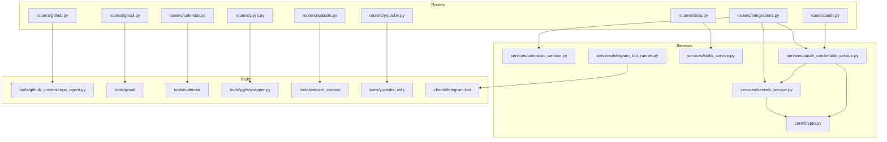
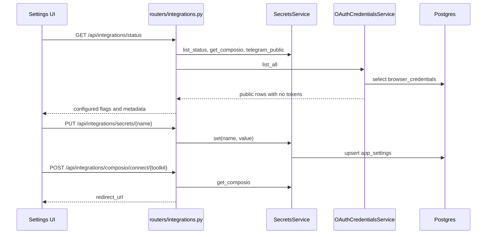
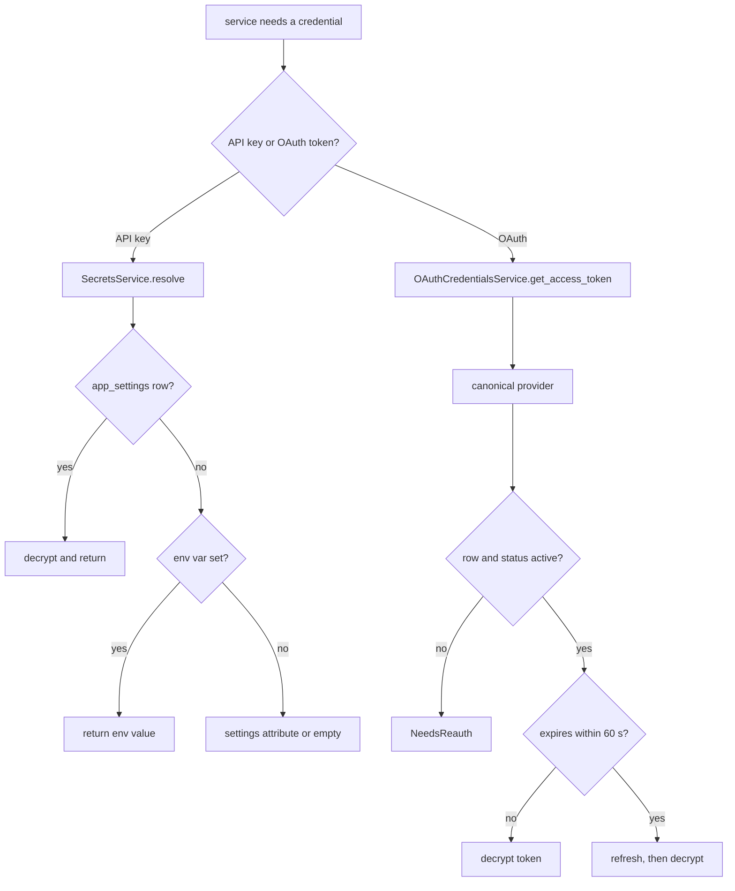
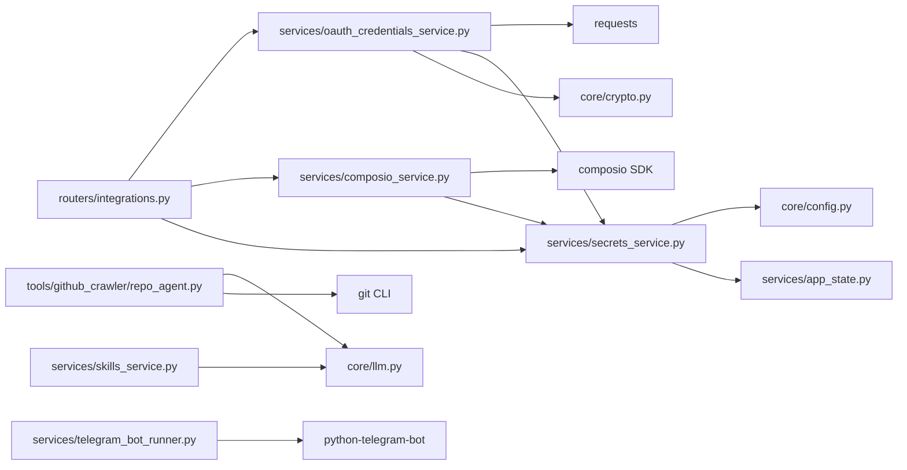

# Service integrations

This folder covers the account and capability integrations that sit outside the browser tab: Google Workspace, GitHub, the JIIT campus portal, YouTube and website analysis, Composio actions, local skills, Telegram, and the encrypted secret store they all read from. The control surface is `routers/integrations.py`. It reports which providers are configured, stores overrides, starts Composio OAuth flows, and lists native tools and registered agents.

The pages are split by service so a reader debugging mail does not have to read about calendar events, and a reader adding a skill does not have to read about OAuth. Shared credential behavior lives in Secret Storage. Shared provider status lives here.

Key capabilities:
- One status route that aggregates Composio, LLM, voice, Telegram, native tools, agents, and infrastructure.
- One encrypted credential row per OAuth provider, refreshed on use.
- A GitHub repository agent that clones into a temp directory and answers from a read-only checkout.
- Composio actions selected by exact slug or by term matching.
- `SKILL.md` discovery from `skills/` and `.agents/skills`.
- A Telegram bot that streams agent replies into a chat.
- A secret registry that separates known keys from arbitrary input.

## Repository layout

Every integration has a route module, a service or tool package, and a credential path. `routers/integrations.py` is the shared settings surface rather than a domain route.

## Building blocks

- `routers/integrations.py`: `GET /status` and the settings routes for Composio, OAuth, secrets, OAuth clients, PyJIIT, voice, runtimes, and compaction.
- `services/composio_service.py`: `CURATED_TOOLKITS`, `authorize_toolkit`, `list_toolkits_view`, and `execute_toolkit_action`.
- `services/oauth_credentials_service.py`: `store`, `get_access_token`, `delete`, and Google refresh logic in `_refresh_google`.
- `services/secrets_service.py`: `SECRET_REGISTRY`, `AppSetting` values, OAuth client pairs, Composio and PyJIIT config.
- `services/skills_service.py`: discovers and runs skills from `SKILL.md` folders.
- `services/telegram_bot_runner.py`: starts the polling bot inside the API process.
- `core/crypto.py`: `encrypt` and `decrypt` for token rows and secret values.

## How it fits together

All integrations read credentials through one of two paths. API keys and base URLs go through `SecretsService`, which reads the `app_settings` row first, then the environment, then the settings attribute. OAuth tokens go through `OAuthCredentialsService`, which stores them encrypted in `browser_credentials`. The status route never returns a secret value, only whether one resolves.

## Pages in this folder

| Page | What it covers |
| --- | --- |
| [Academic Portal Integration](Academic%20Portal%20Integration) | PyJIIT login, sessions, semesters, attendance, and the agent tool |
| [Calendar Integration](Calendar%20Integration) | Google Calendar list and create routes, token path, event tools |
| [Composio Toolkit Actions](Composio%20Toolkit%20Actions) | curated catalog, auth configs, account selection, action execution |
| [GitHub Integration](GitHub%20Integration) | repository URL parsing, clone cache, private archives, read-only shell |
| [Gmail Integration](Gmail%20Integration) | unread, latest, mark read, send, and the four Gmail agent tools |
| [Secret Storage](Secret%20Storage) | secret registry, env and database resolution, AES-GCM payloads |
| [Skills Execution](Skills%20Execution) | `SKILL.md` discovery, frontmatter, prompt assembly, generated files |
| [Telegram Bot](Telegram%20Bot) | polling, access modes, conversation threading, screenshots |
| [Website Analysis Integration](Website%20Analysis%20Integration) | server and client page context, prompt chain, injection validator |
| [YouTube Integration](YouTube%20Integration) | subtitle download, Whisper fallback, transcript cleaning, prompt |

## Credential paths

There are two stores and a clear rule for which one a service uses. Named secrets are for keys and config. OAuth rows are for user tokens.

- `SecretsService.resolve(name)` checks the database, then the env var, then the pydantic settings attribute. It never raises.
- `OAuthCredentialsService.get_access_token(provider)` canonicalizes `gmail`, `calendar`, `youtube`, and `google-search` to `google`, then decrypts or refreshes.
- `resolve_google_token_optional()` returns `None` on `NeedsReauth` so an agent turn can continue without Google.
- Secret writes through `PUT /api/integrations/secrets/{name}` call `reload_default_llm`. OAuth client writes do not.
- The status route reports `db_set`, `env_set`, and `source` per named secret, never the value.

## Dependencies

`routers/integrations.py` imports the secret, Composio, and OAuth services. The OAuth service imports crypto and the secret service. Skills import the LLM factory. The repository agent imports git, the OAuth store, the bridge, and the LLM factory.

## Performance and limits

- `list_toolkit_meta` asks Composio for 500 toolkits. Tool listings and execution ask for 500 tools per toolkit.
- Composio SDK calls are synchronous and wrapped in `asyncio.to_thread`.
- Google token refresh uses a 10 second `requests` timeout.
- Status calls three infrastructure probes in sequence: Postgres `SELECT 1`, Neo4j driver presence, OpenSearch client presence.
- Secret listing decrypts set values only to produce a short masked preview.
- The GitHub clone cache lives under `$TMPDIR/agentic-browser/repos` and expires after 30 minutes.
- Portal and YouTube calls are live network calls with no shared cache.

## Troubleshooting

- "Composio API key is not configured": `get_client_and_user_id` found no `api_key` in the `composio` settings row.
- "Invalid Composio API key": the project key from `platform.composio.dev` is required, not the sessions or MCP key from the dashboard.
- A Composio connect returns 409: the toolkit needs a bring-your-own auth config, surfaced as `composio_auth_config_required` with a `setup_url`.
- Google tools return no token: `resolve_google_token_optional` swallows `NeedsReauth` and returns `None`, so the agent proceeds without Google access.
- A secret shows as unset after saving: confirm the name is in `SECRET_REGISTRY`. `PUT /secrets/{name}` returns 404 for anything else.
- The model does not change after an override: the PUT routes call `reload_default_llm`, but a failure there is logged and swallowed. Check the server log.
- A Telegram bot is silent: no token resolved, or a second poller holds the same token.
- A skill is missing from the list: the folder has no `SKILL.md`, or a same-named folder in `skills/` shadows `.agents/skills`.

## Appendix

### Implementation examples

- `GET /api/integrations/status` returns `composio`, `llm`, `voice`, `telegram`, `native_tools`, `agents`, and `infra` sections.
- `POST /api/integrations/composio/connect/{toolkit}` returns `{toolkit, redirect_url, connection_id}`.
- `GET /api/integrations/oauth` returns `{"connections": [...]}` from `OAuthCredentialsService.list_all`.
- `PUT /api/integrations/secrets/openai_api_key` stores an encrypted value and reloads the default LLM.
- `GET /api/integrations/secrets` returns masked rows with source flags.

### Source files

- `routers/integrations.py`
- `services/composio_service.py`
- `services/oauth_credentials_service.py`
- `services/secrets_service.py`
- `services/skills_service.py`
- `services/telegram_bot_runner.py`
- `core/crypto.py`
