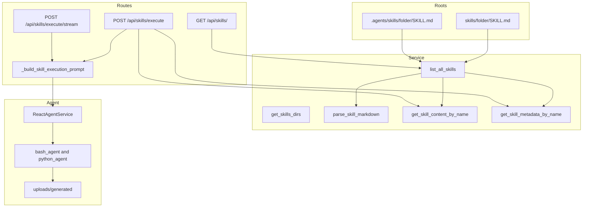
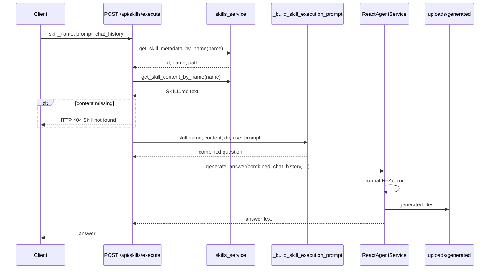
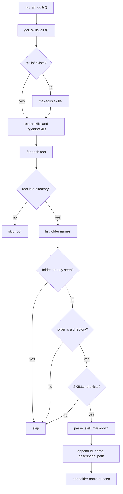
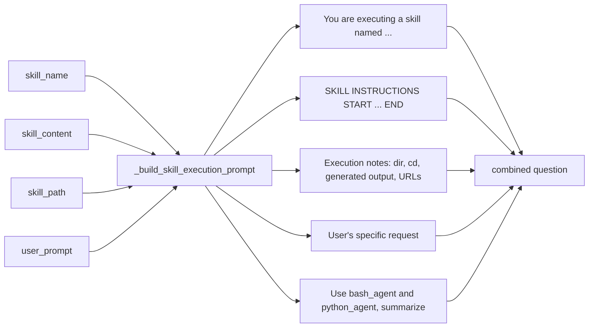
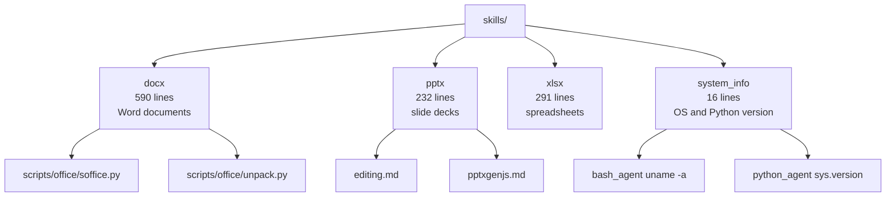
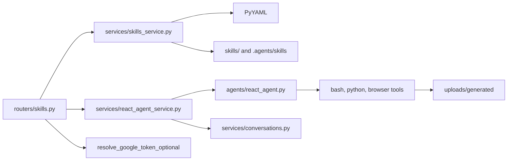

# Skills execution

A skill is a folder with a `SKILL.md` file. `services/skills_service.py` scans two roots, parses YAML frontmatter, and returns an id, name, description, and path. `routers/skills.py` loads the whole file, wraps it in an execution prompt, and sends the result to `ReactAgentService` as if it were a user question.

There is no separate skill runtime and no sandbox. The skill's instructions become part of the prompt, and the normal ReAct agent carries them out with its tools. Skills stay portable as markdown, but the model decides how literally to follow the bundled scripts.

Key capabilities:
- Discovery from `skills/` and `.agents/skills`, with folder-name deduplication.
- Frontmatter defaults when YAML is missing or malformed.
- Lookup by folder id or by the `name` field, case-insensitive.
- Prompt assembly that names the skill directory and the output directory.
- Streaming and non-streaming execution over the same service.
- Bundled examples for docx, pptx, xlsx, and system information.

## Repository layout

The service is small and has no state. The route module holds the prompt template and the two execution endpoints. Skills live as data folders beside the code.

## Building blocks

- `PROJECT_ROOT`: two levels up from `services/skills_service.py`.
- `SKILLS_DIR`: `<root>/skills`. `AGENT_SKILLS_DIR`: `<root>/.agents/skills`.
- `get_skills_dirs`: creates `skills/` if missing and returns both paths in order.
- `parse_skill_markdown`: reads the file, defaults `name` to the folder name and `description` to an empty string, and merges parsed frontmatter.
- `list_all_skills`: walks both roots and returns `{id, name, description, path}` for folders containing `SKILL.md`.
- `get_skill_content_by_name` and `get_skill_metadata_by_name`: return the raw text or metadata for a matching name or id.
- `_build_skill_execution_prompt`: turns a skill file plus a user request into one question.
- `execute_skill`: non-streaming path, returns `ExecuteSkillResponse(answer=...)`.
- `execute_skill_stream`: wraps `stream_answer` in a `StreamingResponse`.

## How it fits together

A request names a skill and supplies a prompt. The route resolves the skill twice, once for metadata and once for content, builds the combined question, and hands it to the agent. Conversation persistence, attachments, memory, and run traces all behave as they do for a normal chat turn because the same service method is called.

The streaming route skips the `generate_answer` wrapper and iterates `service.stream_answer` directly, framing each event with its own `_sse_event` copy. The event names and payloads are identical to the chat stream.

## Discovery

`list_all_skills` scans `skills/` first, then `.agents/skills`. Deduplication is by folder name, not by parsed `name`, so a folder `docx` in the first root hides a folder `docx` in the second. Non-directories and folders without `SKILL.md` are skipped silently.

The id is always the folder name. The display name comes from frontmatter and can contain spaces, as `skills/system_info/SKILL.md` does with `name: System Info Skill`. Lookup accepts either form.

## Frontmatter parsing

Frontmatter is only recognized when the file starts exactly with `---\n`. The closing marker is the next `\n---\n` after offset 4. The block between them is passed to `yaml.safe_load`. A parse error is swallowed, and the defaults survive.

Only `name` and `description` are used by the list endpoint, but the whole frontmatter dict is merged, so extra keys such as `license` are available to callers of `parse_skill_markdown` directly. The examples show `license: Proprietary. LICENSE.txt has complete terms` in the docx, pptx, and xlsx skills.

## The execution prompt

`_build_skill_execution_prompt` produces a question with four parts: the skill name, the file content between explicit start and end markers, execution notes, and the user's request. The markers matter because skill files can be long and contain their own headings. The model is told exactly where the instructions begin and end.

The execution notes name the skill directory on disk and tell the model to read or run bundled resources such as `scripts/...`, `editing.md`, or `pptxgenjs.md` from there. For commands that depend on relative paths, it suggests `cd "<skill dir>" && ...`. Output files must be saved under `uploads/generated/`, and the final answer must include both the absolute path and a relative download URL of the form `/api/upload/files/generated/<filename>`.

The prompt ends by telling the model to use `bash_agent` and `python_agent` to carry out the instructions. Those tools come from the standard agent tool registry. The skills route does not add anything to the tool list. A skill that needs an unavailable tool fails at the tool-call stage and the model has to explain.

## What a skill file looks like

The four bundled skills show the range. `system_info` is 16 lines with a goal and three steps, and it explicitly calls `bash_agent` for `uname -a` and `python_agent` for `sys.version`. `docx` is 590 lines and covers reading with pandoc, creating with `docx-js`, and editing by unpacking and repacking XML. `pptx` is 232 lines with a quick-reference table pointing at `editing.md` and `pptxgenjs.md`. `xlsx` is 291 lines of output requirements, color conventions, and number formats.

The frontmatter descriptions are written as trigger rules. They list phrases such as "Word doc", ".docx", "deck", "slides", and "the xlsx in my downloads", and they say when not to use the skill. A client or orchestrator would read that text to decide whether to invoke the skill, though this route requires the caller to name it.

## Generated output

Anything a skill produces should land in `uploads/generated/`, which `routers/file_upload.py` creates at import time. The download route `/api/upload/files/{file_path:path}` serves it because the resolved path is under `uploads/`. The prompt asks for the relative URL, so the client can render a link without knowing the backend host.

The route does not verify that files were written, that the path is correct, or that the answer's links resolve. A skill that writes to the repo root or to `/tmp` still returns an answer, but the links will not work.

## Dependencies

Skills depend only on `PyYAML` for parsing and the React agent service for execution. There is no database table and no background worker.

## Performance and limits

- Listing reads every `SKILL.md` in both roots on every call. There is no cache.
- An execute request scans the directories twice before the prompt is built.
- The full skill file goes into the prompt with no length cap. The docx skill alone is 590 lines.

## Troubleshooting

- "Skill 'x' not found": no folder in either root has a `SKILL.md`, or the name and id both differ from the request. Matching ignores case and surrounding spaces but not punctuation.
- A skill in `.agents/skills` is hidden: a folder with the same name exists under `skills/`, and the first root wins.
- The name shows as the folder name: frontmatter is missing, not at byte zero, or malformed YAML. The parser does not log the YAML error.
- The model ignores the skill: the content may be longer than the effective context, or the conversation history pushed it out. Start a new conversation or shorten the skill.
- Generated files are not downloadable: they were written outside `uploads/generated/`. The prompt asks for that directory but nothing enforces it.

## Appendix

### API endpoints

| Method | Path | Body | Response |
| --- | --- | --- | --- |
| GET | `/api/skills/` | none | `{"skills": [{id, name, description}]}` |
| POST | `/api/skills/execute` | `ExecuteSkillRequest` | `{"answer": str}` |
| POST | `/api/skills/execute/stream` | `ExecuteSkillRequest` | SSE frames |

### Implementation examples

- `GET /api/skills/` returns `{"skills": [{"id": "docx", "name": "docx", "description": "...", "path": ".../skills/docx/SKILL.md"}]}`.
- `POST /api/skills/execute` with `{skill_name: "system_info", prompt: "check the OS"}` returns `{"answer": "..."}`.

### Source files

- `services/skills_service.py`
- `routers/skills.py`
- `skills/docx/SKILL.md`
- `skills/pptx/SKILL.md`
- `skills/xlsx/SKILL.md`
- `skills/system_info/SKILL.md`
