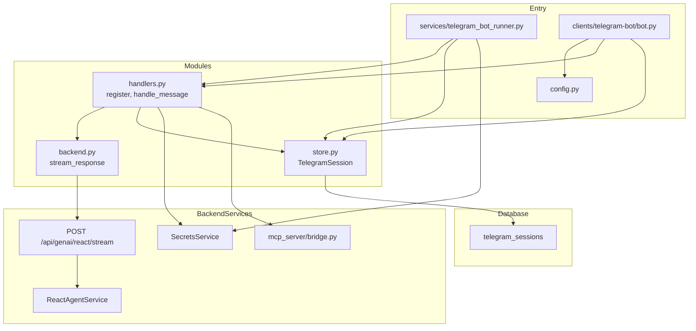
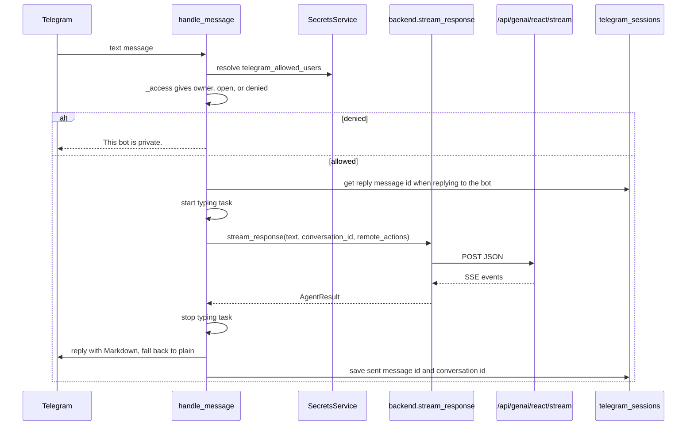
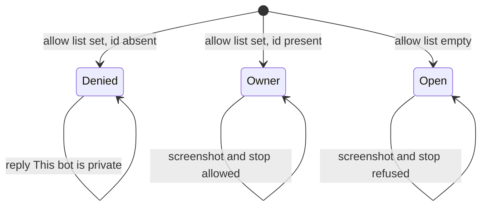
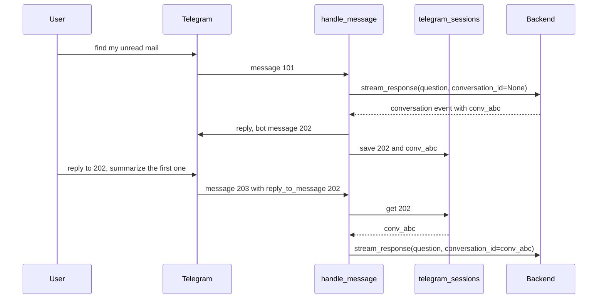
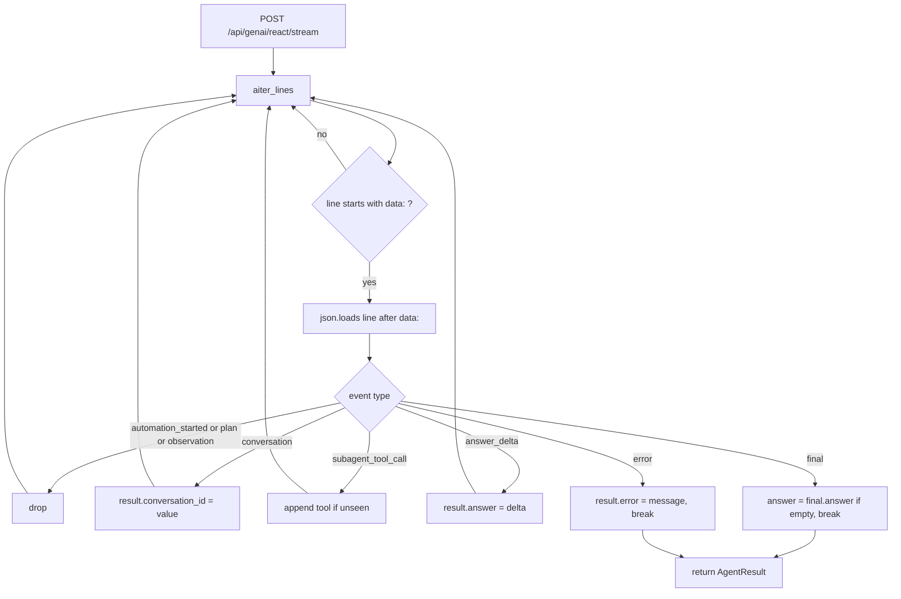
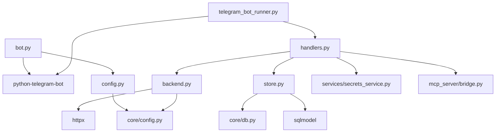

# Telegram bot

The Telegram bot is a `python-telegram-bot` polling client that turns a chat message into a call to `/api/genai/react/stream` and streams the answer back. It lives in `clients/telegram-bot/` as five plain modules: `bot.py`, `handlers.py`, `backend.py`, `store.py`, and `config.py`.

The bot can run inside the API server through `services/telegram_bot_runner.py`, or standalone with `python clients/telegram-bot/bot.py`. Both paths need the backend running, because the bot has no in-process access to the agent.

Key capabilities:
- Long polling with no webhook and no public URL.
- Three access modes: owner, open, denied.
- Conversation threading by replying to a bot message.
- Typing indicator refreshed every 4 seconds.
- Markdown replies with a plain-text fallback.
- Screenshot and stop commands over the browser bridge.
- Tool names summarized at the bottom of each reply.

## Repository layout

The bot directory is added to `sys.path` by both entry points, so the modules import each other by bare name. The shared backend code is importable because the repository root is also on the path.



## Building blocks

- `bot.py`: path setup, logging, `ApplicationBuilder().token(...).post_init(_post_init).build()`, `handlers.register`, and `run_polling`.
- `config.py`: exposes `settings` and raises `ValueError` at import when `telegram_bot_token` is empty.
- `handlers.py`: `_allowed_users`, `_access`, `_keep_typing`, `handle_message`, four command handlers, and `register`.
- `backend.py`: `AgentResult` dataclass and `stream_response`, the SSE client.
- `store.py`: `TelegramSession` SQLModel, `init`, `save`, and `get`.

## How it fits together

A text message that is not a command reaches `handle_message`. The handler checks access, resolves a conversation id from a reply if there is one, starts a typing loop, calls the backend, stops the typing loop, renders the answer, and saves the new bot message id against the conversation.



## Starting the bot

Under the API server, `main.py` creates the task in `lifespan` and assigns it to `app.state.bot_task`. The runner inserts the bot directory into `sys.path`, resolves the token through `SecretsService`, initializes the store, builds the application, registers handlers, warns when no allow list exists, and then enters polling.

Standalone, `bot.py` does the same build with `config.settings.telegram_bot_token` and calls `app.run_polling()`. The README steps are: create a bot with BotFather, copy `clients/telegram-bot/.env.example` to `.env` and set the token, run `uv sync`, then `python clients/telegram-bot/bot.py` from the repo root. Because `config.py` raises on a missing token, the standalone path fails fast at import. The runner path instead skips silently.

Only one process can poll a given token. Running the server and `bot.py` at the same time produces conflicts, because Telegram allows a single `getUpdates` consumer.

## Access control

`_allowed_users` resolves `telegram_allowed_users`, splits on commas, and trims each entry. `_access` compares the numeric Telegram user id as a string. No list means `open`: the bot answers questions but passes `remote_actions=False`, which `ReactAgentService` turns into `context["remote_actions"] = False`. A non-owner cannot trigger browser tasks or Composio actions through the agent.



The command handlers apply the same rule. `/screenshot` and `/stop` check that access is not `owner` and reply "Only allowed users can see the browser." or "Only allowed users can stop browser tasks." otherwise. `/whoami` always answers, because its purpose is to reveal the id needed for the list.

## Conversation threading

The backend returns a `conversation_id` in a `conversation` event. The bot saves a row mapping the id of its own sent message to that conversation. When the user replies to that message, `message.reply_to_message.from_user.is_bot` is true, so the handler looks up the reply's message id and passes the conversation id to the next request.



The table is small. `bot_message_id` is the primary key and `conversation_id` is a plain string with no foreign key. `init` creates it with `checkfirst=True` inside `engine.begin()`, so the bot can start before any migration tooling has run.

## The backend client

`stream_response` posts to `http://localhost:{backend_port}/api/genai/react/stream`, where `backend_port` comes from `core.config`. The payload carries `question`, `client_id: "telegram-bot"`, an optional `conversation_id`, and:

```json
{"client_context": {"remote_actions": true, "surface": "telegram"}}
```

The `httpx` client uses a 1200 second total timeout and a 10 second connect timeout. Those numbers exist because a browser task can run for many minutes while the planner works through steps.



The parser reads only `data: ` lines. The `event:` line is ignored because each JSON payload repeats its own `event` field.

One detail matters for partial answers: `answer_delta` assigns `result.answer = event.get("delta", "")` rather than appending. The bot therefore relies on the `final` event's full `answer`, and the last delta only survives if no final event arrives.

Tool names are collected from `subagent_tool_call` and deduplicated in a set while preserving first-seen order in the list. Automation events are dropped so a browser run does not spam the chat with plan and observation payloads.

## Rendering a reply

`handle_message` starts from `result.answer` or a fallback string, appends a separator and a "Tools used" line when tool calls were seen, and adds a hint to send `/screenshot` when `browser_task` was among them. It sends with `ParseMode.MARKDOWN` and retries as plain text on `BadRequest`, which is the usual failure when model output contains unbalanced Markdown.

The typing loop runs as a separate task and calls `send_chat_action(..., ChatAction.TYPING)` every 4 seconds. It is cancelled in a `finally` block, so an exception in the backend call still stops the indicator. Errors from the typing call are swallowed.

## Commands

`register` wires five command handlers and one text handler:
- `/start` and `/help` both go to `cmd_start`, which describes the bot and, in open mode, prints the setup hint with the user id.
- `/whoami` prints the id and the access status.
- `/screenshot` calls `page.screenshot` with a 20 second timeout and `tabs.list` with 10 seconds, decodes the `dataUrl`, and sends a photo with a title and URL caption truncated to 1000 characters.
- `/stop` calls `task.stop` with a 10 second timeout.
- Any non-command text goes to `handle_message`.

`/screenshot` and `/stop` import `mcp_server.bridge` lazily inside the handler. A `BridgeError` becomes a friendly "Couldn't reach the browser" reply. If the screenshot payload has no comma in its data URL, the bot says the browser did not send one.

## Dependencies



## Performance and limits

- Backend timeout is 1200 seconds total and 10 seconds to connect.
- Typing refresh interval is 4 seconds.

## Troubleshooting

- The bot is silent under the server: no `telegram_bot_token` resolved, so `run_telegram_bot` returned. Set the secret or the env var.
- "TELEGRAM_BOT_TOKEN is not set" when running `bot.py`: `config.py` raises at import. This standalone path does not read the database secret.
- Replies show only the last fragment of an answer: the `final` event was missing or malformed, and `answer_delta` keeps only the last delta.

## Appendix

### Source files

- `clients/telegram-bot/bot.py`
- `clients/telegram-bot/handlers.py`
- `clients/telegram-bot/store.py`
- `clients/telegram-bot/backend.py`
- `clients/telegram-bot/config.py`
- `services/telegram_bot_runner.py`
- `tools/remote_actions.py`
