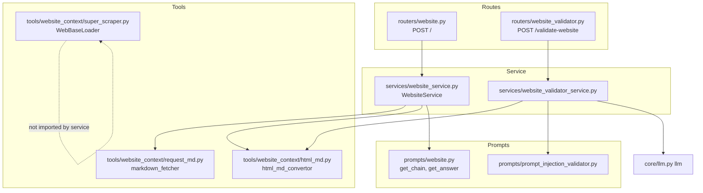
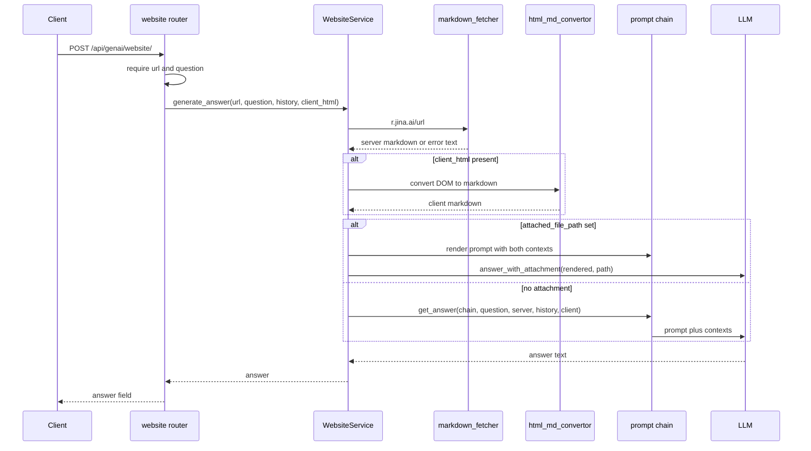
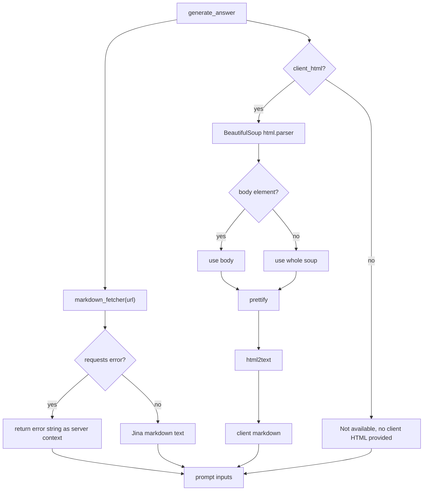
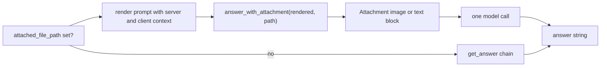
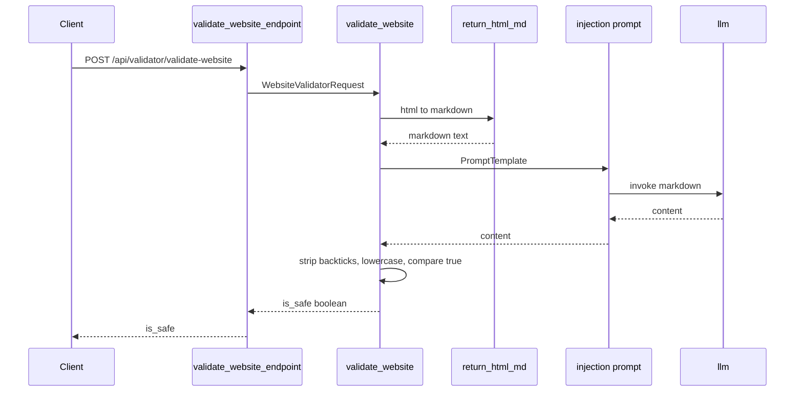
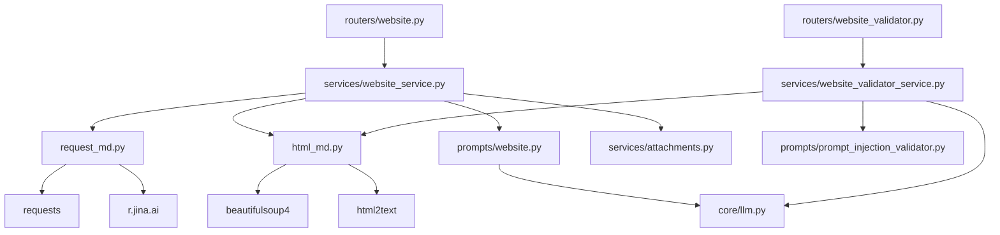

# Website analysis integration

The website integration answers a question about a page using two views of the same content: a server-side markdown fetch and an optional client-rendered DOM. `routers/website.py` exposes `POST /api/genai/website/`, while `routers/website_validator.py` exposes `POST /api/validator/validate-website` for prompt injection checks.

The two sources are deliberately kept separate in the prompt. The server fetch is usually cleaner but can miss JavaScript-rendered content. The client HTML reflects what the user actually sees, including authenticated views, so the prompt tells the model to prefer it when the two disagree.

Key capabilities:
- Server-side markdown fetch through the Jina reader endpoint.
- Client HTML to markdown conversion with BeautifulSoup and html2text.
- A prompt that takes both contexts and cites the client view on conflict.
- Optional file attachments through the shared attachment service.
- A prompt injection validator over converted page text.
- No authentication. Any reachable URL or supplied HTML can be analysed.

## Repository layout

The route module is thin. The service fetches, converts, and renders the prompt. The tools package exports two functions and keeps a third scraper that the service does not use.

## Building blocks

- `WebsiteRequest`: `url`, `question`, `chat_history`, `client_html`, and `attached_file_path`.
- `WebsiteService.__init__`: builds a chain with `get_chain()`.
- `WebsiteService.generate_answer`: fetches server markdown, converts client HTML, flattens chat history, and calls either `get_answer` or `answer_with_attachment`.
- `markdown_fetcher`: `requests.get("https://r.jina.ai/" + url)` and returns response text.
- `html_md_convertor`: parses the HTML, takes `soup.body` when present, prettifies it, and runs `html2text`.
- `prompt`: `PromptTemplate` with `server_context`, `client_context`, `question`, and `chat_history`.
- `get_chain`: `RunnableParallel | prompt | _current_client() | StrOutputParser`.
- `get_answer`: builds `prompt | _current_client() | parser` and invokes it.
- `WebsiteValidatorRequest`: `html` string.
- `WebsiteValidatorResponse`: `is_safe` boolean.
- `validate_website`: converts HTML, runs the injection prompt, and compares the stripped result to `"true"`.

## How it fits together

The website route validates the two required fields, then awaits the service. The service catches every exception and returns an apology string. An HTTP 500 from this route therefore means the router raised before the service call, for example on a missing field.

The initial `self.chain` is not actually used by `get_answer`. That helper rebuilds the pipeline from the module-level `prompt` and the current default client, which is how a model change made after service construction still applies.

## Fetching and converting

`markdown_fetcher` prefixes the URL with `https://r.jina.ai/` and returns the response body as text. It has no timeout argument, so a slow reader service can hold the request open. On an exception it returns `Error fetching content from <url>: ...` rather than raising, and that error string becomes server context.

`html_md_convertor` is local and deterministic. It parses with `html.parser`, prefers the `body` element, prettifies the subtree, and converts the result with `html2text`. It does not run scripts, follow links, or fetch subresources.

`super_scraper.py` contains a separate `clean_response` function built on `langchain_community.document_loaders.WebBaseLoader` with a `SoupStrainer` class filter. The package `__init__.py` does not export it and `WebsiteService` does not import it. Treat it as an alternate scraper kept in the tree, not part of the live path.

## The prompt

The prompt names the model `MDPageChat` and gives it explicit rules. It must not invent details, must reply `Data not available.` when the two contexts do not cover the question, and must prefer the client context on conflict. It asks for headings in hierarchical order, exact code blocks, links with text and URL, images with alt text and source, and tables that preserve headers.

Summaries are capped at 150 words unless the user asks for more. Formatting is plain markdown with bullets, tables, and LaTeX where useful. Chat history is flattened by the service into `role: content` lines before it reaches the prompt.

The service passes `Not available (no client HTML provided).` when `client_html` is empty. The model is told that this is an absent source, not a page that literally says that.

## Attachments

When `attached_file_path` is set, the service does not invoke the chain. It renders the same prompt, then calls `services.attachments.answer_with_attachment(rendered, path)`. That function adds the file as a message part and makes one model call. The difference matters for debugging: a chain failure inside `get_answer` raises into the service catch, while an attachment failure is raised by the attachment helper and caught the same way.

The attachment path must already be under `uploads/`. A path from the client's local disk is refused by the attachment service, and the service turns the refusal into its apology string.

## The validator

The validator route is a plain `def`, so FastAPI runs it in the threadpool. It takes raw HTML, converts it with `return_html_md`, and sends the markdown through the injection prompt. The result is stripped of backticks and lowercased, then compared to `"true"`. Anything else is `is_safe: false`.

There is no try/except in the service or the route, so an LLM error becomes a 500 from FastAPI. The validator also has no size limit. A very large HTML payload is converted in full before the model call.

## Dependencies

## Performance and limits

- The server fetch has no explicit timeout and runs synchronously inside an async service method.
- `html_md_convertor` runs on the event loop thread and holds the whole DOM string in memory.
- The validator makes one model call per request after converting the whole document.

## Troubleshooting

- The answer ignores the live page: `client_html` was not sent. The server fetch can see a different page than the logged-in browser.
- Server context starts with `Error fetching content from`: the Jina request failed and the error string was passed to the model as context.
- The model replies `Data not available.`: neither context covered the question, or both were mostly navigation text.
- 400 `url and question are required`: one field was empty or missing.
- Attachment refused: the path was outside `uploads/`. Send the `path` returned by `/api/upload/`.
- Validator always returns false: the model did not answer exactly `true`, or the page was flagged.

## Appendix

### API endpoints

| Method | Path | Body | Response |
| --- | --- | --- | --- |
| POST | `/api/genai/website/` | `WebsiteRequest` | `{"answer": str}` |
| POST | `/api/validator/validate-website` | `{"html": str}` | `{"is_safe": bool}` |

### Implementation examples

- `markdown_fetcher("https://example.com")` fetches `https://r.jina.ai/https://example.com`.
- `html_md_convertor("<html><body><h1>Hi</h1></body></html>")` returns markdown with `# Hi`.
- `prompt.format(server_context, client_context, question, chat_history)` builds the model input.

### Source files

- `routers/website.py`
- `services/website_service.py`
- `tools/website_context/request_md.py`
- `tools/website_context/html_md.py`
- `prompts/website.py`
- `routers/website_validator.py`
- `services/website_validator_service.py`
- `tools/website_context/super_scraper.py`
