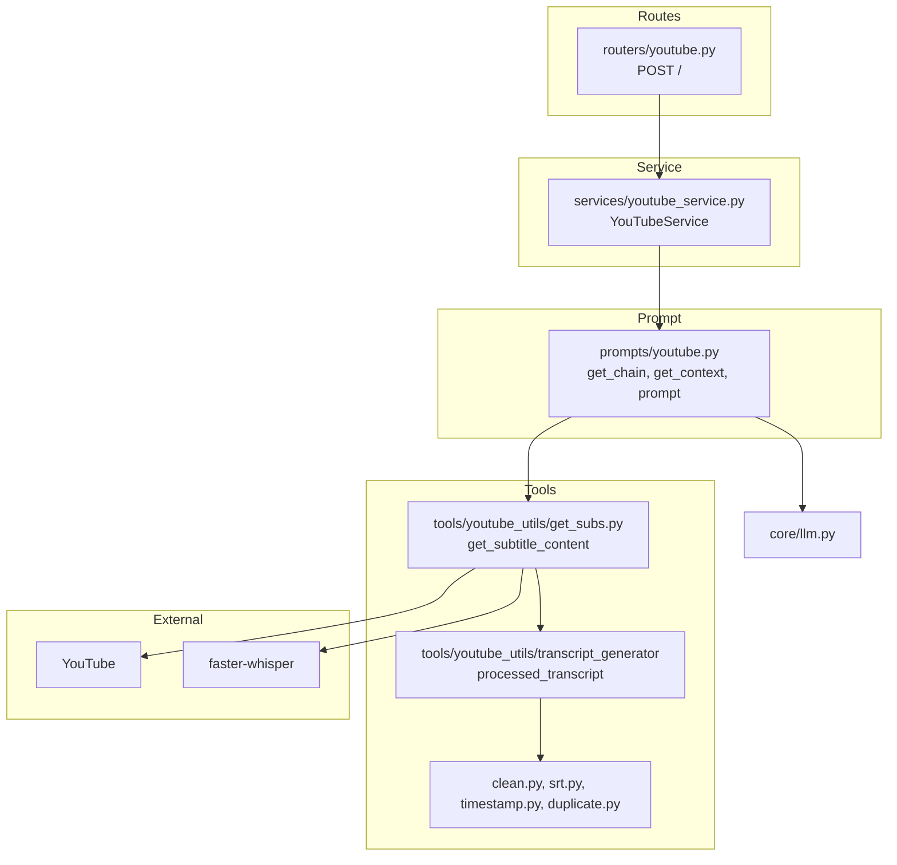
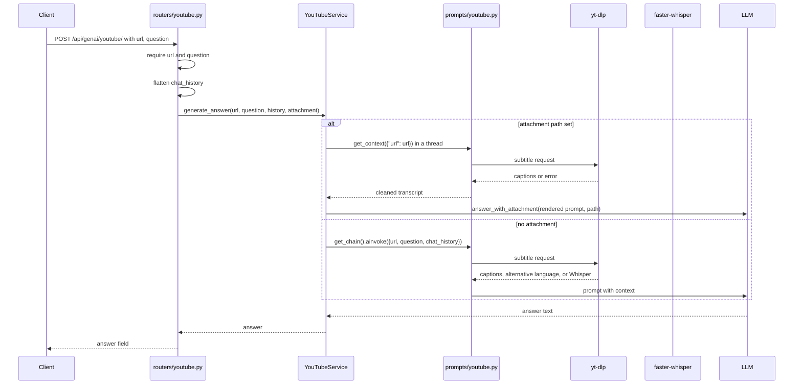
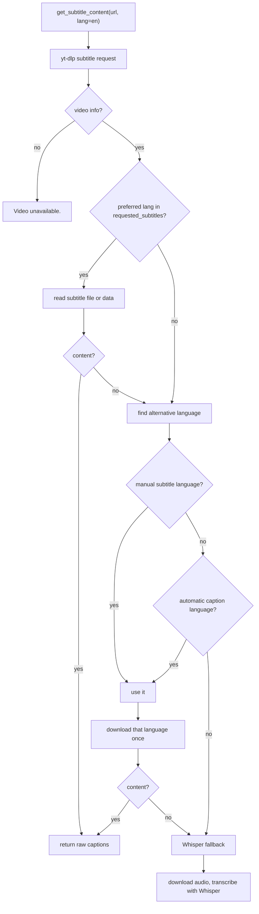
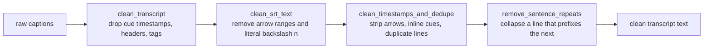
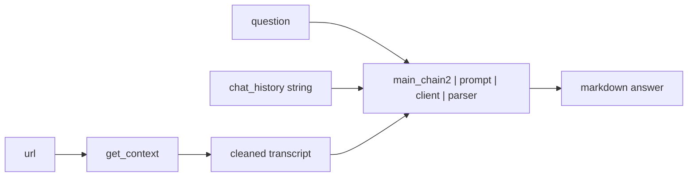
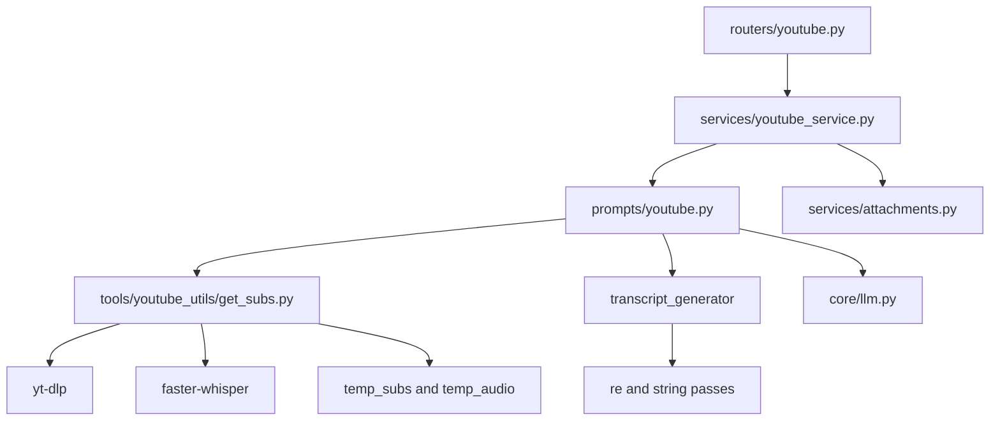

# YouTube integration

The YouTube integration answers questions about a video from its transcript. `POST /api/genai/youtube/` takes a video URL and a question, fetches subtitles with `yt-dlp`, cleans the caption text, and sends the result through a prompt chain. If no subtitle track exists, it downloads the audio and transcribes it with local Whisper.

The prompt is strict about grounding. It tells the model to use only the supplied context, reply `Data not available.` for anything outside it, and avoid inventing titles or statistics. The service catches every error and returns an apology string, so a failed transcript fetch usually arrives as HTTP 200 with a message rather than a 500.

Key capabilities:
- Subtitle download through `yt-dlp` in the preferred language.
- Alternative-language and Whisper fallbacks.
- Caption cleaning: cue tags, timestamps, duplicates, repeated sentences.
- A per-request chain so the current model picker applies.
- Optional file attachments alongside the transcript.
- A route that accepts a URL, question, history, and attachment path.

## Repository layout

The route module validates and flattens history. The service picks the attachment or chain path. The prompt module owns transcript fetching and cleanup wiring. The tools package owns subtitle download and caption cleaning.

## Building blocks

- `AskRequest`: `url`, `question`, `chat_history`, and `attached_file_path`.
- `YouTubeService.generate_answer`: async method that returns a string.
- `get_context`: reads `url` from the input dict and returns cleaned transcript text or an empty string.
- `fetch_transcript`: calls `get_subtitle_content`, detects known error strings, and cleans a real transcript.
- `get_chain`: builds `main_chain2 | prompt | _current_client() | StrOutputParser` on each call.
- `main_chain2`: `RunnableParallel` that maps `url` to context and passes question and history through.
- `get_subtitle_content`: `yt-dlp` subtitle download with language and Whisper fallbacks.
- `processed_transcript`: runs four cleaning passes in a fixed order.
- `download_audio_and_transcribe`: downloads audio and runs `faster_whisper.WhisperModel`.

## How it fits together

The route flattens `chat_history` entries into `role: content` lines before calling the service. That means the service and prompt only deal with a string. The service then chooses between a normal chain call and an attachment call.

The service logs the question at info level and the model response at debug level. A chain error is logged and replaced with: `I apologize, but I encountered an error processing your question about the video. Please try again.`

## Transcript retrieval

`get_subtitle_content` makes one `yt-dlp` pass that asks for manual subtitles, automatic captions, and auto-translated captions in `en` by default. It writes VTT, SRT, or the best available format into `tools/youtube_utils/temp_subs`, reads `requested_subtitles`, and removes the temp directory in a `finally` block.

If the preferred language is missing, it picks an alternative. Manual subtitles win over automatic captions, and the first language that is not the preferred one is chosen. It tries the already-downloaded requested subtitles first, then makes one more request for that language.

The exception path is narrow but important. A `DownloadError` containing `video unavailable` returns that message. A 429, `too many requests`, `subtitles not available`, or `no closed captions found` goes to Whisper. Any other download error returns `Error downloading subtitles: ...`. Unexpected exceptions return `An unexpected error occurred while fetching subtitles: ...`.

The Whisper fallback downloads the best audio stream to `tools/youtube_utils/temp_audio` and runs `faster_whisper.WhisperModel`. It runs as a blocking call inside the request path, so the first transcription pays the model load and the audio decode.

## Transcript cleaning

`processed_transcript` applies four passes. The order matters because each pass assumes the previous one has removed a class of noise.

`clean_transcript` also removes speaker tags such as `<v Name>`, VTT metadata lines, and alignment artifacts. It merges cue lines into paragraphs separated by blank lines. `clean_srt_text` handles the literal `\n` sequences that some caption files contain. The dedupe pass keeps first-seen lines in order. The final pass handles captions that repeat a prefix of the next line, a common rolling-caption artifact.

## The prompt and its context

The prompt names the model `YTVideoChat` and gives it seven rules. Summaries use description and transcript and stay under 150 words. Durations convert from seconds to `X min Y sec`. Statistics quote `view_count`, `like_count`, `upload_date`, and `uploader`. Themes use tags, categories, and transcript. Sentiment uses captions or transcript. Related videos become topic suggestions, never invented titles. Out-of-scope questions get `Data not available.`

The current code only supplies a transcript. `get_context` returns `fetch_transcript(url)`, and no video metadata object is inserted into the prompt. Questions about view counts, upload date, or duration therefore usually hit the out-of-scope rule unless the transcript happens to mention them. This is a gap between the prompt text and the context the chain actually builds.

## Attachments

With `attached_file_path`, the service fetches the transcript in a worker thread, formats the prompt with the transcript, question, and history, then calls `answer_with_attachment`. That helper adds the file to the model input and makes one call. The attachment path must be under `uploads/`.

The attachment branch uses `prompt.format`, not `get_answer`, so the module-level prompt is the source of truth. If the prompt template changes, both branches see the change.

## Dependencies

## Performance and limits

- Subtitle retrieval is one `yt-dlp` request in the common case and two when an alternative language is needed.
- Temp subtitle and audio directories are removed in `finally` blocks. A crash before cleanup can leave files behind.
- Whisper runs locally and blocks the request. The first call loads the model.
- The chain is rebuilt per request. That is cheap next to the download but avoids a stale model client.
- The whole transcript goes into the prompt with no clipping. Long videos can exceed the model context.
- The route awaits `ainvoke`, so the event loop is not blocked while the model answers.
- There is no transcript cache. Asking twice downloads twice.

## Troubleshooting

- Answer is the apology string: the chain raised. Check the server log for the transcript or model error.
- `Video unavailable.`: `yt-dlp` could not extract the video. Check the URL and region restrictions.
- Answers about duration or views say `Data not available.`: the prompt asks for metadata, but the chain only passes a transcript.
- Empty answer: the transcript was empty and the model returned nothing. Try a video with captions or enable the Whisper fallback.
- 429 from YouTube: the subtitle request was rate limited. The code should fall back to Whisper, which also downloads audio and can hit the same limit.
- Wrong language: the default is `en`. `get_subtitle_content` accepts a `lang` argument, but the route does not expose it.
- First Whisper call is slow: the model loads inside the request and is not cached at module level here.
- A very long video overflows the context: the transcript is not clipped. Ask a narrower question or add clipping before the prompt.
- Attachment ignored: the file path was outside `uploads/`, and the attachment helper refused it.

## Appendix

### API endpoint

| Method | Path | Body | Response |
| --- | --- | --- | --- |
| POST | `/api/genai/youtube/` | `AskRequest` | `{"answer": str}` |

`AskRequest` carries `url`, `question`, `chat_history`, and `attached_file_path`.

### Implementation examples

- `get_subtitle_content(url)` returns raw VTT or SRT text, an error string, or a Whisper transcript.
- `processed_transcript(raw)` returns cleaned paragraph text.
- `get_chain()` returns a runnable that accepts `{url, question, chat_history}`.
- `get_context({"url": url})` returns the cleaned transcript or `""`.
- `YouTubeService.generate_answer(url, question, history)` returns the answer string.

### Source files

- `routers/youtube.py`
- `services/youtube_service.py`
- `prompts/youtube.py`
- `tools/youtube_utils/get_subs.py`
- `tools/youtube_utils/transcript_generator/__init__.py`
- `tools/youtube_utils/transcript_generator/clean.py`
- `tools/youtube_utils/transcript_generator/srt.py`
- `tools/youtube_utils/transcript_generator/timestamp.py`
- `tools/youtube_utils/transcript_generator/duplicate.py`
