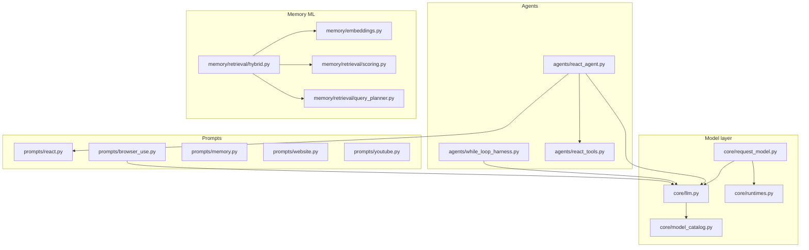
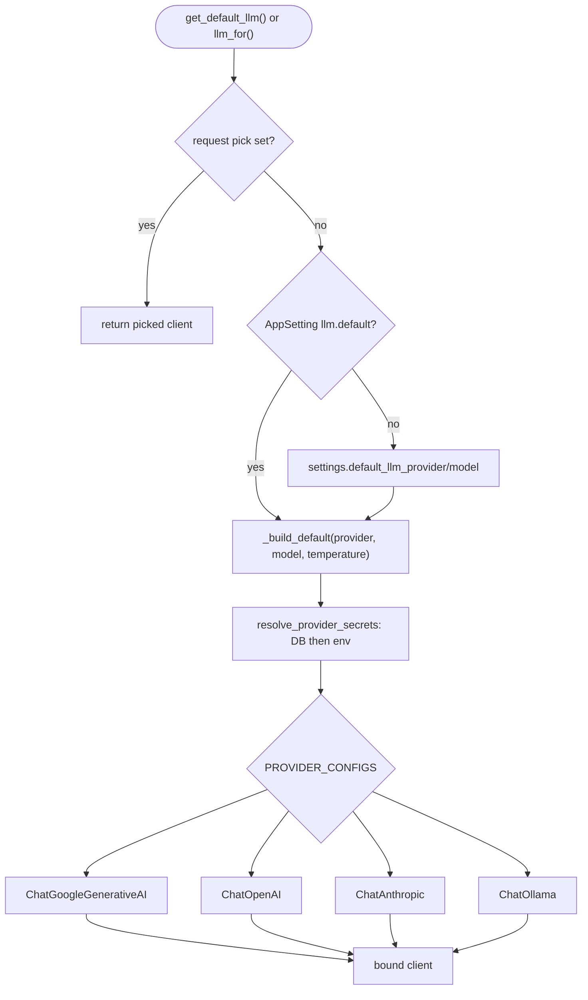
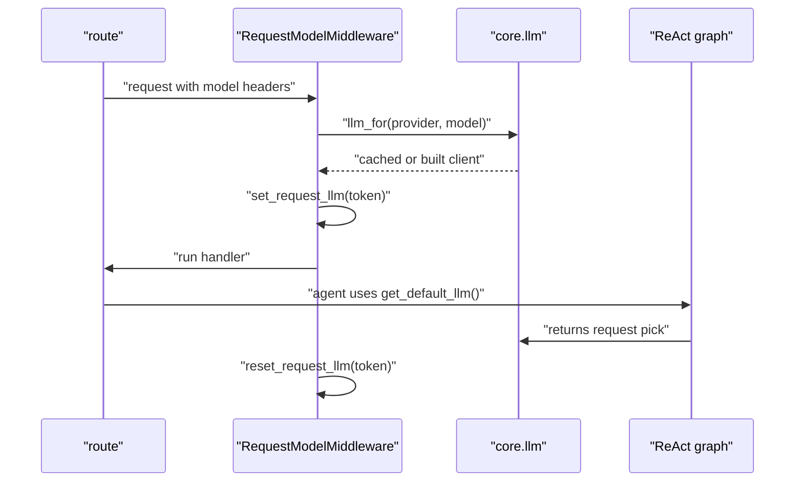
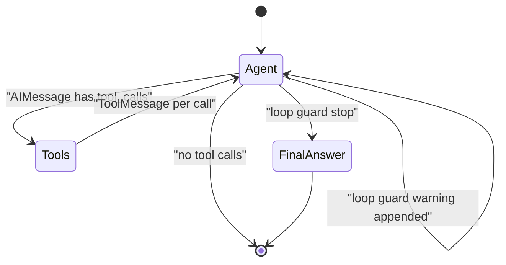
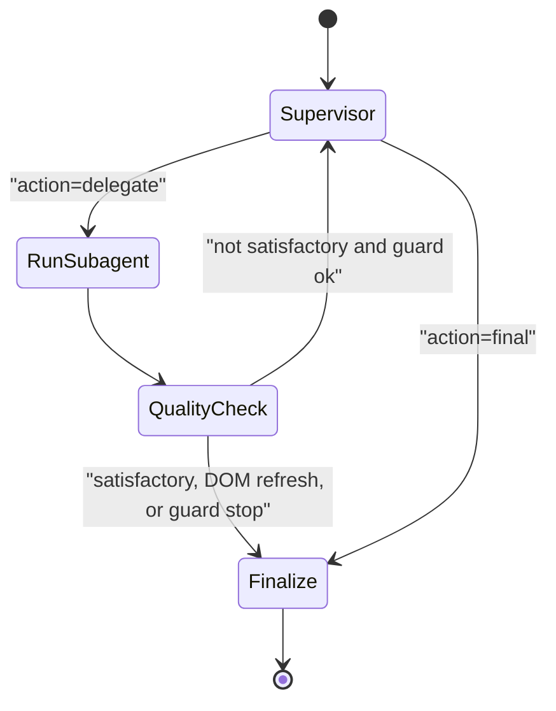
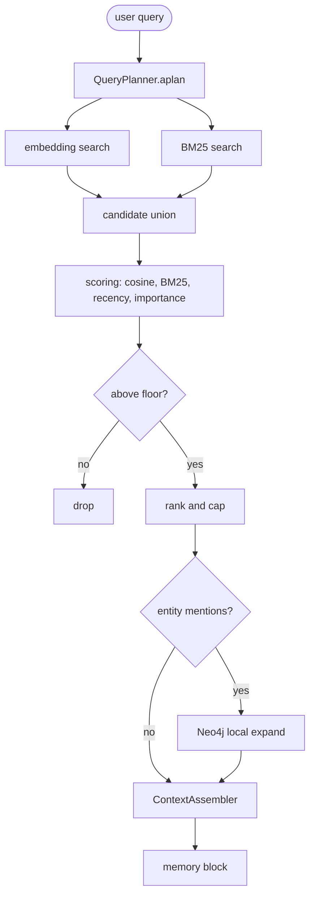
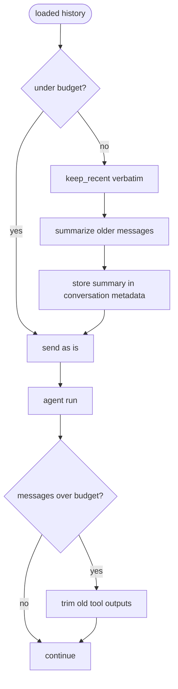
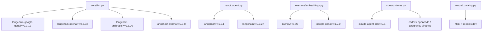

# AI_ML architecture

The AI layer has three jobs: turn a request into a plan, call tools until the plan is done, and keep the context inside the model window. It is provider-agnostic. Eight API providers and four subscription runtimes sit behind one interface, and the model can be swapped per request.

There is no training, fine-tuning or local classifier in the tree. The ML here is prompting, embeddings, retrieval scoring and graph traversal.

Key capabilities:
- Provider registry with per-provider parameter mapping
- Per-request model override from headers
- LangGraph ReAct and supervisor graphs
- Tool binding through LangChain
- Embedding fallback chain
- Retrieval scoring with cosine and BM25
- Compaction and tool-output trimming
- Subscription runtimes as an alternative execution path

## Repository layout

## Building blocks

- `core/llm.py`: `PROVIDER_CONFIGS`, the `LargeLanguageModel` wrapper, `llm_for(provider, model)`, default resolution, and the `llm` / `_model` proxies.
- `core/model_catalog.py`: fetches model metadata from models.dev, caches it, and exposes `model_info(provider, model)` including context window and temperature support.
- `core/request_model.py`: ASGI middleware that reads `X-Agentic-Provider` and `X-Agentic-Model`.
- `core/runtimes.py`: subscription execution for Claude SDK, `codex exec`, ACP agents and Antigravity.
- `agents/react_agent.py`: the ReAct graph and streamed event mapping.
- `agents/while_loop_harness.py`: supervisor, subagent, completion and quality check graph.
- `memory/embeddings.py`: Google, OpenAI or local hashing embeddings, all 768-dimensional.
- `memory/retrieval/hybrid.py`: vector and BM25 candidate generation.
- `memory/retrieval/scoring.py`: cosine floor and ceiling, recency and importance weighting.
- `memory/retrieval/query_planner.py`: query classification and entity mentions.

## How it fits together

A model call resolves in this order: per-request pick, saved default, environment default. The wrapper then maps the provider's key and base URL into the LangChain client constructor.

Clients are cached in `_request_cache` keyed by provider, model, API key and base URL. The cache clears when it exceeds 32 entries, and `reload_default_llm()` clears it on settings changes.

## Graph agents

The ReAct graph has two nodes and one conditional edge.

The supervisor graph adds a quality loop.

Both graphs use the same tool registry and the same loop guard. The supervisor partitions tools into research, browser, productivity and coding groups, and gives each subagent only its group plus memory tools.

## Prompt system

Prompts are Python modules, not template files. `prompts/browser_use.py` holds the runtime system prompt and the JSON payload builder. `prompts/memory.py` holds extraction and reconciliation instructions. `prompts/website.py` and `prompts/youtube.py` build LangChain chains with `PromptTemplate`.

The browser runtime prompt is the most constrained: one action, a fixed JSON shape, an explicit allowed-action list, and rules for notes, loop checks and finish-now. It is sent as a JSON payload after the system message, not as free prose.

## Retrieval and scoring

Memory search is hybrid. OpenSearch returns vector neighbours and BM25 matches; `scoring.py` combines them with recency, importance, support and usage signals. Weak matches are dropped so an unrelated question returns nothing rather than a plausible-sounding fact.

The embedding fallback chain is Google `gemini-embedding-2`, then OpenAI `text-embedding-3-small`, then a local word-hashing embedder. All produce 768 dimensions, but vectors from different providers are not comparable; switching provider requires re-ingestion.

## Context management

Two mechanisms keep long work inside the window:

- `services/compaction.py` summarizes older conversation messages and keeps the last 8 verbatim by default. The trigger is half the model's context window unless `budget_tokens` is set.
- `trim_tool_outputs` cuts old tool results inside a single run when messages exceed the budget.

## Subscription runtimes

A subscription turn does not use the local graph. `RequestModelMiddleware` sees a runtime id in the provider header, checks that it is enabled, sets a `Pick` context variable, and lets the route run. `ReactAgentService._runtime_turn` then calls `runtimes.run_turn`, which spawns the vendor's agent with this app's MCP server. Memory extraction, titles and browser planning stay on the default model.

The runtime ids are not providers. `claude`, `codex`, `antigravity` and `opencode` are handled before the `PROVIDER_CONFIGS` path, which is why a request naming one never reaches `llm_for`.

## Dependencies

## Performance

- Client construction is cached. Building a chat client is the expensive part; calls reuse it.
- `model_info()` avoids a network fetch per call by caching catalog data and refreshing on demand.
- The ReAct graph's LangGraph recursion limit is 2000, but the loop guard normally stops first. The limit is a backstop, not the control.
- Compaction uses a cheap token estimate (`len(text) // 4 + 1`), not a tokenizer, for budget checks.
- Embeddings are batched per ingestion turn: one request for the turn, its claims and its entities.
- Streaming sends deltas as the provider emits them; reasoning blocks are separated from answer text.

## Troubleshooting

- `Failed to initialize LLM`: the provider rejected the key, base URL or model name. The message includes the provider and model. Check the key source in the settings row.
- The model ignores tools: some models do not support tool calling through their LangChain client. Pick a model the catalog marks as tool-capable.
- Reasoning blocks leak into the answer: `_split_chunk` classifies `thinking` and `reasoning` parts separately. A provider that labels reasoning as plain text will leak.
- Retrieval returns weak matches: lower the cosine floor only with a matching embedding provider. The constants are calibrated for `gemini-embedding-2`.
- Compaction never triggers: the catalog has no context size for the model, so the fallback 128k window applies and the half-window budget is large.
- Subscription turn returns an empty answer: the vendor CLI is not logged in or the runtime command is wrong. Test it in Settings, Subscriptions.

## Appendix

### Implementation examples
- Build a client: `await llm_for("openrouter", "qwen/qwen4-max")`.
- Per-request override: send `X-Agentic-Provider: anthropic` and `X-Agentic-Model: claude-4-sonnet`.
- ReAct run: `await run_react_agent(messages, context=context, emit=callback)`.
- Supervisor: `await run_supervisor_harness(user_goal, context, emit)`.
- Context: `await MemoryService().get_context(query, token_budget=1200)`.

### Source files
- `core/llm.py`
- `core/model_catalog.py`
- `core/request_model.py`
- `core/runtimes.py`
- `agents/react_agent.py`
- `agents/while_loop_harness.py`
- `agents/react_tools.py`
- `prompts/browser_use.py`
- `prompts/memory.py`
- `memory/embeddings.py`
- `memory/retrieval/hybrid.py`
- `memory/retrieval/scoring.py`
- `services/compaction.py`
