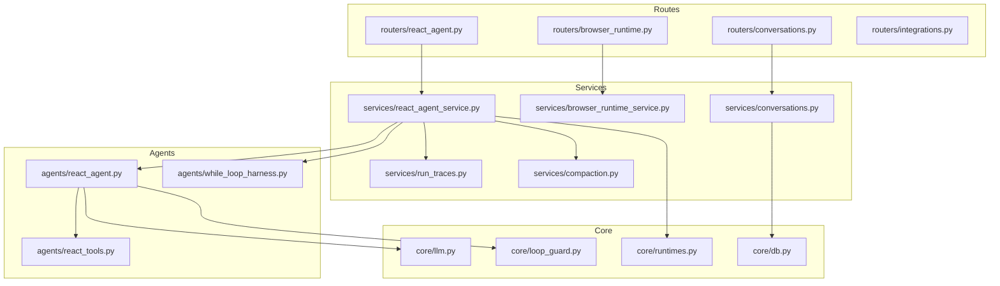
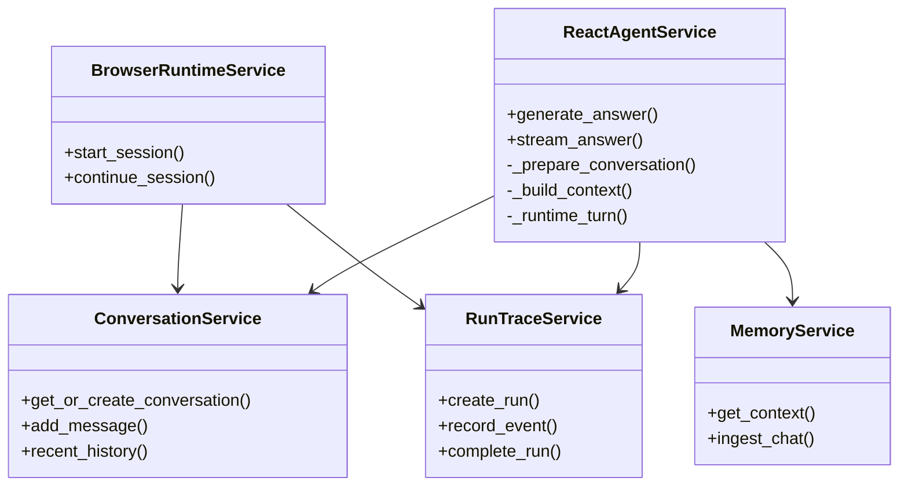
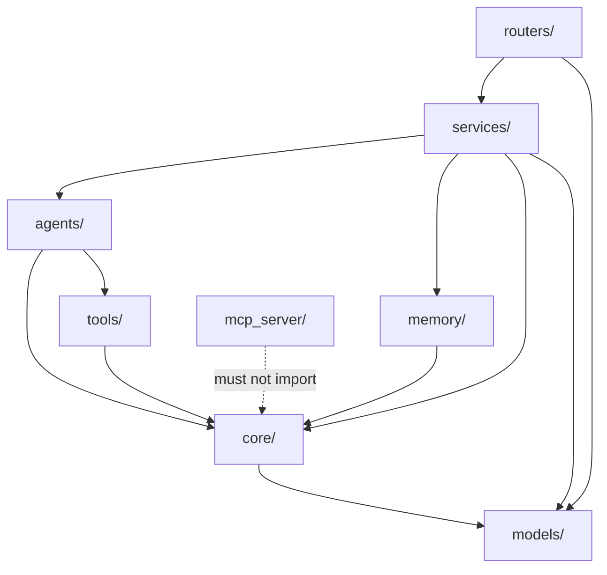
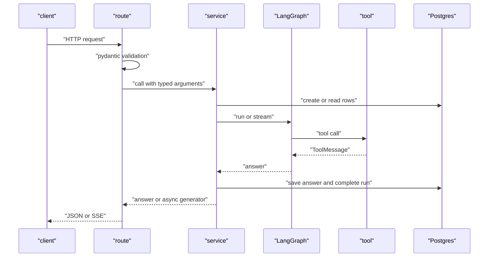
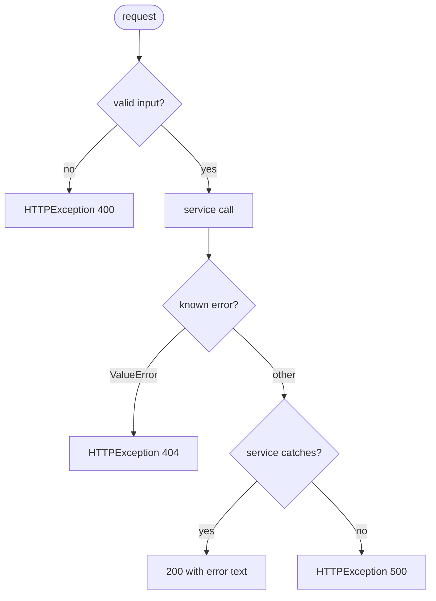
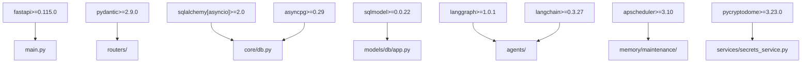

# Backend server design

The backend is a FastAPI application with four internal layers: routes, services, agents and core. Dependencies point down. A route may import a service, a service may import an agent or core module, and core imports neither routes nor services. Memory is a peer subsystem that services call through `MemoryService`.

The code is intentionally explicit rather than framework-heavy. Service classes are constructed in route dependencies, module-level singletons hold clients, and async is used everywhere a network or database call happens.

Key capabilities:
- Thin routes with Pydantic request and response models
- Service classes that own orchestration
- LangGraph agents behind a streamed interface
- Module-level clients for Postgres, Neo4j and OpenSearch
- Guarded startup with degraded modes
- Consistent HTTP error mapping
- Background work with no durable queue

## Repository layout

## Building blocks

### Routes

Routes validate input, call one service, map errors and return a response model. They do not contain prompts or SQL. `routers/react_agent.py` is a good example: it resolves an optional Google token, calls `generate_answer` or `stream_answer`, and wraps the stream in `StreamingResponse` with `text/event-stream`.

A few routes carry more logic because the service is thin:

- `routers/skills.py` builds the skill execution prompt and then delegates to the chat service.
- `routers/voice.py` owns the TTS cache and provider fallback chain.
- `routers/debug.py` runs aggregate SQL directly for the console.

### Services

| Service | Responsibility |
| --- | --- |
| `ReactAgentService` | conversation setup, memory context, agent selection, persistence, post-turn ingestion |
| `BrowserRuntimeService` | session state, planning prompt, action validation, loop guard, trace |
| `ConversationService` | conversation, message and context snapshot CRUD; chat title generation |
| `RunTraceService` | run, subagent, event and tool-call rows |
| `CompactionService` | history loading, summary creation, tool output trimming |
| `SecretsService` | encrypted settings and OAuth client storage |
| `OAuthCredentialsService` | encrypted OAuth tokens and refresh |
| `ComposioService` | toolkit discovery and action execution |

### Agents

`GraphBuilder` compiles a ReAct graph with two nodes. `SupervisorHarness` compiles a four-node graph with a subagent runner. Tools are `StructuredTool` objects built by `build_agent_tools(context)`, which conditionally adds Gmail, Calendar, PyJIIT and browser tools based on the request context.

### Core

`core/config.py` is the Pydantic settings singleton. `core/db.py` owns the async engine and session factory. `core/llm.py` owns provider construction, per-request overrides and the default model. `core/loop_guard.py` owns progress detection. `core/runtimes.py` owns subscription execution. `core/crypto.py` owns AES-GCM.

## Service graph

The main service classes depend on each other in one direction. `ReactAgentService` is the widest: it uses conversations, traces, compaction, attachments, runtimes and memory.

## Dependency direction

The dotted edge is a hard rule stated at the top of `mcp_server/server.py`: the MCP package must not import the backend. It reaches memory over HTTP and the browser over its own bridge.

## How it fits together

Error handling has two patterns:

- Routes that call a service with its own try/except return a friendly string and HTTP 200. `generate_answer` does this on unexpected failures.
- Routes that own validation raise `HTTPException` with a 400 or 404 and a short detail string. The stream route raises 400 for a missing question before opening the stream.

## Data access

`core/db.py` exposes one async engine and a `get_session()` context manager that commits on success and rolls back on exception. Services use SQLAlchemy `select` statements directly; there is no repository layer. A few modules use `sqlmodel` models (`models/db/app.py`) while memory uses declarative SQLAlchemy (`models/db/memory.py`). Both share the same metadata and engine.

Neo4j and OpenSearch clients are module singletons in `core/clients/`. They connect lazily and expose small wrappers rather than raw drivers.

## Background work

- Post-turn memory ingestion is an `asyncio.create_task` held in `_BACKGROUND_TASKS` so it cannot be garbage collected mid-run.
- Telegram polling is a task created in `lifespan`.
- APScheduler runs memory maintenance.
- The MCP settings watcher polls the settings file every 2 seconds.

None of these have a durable queue. A process restart loses an in-flight ingestion or maintenance pass; the next turn or schedule retries.

## Dependencies

## Performance

- Session commits happen once per context manager, not per statement. A service method that writes several rows pays one commit.
- `pool_pre_ping=True` adds a round trip before checkout when a connection may be stale.
- Streaming avoids buffering the whole answer; the route yields SSE frames as the agent emits them.
- Memory context retrieval runs three operations concurrently with `asyncio.gather`: query planning, procedural memories and profile claims.
- Tool calls that block (Gmail, GitHub, filesystem) run in threads or subprocesses.

## Troubleshooting

- A route returns 200 with an apology string: the service caught an exception. Check the backend log, where `logger.error` or `logger.exception` recorded the cause.
- `get_session` rollback loops: an exception inside the `async with` block rolls back, but the caller may retry. Ensure writes are idempotent or keyed.
- A service import fails at startup: services import agents and core at module load. A missing optional package can break the route import. Check the traceback for the package name.
- Background work disappears after restart: ingestion and maintenance have no queue. Re-run maintenance from the console if needed.
- Circular import between `services/react_agent_service.py` and `agents/react_agent.py`: the service imports the agent lazily inside the streaming branch. Keep new cross-layer imports inside functions.

## Appendix

### Implementation examples
- Route dependency: `def get_service() -> BrowserRuntimeService: return BrowserRuntimeService()`.
- Error mapping: `except ValueError as exc: raise HTTPException(status_code=404, detail=str(exc))`.
- Session: `async with get_session() as session: ...`.
- Stream: `StreamingResponse(event_generator(), media_type="text/event-stream")`.

### Source files
- `main.py`
- `routers/react_agent.py`
- `services/react_agent_service.py`
- `services/browser_runtime_service.py`
- `services/conversations.py`
- `services/run_traces.py`
- `agents/react_agent.py`
- `agents/react_tools.py`
- `core/llm.py`
- `core/db.py`
- `core/loop_guard.py`
- `core/runtimes.py`
