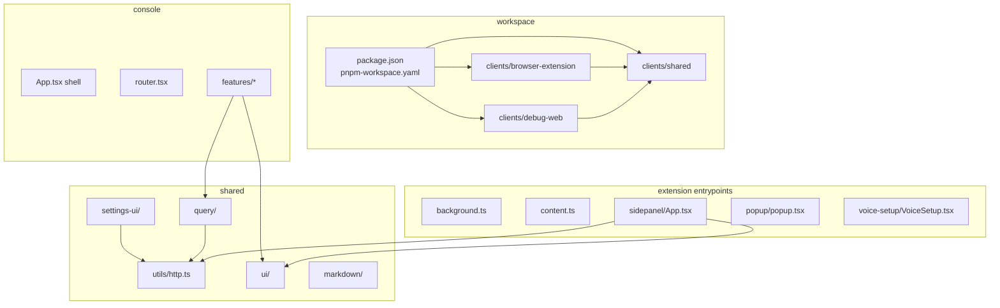
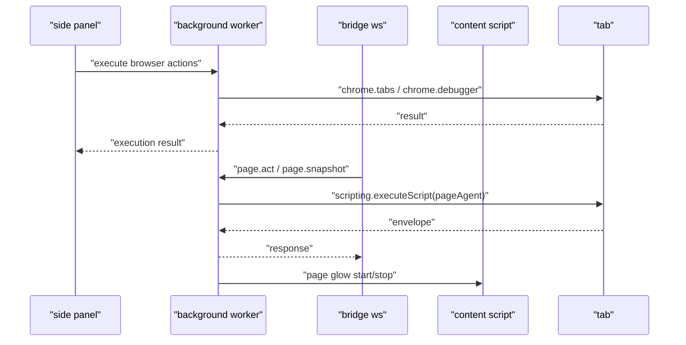
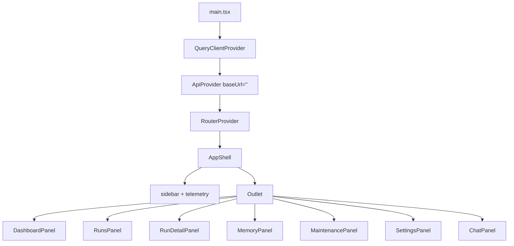
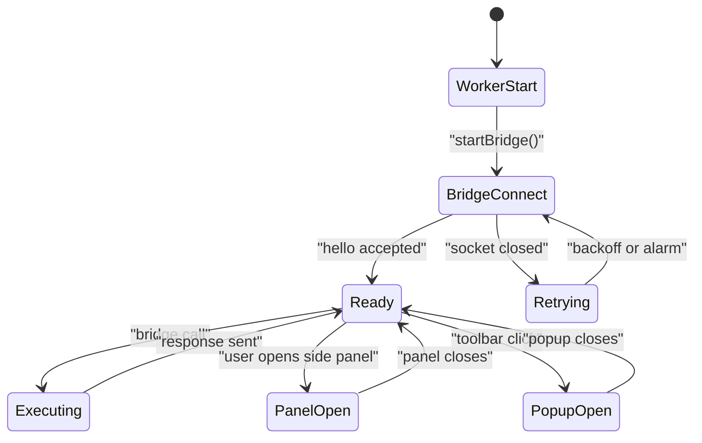
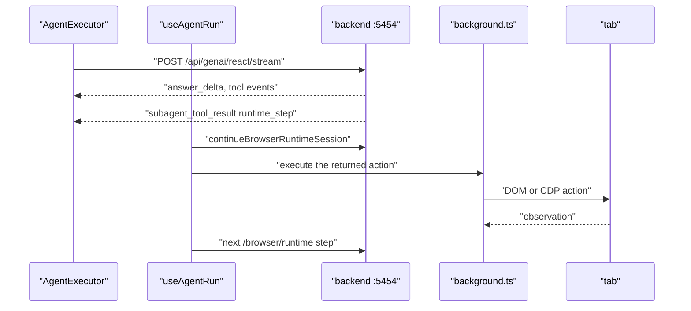
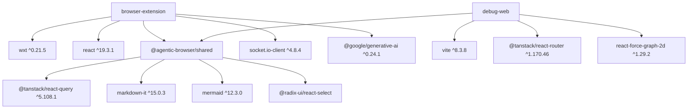

# Browser extension architecture

The frontend is a pnpm workspace with three packages and four extension surfaces. `clients/browser-extension` is a WXT MV3 extension with a side panel, popup, background service worker, content script and voice setup page. `clients/debug-web` is a Vite single-page console. `clients/shared` holds the API client, query hooks, settings UI, markdown renderer and design system.

Both apps render React 19. The console uses TanStack Router and Query. The extension uses TanStack Query only where it helps; most of its state is React state plus `browser.storage.local`.

Key capabilities:
- WXT multi-entrypoint extension with one shared design system
- Side panel as the primary chat surface
- Background service worker owning the bridge socket and action execution
- Console with a persistent shell and eight routes
- Shared API client and query keys
- Theme driven by a `data-theme` attribute
- Local session cache linked to server conversation ids

## Repository layout



## Building blocks

### Extension

- `wxt.config.ts`: manifest name, 22 permissions, `<all_urls>` host permission, side panel path, and the React module.
- `entrypoints/background.ts`: 1780 lines. Owns tab tracking, the bridge socket start, context menus, action execution, screenshots and the remote task loop. MV3 workers sleep, so the bridge client keeps a ping every 20 seconds.
- `entrypoints/content.ts`: a content script on every URL. Most of its overlay code is commented out; the active path sets up page glow and message listeners.
- `entrypoints/sidepanel/App.tsx`: auth gate, theme handling, and the `AgentExecutor` plus settings menu.
- `entrypoints/sidepanel/AgentExecutor.tsx`: the chat shell: header, message list, composer and work log.
- `entrypoints/popup/popup.tsx`: a small tab switcher and bridge status view.
- `entrypoints/voice-setup/VoiceSetup.tsx`: a standalone voice configuration page.

### Console

- `src/App.tsx`: `AppShell` with a collapsible left nav grouped Operate, Inspect and Configure, plus a telemetry header, theme toggle and keyboard shortcuts.
- `src/router.tsx`: TanStack Router tree for `/dashboard`, `/runs`, `/runs/$runId`, `/memory`, `/diagnostics`, `/diagnostics/$runId`, `/settings`, `/chat` and `/chat/$conversationId`.
- `src/lib/api.ts`: shared API plus console-only ingestion and chat streaming.
- `src/features/`: one folder per page: overview, runs, memory, diagnostics, chat, common.

### Shared

- `utils/http.ts`: the API client.
- `query/`: query keys, option factories, hooks, provider, default client.
- `ui/`: primitives and composite widgets.
- `settings-ui/`: sections and forms used by both apps.
- `markdown/`: markdown-it renderer with syntax highlighting and Mermaid support.
- `theme/theme.css`: CSS variables for both themes.

## How it fits together

The extension has a fan-out problem: one service worker serves the side panel, popup, content scripts and the bridge. Messages between them use `browser.runtime.sendMessage` and `browser.tabs.sendMessage`, with the background worker as the coordinator.



The console is simpler. One `ApiProvider` supplies the base URL to every hook, and the router swaps page components inside a fixed shell.



## Package boundaries

`clients/shared` exports subpaths, not one barrel. Each app imports only what it needs:

```json
{
  "./api": "./src/api/index.ts",
  "./query": "./src/query/index.ts",
  "./markdown": "./src/markdown/index.ts",
  "./settings-ui": "./src/settings-ui/index.ts",
  "./ui": "./src/ui/index.ts",
  "./icons": "./src/icons/index.ts",
  "./format": "./src/format/index.ts",
  "./theme.css": "./src/theme/theme.css",
  "./agent": "./src/agent/index.ts"
}
```

The extension's side panel uses `api`, `ui`, `settings-ui` and `theme.css`. The console uses `query`, `ui` and `settings-ui`. Markdown rendering is shared so chat answers look the same in both surfaces.

## Design system

`theme/theme.css` defines a warm graphite dark theme and a paper light theme. The contract is `[data-theme="light"]` or `[data-theme="dark"]` on `<html>`. Both apps set it and persist the choice:

- Extension: `localStorage.theme` with `dark`, `light` or `system`; system listens to `prefers-color-scheme`.
- Console: `localStorage.theme` with `dark` or `light`; no system mode.

Type is Bricolage Grotesque for display, Hanken Grotesk for body, Geist Mono for telemetry. The accent is an ember orange. `ab-` classes (`ab-pill`, `ab-btn`, `ab-mono`, `ab-eyebrow`) are the shared vocabulary layered over the CSS variables.

## Surface lifecycle

The extension has one worker and several renderers. The worker owns the socket and the action queue; renderers come and go as the user opens the panel, popup or a tab.



## State ownership

| State | Owner | Persistence |
| --- | --- | --- |
| Auth profile | `useAuth` | `browser.storage.local.googleUser` |
| Chat sessions and messages | `useSessions` | `browser.storage.local` plus server conversation id |
| Server conversations | Postgres | `/api/conversations` |
| Settings | `AppSetting` rows | backend, read through `/api/integrations/status` |
| Theme | app shell | `localStorage.theme` |
| Bridge status | bridge client | `browser.storage.local.bridgeStatus` |
| Query cache | TanStack Query | memory only |

The extension keeps local session state so the panel loads instantly, then links each session to a server conversation id. The console does not keep local chat state; it reads conversations and messages from the API.

## Message flow to the backend

The side panel has two paths. Chat goes over HTTP or SSE to `/api/genai/react` and `/api/genai/react/stream`. Browser actions go through the background worker, which either executes locally or receives a bridge call from the MCP side. The panel calls `continueBrowserRuntimeSession` when a `subagent_tool_result` for `runtime_step` arrives, which is how a planned action becomes an observation.



## Dependencies



## Performance

- The extension bundle is split by WXT entrypoint. The background worker loads separately from the side panel.
- The bridge pings every 20 seconds to keep the MV3 worker alive; Chrome 116+ keeps a worker with an open socket alive while traffic flows.
- The console uses `keepPreviousData` on paged lists and a 1.5 second poll only while a run is live.
- Charts are SVG and canvas, not a charting library, so the dashboard has no heavy dependency.
- Fonts are bundled via Fontsource and subset by weight, not loaded from a CDN.

## Troubleshooting

- Side panel blank after a build: check the browser console for a React error. A stale `.output` folder after dependency changes usually needs `pnpm build:extension`.
- Theme flashes light on load: the extension's `public/theme-boot.js` sets `data-theme` before React mounts. If it is missing from the build, the default dark theme applies after hydration.
- Console deep link 404s on refresh: the host must rewrite unknown paths to `index.html`.
- Bridge status stuck at `disconnected`: the service worker was suspended and the socket has not reconnected. Open the popup or side panel to wake it, or reload the extension.
- Settings UI renders in one app but not the other: `settings-ui` expects an `ApiProvider` and a TanStack Query client above it.
- Fonts fall back to system: the theme CSS imports Fontsource packages; a build that strips CSS imports loses them.
- A planned browser action never runs: the `runtime_step` handler did not call `continueBrowserRuntimeSession`. Check the work log for the `browser_action_agent` row.

## Appendix

### Implementation examples
- Extension entry: `defineBackground(() => { startBridge(); ... })`.
- Side panel: `App` renders `AgentExecutor` after `useAuth` resolves.
- Console route tree: `rootRoute.addChildren([...])`.
- Shared theme: `<html data-theme="dark">`.
- Query client: `createDefaultQueryClient()` from `shared/query`.

### Source files
- `clients/browser-extension/wxt.config.ts`
- `clients/browser-extension/entrypoints/background.ts`
- `clients/browser-extension/entrypoints/content.ts`
- `clients/browser-extension/entrypoints/sidepanel/App.tsx`
- `clients/browser-extension/entrypoints/popup/popup.tsx`
- `clients/debug-web/src/App.tsx`
- `clients/debug-web/src/router.tsx`
- `clients/debug-web/src/main.tsx`
- `clients/shared/src/utils/http.ts`
- `clients/shared/src/theme/theme.css`
- `pnpm-workspace.yaml`
