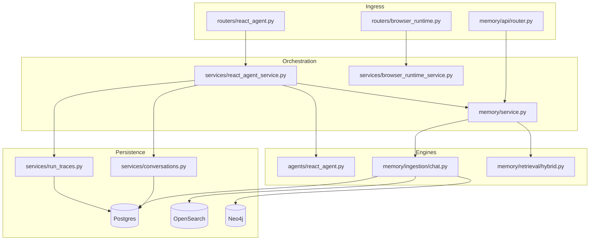
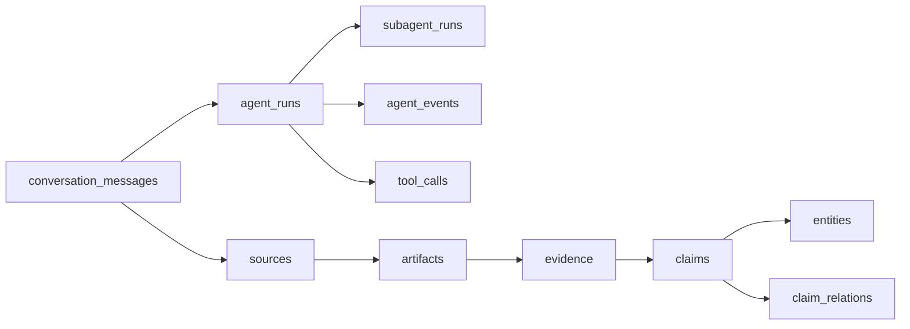
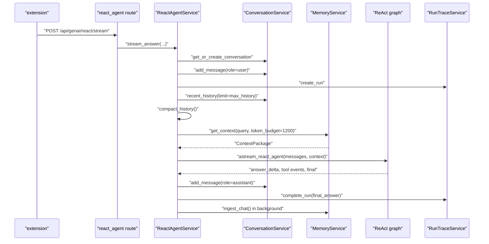
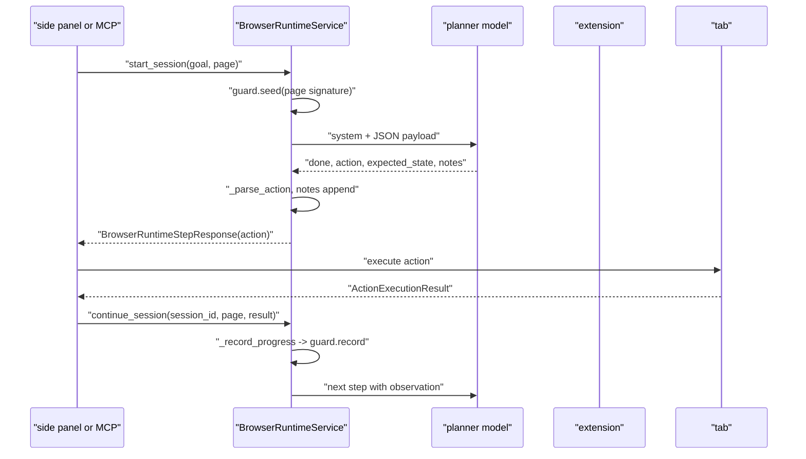
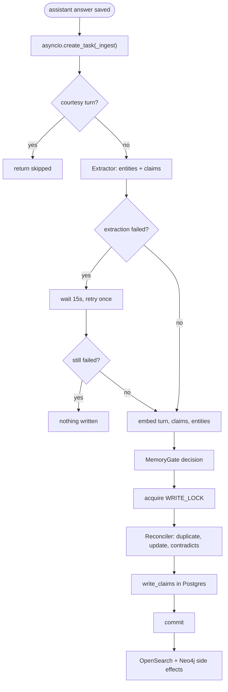
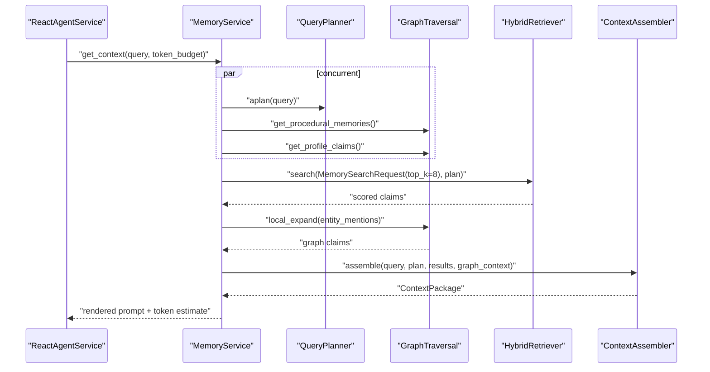
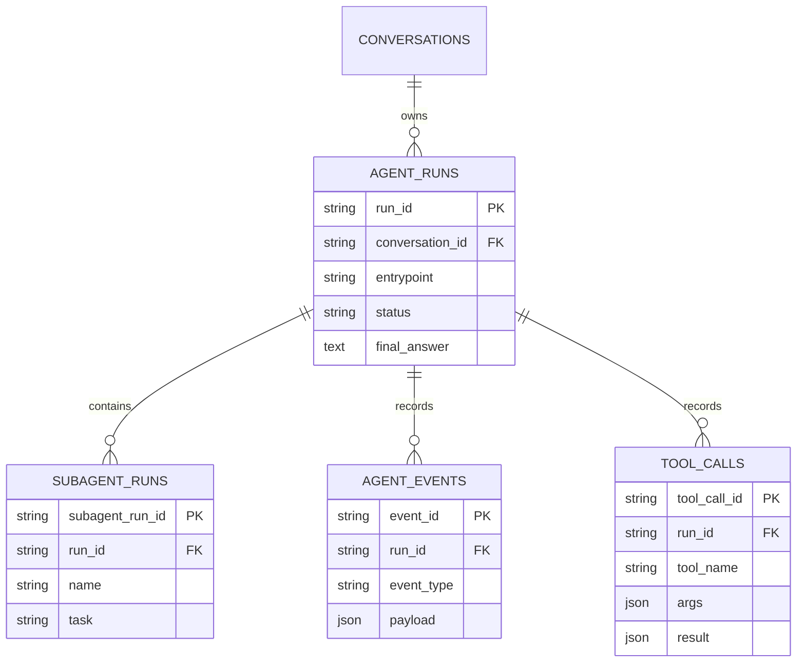

# Component interactions and data flow

Four flows carry almost everything: a chat turn, a browser action loop, a memory write, and a memory read. They share the same persistence and trace machinery, but they cross different boundaries.

This page follows each flow end to end and names the function that hands off to the next stage. It is the page to read before changing a payload shape, because most shape changes break two or three flows at once.

Key capabilities:
- Chat turn from HTTP to SSE to persisted answer
- Browser action from planner to extension to observation
- Post-turn memory extraction and reconciliation
- Per-turn memory context assembly
- Run trace writes at each stage
- One identifier chain across all four flows

## Repository layout

## Building blocks

- `services/react_agent_service.py`: chat orchestration, context assembly and post-turn ingestion.
- `services/browser_runtime_service.py`: session state, one-step planning and progress recording.
- `services/conversations.py`: conversation, message and context snapshot rows.
- `services/run_traces.py`: run, subagent, event and tool-call rows.
- `memory/ingestion/chat.py`: the write pipeline, gated and reconciled.
- `memory/retrieval/hybrid.py`: the read pipeline, scored and assembled.

## How it fits together

The four flows share one identifier chain: `conversation_id` groups messages and runs, `run_id` groups events and tool calls, and `claim_id` links a fact to its evidence and graph node.

## Flow 1: chat turn

`_prepare_conversation` is the boundary between transport and agent work. It returns the service, conversation, user message, compacted history and trace. Every later write reuses those ids.

The context builder adds four things to the agent call: the Google token, the PyJIIT session, the page markdown, and the memory prompt with the claims it contains. The claims list is kept so `claims_used_in_answer` can mark which memories the answer actually used after the turn.

## Flow 2: browser action

The runtime never executes anything. It validates the action type against `allowed_actions`, records the tool call and result in the trace, and returns the action. The client is responsible for running it and posting back a `PageSnapshot` plus an `ActionExecutionResult`.

Two details matter for data shape:

- `_serialise_page` drops the screenshot and truncates `visible_text` to 5000 characters and `interactive` to 80 elements before sending the page to the model.
- `_page_signature` uses a 600-character text prefix and the first 12 interactive elements, so a clock changing in the footer does not count as progress.

## Flow 3: memory write

`ChatIngestionPipeline.process` reads the user message only. The assistant reply is passed as context for resolving references, so assistant promises never become facts. Messages over 4000 characters are extracted in up to three overlapping windows.

`write_claims` writes Postgres first. `SideEffects` queues OpenSearch and Neo4j work, which runs after commit. If indexing fails, the row exists and `repair.py` can rebuild the derived stores later.

## Flow 4: memory read

The assembler orders sections by priority: facts from the question, preferences, related memories, then the always-on profile. It removes repeats and caps each section's share of the budget.

## Trace writes

Every flow above records to the same four tables.

`RunTraceService.record_event` maps event types to rows. `subagent_started` creates a subagent row; `subagent_tool_call` creates a tool call and remembers its id; `subagent_tool_result` closes it. The console reads these rows directly through `/api/debug`.

## Data shapes at boundaries

| Boundary | Shape | Defined in |
| --- | --- | --- |
| Client to chat route | `CrawlerRequest` | `models/requests/crawller.py` |
| Service to agent | `AgentMessagePayload` list | `agents/react_agent.py` |
| Agent to client stream | event dicts | `services/react_agent_service.py` |
| Client to browser runtime | `PageSnapshot`, `ActionExecutionResult` | `models/requests/automation.py` |
| Runtime to client | `BrowserRuntimeStepResponse` | `models/response/browser_runtime.py` |
| Memory write | `IngestChatRequest` | `models/memory.py` |
| Memory read | `ContextPackage` | `models/memory.py` |
| MCP to extension | `{method, params}` | `mcp_server/bridge.py` |

The chat request is `CrawlerRequest`, which carries `question`, `chat_history`, `client_html`, `conversation_id`, `client_id` and `client_context` plus the optional Google and PyJIIT sessions. The response is `CrawllerResponse` with one `answer` field, or an SSE stream of event dicts.

## Dependencies

```mermaid
graph TB
  Chat["chat flow"] --> Conv["services/conversations.py"]
  Chat --> Comp["services/compaction.py"]
  Chat --> MemSvc["memory/service.py"]
  Chat --> Trace["services/run_traces.py"]
  Browser["browser flow"] --> Runtime["services/browser_runtime_service.py"]
  Browser --> Guard["core/loop_guard.py"]
  Browser --> Ext["extension handlers"]
  Write["memory write"] --> Pipeline["memory/ingestion/chat.py"]
  Write --> Recon["memory/ingestion/reconcile.py"]
  Write --> Writer["memory/ingestion/writer.py"]
  Read["memory read"] --> Hybrid["memory/retrieval/hybrid.py"]
  Read --> Asm["memory/retrieval/context_assembler.py"]
```

## Performance

- Chat loads up to `max_history` (default 400) messages, then compacts. History loading is one query ordered by creation.
- Memory context retrieval runs three calls concurrently before search.
- Browser planner payloads cap page text at 5000 characters and interactive elements at 80; screenshots are sent as image blocks only when present.
- The runtime keeps the last 6 observations and 40 notes. Older observations are dropped from the prompt.
- Trace writes are one transaction per event. A long run writes many small rows; the console reads them by `run_id` with an index.

## Troubleshooting

- Assistant answer is missing from the console but appeared in the chat: the answer was streamed but `add_message` failed, or the run was cancelled before the final write. Check `agent_runs.status` and `final_answer`.
- Browser action loops on the same step: the client is not posting `ActionExecutionResult`, so the runtime never records progress. Confirm `continueBrowserRuntimeSession` runs.
- Memory write creates duplicates: reconciliation saw the pair as unrelated. Check the embedding provider; vectors from different providers are not comparable.
- Memory context is empty despite stored claims: the status filter excludes provisional claims from normal search, or the query score fell below the floor.
- Trace shows a subagent but no tool calls: the tool was called outside `instrument_tools`, or the event used a different subagent name.
- SSE stream ends without `final`: an exception escaped the generator. The service records an `error` event and completes the run as failed.

## Appendix

### Implementation examples
- Chat: `ReactAgentService.stream_answer` yields `{event, ...}` dicts.
- Browser: `BrowserRuntimeService.continue_session` returns one action or a final message.
- Memory write: `MemoryService.ingest_chat(IngestChatRequest(...))`.
- Memory read: `await MemoryService().get_context(query, token_budget=1200)`.
- Trace: `RunTraceService.create_run`, `record_event`, `complete_run`.

### Source files
- `main.py`
- `services/react_agent_service.py`
- `services/browser_runtime_service.py`
- `services/run_traces.py`
- `services/conversations.py`
- `services/compaction.py`
- `memory/service.py`
- `memory/ingestion/chat.py`
- `memory/retrieval/hybrid.py`
- `models/db/app.py`
- `models/db/memory.py`
