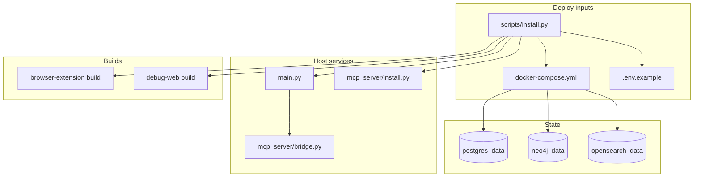
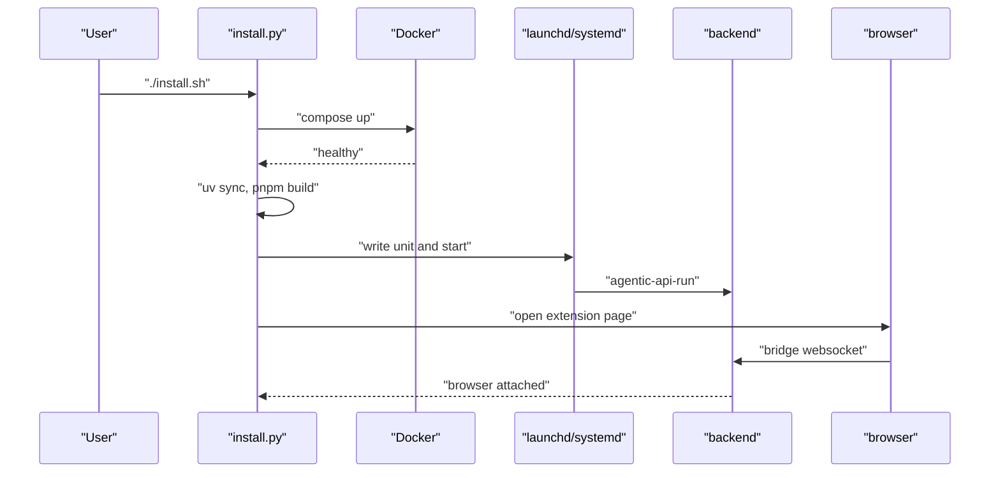
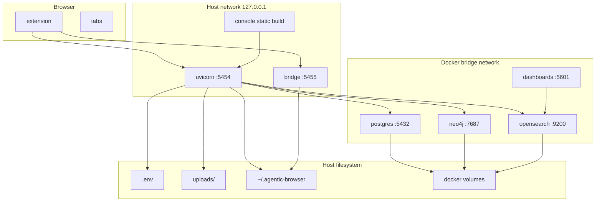
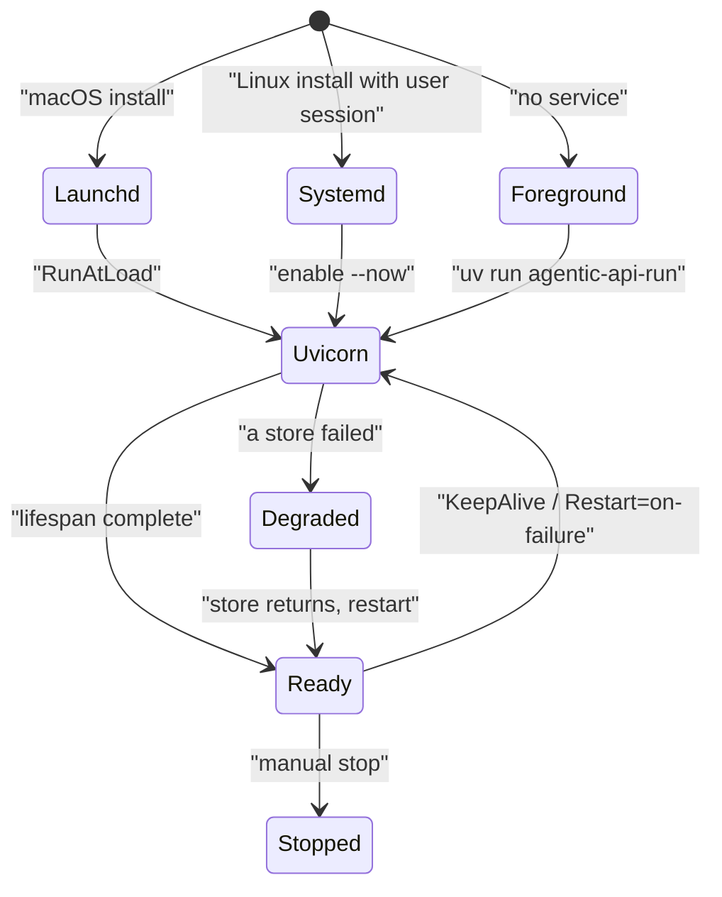
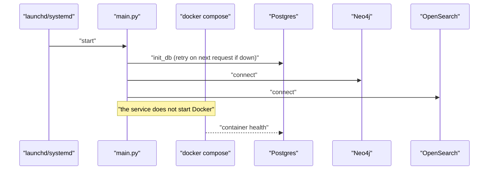
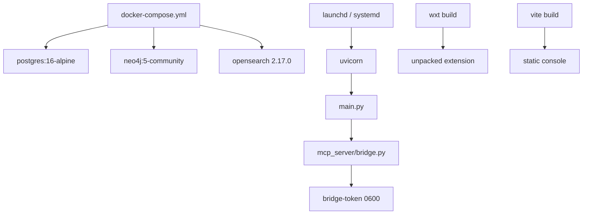

# Deployment architecture

The deployed shape is a laptop install, not a server fleet. One checkout, one set of containers, one backend process, one bridge, and one browser extension per browser. The architecture supports a remote Mac or Linux box only in the sense that the backend can bind a network interface; there is no TLS terminator, auth proxy or horizontal scaling.

This page covers the runtime topology, volume ownership, service supervision and network exposure. Build and install steps are on the project Getting Started page.

Key capabilities:
- Single-host process graph with fixed ports
- Docker volumes for all durable state
- Host-level login services for the backend
- Loopback bridge with a file token
- Extension loaded from a local build
- No reverse proxy or TLS in the repo
- Postgres as the only volume that must be backed up

## Repository layout



## Building blocks

- `docker-compose.yml`: the four containers and their volumes.
- `scripts/install.py`: the only orchestration tool. It writes env, starts containers, builds, installs services and registers MCP.
- `main.py`: the process the service manager runs.
- `mcp_server/bridge.py`: the loopback listener that the extension dials.
- `clients/browser-extension/.output`: the loaded extension, not a store package.

## How it fits together

Deployment is one pass with a manual browser step in the middle. Nothing is idempotent at the container level except Compose itself; the installer is safe to re-run because it checks before writing.



## Runtime topology



## Ports and exposure

| Listener | Default bind | Exposure | Auth |
| --- | --- | --- | --- |
| Backend | `0.0.0.0:5454` | all interfaces | none |
| Bridge | `127.0.0.1:5455` | loopback | token for relay |
| Postgres | `0.0.0.0:5433` | host port mapped by Docker | database password |
| Neo4j | `0.0.0.0:7474`, `7687` | host ports | Neo4j auth |
| OpenSearch | `0.0.0.0:9201` | host port | security plugin disabled |
| Dashboards | `0.0.0.0:5602` | host port | none |

Docker publishes ports on all interfaces by default. On a shared network, change the compose port mappings to `127.0.0.1:5433:5432` and the equivalents, or run a host firewall. OpenSearch in particular has no auth in this configuration.

The installer offers `BACKEND_HOST=127.0.0.1`, which restricts the API to loopback. The bridge already binds loopback in `mcp_server/config.py`.

## Volume ownership

| Volume | Owner | Contents |
| --- | --- | --- |
| `postgres_data` | Postgres | conversations, runs, settings, credentials, memory tables |
| `neo4j_data` | Neo4j | entity nodes and claim links |
| `neo4j_logs` | Neo4j | query and server logs |
| `neo4j_plugins` | Neo4j | APOC jar |
| `opensearch_data` | OpenSearch | claim, artifact and entity indices |

Deleting `postgres_data` orphans the derived stores. They still answer queries, but `repair.py` will remove rows that no longer have a Postgres parent on the next maintenance run.

Host-side state:

- `uploads/` holds attachments and generated skill output.
- `~/.agentic-browser/bridge-token` is the relay token, mode 0600.
- The MCP settings file under `~/.agentic-browser/` is the tool group config.
- `~/.agentic-browser/runtime-workspace/` is the empty cwd for subscription agents.
- `~/.agentic-browser/antigravity/` is the Google AI profile.
- `~/.agentic-browser/logs/backend.log` receives launchd output.
- `.oauth_encryption_key` beside `main.py` is the fallback AES key.

## Supervision



The backend itself does not fork or daemonize. The service manager owns the process. Logs go to one file on macOS and to the journal on Linux.

## Startup dependency order



The login service does not start Docker and does not wait for it. If the machine boots faster than Docker, the backend starts degraded and does not retry the stores automatically. Restart the backend after the containers are healthy.

## Browser-side deployment

The extension is not distributed through a store in this repo. It is built to `.output/chrome-mv3` or `.output/firefox-mv2` and loaded unpacked. That has three consequences:

1. Updates are manual: rebuild and reload.
2. The extension id changes per install unless a key is pinned, so OAuth redirect URLs must match the current id.
3. Firefox treats it as a temporary add-on and removes it on quit.

The build embeds `VITE_API_URL` at compile time. A build pointed at a remote backend will keep that host until rebuilt, even if the user changes `baseUrl` in the panel for other calls.

## Backups

There is no backup job. The durable state is the three volumes plus `~/.agentic-browser` and `uploads/`. A consistent backup requires stopping the backend or accepting that memory side effects may lag the Postgres commit.

```sh
docker compose stop
docker run --rm -v agentic-browser_postgres_data:/data -v "$PWD":/backup alpine \
  tar czf /backup/postgres-data.tgz -C /data .
docker compose start
```

Neo4j and OpenSearch can be rebuilt from Postgres with the maintenance repair job, so the Postgres volume is the one that must be backed up.

## Scaling limits

| Resource | Limit in code |
| --- | --- |
| Backend workers | one uvicorn process |
| DB pool | 10 + 20 overflow |
| Bridge hosts | one per machine, port-bound |
| MCP sessions | many clients, one bridge |
| Memory writers | one process due to `WRITE_LOCK` |
| Upload size | 10 MB per file |
| Repo archive | 300 MB compressed, 1500 MB unpacked |

Horizontal scaling would break memory reconciliation and the bridge election. The roadmap names the advisory lock as the fix for the first.

## Dependencies



## Performance

- Container health checks run on 10 to 15 second intervals. OpenSearch is the slowest to become usable on a laptop.
- The backend uses one process and a 10-connection pool. It is sized for a single user.
- The bridge holds one WebSocket per attached browser and serializes sends per connection with a lock.
- Uploads are capped at 10 MB and repository archives at 300 MB compressed, 1500 MB unpacked.
- The extension build is static; there is no runtime asset server.

## Troubleshooting

- Service starts before Docker: the backend logs `Postgres init skipped`. Restart it after `docker compose ps` is healthy.
- Backend reachable on the LAN: `BACKEND_HOST` is `0.0.0.0`. Set it to `127.0.0.1` and restart.
- OpenSearch exposed with no auth: change the compose port mapping to bind loopback.
- Extension cannot reach a remote backend: rebuild with `VITE_API_URL` pointing at it, and add the extension origin to `CORS_ORIGINS` if the backend is behind another origin.
- Bridge token mismatch after moving machines: copy `~/.agentic-browser/bridge-token` or let the new host regenerate it and restart relays.
- Uploads fill the disk: `uploads/` is never pruned. Skill output and attachments accumulate.
- Memory rows survive but search does not: `opensearch_data` was recreated empty. Run the repair job to rebuild the indices from Postgres.

## Appendix

### Implementation examples
- Compose: `docker compose up -d postgres neo4j opensearch`.
- Service: `launchctl load -w ~/Library/LaunchAgents/sh.taf.agentic-browser.plist`.
- Logs: `tail -f ~/.agentic-browser/logs/backend.log` or `journalctl --user -u agentic-browser`.
- Bridge: `curl http://127.0.0.1:5455/bridge/status`.

### Source files
- `docker-compose.yml`
- `scripts/install.py`
- `main.py`
- `mcp_server/bridge.py`
- `mcp_server/config.py`
- `clients/browser-extension/wxt.config.ts`
