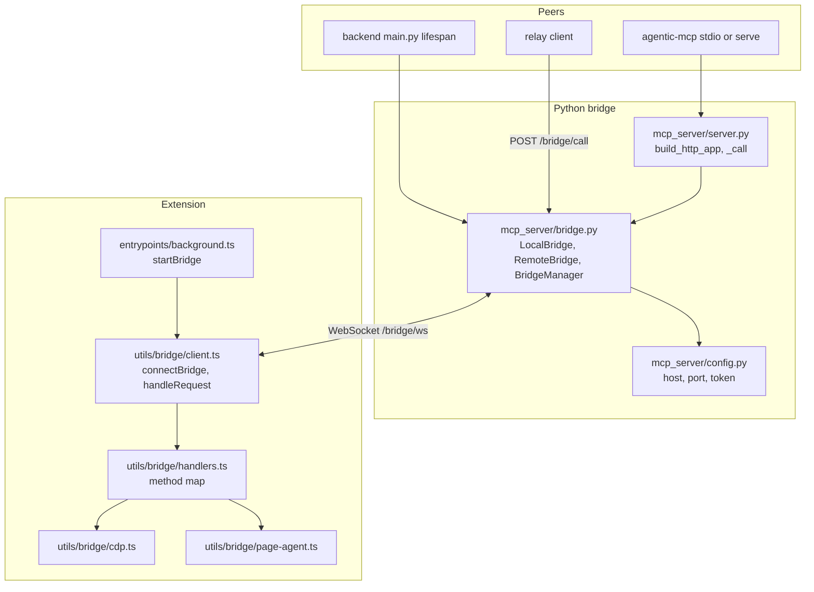
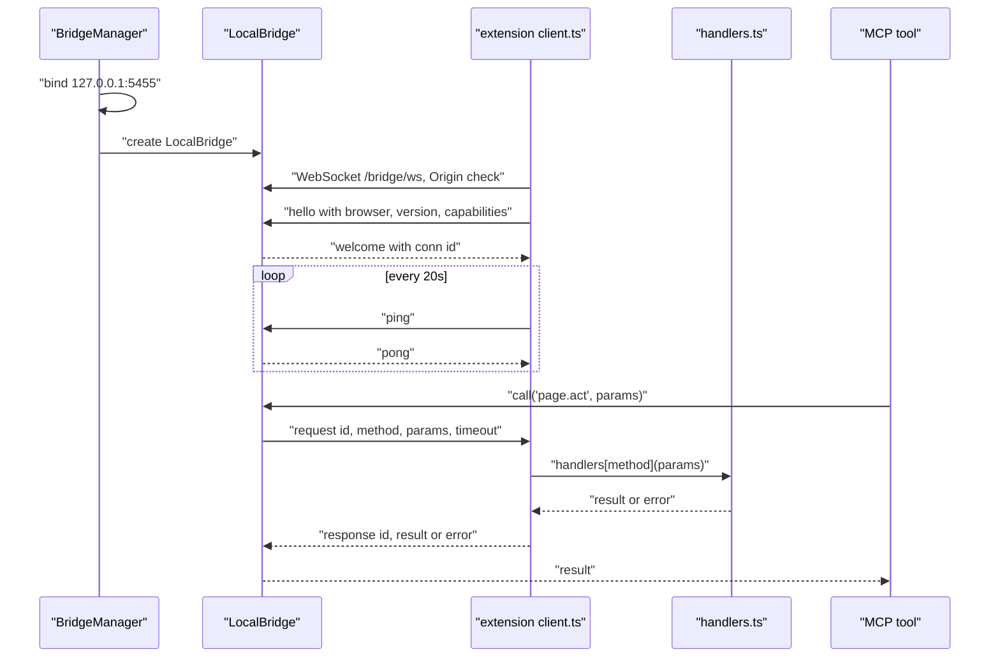
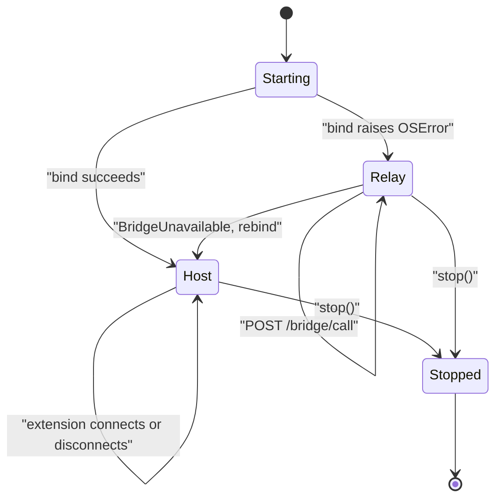
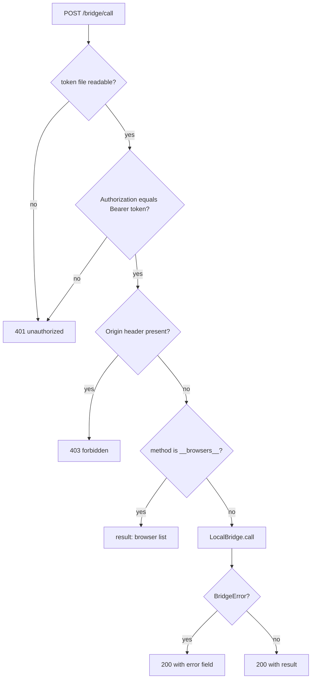
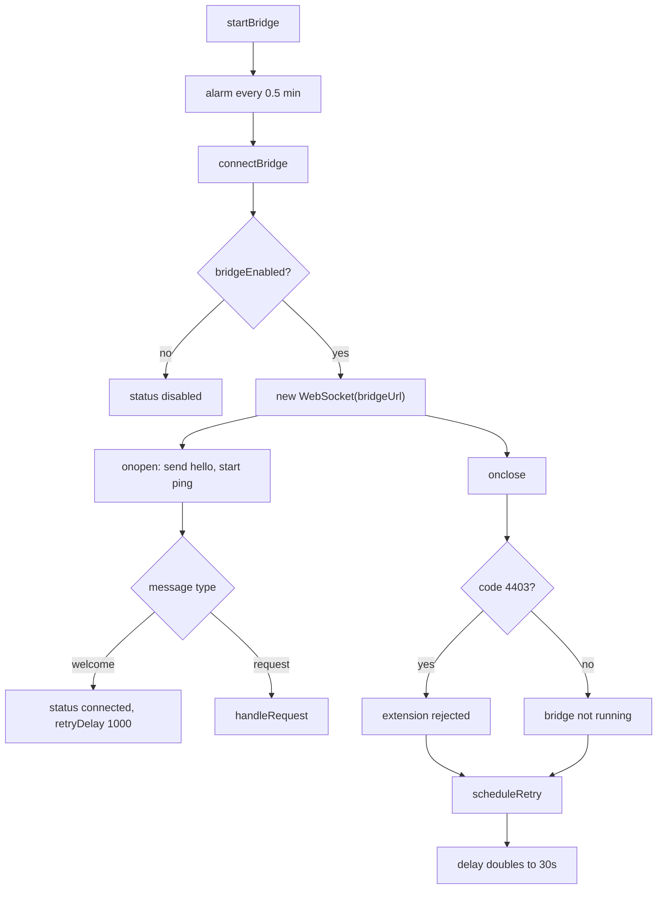
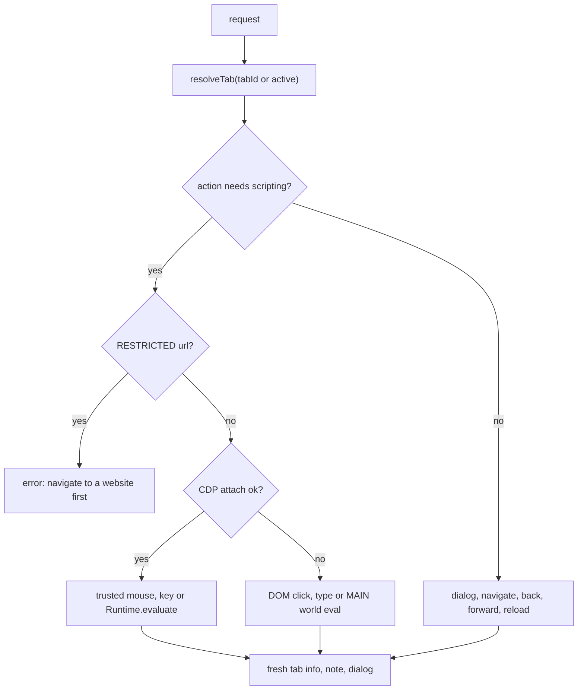
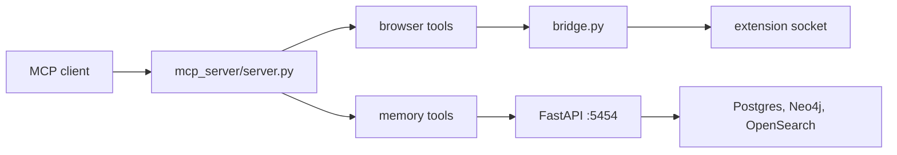
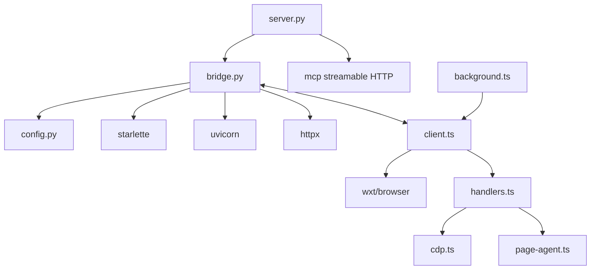

# MCP protocol implementation

`mcp_server/bridge.py` connects MCP tool calls to the browser extension. One process owns `127.0.0.1:5455` and accepts an extension WebSocket at `/bridge/ws`. Tool calls become JSON request frames on that socket. Any other process that wants the browser relays through `POST /bridge/call` with a bearer token from `~/.agentic-browser/bridge-token`.

The MCP package itself must not import the backend. It speaks MCP to clients over stdio or streamable HTTP, reaches memory over HTTP, and reaches the browser over this bridge.

Key capabilities:
- One host per machine, with relay for every other process
- Request ids and per-call futures so responses match calls
- Extension origin checks and a 0600 relay token
- Status and call HTTP endpoints
- Trusted input through the debugger when available
- Automatic reconnect with exponential backoff
- Method map for tabs, page, repository download and remote tasks

## Repository layout

The protocol spans the Python bridge, the extension client, the handler map and the service worker bootstrap.

## Building blocks

- `bridge.py`: `BrowserConnection` stores the WebSocket, hello info, `pending` futures and a `send_lock`. `LocalBridge.handle_websocket` owns the socket loop. `LocalBridge.call` sends a request and waits on a future.
- `RemoteBridge`: httpx client for relayed calls. `_post` reads the token, posts JSON, and turns a non-200 or an `error` field into `BridgeError`.
- `BridgeManager`: `ensure_started` tries to bind the port. If it succeeds it builds the Starlette app and serves it on the socket. If not, it stays in relay mode. `call` retries once after a relay failure by trying to take the port.
- `config.py`: `BRIDGE_HOST`, `BRIDGE_PORT`, `STATE_DIR`, `TOKEN_FILE`, `ALLOWED_EXTENSION_IDS`, `API_URL`, `MEMORY_TOOLS` and `TOOL_SURFACE`. `read_or_create_token` writes 32 random bytes with mode 0600.
- `client.ts`: `connectBridge`, `disconnectBridge`, `getBridgeStatus`, `startBridge`. Settings come from `browser.storage.local` keys `bridgeEnabled` and `bridgeUrl`; status is written back to `bridgeStatus`.
- `handlers.ts`: the method map for `tabs.*`, `page.*`, `repo.download`, `task.run` and `task.stop`.

## How it fits together

A host process binds the port, serves the MCP app and the bridge routes, then waits for the extension. The extension sends `hello` within 10 seconds or the socket closes with 4400.

If the bind fails with `OSError`, `ensure_started` leaves `local` as `None`. Calls then go through `RemoteBridge`. A `BridgeUnavailable` on that path triggers one `ensure_started` and one retry, which covers a host that exited between calls.

## Wire frames

Every frame is JSON text. The extension answers only on the same socket, and the server matches responses by the `id` it generated.

| Frame | Direction | Fields |
| --- | --- | --- |
| `hello` | extension to bridge | `browser`, `version`, `extension_version`, `extension_id`, `capabilities` |
| `welcome` | bridge to extension | `id`, the short connection id |
| `request` | bridge to extension | `id`, `method`, `params`, `timeout` |
| `response` | extension to bridge | `id`, plus `result` or `error` |
| `ping` | extension to bridge | none |
| `pong` | bridge to extension | none |

`handle_websocket` rejects an origin that is not `chrome-extension://` or `moz-extension://` with close code 4403. When `ALLOWED_EXTENSION_IDS` is non-empty, the extension id must be in the set. It accepts the socket, waits up to 10 seconds for the first frame, and closes with 4400 if it is not a `hello`.

On disconnect, every pending future on that connection gets `BridgeError("Browser disconnected during the call")`. A response with an `error` field sets the future exception instead of a result.

`_pick` chooses the connection. With an explicit browser id it looks that id up. Without one it takes the most recent connection in `_order`. If none exists it waits up to 3 seconds on an `asyncio.Event` before raising the `NO_BROWSER_MESSAGE` text, which names the WebSocket URL.

## HTTP endpoints

`LocalBridge.routes` returns three routes. `build_http_app` inserts them ahead of the MCP mount, so `/bridge/*` wins over the catch-all MCP route.

`GET /bridge/status` is unauthenticated and returns `{"ok": true, "service": "agentic-browser-bridge", "browsers": [...]}`. It is bound to loopback, so only local processes reach it.

`POST /bridge/call` compares the header with `hmac.compare_digest` against `Bearer <token>`. The origin check exists because browsers always attach `Origin` to a cross-origin POST, so a web page cannot use the relay even if it learns the port. `__browsers__` is an internal sentinel that returns the browser list without a socket call.

Relay errors keep HTTP status 200 and put the message in `error`. `RemoteBridge._post` turns that into `BridgeError`, so the MCP tool sees a normal failure string.

## Extension client

`client.ts` keeps one socket at module scope. `connectBridge` reads storage, closes any existing socket, and opens a new `WebSocket`. It sends `hello` on open with capabilities `tabs`, `snapshot`, `act`, `evaluate`, `screenshot`, plus `cdp` when `cdpAvailable()` is true. It starts a 20 second ping interval.

Settings changes to `bridgeUrl` or `bridgeEnabled` trigger a forced reconnect and reset the retry delay. While a handler is running, the extension badge shows `RUN` with a purple background, then clears 800 milliseconds after the call finishes.

`handleRequest` looks up `handlers[msg.method]`. An unknown method produces the error "Unknown bridge method ... Update the extension." The reply is sent only when the socket is still open, and `inflight` is decremented in `finally`.

## Extension handlers

`handlers.ts` resolves the target tab, refuses restricted URLs, and runs page work through `browser.scripting.executeScript` with the `pageAgent` function. `RESTRICTED` covers chrome, edge, brave, about, devtools, extension schemes, view-source and the Chrome Web Store.

Click and type prefer the debugger. `trustedClick` resolves the element to screen coordinates, checks that nothing covers it, and uses `cdp.mouseClick`. A covered element falls back to a DOM click with a note naming what covered it. Typing focuses through the page agent, then inserts text through CDP, so the page sees trusted input events.

`frameOf` parses refs of the form `f12e5` into a frame id. Selectors and `text=` targets go to the main frame. `pageSnapshot` collects the main frame plus up to eight http(s) subframes, skipping frames smaller than 120 by 60 pixels.

`page.evaluate` uses `Runtime.evaluate` with `returnByValue`, `awaitPromise` and `userGesture`. If the expression contains a top-level `await`, it retries in repl mode.

`repo.download` is restricted to GitHub archive URLs and a local backend upload URL, with a 300 MB cap. `task.run` accepts an http(s) URL and delegates to `runRemoteBrowserTask`. `page.act` wraps the action in `setPageGlow` so the user sees which tab the agent is using.

## Tool surface

`config.py` defines `TOOL_SURFACE` and `MEMORY_TOOLS`, which decide which tool groups an MCP session exposes. The browser tools go through the bridge. The memory tools do not: they call the backend at `AGENTIC_BROWSER_API_URL`, default `http://127.0.0.1:5454`, so a bridge-only process cannot answer a memory question.

## Dependencies

The bridge depends on Starlette for routes, uvicorn for the embedded server, httpx for relay, and the extension for the peer. The extension depends on `wxt/browser` and its own CDP and page-agent modules.

`mcp_server/pyproject.toml` pins `httpx>=0.28`, `uvicorn>=0.54`, `starlette>=1.10`, `websockets>=17.0`, `mcp>=2.3.0` and `pydantic>=2.14`.

## Performance

- `DEFAULT_TIMEOUT` is 30 seconds and `MAX_TIMEOUT` is 1800.
- `_pick` waits 3 seconds for a browser, then `call` waits the method timeout plus 2 seconds.
- The relay httpx client uses `timeout + 5`.
- The extension pings every 20 seconds. The alarm runs every 0.5 minutes to reconnect after the worker sleeps.
- Retry delay starts at 1 second and doubles to a 30 second cap.
- Screenshots are downscaled to 1280 pixels wide and JPEG quality 0.75 before transport. Background tabs require the debugger and may fail to paint.
- The snapshot accepts 2000 to 100000 characters and gives each subframe a third of that budget.

## Troubleshooting

- The extension closes immediately with code 4403: its origin id is not in `AGENTIC_BROWSER_EXTENSION_IDS`, or the origin is not an extension scheme. Add the id, or unset the variable.
- The socket closes with 4400: no `hello` within 10 seconds, or the first frame was not a hello. Reload the extension so `client.ts` sends it.
- "No browser is connected to the Agentic Browser bridge": no socket in `_connections`. Open the browser, check the extension's MCP Bridge status, and run `agentic-mcp status`.
- Relay returns 401: `read_token()` is empty or the caller's token differs. Restart the bridge host so `read_or_create_token` writes a new file.
- Relay returns 403: the POST carried an `Origin` header. Relay from a local process.
- Relay returns 200 but the tool reports an error: the bridge returns `{"error": ...}` with HTTP 200, and `RemoteBridge` converts it. Read the error text, not the status.
- A call times out after a navigation: the extension handler is waiting for a load that never completes, and the bridge adds only 2 seconds. Raise the method timeout or use `waitFor`.
- An action fails with "A dialog is open": an alert, confirm or prompt blocks the page. Call `browser_act` with `action=dialog`.
- Two processes fight over the port: on POSIX only one can bind despite `SO_REUSEADDR`; on Windows the option is disabled in `_bind`. Let the first process host and the rest relay.

## Appendix

### Implementation examples

- `LocalBridge().call("tabs.list", {})` returns the tab list from the attached extension.
- `POST /bridge/call` with `{"method": "__browsers__"}` returns the browser list without a socket call.
- `connectBridge(true)` forces a reconnect after a settings change.
- `handlers["page.snapshot"]({tabId: 4, screenshot: true})` returns text, url, title and a data URL.
- `agentic-mcp status` reads `/bridge/status` and prints each browser.

### Source files

- `mcp_server/bridge.py`
- `mcp_server/config.py`
- `mcp_server/server.py`
- `clients/browser-extension/entrypoints/utils/bridge/client.ts`
- `clients/browser-extension/entrypoints/utils/bridge/handlers.ts`
- `clients/browser-extension/entrypoints/background.ts`
