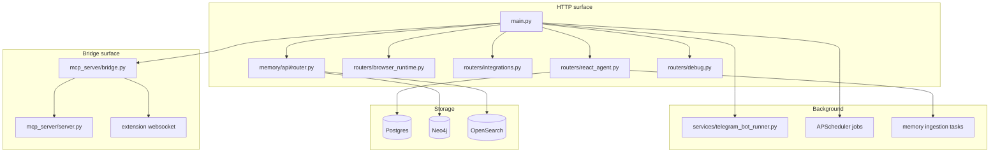
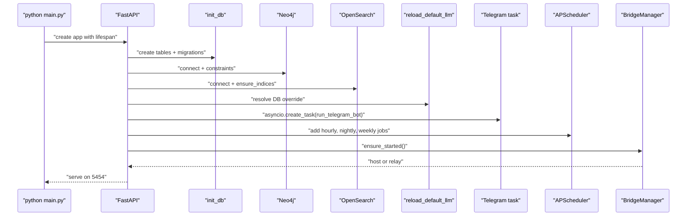
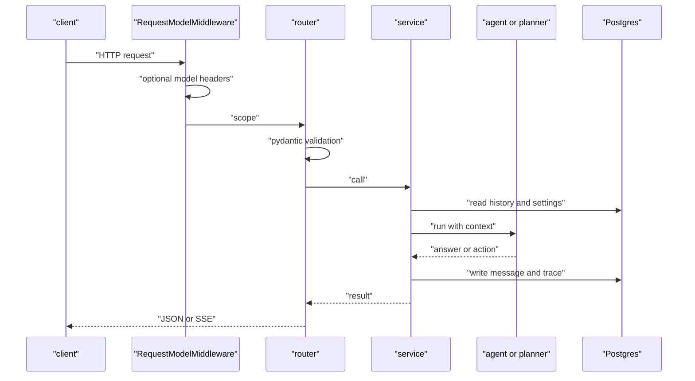
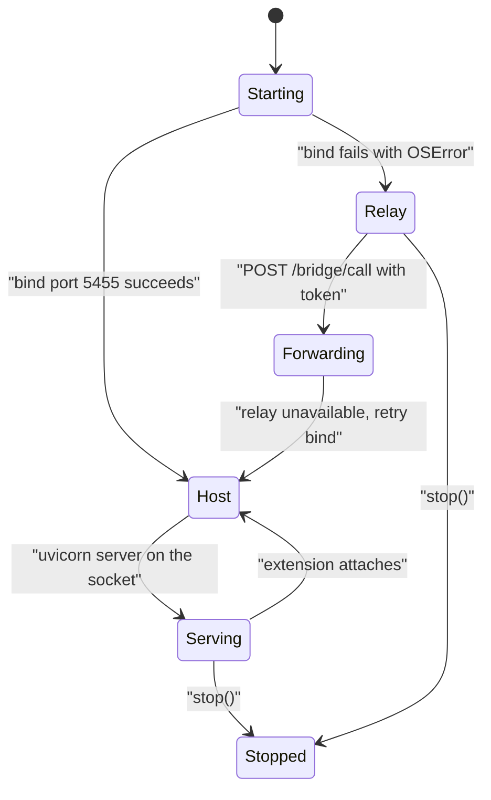
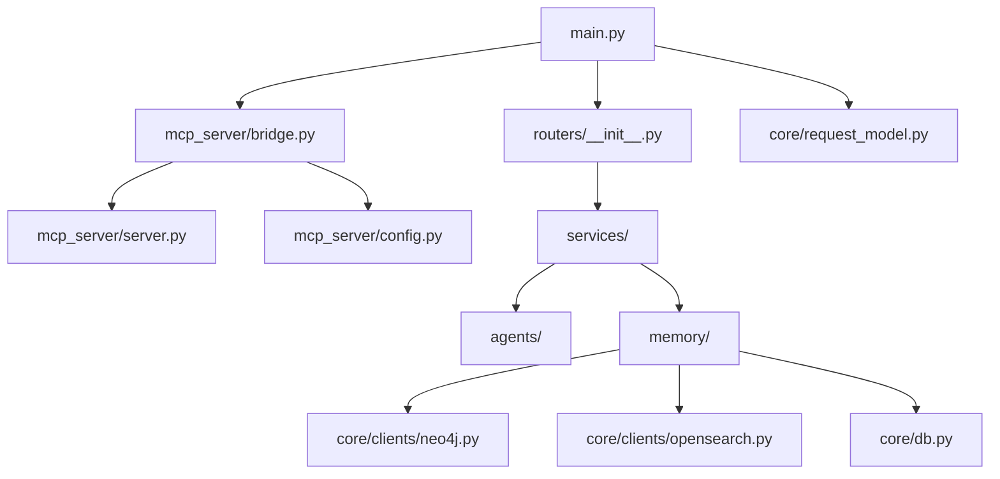

# Overall system design

The system is a local service graph with two entry points: HTTP on 5454 for the app, and the bridge on 5455 for MCP and extension traffic. Both can live in one Python process (the backend hosts the bridge when the port is free) or split across processes (an `agentic-mcp` stdio server owns the bridge and the backend relays).

This page covers the process boundaries, port ownership, startup order and router mounts. Layer responsibilities are on [Technical Architecture Overview](Technical%20Architecture%20Overview); deploy mechanics are on [Deployment Architecture](Deployment%20Architecture).

Key capabilities:
- One backend process with optional background tasks
- Bridge host or relay election on port 5455
- Router groups for every product surface, mounted from one composition root
- Optional Telegram bot and scheduler in the same event loop
- Docker-backed storage on fixed host ports
- A single request path through validation, service and agent layers

## Repository layout

## Building blocks

- `main.py`: creates the app, registers middleware, includes routers, defines `lifespan` and `run()`.
- `routers/__init__.py`: re-exports every router under a stable alias. `main.py` imports the aliases, not the modules.
- `mcp_server/bridge.py`: `BridgeManager` decides host or relay. `LocalBridge` owns extension WebSockets; `RemoteBridge` posts to another process.
- `services/telegram_bot_runner.py`: optional polling task started from `lifespan` when a token resolves.
- `memory/maintenance/consolidation.py`: `ConsolidationRunner` with `hourly`, `nightly` and `weekly` entry points, scheduled by APScheduler.
- `core/request_model.py`: ASGI middleware that swaps the model for one request from headers.

## How it fits together

Startup is a sequence of guarded steps. Each one is optional except the app object itself.

On shutdown the order reverses: bridge stop, scheduler shutdown, bot cancel, Neo4j close, OpenSearch close.

## Router mounts

| Prefix | Router | Main routes |
| --- | --- | --- |
| `/api/mcp` | `routers/mcp_settings.py` | settings read/write, restart |
| `/api/genai/health` | `routers/health.py` | health |
| `/api/genai/github` | `routers/github.py` | repo question, private archive upload |
| `/api/genai/website` | `routers/website.py` | page question |
| `/api/genai/youtube` | `routers/youtube.py` | video question |
| `/api/google-search` | `routers/google_search.py` | search |
| `/api/gmail` | `routers/gmail.py` | unread, latest, mark read, send |
| `/api/calendar` | `routers/calendar.py` | events, create |
| `/api/pyjiit` | `routers/pyjiit.py` | login, semesters, attendance |
| `/api/genai/react` | `routers/react_agent.py` | chat, chat stream |
| `/api/validator` | `routers/website_validator.py` | website validation |
| `/api/agent` | `routers/browser_use.py` | generate script |
| `/api/upload` | `routers/file_upload.py` | upload, download |
| `/api/skills` | `routers/skills.py` | list, execute, execute stream |
| `/api/auth` | `routers/auth.py` | OAuth exchange, status, callbacks |
| `/api/state` | `routers/state.py` | sessions, settings keys |
| `/api` | `routers/conversations.py` | conversations, messages, runs |
| `/api/voice` | `routers/voice.py` | transcribe, models, speak |
| `/api/memory` | `memory/api/router.py` | search, context, tools, ingest, maintenance |
| `/api/browser/automation` | `routers/automation.py` | legacy one-step planner |
| `/api/browser/runtime` | `routers/browser_runtime.py` | start, step |
| `/api/debug` | `routers/debug.py` | stats, timeseries, runs, memory, maintenance |
| `/api/integrations` | `routers/integrations.py` | settings, Composio, runtimes, secrets |

The conversations router is mounted at `/api`, so its paths are `/api/conversations` and `/api/runs/{run_id}`.

## Request path

The mounted routers share one path through the process. A request is validated in the route, orchestrated in a service, executed by an agent or a browser planner, and persisted through `core/db.py`.

## Bridge election

Only one process can own `127.0.0.1:5455`. `BridgeManager.ensure_started()` tries to bind. Success makes it the host. A bind failure puts it in relay mode, where calls go through `POST /bridge/call` with the shared token.

The host creates `~/.agentic-browser/bridge-token` if missing. The relay reads it. If the previous host dies, `BridgeManager.call` catches `BridgeUnavailable`, re-runs `ensure_started()` and retries once.

## Process and port map

| Process | Port | Protocol | Owner |
| --- | --- | --- | --- |
| Backend | 5454 | HTTP, SSE | `main.py` |
| Bridge host | 5455 | HTTP, WebSocket | backend or `agentic-mcp` |
| MCP HTTP | 5455 | streamable HTTP at `/mcp` | bridge host |
| Postgres | 5433 host | Postgres wire | Docker |
| Neo4j | 7474, 7687 | HTTP, Bolt | Docker |
| OpenSearch | 9201 host | HTTP | Docker |
| Dashboards | 5602 host | HTTP | Docker |

## Background work

- Post-turn memory ingestion is an `asyncio.create_task` held in `_BACKGROUND_TASKS` so it cannot be garbage collected mid-run.
- Telegram polling is a task created in `lifespan`.
- APScheduler runs memory maintenance.
- The MCP settings watcher polls the settings file every 2 seconds.

None of these have a durable queue. A process restart loses an in-flight ingestion or maintenance pass; the next turn or schedule retries.

## Dependencies

## Performance

- The bridge waits up to 3 seconds for a browser to attach (`_pick(browser, wait=3.0)`) and adds 2 seconds to each call timeout.
- API call timeouts clamp between 1 second and 1800 seconds (`MAX_TIMEOUT`).
- The backend has no worker pool; one uvicorn process handles all routes and background tasks.
- Telegram polling runs in the same event loop. A slow bot handler competes with HTTP work.
- Scheduler jobs run in-process. APScheduler uses the asyncio scheduler, so a long nightly pass does not block HTTP.

## Troubleshooting

- Port 5454 in use: another backend is running. `lsof -nP -iTCP:5454 -sTCP:LISTEN`.
- Port 5455 in use by an unrelated process: the backend starts in relay mode and fails calls to the wrong service. Stop the other process or set `AGENTIC_BROWSER_BRIDGE_PORT`.
- Bridge role flips between host and relay: every new `agentic-mcp` process tries to bind first. Whichever starts first owns it. `/api/mcp/settings` shows the current role.
- Telegram bot never starts: no token resolved, or `python-telegram-bot` failed to import. The startup guard logs `Telegram bot init skipped`.
- Scheduler missing: APScheduler import or job registration failed. The guard logs `Scheduler init skipped`.
- API returns a CORS error from a custom frontend: add the origin to `CORS_ORIGINS`; the regex only covers extension schemes and localhost.

## Appendix

### Implementation examples
- Run: `uv run agentic-api-run`, or `python main.py` (reload enabled).
- Root: `GET /` returns `{"name": "Agentic Browser API", "version": "0.1.0"}`.
- Bridge: `GET http://127.0.0.1:5455/bridge/status`.
- Settings: `GET /api/mcp/settings` reports bridge role, URL and attached browsers.

### Source files
- `main.py`
- `core/config.py`
- `routers/__init__.py`
- `mcp_server/bridge.py`
- `mcp_server/server.py`
- `mcp_server/config.py`
- `services/telegram_bot_runner.py`
- `memory/maintenance/consolidation.py`
