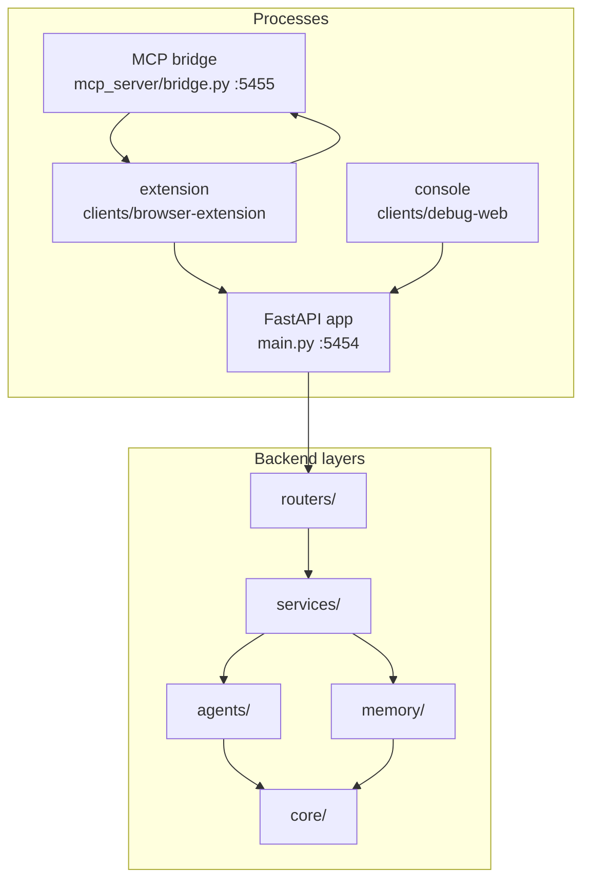
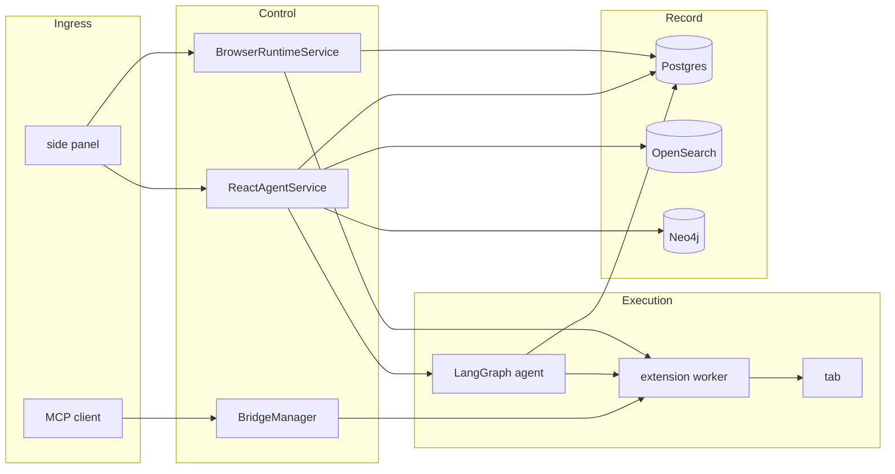
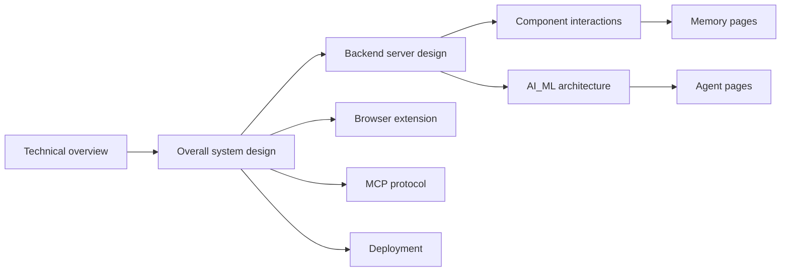
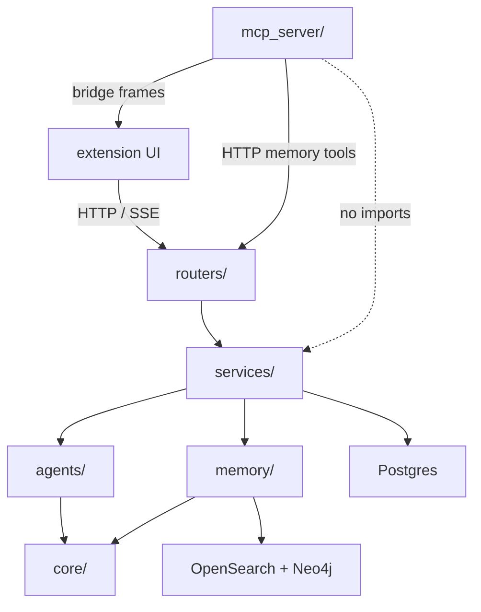
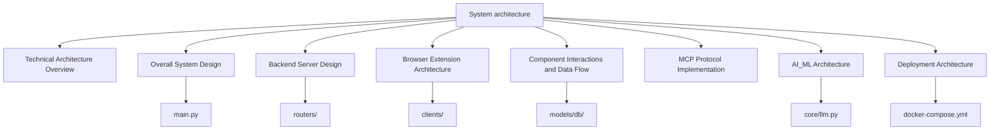

# System architecture

This folder describes the system at four levels: processes and ports, the backend's request path, the frontend split, and the data and model pipelines. Each page names the files that own the behaviour, so a code change can be traced from a diagram to a module.

The short version: a FastAPI backend plans, an extension executes, LangGraph agents call tools, and three stores remember. The MCP bridge is a second entry point to the same browser.

Key capabilities:
- Process topology and port ownership for the backend and bridge
- A strict layering rule from routes down to core
- Extension, console and shared package boundaries
- Four data flows: chat, browser action, memory write and memory read
- A provider-agnostic model layer with per-request overrides
- A single-host deployment with Docker-backed stores
- A bridge protocol that carries MCP tool calls to the extension

## Repository layout

## Pages in this folder

| Page | One line |
| --- | --- |
| [Technical Architecture Overview](Technical%20Architecture%20Overview) | layers, boundaries, state ownership and trust boundaries |
| [Overall System Design](Overall%20System%20Design) | process topology, ports, startup order, router mounts and bridge election |
| [Backend Server Design](Backend%20Server%20Design) | routes, services, agents, dependency direction and error mapping |
| [Browser Extension Architecture](Browser%20Extension%20Architecture) | extension surfaces, console, shared package and theme contract |
| [Component Interactions and Data Flow](Component%20Interactions%20and%20Data%20Flow) | chat, browser action, memory write and memory read end to end |
| [MCP Protocol Implementation](MCP%20Protocol%20Implementation) | bridge frames, relay token, extension handlers and reconnect |
| [AI_ML Architecture](AI_ML%20Architecture) | model clients, LangGraph graphs, prompts, retrieval and compaction |
| [Deployment Architecture](Deployment%20Architecture) | compose, installer, login services, volumes and exposure |
| [System Architecture](System%20Architecture) | this folder map and the shared concepts behind it |

## Shared concepts

Two entry points to the browser. The side panel posts to `/api/browser/runtime`, while MCP clients post to the bridge. Both end in the same extension handlers.

Three stores, one record. Postgres is authoritative. OpenSearch and Neo4j are derived and repaired from it.

Agents are graphs. `agents/react_agent.py` and `agents/while_loop_harness.py` compile LangGraph state machines; they are not prompt strings.

Tools are typed. Every tool is a `StructuredTool` with a Pydantic `args_schema`. The model sees names, descriptions and schemas.

Runs are first-class rows. A chat turn creates an `agent_runs` row before the model is called and completes it after the answer is saved.

## Reading order

Start with the technical overview for the layer table. Read the overall system design before changing a port, a mount or a startup step. Read component interactions before changing a payload shape, because most shapes cross two or three flows.

## Boundaries worth knowing

| Boundary | Rule | Enforced in |
| --- | --- | --- |
| MCP to backend | `mcp_server/` must not import backend modules | comment at the top of `mcp_server/server.py` |
| Services to agents | services call agents, agents never call services | `services/` and `agents/` imports |
| Routes to persistence | routes never open a session directly | `routers/*` |
| Extension to backend | HTTP or SSE only, except the bridge socket | `clients/browser-extension` |
| Postgres to mirrors | mirrors update after commit, never inside it | `memory/ingestion/writer.py` |

## Dependencies

## Performance

- One uvicorn process and one event loop. Blocking calls go to threads or subprocesses.
- Postgres pool is 10 with 20 overflow. Neo4j and OpenSearch are lazy module singletons.
- Chat streams over SSE so the first token reaches the panel before the run finishes.
- The bridge waits 3 seconds for a browser and adds 2 seconds to each call timeout.
- Memory context is budgeted per turn: 1200 tokens for chat, 3000 for a direct `/context` call.

## Troubleshooting

- The API starts but every database route fails: a store was down during `lifespan`, and the warning was logged instead of raised. Start the container and restart the backend.
- The panel cannot reach the backend: check `baseUrl`, `VITE_API_URL` and port 5454 in that order.
- MCP browser tools fail while memory tools work: the backend is up but no extension socket is attached. Check `/bridge/status`.
- Memory tools fail while browser tools work: the MCP process cannot reach `AGENTIC_BROWSER_API_URL`.
- Run detail is empty: the console reads `/api/debug`; confirm the run row exists and the console points at the same backend.
- A page in this folder disagrees with another: the narrower page wins for its own symbols. The wider page names the boundary, the narrower one names the file.

## Appendix

### Implementation examples
- Root response: `GET /` returns `{"name": "Agentic Browser API", "version": "0.1.0"}`.
- Bridge status: `GET http://127.0.0.1:5455/bridge/status`.
- Model override: the `X-Agentic-Provider` and `X-Agentic-Model` headers.
- Compose: `docker compose up -d postgres neo4j opensearch`.

### Source files
- `README.md`
- `main.py`
- `docker-compose.yml`
- `docs/architecture-light.svg`
